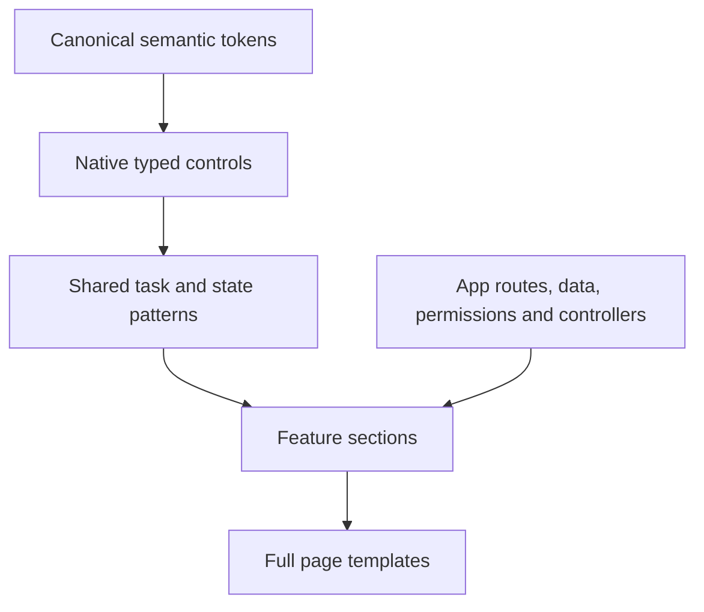

# Fixed layouts, component hierarchy and usage rules

Use these defaults across all ten98 apps. Campaign’s existing logo, icon geometry and login remain the brand baseline. Familiarity comes from stable scope, navigation, slot order, action placement and truthful state—not a separate layout for each product.

## Choose one fixed template

| User task | Template | Required order | Main action |
| --- | --- | --- | --- |
| Understand a scope | `OverviewTemplate` | Page header → scope → filters → metrics → results | Header, only when the overview has a clear action |
| Find or act on records | `CollectionTemplate` | Page header → scope → toolbar → selection → results → pagination | Header for create; selection slot for bulk actions |
| Inspect one resource | `DetailTemplate` | Breadcrumb → page header → scope → status → navigation → content plus related information | Header, scoped to the selected resource |
| Create or change a draft | `EditorTemplate` | Breadcrumb → page header → scope → steps → feedback → form plus preview → footer | Save/review/publish in footer; optional navigation/preview in header |
| Configure a scope | `SettingsTemplate` | Page header → scope → navigation → feedback → grouped fields | Explicit save within the relevant form/section |

Compose a template inside the existing `AppShell`. The shell owns one main landmark and global navigation. The template uses a section and one `PageHeader`; it does not add forms, submit handlers, requests, persistence or permissions. Keep native form IDs, names, refs, constraints, keys and `FormData` contracts in the consuming app. An external footer submit button must retain its `form` association.

On narrow screens detail/editor columns stack in source order. List/detail tasks use `DetailWorkspace` so one pane is visible while drafts stay mounted. The app guards selection and restores the originating list control after Back. When a selection change would leave focus in a hidden or removed workspace control, the shared component falls back to the visible pane heading. It does not take initial focus or replace an app's visible focus target. Tables scroll inside labelled regions; a sidebar hides its scrollbar while remaining scrollable and keyboard reachable. Comfortable density is the default, compact is an explicit preference, and action targets remain usable on touch screens.

Put the primary analytical result in the full-width results area. An editor's preview column is for related context or an actual content preview; it must not squeeze the main evidence table into a sidebar. Group query controls before their results and keep the applied scope visible when the draft changes. Summaries adapt to the space inside their panel, including narrow side panels on a desktop viewport.

Keep row-action text short and consistent: Preview, Inspect, Manage, Edit and Delete. Show the record's identity in its existing data column and include that identity in each action's accessible name. Repeating a long record name inside every visible button must not inflate table rows. Use a supplied human name before an ID fallback; never fetch extra provider data solely to decorate a label. Preserve separate actions, confirmations and the selected record's exact scope.

Existing-app native forms use `.form-grid` for paired fields: two constrained columns on wider screens, one column at viewport widths of 480px or less. Preserve field order and native date/time types, names, values, constraints and read-only/disabled states. Test actual labels and control bounds at 320px with enlarged text; retain app-specific column overrides when their task requires a different structure.

Shared controls use `--t98-control-height` as their minimum: 38px comfortable and 32px compact. Wrapped text can increase their height. Components explicitly designed for larger targets use `--t98-control-touch`; a narrow viewport alone does not impose 44px on every control. Check actual targets and spacing against [WCAG 2.5.8](https://www.w3.org/WAI/WCAG22/Understanding/target-size-minimum.html); the separate [enhanced criterion](https://www.w3.org/WAI/WCAG22/Understanding/target-size-enhanced.html) uses 44px. Text enlargement checks must verify visible labels actually double, including controls with fixed pixel font sizes.

Fixed templates define familiar regions and order, rather than clipping text into fixed heights. Shared shell headers retain their normal minimum height and grow when context wraps. Keep the full context, menu and profile controls within the viewport at enlarged text sizes; do not hide content to make a width assertion pass. Application styles must not restore fixed-height or nowrap constraints over this shared behavior.

## Appearance in account settings

Use one `AccountMenu` in the top-right header for account identity, existing account links and sign out. The sidebar ends with `SidebarFooter`: Settings, optional connection utilities and the real app version. Do not repeat profile controls in both locations. Preserve native router links, draft guards and logout controllers; see [account navigation](SIDEBAR.md#account-controls-and-the-sidebar-footer).

Place an **Appearance** select under **Your account**, using **System**, **Light** and **Dark** in that order. Explain that System follows the device preference and state the actual persistence scope. Apply the choice immediately; announce whether it was saved or only applied temporarily when storage is unavailable. Do not add a second save action for an immediate preference.

Use the existing labelled native select/field pattern. The app owns preference storage, boot order and effects; the library does not need another theme controller. The first paint, selected option, semantic roles and used color scheme must agree. Verify System against both operating-system preferences, explicit choices across reload/navigation, keyboard operation, and the storage-denied message. A manually assigned `data-theme` proves CSS only, not a working preference flow.

## Component hierarchy

1. **Tokens:** use semantic CSS variables or typed references. Do not create a product-specific palette or spacing scale.
2. **Controls:** use `Field` with native `Input`, `Select` or `Textarea`; `Button` for an action, a link for navigation. Use compatibility `App*` exports for established Campaign/Discover markup; do not replace a controlled select with uncontrolled `AppSelect`.
3. **Patterns:** use applied filters, evidence, reviews, operation receipts, media, audience, inspection and analytics presentation. Preserve explicit state rather than inventing domain rules.
4. **Flows:** smaller feature sections built from controls and patterns. `FlowSection` owns a compact h2, optional applied scope and spaced feature content. It adds no page title, shell, route, form or controller. The app supplies outcomes, guards and data.
5. **Templates:** full page layouts combining several feature sections and components. Choose by the user’s task and keep slot order and action placement. A template owns one h1 within the app shell. It is not an excuse to change an app’s URL, access or form contract.

Do not mount a page template inside a feature flow. Use a Card when a surface communicates a real grouping; a feature boundary does not require another bordered card. Put draft-dependent actions after their configuration controls. Keep primary results full width after configuration and supporting features after the primary content in source order.

## Spacing ownership

| Relationship | Token | Use |
| --- | --- | --- |
| Closely related content | `--t98-space-2` / 8px | Title support, metadata, small item groups |
| Related actions | `--t98-space-3` / 12px | Wrapping button rows |
| Controls and content | `--t98-space-4` / 16px | Fields, Card content children, flow body |
| Separate feature sections | `--t98-space-6` / 24px | Template content and form sections |

The parent owns the gap. Do not add margins to the same boundary. Card owns spacing between its direct content children and uses a 20px (`--t98-space-5`) inset, reduced to 16px (`--t98-space-4`) on narrow screens. Group related buttons with `FormActions` and fields with `FormGrid`. Use `Stack gap={4}` for related controls and `Stack gap={6}` for separate subparts. Short report filters use `FeatureControls`; results remain full width. These components use shared tokens and preserve DOM order. Buttons keep intrinsic width unless a specific task requires a full-width action.

An Alert’s explanation remains ordinary inline prose. Its optional `actions` slot places a wrapping row 12px below the explanation. Keep paragraphs and recovery actions stacked; never squeeze them into separate narrow columns. Use h3 for feature subparts beneath FlowSection’s h2.

## Implementation brief for app sessions and workers

Implement the named feature within an existing full-page template using shared components and tokens. Identify its inputs, applied scope, results, actions and supported states before editing. Keep the original application controller and preserve native labels, constraints, permissions, drafts, cancellation, reviews and reconciliation. Remove duplicated page chrome from the feature. Use the spacing rules above; do not invent a local palette, spacing scale or layout framework. Rebuild an inconsistent specimen when simpler composition produces a clearer result, while preserving observable behavior.

Work with bounded file ownership. First identify the concrete source and screenshot defect; then implement the smallest coherent correction. Run architecture, type, native and build checks. Use Playwright for the real interaction, light/dark themes, wide/narrow layouts, enlarged text and recovery, then inspect screenshots. New geometric checks need a deliberately broken layout that fails the same assertion and recovers after restoration. Stop a failing batch, diagnose its cause and retain the original acceptance checks. Synthetic catalogue outcomes do not establish live-service or production acceptance.

## Shared behavior contracts

| Decision | Default rule |
| --- | --- |
| Scope | Show workspace/project/resource and applied dates before results or consequential actions. Pending draft controls do not relabel retained data. |
| Actions | One main action per task. Stable labels and positions. Mutations are explicit and duplicate pending submissions are prevented by the app. |
| Forms | Visible labels; linked help/errors; native validation; input retained on failure. Save behavior and unsaved exit handling are explicit. |
| Read only | Content and navigation remain inspectable. Explain unavailable edit actions. The server continues to enforce permissions. |
| Status | Separate loading, empty, filtered-empty, zero, unavailable, partial, stale and unknown. Submitted, accepted, delivered and observed are distinct outcomes. |
| Recovery | Unknown outcomes keep their receipt and require reconciliation before repetition. A generic retry button does not decide safety. |
| Evidence | Source/time and essential quality warnings stay beside results. Details may use a labelled disclosure; no fabricated freshness score or missing-data denominator. |
| Navigation | The app owns URL/history/scope and draft guards. Selection does not automatically clear a draft or trigger provider reads before a guarded switch. |
| Accessibility | Complete keyboard paths, labelled actions, visible focus, focus recovery, logical spacing and narrow/enlarged-text acceptance in English LTR. RTL is not required. No drag-only editing. |
| Consistency | Reuse the existing template and named API before making a new layout. Any exception records the concrete task and why the standard fails. |

## Progressive evidence decision

Report headers should use the compact evidence variant with source/time and supplied warnings; full evidence belongs in investigation detail. Definitions and longer limitations can use `Measurement details`. Essential partial/stale/unavailable messages remain visible.

This is a ten98 design decision inferred from [Plausible’s prominent applied filters](https://plausible.io/docs/filters-segments) and [Google Analytics’ report/card quality disclosure](https://support.google.com/analytics/answer/12856703?hl=en), checked on 19 October 2026. It does not import either product’s query, identity or sampling rules. Immediate filter application in Plausible does not override Discover’s draft/applied query boundary or paid-run review.

## Acceptance before adoption

A component needs typed props, canonical tokens, complete TSX and applicable state examples. A flow needs reference-backed interaction decisions plus actual keyboard, narrow-screen, failure/recovery and draft checks. Compilation and SSR are necessary checks, not proof of live-provider behavior. See [bounded workers](SWARM.md), [research](research/campaign-discover/recommendations.md) and [completion ledger](CAMPAIGN-DISCOVER-COMPLETION.md).
