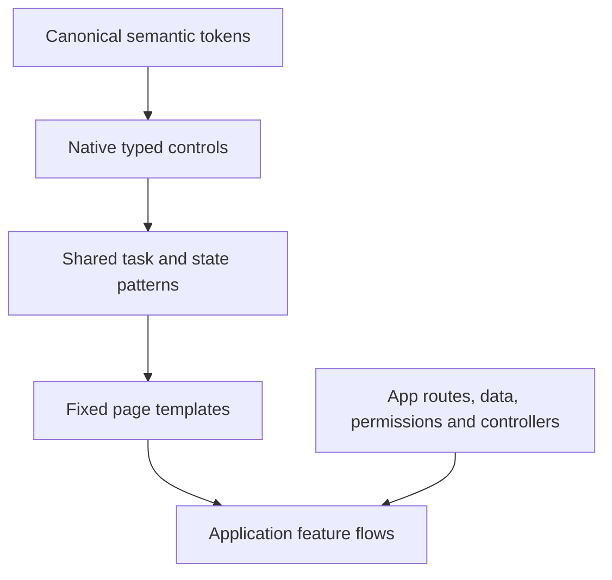

# Fixed layouts, component hierarchy and usage rules

Use these defaults across all ten98 apps. Campaign’s existing logo, icon geometry and login remain the brand baseline. Familiarity comes from stable scope, navigation, slot order, action placement and truthful state—not a separate layout for each product.

## Choose one fixed template

| User task | Template | Required order | Main action |
| --- | --- | --- | --- |
| Understand a scope | `OverviewTemplate` | Page header → scope → filters → metrics → results | Header, only when the overview has a clear action |
| Find or act on records | `CollectionTemplate` | Page header → scope → toolbar → selection → results → pagination | Header for create; selection slot for bulk actions |
| Inspect one resource | `DetailTemplate` | Breadcrumb → page header → scope → status → navigation → content plus related information | Header, scoped to the selected resource |
| Create or change a draft | `EditorTemplate` | Breadcrumb → page header → scope → steps → feedback → form plus preview → footer | Save/review/publish in footer; optional navigation/preview in header |
| Configure a scope | `SettingsTemplate` | Page header → scope → navigation → feedback → grouped fields | Explicit save within the relevant form/section |

Compose a template inside the existing `AppShell`. The shell owns one main landmark and global navigation. The template uses a section and one `PageHeader`; it does not add forms, submit handlers, requests, persistence or permissions. Keep native form IDs, names, refs, constraints, keys and `FormData` contracts in the consuming app. An external footer submit button must retain its `form` association.

On narrow screens detail/editor columns stack in source order. List/detail tasks use `DetailWorkspace` so one pane is visible while drafts stay mounted. The app guards selection and restores focus after Back. Tables scroll inside labelled regions; a sidebar hides its scrollbar while remaining scrollable and keyboard reachable. Comfortable density is the default, compact is an explicit preference, and action targets remain usable on touch screens.

Existing-app native forms use `.form-grid` for paired fields: two constrained columns on wider screens, one column at viewport widths of 480px or less. Preserve field order and native date/time types, names, values, constraints and read-only/disabled states. Test actual labels and control bounds at 320px with enlarged text; retain app-specific column overrides when their task requires a different structure.

Shared controls use `--t98-control-height` as their minimum: 38px comfortable and 32px compact. Wrapped text can increase their height. Components explicitly designed for larger targets use `--t98-control-touch`; a narrow viewport alone does not impose 44px on every control. Check actual targets and spacing against [WCAG 2.5.8](https://www.w3.org/WAI/WCAG22/Understanding/target-size-minimum.html); the separate [enhanced criterion](https://www.w3.org/WAI/WCAG22/Understanding/target-size-enhanced.html) uses 44px. Text enlargement checks must verify visible labels actually double, including controls with fixed pixel font sizes.

## Component hierarchy

1. **Tokens:** use semantic CSS variables or typed references. Do not create a product-specific palette or spacing scale.
2. **Controls:** use `Field` with native `Input`, `Select` or `Textarea`; `Button` for an action, a link for navigation. Use compatibility `App*` exports for established Campaign/Discover markup; do not replace a controlled select with uncontrolled `AppSelect`.
3. **Patterns:** use applied filters, evidence, reviews, operation receipts, media, audience, inspection and analytics presentation. Preserve explicit state rather than inventing domain rules.
4. **Templates:** choose by the user’s task. Keep slot order and action placement. A template is not an excuse to change an app’s URL, access or form contract.
5. **Flows:** the app supplies authoritative outcomes, guards and data. The research and human/coordinator decide UX; existing source supplies compatibility evidence.

## Shared behavior contracts

| Decision | Default rule |
| --- | --- |
| Scope | Show workspace/project/resource and applied dates before results or consequential actions. Pending draft controls do not relabel retained data. |
| Actions | One main action per task. Stable labels and positions. Mutations are explicit and duplicate pending submissions are prevented by the app. |
| Forms | Visible labels; linked help/errors; native validation; input retained on failure. Save behavior and unsaved exit handling are explicit. |
| Read only | Content and navigation remain inspectable. Explain unavailable edit actions. The server continues to enforce permissions. |
| Status | Separate loading, empty, filtered-empty, zero, unavailable, partial, stale and unknown. Submitted, accepted, delivered and observed are distinct outcomes. |
| Recovery | Unknown outcomes keep their receipt and require reconciliation before repetition. A generic retry button does not decide safety. |
| Evidence | Source/time and essential quality warnings stay beside results. Details may use a labelled disclosure; no fabricated freshness score or missing-data denominator. |
| Navigation | The app owns URL/history/scope and draft guards. Selection does not automatically clear a draft or trigger provider reads before a guarded switch. |
| Accessibility | Complete keyboard paths, labelled actions, visible focus, focus recovery, logical spacing and narrow/RTL/zoom acceptance. No drag-only editing. |
| Consistency | Reuse the existing template and named API before making a new layout. Any exception records the concrete task and why the standard fails. |

## Progressive evidence decision

Report headers should use the compact evidence variant with source/time and supplied warnings; full evidence belongs in investigation detail. Definitions and longer limitations can use `Measurement details`. Essential partial/stale/unavailable messages remain visible.

This is a ten98 design decision inferred from [Plausible’s prominent applied filters](https://plausible.io/docs/filters-segments) and [Google Analytics’ report/card quality disclosure](https://support.google.com/analytics/answer/12856703?hl=en), checked on 19 October 2026. It does not import either product’s query, identity or sampling rules. Immediate filter application in Plausible does not override Discover’s draft/applied query boundary or paid-run review.

## Acceptance before adoption

A component needs typed props, canonical tokens, complete TSX and applicable state examples. A flow needs reference-backed interaction decisions plus actual keyboard, narrow-screen, failure/recovery and draft checks. Compilation and SSR are necessary checks, not proof of live-provider behavior. See [bounded workers](SWARM.md), [research](research/campaign-discover/recommendations.md) and [completion ledger](CAMPAIGN-DISCOVER-COMPLETION.md).
