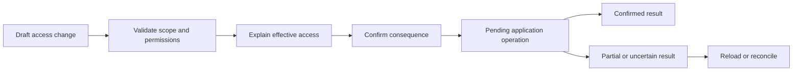
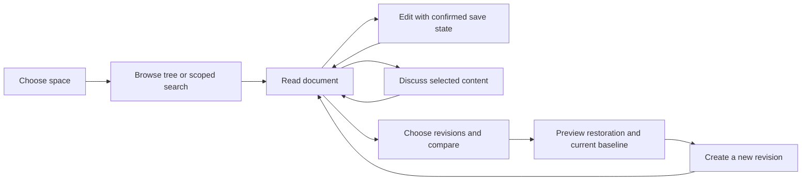
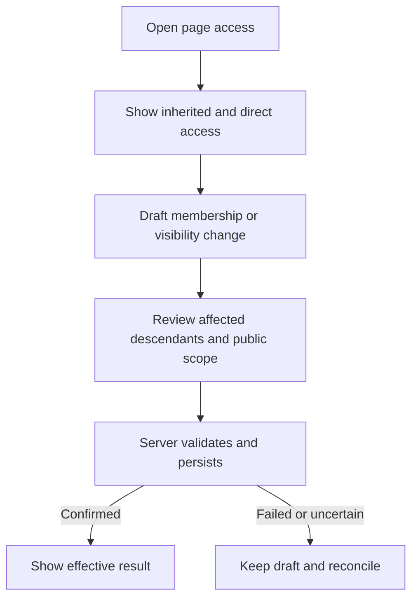

# Auth and Wiki flow references

Snapshot: **19 October 2026**. Scope and evidence selection: [evidence.md](evidence.md). Approval status: proposed ten98 flows; human and parent design-system session decide what proceeds. Application sessions own all storage, identity, authorization, collaboration and asynchronous execution.

## Reading this document

**Observed reference** is behavior from a linked official source, not a claim of hands-on tenant testing. **Proposed ten98 flow** is our design inference. The state and accessibility specifications are proposals to validate in the actual application. Existing exports named here are verified against [COMPONENTS.md](../../COMPONENTS.md); a “gap” is not a component that already exists.

## Auth coverage map

| Current matrix area | Reference flow below | Shared presentation |
| --- | --- | --- |
| Authentication fields/cards/layouts; identity protocols | A1 application setup and A2 sign-in | `AuthLayout`, `AppBrand`, `AppIcon`, `Field`, `Input`, `Select`, `Button`, `Stepper` |
| Team and role tables/badges; directory tree | A3 directory and membership | `DataTable`, `Badge`, `Tabs`, `PermissionMatrix`, `Breadcrumb` |
| Credentials and recovery | A2 sign-in and A4 credential recovery | `SettingsSection`, `SecretField`, `CopyButton`, `Alert`, `ConfirmDialog` |
| Sessions; device/session investigation | A5 session investigation | `DataTable`, `ResourceCard`, `ActivityFeed`, `ConfirmDialog` |
| Provisioning | A6 lifecycle and downstream jobs | `ResourceCard`, `Badge`, `ActivityFeed`, `Alert` |
| Policy enforcement; policy builder | A7 policy authoring and evaluation | `Field`, `Select`, `Checkbox`, `Accordion`, `Tabs`, `Alert` |
| Access graph | A8 effective access explanation | Start with `DataTable`, `Breadcrumb`, `Badge`; graph remains a specialized extension |
| Dialogs and activity across all areas | A3–A8 | Named consequence, confirmed result, actor/resource/time and pending/partial states |

### A1. Add an application and connect a protocol

**Observed reference.** authentik uses Applications → New Application, then application metadata, provider choice/configuration, bindings and review before creation. Existing providers are selectable. With no bindings, its application is accessible to all authentik users; hiding an app from the dashboard does not revoke access. [Application wizard](https://docs.goauthentik.io/add-secure-apps/applications/manage_apps/). Providers represent protocols including OIDC/OAuth2, SAML, LDAP and proxy; the main provider is normally paired with one application. [Providers](https://docs.goauthentik.io/add-secure-apps/providers/).

**Proposed ten98 flow.** Preconditions: an authorized administrator and a chosen environment/workspace. Applications list → “Connect application” → choose app/template or custom protocol → enter protocol-specific endpoints → choose who gets access → review scope and unresolved settings → save draft or create → test with a nominated account → activate. Keep environment, protocol and audience in the review summary. A connected protocol is not proof that provisioning is enabled.

**States/safeguards.** Empty list offers setup; metadata fetch is separately loading; malformed metadata keeps entered values; duplicate name/identifier is a field error; test failure reports a safe diagnostic ID; unavailable external metadata allows retry without losing the draft. Explicitly show “No one”, selected groups, or “Everyone”; do not silently inherit authentik's permissive empty-binding rule. Draft/test/active labels require backend meaning.

**UI contract.** Existing `Stepper` displays progress only; the app owns step navigation, persistence and tests. Use `SecretField` only after the app authorizes disclosure. Copying public IDs and revealing secrets are separate actions. The shared layer may later need a review-summary composition, not a provider engine. On narrow screens, one step per page with the same review details; focus the first invalid field and preserve Back/Cancel paths.

### A2. Sign in, complete verification and return to the requested app

**Observed reference.** Auth0 Universal Login centralizes authentication; configured connections supply identity sources, with login presentation managed separately from application integration. [Universal Login](https://auth0.com/docs/authenticate/login/auth0-universal-login). authentik distinguishes authentication, authorization, enrollment, recovery and invalidation flows; application logout and global identity logout can have different scopes. [Default flow designations](https://docs.goauthentik.io/add-secure-apps/flows-stages/flow/default-flows).

**Proposed ten98 flow.** App protected route → existing Campaign login layout and identity → local credential or configured organization provider → verification challenge when required → any explicit consent → safe return to the requested route. The app/session layer decides which methods are available; the UI must not invent provider availability or claim a successful session before validation.

**States/safeguards.** Initial sign-in; redirect pending; verification required; challenge expired; invalid response; retry delay; provider unavailable; user cancellation; account restricted; session expired during return. Keep errors useful without exposing whether a private account exists. Preserve the requested route using application-owned validation. “Sign out of this app” and “Sign out of all ten98 apps” need distinct, accurate consequences.

**UI contract.** Reuse the current Campaign `AppBrand`/icons/login pattern and existing form components. Browser-native passkey prompts and password managers stay native. Use visible labels, `autocomplete` appropriate to identifier/password/one-time code, paste-friendly fields and announced validation. Avoid a custom split OTP widget until a concrete requirement justifies it. At narrow widths keep the form primary and the decorative/story panel secondary.

### A3. Find a person, inspect membership and change access

**Observed reference.** authentik Directory → Users supports folder-scoped creation and user details. Groups and Roles are separate tabs; Assigned Roles distinguishes direct roles from All Roles, which includes inherited roles. Session, events, consent, refresh-token and MFA tabs keep different resource types separate. [Manage users](https://docs.goauthentik.io/users-sources/user/user_basic_operations). JumpCloud separates user groups, device groups and policy groups, with group-based resource assignment. [Groups](https://www.jumpcloud.com/support/get-started-device-groups).

**Proposed ten98 flow.** People → search/filter → open person → Overview / Membership / Access / Sessions / Activity → edit direct membership → show added/removed access and source → save → confirmed activity. Directory hierarchy is an organizational view; a folder move must not imply access changes unless the backend says so.

**States/safeguards.** Empty directory versus filtered empty; directory sync loading; external-source-owned attributes read-only with source named; unsaved membership draft; conflicting external sync; missing privilege; partial group resolution; stale access explanation. An inherited role links to the granting group instead of showing an ineffective local checkbox. Recheck access before save; show the scope of bulk changes.

**UI contract.** `PermissionMatrix` can edit a small explicit role/permission draft; it does not calculate inheritance or enforce access. `DataTable` is local-data only, so large directories need the application's server-filtered list. Proposed tree gap: lazy branches, loading/error per branch, selection distinct from expansion, keyboard arrows/Home/End and a searchable flat alternative. Start with native nested links/disclosures if they meet the first real requirement.

### A4. Enroll a credential or recover access

**Observed reference.** authentik user Settings → Credentials offers TOTP enrollment by QR/secret plus verification, WebAuthn/passkeys and static recovery tokens; its settings also distinguish app passwords from API tokens. [User settings](https://docs.goauthentik.io/users-sources/user/user-interface/). Auth0's database-account recovery is login reset request → email → single-use reset link → new password → confirmation; only the latest emailed link is valid. Social/enterprise passwords are reset at their identity provider. [Password recovery](https://auth0.com/docs/authenticate/database-connections/password-change).

**Proposed ten98 flow.** Account security → add method → choose an allowed method → native enrollment or QR/text instructions → verify → recovery material if policy requires → confirmed methods list. Recovery starts from the same Campaign-pattern login and routes to the correct provider. Removing the last usable method requires the app's recovery/lockout policy.

For an app password or automation credential, use a separate branch: choose purpose/owner and permitted expiry → create → authorized copy → update the consuming client → revoke the old credential → confirm outcome. A label must not imply an application scope that the credential does not enforce. The app defines which token types exist and their actual permissions; rotation cannot be completed by changing a displayed value alone. [Credential distinctions and rotation reference](https://docs.goauthentik.io/users-sources/user/user-interface/#tokens-and-app-passwords).

**States/safeguards.** No methods; enrollment pending; native prompt canceled; unsupported browser/device; invalid or expired code; recovery request accepted; delivery failure; link expired/used; external-provider-owned password; removal pending/failure. Do not imply “email delivered” when only the request was accepted. Recovery material is sensitive data, not catalogue sample content.

**UI contract.** Reuse fields, buttons, alerts, `CopyButton` and controlled dialogs. `SecretField` masking is presentation, not authorization. A proposed credential summary should describe type, name, created/last-used metadata only when known; it should not expose secrets in a list. A text alternative accompanies QR enrollment; status changes are announced and do not depend on color.

### A5. Investigate and end a session

**Observed reference.** Keycloak supports realm-wide Sessions, client-specific Sessions and user-specific Sessions. Realm-wide sign-out invalidates SSO cookies but does not automatically invalidate every outstanding access token; adapter/protocol behavior differs. Revocation uses a cutoff and applies according to client support. [Session administration](https://www.keycloak.org/docs/latest/server_admin/#_user-session-management). authentik lets end users end their current or remote sessions; ending the current one signs them out. [User session view](https://docs.goauthentik.io/users-sources/user/user-interface/#sessions).

**Proposed ten98 flow.** Person → Sessions → select a session → inspect device/browser, app, timestamps and available events → “End session” → confirm exact scope → pending outcome → confirmed ended or partial/uncertain state. Provide the same presentation in self-service with only the person's permitted sessions.

**States/safeguards.** None active; loading; stale list; already ended elsewhere; current session; unknown device metadata; selected-session revocation pending; downstream logout unsupported; failure/uncertain outcome. Describe the actual guarantee and remaining token lifetime when known. Do not substitute IP geolocation for a verified device or promise instantaneous global logout.

**UI contract.** `DataTable`, `ResourceCard`, `ActivityFeed`, `ConfirmDialog`. Preserve focus after row removal; when ending the current session, explain the navigation consequence beforehand. Proposed investigative-detail composition can be shared with Monitor, but event correlation, redaction, retention and revocation are app-owned.

### A6. Provision, suspend and offboard a person

**Observed reference.** JumpCloud's Staged state permits preassignment before activation; Active grants assigned access and Suspended retains the user while revoking access. Resource-specific exceptions exist. Users → selection → Actions → Suspend supports now/scheduled paths and visible scheduled state. [Lifecycle states](https://jumpcloud.com/support/manage-user-states). Its application Provisioning tab configures SCIM attributes, base URL and token, and supported create/update/deprovision capabilities vary by connector. [SSO/provisioning](https://jumpcloud.com/support/get-started-applications). Okta distinguishes suspension, deactivation and deletion; deactivation progress is asynchronous and downstream deprovisioning depends on app support/configuration. [Lifecycle consequences](https://help.okta.com/oie/en-us/content/Topics/users-groups-profiles/usgp-deactivate-user-account.htm).

Okta's separate suspension flow preserves group/app assignments and supports unsuspension, making it a distinct action from offboarding. [Suspend and unsuspend](https://help.okta.com/oie/en-us/content/topics/users-groups-profiles/usgp-suspend.htm).

**Proposed ten98 flow.** Create/import identity → assign groups/resources → review effective access → activate → track per-resource jobs. Offboard → preview affected sessions/apps/devices and preserved data → choose permitted timing → confirm → job timeline → reconcile failures. Suspension and deletion need separate labels and consequences.

**States/safeguards.** Staged; activation scheduled; queued; provisioning; partial; active; suspension scheduled; suspended; downstream failure; reconciliation required. Use absolute scheduled time plus timezone. Persist job IDs; do not present a global green success while a connector is still pending. A retry button is a callback, not proof that replay is safe. App logic owns idempotency, dependency ordering and rollback limits.

**UI contract.** Compose status badges, resource cards, activity and persistent alerts. A reusable operation-result list may be justified when Connect or Monitor also needs per-target outcomes. Keep table selection scope visible. Pending results survive route changes through app-owned jobs; no fake progress percentage.

### A7. Author a policy and explain its evaluation

**Observed reference.** authentik Customization → Policies creates a typed policy, then binds it to a flow, stage binding, application or source. A stage policy is attached to that flow's stage binding, not globally to every reuse of the stage. [Policy creation/binding](https://docs.goauthentik.io/customize/policies/working_with_policies). Its Flow Inspector steps through execution and context, but **executes real writes**. [Inspector](https://docs.goauthentik.io/add-secure-apps/flows-stages/flow/inspector). Entra What If accepts a subject, target and sign-in conditions and returns policy results; it omits service dependencies. Report-only evaluation is visible in sign-in logs and can still trigger device-certificate prompts. [What If](https://learn.microsoft.com/en-us/entra/identity/conditional-access/what-if-tool), [report-only](https://learn.microsoft.com/en-us/entra/identity/conditional-access/concept-conditional-access-report-only).

**Proposed ten98 flow.** Policies → create from a narrowly named template → subject/target/conditions/outcome → readable sentence summary → validate → evaluate scenario → review affected scope → save draft → explicitly activate. Show why each rule matched, failed or could not be evaluated. Start with form rows and disclosures; a node canvas is not required for this task.

**States/safeguards.** Draft; invalid expression; missing reference; no matching subjects; evaluation loading; match/no match/unknown; simulation unsupported; stale revision; active; disabled. Distinguish simulation from live execution in both copy and result metadata. Provide an application-defined protected-admin/lockout check and version comparison before activation. Those guarantees require backend support.

**UI contract.** Existing fields, native selects/checkboxes, accordion, alerts and tables cover an initial rules editor. Proposed extension only after a real policy schema: condition row/group and evaluation explanation. Keyboard users must add/remove/reorder rules without dragging; errors identify the exact rule and retain values. Complex policy syntax remains app-owned.

### A8. Explain effective access before building an access graph

**Observed basis.** Direct versus inherited roles are visible in authentik's user role tabs (A3); JumpCloud uses group/resource assignments (A3). This research did **not** validate a complete graph editor in those sources. A graph is a matrix-listed future extension, not an observed requirement.

**Proposed ten98 flow.** Person or application → “Why this access?” → direct grants, inherited paths and applicable policies → select a path → inspect source and evaluation timestamp → navigate to the authorized source editor. Start with a readable relationship table, expandable paths and breadcrumbs. Add a graph only after it answers a demonstrated investigative question better.

**States/safeguards.** No grant; direct grant; multiple paths; denied by policy; incomplete evaluation; unknown source; stale directory snapshot; insufficient permission to disclose a relationship. Removing one path may leave another; the review must show effective outcome, not just the deleted link.

**UI contract.** Share explanation presentation; the application calculates relationships and authorization. If a graph is approved, require a text/table equivalent, named nodes/edges, keyboard traversal, focus restoration and a narrow-screen list. No canvas dependency is proposed now.

## Shared acceptance states

For every adopted flow, the catalogue and consumer should demonstrate empty, filtered empty, loading, error, permission/read-only, stale, pending and partial outcomes where applicable. A state without domain meaning should be marked not applicable, not invented. Also check long names, unbroken identifiers, RTL with mixed-direction IDs, 200% zoom, reduced motion, keyboard-only use and narrow widths. Hide the sidebar's visual scrollbar while retaining scrollability and visible focus; hidden bars must never make off-screen items unreachable.

## Wiki observed reference flows

The observations in this section are intentionally concise. Subsequent ten98 state and accessibility requirements are our proposals, not reconstructed undocumented vendor behavior.

### W1 — Document home, creation and tree

**Observed:** Docmost's sidebar creates a page through **New page** or the Pages `+`; an untitled document opens for title/body editing. A page-row `+` creates a child; drag-and-drop nests/reorders. Page actions include move with descendants, duplicate, trash and recovery. The toolbar separates Read/Edit, Share, Comments, contents and overflow actions. [Docmost Pages](https://docmost.com/docs/user-guide/pages).

**Observed:** Notion supports `/page` inside a parent and a sidebar `+`; expanding the parent reveals children and breadcrumbs locate the page. Dragging changes nesting. [Notion subpage guide, with screenshot](https://www.notion.com/help/create-a-subpage).

**Contrast:** BookStack starts with Books containing Pages and optional Chapters; Shelves group Books, and one Book can belong to several Shelves. [BookStack content model](https://www.bookstackapp.com/docs/user/content-overview/). This is more constrained than the arbitrary document tree requested here.

### W2 — Authoring and collaboration

**Observed:** Docmost's rich-text editor exposes a filterable slash menu on a new line and a floating formatting toolbar after text selection. Its documented blocks include headings, tasks, lists, code, tables, media, callouts, diagrams and embeds. Keyboard formatting shortcuts are documented. [Docmost Editor](https://docmost.com/docs/user-guide/editor). The official [repository feature inventory](https://github.com/docmost/docmost) identifies real-time collaboration, but this study did not measure concurrent-edit convergence, offline behavior or conflict recovery.

**Observed visual reference:** The [Docmost homepage](https://docmost.com/) was opened and visually inspected in the browser. Its product screenshot shows a persistent left page tree, central reading/editing canvas, top document actions and right comments panel. The screenshot is a layout reference, not proof of working multi-user behavior. No brand assets are to be reused.

### W3 — Find a document

**Observed:** Docmost opens search through the top search control or Ctrl/Cmd+K. Results show title and text excerpts; space scope defaults to the current space and can expand to accessible spaces. Type filters distinguish pages and attachments. [Docmost Search](https://docmost.com/docs/user-guide/search).

**Observed:** Notion's search offers relevance/date sorting and title, creator, location and date filters. Its default ranking favors recent changes and title matches; location filtering includes descendants. A blank search shows recently visited pages. Database search and workspace search have different coverage, which the guide explicitly explains. [Notion Search](https://www.notion.com/help/search).

**Contrast:** BookStack provides global search, book/chapter-scoped search and search within move/link pickers. Its filter UI exposes advanced search syntax rather than requiring users to learn syntax first. [BookStack Search](https://www.bookstackapp.com/docs/user/searching/).

### W4 — Inline discussion

**Observed:** In Confluence, selecting text exposes a comment command; comments can be entered inline or at document level and submitted with Ctrl/Cmd+S. Comments created while editing a page are withheld from viewers and relevant notifications until publication. [Confluence Comments, with visual examples](https://support.atlassian.com/confluence-cloud/docs/comment-on-pages-and-blog-posts/).

**Observed:** Outline resolves a thread from its menu and exposes resolved threads through the comments-sidebar checkmark, allowing restoration. [Outline comment resolution screenshot](https://www.getoutline.com/changelog/comment-resolution).

**Observed:** BookStack's May 2025 release adds text-range references, an inline thread popover and a jump-to-thread action. A changed reference is marked outdated; a deleted target becomes non-navigable. Active/archived threads remain separately accessible. Only the starting comment carries the content reference, preventing split-thread ambiguity. [BookStack content-comment examples](https://www.bookstackapp.com/blog/bookstack-release-v25-05/). This dated release explains the behavior introduced then; it is not a claim that every current editor variant has identical capabilities.

### W5 — Revision history, compare and restore

**Observed:** Outline opens history from the last-updated timestamp, document menu or command menu; a sidebar lists revisions and events. Selecting a revision displays changes; restore produces a **new revision** instead of erasing subsequent history. [Outline Revision history](https://docs.getoutline.com/s/guide/doc/revision-history-AiL6p22Ssq).

**Observed:** Confluence's page history includes version, date, author and update comment; users can inspect a version, restore it or select two versions for comparison. [Confluence technical-documentation guide](https://support.atlassian.com/confluence-cloud/docs/use-confluence-for-technical-documentation/).

**Observed:** Notion's history previews highlighted changes, supports restoring a version or copying selected blocks, and requires at least edit access to open history. Not every non-text change is represented. [Notion history and recovery](https://www.notion.com/help/duplicate-delete-and-restore-content).

### W6 — Access, inheritance and sharing

**Observed:** Docmost's commercial page-permission flow is **Share → Access → Restricted → choose users/groups and View/Edit role**. The initiating user gains edit access; the final editor cannot be removed. Restrictions inherit through ancestors, and access requires every restricted ancestor. Space/page roles combine restrictively; the UI links to the ancestor supplying a restriction. Search filters unauthorized pages. [Docmost Page Permissions](https://docmost.com/docs/user-guide/pages/page-permissions).

**Observed:** In Outline, a collection defines default access, groups and individual grants. The highest grant wins when a user is granted access both individually and through a group. New-collection setup can disable public sharing. [Outline Collections, including menu screenshot](https://docs.getoutline.com/s/guide/doc/collections-l9o3LD22sV). This differs from Docmost's restrictive intersection; do not mix the two models silently.

**Observed:** Notion's Share control separates invited users, workspace access and anyone-with-link access. Search visibility and public accessibility are separate concepts. [Notion Sharing](https://www.notion.com/en-gb/help/sharing-and-permissions).

**Observed:** Wiki.js 2.x requires global action permissions plus path-based page rules; more specific paths take priority, with deny winning for otherwise equal rules. Rules are administered on Groups. [Wiki.js Groups and Permissions](https://docs.requarks.io/groups). BookStack explains inherited content overrides and exposes an indicator linking to the controlling permission scope. [BookStack Roles and Permissions](https://www.bookstackapp.com/docs/user/roles-and-permissions/).

### W7 — Document storage lifecycle and portability

**Observed:** Docmost import starts within the destination space, through the Pages overflow menu. Users select source format and upload; Notion exports retain hierarchy. Its export dialog offers Markdown/HTML plus descendants and attachment inclusion; multi-item output is a hierarchical ZIP. Space export and browser Print PDF are separate routes. [Docmost Import/Export](https://docmost.com/docs/user-guide/import-export). Current paid-edition documentation must be consulted for format availability; this flow description does not imply all import formats are in Community.

**Observed:** Docmost moves deleted pages to trash for restoration or permanent deletion, and allows page export through the page menu. [Docmost Pages](https://docmost.com/docs/user-guide/pages).

**Contrast:** Wiki.js 2.x documentation organizes pages by URL path instead of traditional folders. Its older Pages guide says editor choice cannot be changed, while the separately indexed Editors documentation describes conversion and automatic pre-conversion snapshots. That documentation conflict requires version-specific validation before using conversion behavior as a reference. [Pages](https://docs.requarks.io/en/guide/pages), [Editors](https://docs.requarks.io/s/editors).

## Wiki matrix coverage and proposed ten98 flows

All items below are **proposals for parent + owner decision**, mapped to the existing matrix. They describe shared presentation contracts; persistence, authorization, synchronization, indexing and revision integrity remain Wiki application responsibilities.

Preconditions: W1/W2 need an accessible space and create/edit rights; W3 searches only the caller's authorized content; W4 needs comment rights plus a stable document/anchor identity; W5 needs retained revisions and permission to inspect or restore them; W6 needs a defined permission model and a permitted access-management action; W7 needs supported formats, storage limits and export/trash privileges. The app must recheck these conditions when submitting, since the page can remain open after access changes.

| Current matrix area | Reference | Proposed user flow | Existing foundation / genuine gap |
| --- | --- | --- | --- |
| Document storage | W1, W7 | Choose space → create or import → name and edit → see confirmed save state → organize → recover through trash | `AppShell`, `PageHeader`, `Field`, `Input`, `Dialog`, `Alert`, `Progress`; import results and storage jobs remain app-owned |
| Collaboration | W2, W4 | Open editable page → identify collaborators → edit → see saved/pending/reconnecting → review discussion | `Avatar`, `Badge`, `Alert`, `ActivityFeed`; presence transport and editor synchronization are not library features |
| Search | W3 | Open search → explicit space scope → type → refine → result with path and freshness → navigate back without losing query | `Dialog`, `Input`, `Select`, `Badge`, `EmptyState`, `Skeleton`; command-list/result navigation is a future concrete component requirement |
| Revision integrity | W5 | Open history → select version(s) → inspect affected content → restore as a new revision → confirm persisted result | `ActivityFeed`, `Tabs`, `Button`, `ConfirmDialog`, `Alert`; app owns durable revision IDs, merge/conflict policy and authorization |
| Access enforcement | W6 | Open access panel → inspect inherited/effective access → select grant/change → review affected scope → persist → display confirmed access | `Dialog`, `Field`, `Select`, `Badge`, `Alert`; member/group combobox and effective-access explanation are candidates, not current exports |
| Rich-text editor | W2 | Enter edit → insert/type/select → format using menu or shortcut → finish with clear save/publish behavior | Existing buttons/tokens can style chrome; rich-text engine, selection model, paste sanitization and collaboration adapter need a concrete app requirement |
| Document tree behavior | W1 | Expand path → choose page → create child or Move → choose parent → preview destination and access impact → confirm | Shell/sidebar slot, `Breadcrumb`, `Button`; tree keyboard model, lazy children, virtualized scale and move picker are missing specialized behavior |
| Inline comments | W4 | Select text → compose → submit → reply/resolve → reopen; handle missing or changed anchor | `Textarea`, `Button`, `Avatar`, `Tabs`, `Badge`; comment anchoring and editable threads need a specialized contract |
| Version comparison | W5 | Choose older/newer revisions → read inline changes or paired view → inspect attachment/block changes → restore deliberately | `Tabs`, `Select`, `Badge`, `Alert`; accessible structured diff viewer is a future extension |

### Proposed common states and safeguards

These states complete the local [state model](../../UX-PATTERNS.md); they are not asserted to exist in every reference app.

| Flow | Empty / loading | Pending / failure / stale | Access / consequential action |
| --- | --- | --- | --- |
| Space and page tree | Empty space explains New page and Import; lazy branch announces loading without collapsing other paths | Failed child fetch offers retry in that branch; stale tree indicates refresh; failed move leaves original position and draft intact | Missing/inaccessible page does not disclose private titles; move previews new parent and affected descendants; prevent self/descendant cycles |
| Editor and collaboration | Untitled draft remains usable; opening skeleton preserves navigation context | Distinguish local edits, saving, saved, offline, reconnecting and save failed; preserve content and offer recovery/export if server outcome is uncertain | Permission revoked while open transitions to readable/recoverable state; block further server writes and explain why; app rechecks access |
| Search | Recents before query; searching announcement; no matches differs from empty space | Preserve query and filters on error; stale index should identify delay; partial indexing must not be represented as complete absence | Backend filters every result and snippet; result counts must not expose hidden documents |
| Comments | Explain no discussions; load thread independently of document | Retain unsent draft; mark sending/failed; prevent duplicate submissions; show deleted/changed source text without attaching it to unrelated text | Read-only/locked threads explain the reason; deletion, resolution and archival are separate actions |
| History/diff | First revision explains lack of an earlier comparison; loading leaves selected revisions visible | Missing version, purged attachment, unsupported block and stale current revision are distinct; failed restore keeps historical view open | Restore creates a new recorded version; preview baseline/current IDs so concurrent changes are detectable; retained revisions may require separate access |
| Access/sharing | Empty member results differ from an empty access list | Keep draft changes until confirmed; show effective result after reload, not optimistic success after an uncertain write | Show inherited vs direct grants and public exposure separately; prevent accidental loss of all management access; removing a restriction must show who gains access |
| Import/export/trash | Explain accepted formats and size limits before selection | Known-size transfer progress uses real values; processing can be indeterminate; show partial import report and safe retry semantics | Export respects attachment/page access; trash action identifies descendants; permanent deletion states irreversibility and revision/attachment consequences |

### Proposed keyboard and responsive contract

- Preserve a visible route into every action also offered on hover, drag or text selection. A keyboard Move dialog must accompany drag-and-drop. A named comment action must accompany a pointer-only floating toolbar.
- For a true tree widget, specify roving focus, Up/Down, Left/Right expand/collapse, Home/End and type-ahead before implementation. If scale is small, nested semantic lists with disclosure buttons may be simpler; choose after concrete page counts are known. Do not apply `role=tree` to a list without implementing its keyboard contract.
- Keep tree selection, document focus and active revision separate. After moving or deleting, restore focus to a predictable sibling/parent. Search Escape restores the launching control; Enter follows the selected result; screen readers receive result/loading updates without repeated announcements for every keystroke.
- At narrow widths, show one primary pane: document first, tree/comments/history in switchable panels with a return path. Keep the document title and location available. Offer a stacked or inline diff where side-by-side comparison would require two-axis scrolling; Notion's mobile limitation is a caution, not a ten98 target.
- At 200% zoom, retain all share/restore actions and readable labels. Test long titles, deeply nested branches, mixed Arabic/English content and RTL. Code and identifiers may need LTR isolation. Comments need textual anchor status rather than color-only state.
- Respect the owner's **no visible sidebar scrollbar** preference while preserving mouse, touch and keyboard scrolling. Hidden scrollbar chrome must not hide content or prevent focused items scrolling into view. A usable collapsed path and searchable tree reduce excessive navigation depth.

### Proposed flow diagrams

