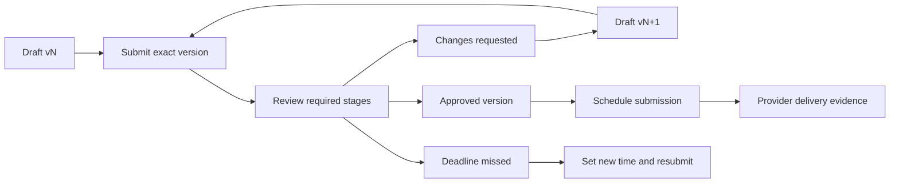
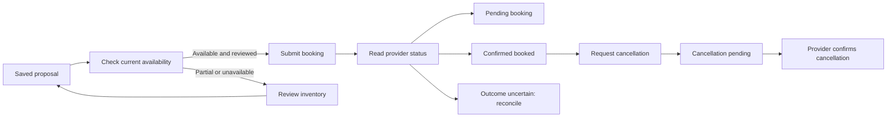
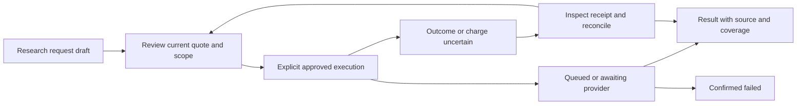

# Campaign and Discover: observed flows and proposed ten98 adaptations

Research snapshot: **19 October 2026**. This is a flow specification for review, not an accepted product backlog. [Evidence and selection method](evidence.md) distinguish independently hosted reviews, vendor claims, direct visual inspection and documentation-only observations. [Recommendations](recommendations.md) list decisions for the human and parent design-system session.

**Observed** means supported by the linked public source. **Proposed** means our design inference. Competitor keyboard, screen-reader and mobile behavior has not been certified. Accessibility and responsive requirements below are proposed ten98 acceptance criteria. Existing app rules take precedence over attractive competitor controls.

## Common composition and state contract

Use existing `AppShell`, `PageHeader`, `ResourceCard`, `DataTable`, `MetricCard`, `Field`, native inputs/selects, `Badge`, `Alert`, `Dialog`, `ConfirmDialog`, `ActivityFeed`, `DateRangeField`, `CopyButton`, `Progress` and `Skeleton` first. `Stepper` shows progress; it does not own step navigation. `DataTable` does not implement server querying or virtualize arbitrarily large results. Specialized components listed as gaps are proposals, not current exports.

| State | Required presentation across these flows |
| --- | --- |
| Loading | Identify the resource, query or scope being loaded; preserve previous context and draft. Do not show a zero chart as a loading placeholder. |
| Empty / filtered empty | Separate no accounts, no records, no eligible items and no filter matches. Give an appropriate connection, creation or clear-filter action. |
| Error / partial | Keep usable destinations or rows; identify the failed portion and safe next action. A successful subset is not an overall success. |
| Permission / read only | Keep readable authorized content. Explain the capability needed beside the affected action. Server enforcement stays in the app. |
| Stale | Show last successful update, requested time range and refresh state. Preserve the previous result with its timestamp. |
| Pending / uncertain | Pending has a known job/receipt to inspect. Uncertain means the outcome could have happened: reconcile before retrying a consequential write. |
| Confirmed zero / unavailable | Render `0` only when measured. Show unavailable, unobserved or not yet collected with a reason otherwise. |

For every flow: preserve project/workspace scope in links and headings; use visible field labels and textual status; retain unsaved work; allow keyboard completion without dragging; provide a narrow-screen list/detail route; keep tables horizontally scrollable inside their own region when necessary. Do not hide overflow to make a screenshot pass. Hidden sidebar scrollbar styling must retain scrolling and keyboard reachability. Test 320 CSS pixels, 200% zoom, LTR/RTL and long labels on the actual consumer.

## C1. Compose and validate a social post

**Scope:** existing social publishing and composer/adaptation extension. Primary reference: [Buffer composer](https://support.buffer.com/articles/scheduling-posts-4Qdld7giAZ); actual guide image inspected, as recorded in [evidence](evidence.md#social-visual-and-behavioral-references).

**Observed:** Buffer selects channels, accepts shared content, then customizes by network and previews before choosing queue/date/now. Queue choices depend on posting times; media support varies. Its guide says published-copy changes require native platforms. ten98 already supports some provider-backed post changes, so that limitation must not remove working functionality.

**Proposed flow:** project → explicit destination accounts → shared draft → per-account variants → media/alt text/options → destination readiness summary → approval if required → explicit publish/schedule → per-destination receipt. Preserve Campaign's finer per-account copies rather than flattening them into Buffer's network-level grouping. Show the effective caption/media/time for the selected account; never silently replace divergent copies.

**States/safeguards:** an incomplete draft can be saved; pending media processing is distinct from ready; unknown dimensions remain unverified; unsupported format/options show a remedy; provider preflight failure retains all input; one failed destination does not erase successful receipts. Stale approval after a material edit is visible. The app owns weighted character counting, privacy choices, consent requirements, credentials and preflight.

**Layout/access:** `Tabs`, `Field`, `Textarea`, `Select`, `Badge`, `Alert`, `Progress`, `Dialog`; propose destination picker, media strip and preview only after API review. Show composition and preview side by side on wide screens, in sequence on narrow screens. Reorder media with labelled move controls as well as optional drag; alt text is editable in the media context. Preview is labelled approximate where platform rendering differs.

## C2. Plan a calendar and approve content

**Scope:** calendar, native date inputs, approval screens and activity. References: [Sprout calendar](https://support.sproutsocial.com/hc/en-us/articles/360000121343-How-do-I-use-the-Publishing-Calendar), [Sprout approval](https://support.sproutsocial.com/hc/en-us/articles/205974715-Message-Approval-Workflows), [Agorapulse timezones](https://support.agorapulse.com/en/articles/8769381-how-to-manage-time-zones-in-agorapulse), [Planable requests](https://help.planable.io/hc/en-us/articles/21715207498652-Requesting-approval).

**Observed:** Sprout provides list/week/month views, filters and explicit rescheduling alongside drag. Its approvals run in ordered steps; a post missing approval by its scheduled time requires a new time and resubmission. Agorapulse distinguishes profile publishing timezone from calendar display timezone. Planable's bulk request explicitly selects eligible posts, reviewers and a confirmed count.

**Proposed flow:** scope/range/view → inspect scheduled/draft/review items → open detail → edit date/time with named timezone → validate → save or request review. Reviewers see exact version, destinations and due time, then approve or request changes with a note. An edit can make prior approval stale according to the app's existing contract. Approval, scheduling and provider delivery stay separate statuses.

**States/safeguards:** no posts in range differs from no filter matches; permission controls are profile-specific; stale calendar sync carries its last timestamp; overdue approvals do not publish automatically; reassignment is explicit; remote schedule changes are reviewed before overwrite. Calendar display timezone changes must not silently change the submitted instant. Ambiguous/nonexistent DST times need explicit app validation.

**Layout/access:** `Tabs`, native date/time controls, `Card`, `Badge`, `EmptyState`, `Dialog`, `Stepper`, `ActivityFeed`. Proposed calendar is controlled presentation with an agenda fallback; application owns recurrence, scheduling and Google Calendar synchronization. On narrow screens use list/agenda; keyboard rescheduling uses the same labelled date form as pointer users.

**Decision, not acceptance:** [Planable approval modes](https://planable.io/guides/content-approvals-in-planable/) distinguish optional/required/multi-level approval. [SocialPilot's client settings](https://help.socialpilot.co/article/573-how-do-i-add-clients-to-my-team) include auto-approval before a scheduled time. Recommend ten98 continue to block missing approval; do not import auto-approval without an explicit human decision. External reviewer links and multi-stage policies are separate scope decisions.

## C3. Create and activate a paid campaign

**Scope:** existing Campaign advertising, account mapping, campaign validation and ad preview extension. References: [Google Search campaign setup](https://support.google.com/google-ads/answer/9510373?hl=en), [TikTok ad groups](https://ads.tiktok.com/resources/help/article/create-ad-group), [Google review guidance](https://support.google.com/google-ads/answer/11052121?hl=en).

**Observed:** Google leads from objective/type and conversion goals through bidding/targeting, keywords/ads and budget to review, where issues link back to their fields. TikTok separates campaign, ad-group and ad concerns; available fields depend on objective and budget strategy. These guides document native products, not ten98's provider API parity.

**Proposed flow:** choose project and verified account → choose supported objective/type → configure targeting/bidding → compose creative with destination-specific preview → set budget with immutable account currency and allocation type → review exact outgoing settings → validate → create paused → inspect provider receipt/readback → explicitly activate when ready. Preconditions: current mapping, role, creative approval and supported provider capability. A local draft is saveable before it is complete.

**States/safeguards:** no account routes to connection setup; stale account capabilities require refresh before submission; invalid budget/creative produces field errors and a linked summary; unavailable preflight blocks writes without erasing the draft; provider review/disapproval is distinct from local validation; ambiguous write shows a persistent reconciliation panel; activation is not guaranteed delivery. Keep daily, lifetime, campaign-total and shared budgets visibly distinct. Do not normalize them into one generic money field.

**Layout/access:** existing `Stepper` plus `SettingsSection` and `Field`; `Tabs` for account-specific creative; plain-language review rows and a `ConfirmDialog` for activation. Proposed gaps: reusable ad-preview frame and structured review summary only after accepted use cases. On mobile, preview follows the relevant form section; errors link to focusable controls. The app owns eligibility, validation, currency math, revision checks, submission and receipts.

## C4. Inspect performance and review paid changes

**Scope:** existing Campaign metrics/tables, keywords, budgets, campaign controls and asynchronous reports. References: Google Ads Editor [check](https://support.google.com/google-ads/editor/answer/56370?hl=en), [post](https://support.google.com/google-ads/editor/answer/30583?hl=en) and [recent-change review](https://support.google.com/google-ads/editor/answer/30582?hl=en); [Optmyzr budget guide](https://help.optmyzr.com/en/articles/3120995-reach-target-monthly-spend-user-guide).

**Observed:** Ads Editor checks a selected scope and count, then separately posts a reviewed summary and shows per-campaign progress/errors. Downloaded changes can conflict with local edits. Optmyzr exposes target spend, budget ownership and allocation settings, and documents incompatible total budgets and conflicting automation tools.

**Proposed flow:** choose account/timezone/date range → inspect fresh performance and source labels → select a campaign or precise rows → edit a permitted field → inspect before/after plus affected count → validate against current provider state → confirm → inspect receipt and readback. A requested export/report gets a persistent job row with status and a download link only when ready.

**States/safeguards:** no measured spend is unavailable, not zero; delayed conversions retain collection time; a filtered-empty table offers clear filters; shared/unreadable budget ownership disables allocation editing with explanation; remote changes require review; a pending report survives reload; a failed download can be retried independently of requesting another paid/provider job. Broad bulk editing and automated budget reallocation are **new suggestions** requiring separate scope approval.

**Layout/access:** `DateRangeField`, `MetricCard`, `DataTable`, `Alert`, `Dialog`, `ActivityFeed`. Proposed review panel can start as composed primitives. Numeric columns retain units/currency; compact density cannot remove labels; selected count announces scope. App owns attribution, calculations, pagination, reports and write serialization.

## C5. Plan, book and reconcile OOH placements

**Scope:** existing OOH proposal/availability/booking ledger and future map/creative presentation. References: [Broadsign Guaranteed campaign UI](https://docs.broadsign.com/broadsign-platform/en/Documentation_Gteed_Campaigns/g-c-new-campaign.html), [API sequence](https://docs.broadsign.com/broadsign-platform/en/Documentation_Gteed_Campaigns/g-c-new-campaign-rest.html), and [public action images](evidence.md#public-visual-evidence-inspected).

**Observed:** Broadsign separates client/campaign details, inventory line items and creative assignment. Save, hold, submit and book have different consequences. Availability is checked at commitment; a prior hold is not a permanent guarantee. The API sequence retrieves the campaign after submission to establish its resulting state.

**Proposed flow:** verified provider/environment/project inventory → select authorized screens/faces in list and optional map → date range and provider quote → save proposal → availability result by affected item → explicit booking review → submit → status readback → delivery evidence → explicit cancellation request when eligible → pending/confirmed cancellation. The current app's frequency/full-day/one-line-item limits remain visible; do not expose unsupported dayparting simply because the reference does.

**States/safeguards:** empty inventory distinguishes unsynced from no authorized screens; partial availability identifies affected items; stale availability is rechecked before booking; permission changes block commitment; booking/cancellation pending retains receipt; uncertain partial creation routes to provider reconciliation. Cancellation does not imply refund. Do not divide a line-item quote into invented per-screen costs or substitute estimated impressions for proof of play.

**Layout/access:** `ResourceCard` for connection, `DataTable` for inventory, `DateRangeField`, `Badge`, `Alert`, `ConfirmDialog`, `ActivityFeed`; map is a proposed app-owned renderer with the same selectable list. Keyboard users select inventory through the table; map-only pins cannot be the sole access path. On narrow screens, alternate list/map views preserve selection and show a persistent selection count. Creative-bundle operations unsupported by Campaign remain an explicit provider handoff.

This diagram is the proposed ten98 presentation model; provider states and transitions are app-owned.

## C6. Publishing recovery and unified inbox

**Scope:** existing publishing lifecycle and inbox. References: [Buffer error library](https://support.buffer.com/articles/facebook-error-library-x7IMglwe8J), [Later failed posts](https://help.later.com/hc/en-us/articles/360060833574-Troubleshooting-Failed-Posts), [Agorapulse assignment/review](https://support.agorapulse.com/en/articles/10441656-how-to-assign-and-review-items-in-the-inbox), [Sprout Smart Inbox](https://support.sproutsocial.com/hc/en-us/articles/46903806068237-Working-in-the-Smart-Inbox-Sprout-Bites).

**Observed:** provider disconnection and publishing-limit errors have different remedies. Later distinguishes automatic publishing from a notification requiring a person to finish in the native app. Agorapulse assigns an item to a teammate with an optional internal message; native-platform replies are not automatically marked reviewed. Sprout documents split-pane conversations and teammate response indicators. Workflow review state is therefore separate from provider send state.

**Proposed recovery:** destination/result/attempt time → specific reason → supported remedy → allowed retry or native handoff. Retry only known failed destinations; unknown outcomes require reconciliation. A delivered notification is not a published post.

**Proposed inbox:** choose account/filter → open conversation → inspect public/private context → assign → choose internal note or external reply → submit → inspect send receipt → review/resolve/reopen. Preserve drafts when changing selection. Never infer consent from an inbound message or contact creation.

**States/safeguards:** initial empty inbox, filtered empty, stale sync, permission lost, reply pending, uncertain send, resolved-but-new-message and failed attachment must be distinguishable. Explain unsupported channel actions. If collision indicators are approved, they are advisory and never imply a durable send lock. Provider/window/template restrictions stay app-owned.

**Layout/access:** `Tabs`, `Avatar`, `Badge`, `Textarea`, `Alert`, `ResourceCard`, `ActivityFeed`, `ConfirmDialog`. Proposed conversation list/detail/reply composition uses app callbacks and data. Mobile opens one pane at a time with a stable back path and restored list focus. Internal notes and public replies differ by explicit text/control, not color alone. Conversation history uses meaningful sender/time labels.

## C7. Find, approve and attach media

**Scope:** existing Drive/DAM metadata, uploads and approval; future media/DAM editor. References: Bynder [asset detail](https://support.bynder.com/hc/en-us/articles/21745299220882-Exploring-the-Asset-Detail-View) and [versions](https://support.bynder.com/hc/en-us/articles/360013931859-Upload-New-Version-of-an-Asset); Frontify [upload](https://help.frontify.com/en/articles/5810426-uploading-assets-to-frontify) and [sharing](https://help.frontify.com/en/articles/4895189-sharing-capabilities-assets-collections-and-folders); Brandwatch [content pool](https://social-media-management-help.brandwatch.com/en/articles/17450100-content-pool-introduction).

**Observed:** Bynder places metadata/permissions/renditions in asset detail; versions preserve metadata and have one active version. Frontify allows batch metadata and governed sharing/download requests. A stored library asset need not satisfy a destination network's publishing requirements.

**Proposed flow:** search/filter → inspect preview, provenance, rights, approval and delivery expiry → choose permitted rendition → attach to exact destination. Upload runs files → metadata → per-file transfer/processing → verified delivery reference → review. Replacing delivery media preserves the original and invalidates affected approvals under the existing app contract.

**States/safeguards:** empty library versus filter miss versus unavailable sync/index; failed/pending/cancelled upload per file; expired delivery URL; unsupported format; missing usage rights; read-only asset; changed original; stale approval. Do not silently replace already-approved scheduled media. Version pinning and advanced rights enforcement are proposals requiring product decisions, not capabilities this library adds.

**Layout/access:** `Card`/`DataTable` view choices, `Tabs`, `Field`, `Badge`, `Progress`, `Dialog`, `ActivityFeed`; proposed media picker/upload queue/version-rendition selector. Provide upload through native file input as well as drop; keyboard selection and move controls; full filename inspection; metadata after preview on narrow screens. App owns storage, processing, checksums, expiry, public access and rights authorization.

**Optional specialization:** Later's [visual feed planner](https://help.later.com/hc/en-us/articles/360043244233-Preview-Your-Feed-With-Your-Visual-Instagram-Planner) previews a grid and changes schedules when items are rearranged. If approved later, show those date changes before saving, label feed-preview limitations and support move-earlier/later controls. It is not required to preserve current Campaign functionality.

## C8. Direct campaign audience, preview and send

**Scope:** an existing Campaign adjunct confirmed by its public/local documentation, not an expansion of Discover. References: Mailchimp's [email checklist](https://mailchimp.com/help/create-and-send-regular-email/), [import result report](https://mailchimp.com/help/view-import-results/), and listmonk's [campaign API](https://listmonk.app/docs/apis/campaigns/) and [send permissions](https://listmonk.app/docs/roles-and-permissions/). These are supplementary flow references; no category-wide review ranking was completed for email/SMS products.

**Observed:** Mailchimp gathers recipients, sender, subject and content into a reviewable checklist and reports added/updated/skipped/error import outcomes. listmonk separates campaign management from permission to start/schedule sends and exposes preview/status operations.

**Proposed flow:** choose channel and permitted purpose → preview contact import with row-level conflicts → record channel-specific consent evidence → compose using a supported template/format → preview eligible audience and exclusion reasons → review exact recipient count/content/sender/time → explicit send/schedule → delivery receipts and replies. Preserve Campaign's transactional-only Cloudflare boundary; a Mailchimp marketing reference does not authorize marketing sends through that connection.

**States/safeguards:** no eligible recipients shows why; invalid rows remain downloadable/readable without silently merging identities; unverified address differs from invalid; suppression wins over earlier consent; pending/uncertain recipients are not resent automatically; sent, delivered and read are separate provider-supported states. Template approval, expiry or provider permission changes invalidate a stale send review.

**Layout/access:** `Field`, `Select`, `DataTable`, `Alert`, `Progress`, `Dialog`, `Badge`; keyboard row inspection and column-mapping controls with text labels. Proposed import-preview or audience-summary patterns are compositions until multiple accepted callers need an API. App owns contact identity, consent, suppression, scheduling, delivery and policy enforcement.

## D1. Website installation to first useful report

**Scope:** analytics collection/consent and resource/status foundation. References: [Umami collection](https://docs.umami.is/docs/collect-data), [Plausible installation checks](https://plausible.io/docs/troubleshoot-integration), [GA4 DebugView](https://support.google.com/analytics/answer/7201382).

**Observed:** Umami exposes code from website editing. Plausible separates installation detection from counted visits, with retry/manual verification paths. GA4 inspects selected debug devices/events; consent or privacy settings can suppress observations.

**Proposed flow:** website details → installation method → copy snippet → external deployment → check → latest accepted event receipt → overview. Preconditions: authorized website/origin, configuration role and collection policy. Display check evidence separately from real receipt evidence.

**States/safeguards:** not installed, checking, check unavailable, waiting for events, events received, collection disabled and stale receipt. Copying code is not installation; a successful check is not complete traffic coverage. Keep website/configuration visible during retries; show why a check is inconclusive.

**Layout/access:** `ResourceCard`, `Stepper`, `CopyButton`, `Field`, `Select`, `Badge`, `Alert`, `ActivityFeed`. Long status labels wrap at narrow widths/zoom. Proposed installation-status composition carries timestamps and callbacks; scanning, consent and ingestion stay app-owned.

## D2. Overview, filter and comparison

**Scope:** analytics metrics/sparklines/tables, comparisons and reporting. References: [observed Plausible demo](https://plausible.io/plausible.io), [Umami comparison](https://docs.umami.is/docs/compare), [Fathom dashboard](https://usefathom.com/docs/start/dashboard).

**Observed:** Plausible exposes readable dimension/operator/value filters in the URL. Umami adds previous-period/year comparison to headline metrics and series. Fathom offers comparison beside the date control and a mobile date picker alternative to chart dragging.

**Proposed flow:** website/project → range/timezone → metric → filter → compare against a named baseline → drill into a breakdown. Preserve applied scope through links and browser history; pending control edits do not relabel previous results as newly calculated.

**States/safeguards:** zero, unavailable, filtered-empty, partial, stale, updating, permission denied. A zero/missing baseline must not produce an unexplained infinite percent change. Charts expose units and accessible values; selection persists only within valid query scope.

**Layout/access:** `MetricCard`, `DateRangeField`, `Sparkline`, `Tabs`, `DataTable`, `Alert`, `Skeleton`; propose controlled filter chips/comparison controls only after the app query contract is documented. Chips have labelled remove buttons and Clear all; compact header wraps rather than clips. Apps own metric calculations, time windows, filtering, pagination and query serialization.

## D3. Query explorer and breakdown

**Scope:** query explorer extension, searchable research/analytics tables and execution limits. Reference: [Umami breakdown](https://docs.umami.is/docs/breakdown).

**Observed:** choose dimensions and filters, then Run, to inspect a breakdown of traffic metrics.

**Proposed flow:** select source → metric/dimensions → conditions → review applied query → explicit run → result table → detail or save/report. Start with supported fields and operators; a general SQL editor is not required by this reference.

**States/safeguards:** invalid query, unavailable dimension, draft not run, running, no matches, partial result, deadline, permission loss and stale prior result. Preserve last successful data under its original query while the new one runs. Charged research adds the quote/receipt contract described in D12; analytical viewing does not imply a new paid run.

**Layout/access:** native `Field`/`Select`, `DataTable`, `EmptyState`, `Alert`, `Progress`; proposed query-panel composition. Controls stack before results on mobile; result context remains readable. The app owns query semantics, costs, cancellation and execution.

## D4. Goals and funnels

**Scope:** existing conversion analysis; specialized editor/result presentation when needed. References: [Umami goals](https://docs.umami.is/docs/goals), [Umami funnels](https://docs.umami.is/docs/funnel), [Mixpanel funnel quickstart](https://docs.mixpanel.com/docs/reports/funnels/funnels-quickstart), [Amplitude order modes](https://amplitude.com/docs/analytics/charts/funnel-analysis/funnel-analysis-build).

**Observed:** Umami defines goals from a viewed page or event and funnels with at least two steps; its window is between consecutive steps and intervening events are allowed. Mixpanel separates behavior, measurement, filters, breakdowns and visualization. Amplitude distinguishes This order, Any order and Exact order, with starting-event segment semantics. These are different measurement contracts.

**Proposed flow:** name → supported page/event conditions → order and window with explicit definition → run → inspect entrants/completions/drop-off → detail. Show counting unit, time-window basis, timezone and denominator next to the result. Preserve Discover's actual semantics; do not silently adopt competitor modes.

**States/safeguards:** insufficient steps, invalid condition/window, draft not run, no entrants, confirmed zero completions, incomplete observation window, expired evidence, unavailable/failed query. “0%” must not stand for unobserved data.

**Layout/access:** `Field`, `Select`, `Button`, `Card`, `DataTable`, `Alert`, `Dialog`; propose ordered condition editor and accessible funnel summary. Move-up/down buttons accompany any drag; bars have text counts/rates and a table alternative. App owns identity, attribution, denominators and query math.

## D5. Retention and journeys

**Scope:** analytics/research screens and advanced comparison/visualization. References: [Umami retention](https://docs.umami.is/docs/retention), [Umami journey](https://docs.umami.is/docs/journey), [PostHog paths](https://posthog.com/docs/product-analytics/paths).

**Observed:** Umami retention runs a selected period into a cohort grid; journeys configure steps and optional boundaries. PostHog explains that frequent paths differ from funnel conversion because units, windows and truncation differ.

**Proposed flow:** choose cohort/event definition and range → run → inspect labelled cohort cells or bounded transitions → open underlying detail. Show cohort size, counting basis and top-N/truncation limits. Treat path discovery and testing a specified funnel as separate tasks.

**States/safeguards:** future/unobserved cells differ from measured zero; insufficient history, partial retention, expired evidence, stale query and unavailable path dimensions are explicit. A truncated graph is not a complete journey census.

**Layout/access:** `DataTable`, `Tabs`, `Card`, `Tooltip`, `Alert`; propose cohort table and journey inspector only against accepted contracts. Provide focus/click details rather than hover alone, a linear path table, and clear temporal meaning in RTL. Apps own identity/retention and aggregation.

## D6. Attribution and campaign measurement

**Scope:** Discover attribution/measurement, while paid control stays Campaign-owned. Reference: [Umami attribution](https://docs.umami.is/docs/attribution).

**Observed:** select a model and page/event conversion condition, then run and inspect contribution by acquisition dimensions.

**Proposed flow:** conversion definition → supported model/lookback → scope/range → results → source evidence. Persist model and identity basis beside charts and exports.

**States/safeguards:** no conversions differs from conversions with no attributed source; source capture disabled, consent/retention-limited data, stale data and unavailable provider metrics remain explicit. Attribution describes a model, not proven causality. Cross-app links show target project/account and never trigger an ad mutation from a report click.

**Layout/access:** `Select`, `Field`, `DataTable`, `MetricCard`, `Badge`, `Alert`; measurement-definition disclosure can be composed from `Accordion`. Apps own attribution math and identity linkage.

## D7. Heatmap investigation

**Scope:** heatmap extension. References: [Clarity heatmaps](https://learn.microsoft.com/en-us/clarity/heatmaps/heatmaps-overview), [official inspected screenshot](https://learn.microsoft.com/en-us/clarity/media/clickmaps.png).

**Observed:** page and scope selection lead to different map modes; an element ranking sits beside the page visualization with recording drill-through. This is documented behavior plus visual image inspection, not a completed live-demo interaction test.

**Proposed flow:** retained page/viewport/time scope → supported map mode → ranked element and overlay → corresponding recordings. Keep count, captured viewport and snapshot time near the display.

**States/safeguards:** capture disabled, no samples, filter miss, screenshot unavailable, mismatched page version/viewport, partial coverage, expired capture and revoked access. Never draw a precise-looking overlay when alignment is unknown.

**Layout/access:** `Tabs`, `DataTable`, `Select`, `Badge`, `Alert`, `EmptyState`; propose inspector slots for a domain-owned renderer. Keyboard users choose ranked rows and read counts; narrow screens switch between list and preview without losing selection. Capture, redaction, sandboxing and alignment stay in Discover.

## D8. Replay investigation

**Scope:** replay extension. Reference: [Umami replay](https://docs.umami.is/docs/replays) and [official inspected player image](https://docs.umami.is/images/docs/replay-player.png).

**Observed:** replay uses separate recording configuration/sampling, library/session access, playback controls and named saved recordings. Current public Umami defaults differ from Discover: do not copy its masking/storage defaults.

**Proposed flow:** inspect collection policy → library with capture/expiry/completeness → explicit Load recording → player controls and event context → related report. Preserve Discover's strict masking, separate consent and default seven-day retention from its existing contract.

**States/safeguards:** not sampled, incomplete upload, unavailable prefix, loading paused, expired, failed and access revoked. Show gaps as gaps. Saving a recording label must not imply extended retention. Analytics collection success does not imply replay capture.

**Layout/access:** `Progress`, `Button`, `Select`, `Badge`, `Alert`, `DataTable`, `Dialog`; propose replay controls/status around the app-owned player. Named play/pause, elapsed/duration, seek, speed, inactivity skip and fit controls; keyboard-operable time navigation. Do not auto-download sensitive replay payload merely because a row is visible. App owns recorder, payload access, retention and isolated rendering.

## D9. Build and share reports

**Scope:** research/report editor extension and existing boards/sharing/export. References: [Umami boards](https://docs.umami.is/docs/using-boards), [board design](https://docs.umami.is/docs/design-a-board), [Fathom sharing](https://usefathom.com/docs/features/shared-dashboards), [Matomo reporting](https://matomo.org/guide/manage-matomo/email-reports/).

**Observed:** Umami chooses source/type/settings in a component picker and composes rows/columns under a board date scope. Fathom documents named share links with scope, optional expiry/password and independent revocation. Matomo documents scheduled report delivery, which is only an additional candidate here.

**Proposed flow:** source → widget → configuration → preview → add → layout → save revision → reader preview → explicit share/export scope review → issue or download. Show source, freshness and local error per widget; one failed widget must not erase a useful board.

**States/safeguards:** empty board, unsupported widget/source, missing resource, stale revision conflict, unsaved edits, partial widget failure, read-only and expired/revoked share. A preview does not enable a public link. Exports retain applied filters/timezone/as-of/coverage and state whether they contain all results or a bounded subset.

**Layout/access:** `Card`, `Dialog`, `Field`, `Select`, `DataTable`, `SecretField`, `CopyButton`, `ConfirmDialog`; propose widget-picker/report-frame/share-list only when needed. Keyboard move controls and resize presets accompany drag. Narrow screens use sequential configuration/preview sections. App owns saving, revisions, export completeness, permissions and revocation. Scheduled email/Slack delivery is a new suggestion unless separately approved.

## D10. Measurement confidence across reports

**Scope:** state consistency across all analytics and research. References: [GA4 sampling disclosure](https://support.google.com/analytics/answer/13331292?hl=en), [Umami metric definitions](https://docs.umami.is/docs/metric-definitions), and the local [shared state model](../../UX-PATTERNS.md#state-model).

**Observed:** GA4 exposes sampling information; even unsampled unique counts can be estimated. Umami documents identity/visit rules. Similarly named vendor metrics are not automatically equivalent.

**Proposed composition:** an adjacent compact explanation of measured/estimated basis, as-of time, retained interval, sampling, applied scope and known limitations. Clicking a metric explanation must not silently launch new collection/research.

**States/safeguards:** consent refusal and dropped capture do not reveal the missing-traffic denominator. Comparisons need compatible collection/retention scope. Use an explained unavailable value where evidence cannot support a number.

**Layout/access:** existing `Badge`, `Alert`, `Tooltip`, `Accordion`, `ActivityFeed` cover most cases. A compact evidence/quality summary is a high-value shared candidate; callbacks and calculations remain app-owned. Essential limitations are visible text, not tooltip-only content.

## D11. Keyword exploration and saved research

**Scope:** SEO/query explorer, keyword research and saved lists. Reference: [Semrush Keyword Magic](https://www.semrush.com/kb/617-keyword-magic-tool-manual), with visual inspection recorded in [evidence](evidence.md#search-visual-evidence).

**Observed:** seed and country database → match/question mode → topic groups/metric filters → SERP inspection → selected/all/group copy/export/save. Export scope is explicit.

**Proposed flow:** seed/country/language and bounded result size → quote if charged → execute approved request → inspect labelled provider metrics → select rows → save keywords or open evidence. Preserve Discover's actual 25/50/100 idea bounds and provider contract.

**States/safeguards:** initial no query, invalid market, loading/queued, no returned ideas, no filter matches, partial bounded result, stale index observation, unavailable metric, unknown charge and permission loss. Typing or changing a draft filter must not purchase another report. Saved keywords are not a promise of active recurring rank tracking.

**Layout/access:** `Field`, `Select`, `DataTable`, `Badge`, `Alert`, `Tabs`, `EmptyState`; applied-filter composition and evidence detail if accepted. Keep selection scope/count visible; show full query and units; move facet rail above results on narrow screens. Apps own provider paging, saved lists and usage accounting.

## D12. Domain/backlink research and charged-run review

**Scope:** domain research, backlinks, comparisons and research execution/accounting. References: Ahrefs [target scope](https://ahrefs.com/academy/how-to-use-ahrefs/site-explorer/intro), [backlink investigation](https://ahrefs.com/blog/find-backlinks/), [filters](https://help.ahrefs.com/en/articles/2134275-how-to-use-filters-in-site-explorer-backlinks-reports), Similarweb [comparison](https://support.similarweb.com/hc/en-us/articles/360010749958-View-Website-Performance).

**Observed:** Ahrefs makes protocol/target/scope explicit and applies backlink filters with Show results. Similarweb compares selected domains under time/geography/device population. Their scope and estimation methods affect meaning.

**Proposed flow:** canonical target and supported scope → source/market/options → quote review including result/page bound → explicit execution → durable run/receipt → source-labelled result table → referring-page/anchor/observation detail → scoped export. Organic and backlink scope equivalence remain separate where Discover's contract differs. Ahrefs is a UX reference, not an approved new connector.

**States/safeguards:** invalid target, missing provider, quote changed/expired, queued/running/awaiting provider, partial response, observed zero, unavailable, failed before dispatch, uncertain after dispatch, expired retained evidence. Reconciliation precedes another charged attempt after uncertainty. A new paid page/filter is a new quote where the app requires it. Retrieval time does not make the upstream index fresh.

**Layout/access:** `Field`, `Select`, `DataTable`, `MetricCard`, `Badge`, `Alert`, `ConfirmDialog`, `ActivityFeed`, `Progress`. Proposed run receipt/evidence summary receives app state/actions; no billing/retry engine. Show **DataForSEO rank (0–100)** for that provider score, never relabel it Ahrefs DR/Moz DA. Tables/detail routes preserve scope, and URL/code fragments retain appropriate LTR direction in RTL screens.

Transitions are app-owned; the diagram proposes presentation of known states, not automatic retry.

## D13. Project setup and rank history

**Scope:** rank comparison and project research setup. References: [SE Ranking project wizard](https://help.seranking.com/hc/en-us/articles/30986337894300-How-to-create-a-project), Semrush [tracking setup](https://www.semrush.com/kb/548-configuring-position-tracking), [configuration limits](https://www.semrush.com/kb/1106-device-location-change) and [overview](https://www.semrush.com/kb/549-position-tracking-overview-manual).

**Observed:** SE Ranking progressively collects URL/scope, engine/location, keywords/prompts, competitors and optional integrations. Semrush binds observations to engine/location/device, with additional targets separate from original settings.

**Proposed flow:** lightweight project creation → optional capability setup → keywords and market/device → explicit run/schedule as supported → Latest / History / Runs → compare compatible observations → inspect underlying result. Show keyword/engine combinations and usage before committing.

**States/safeguards:** no saved keywords, no completed runs, running, last attempt failed with older valid observation, unsupported market/device, not checked, not found within observed coverage, partial coverage, incompatible baseline and paused schedule. Editing settings must not rewrite historical observation context.

**Layout/access:** `Stepper`, `SettingsSection`, `Tabs`, `DataTable`, `DateRangeField`, `Badge`, `Alert`, `ActivityFeed`; proposed rank comparison only when needed. Use text deltas and explicit position meaning rather than color alone; narrow screen detail exposes one keyword/history at a time. Scheduling/configuration/usage are app-owned.

## D14. Technical site audit

**Scope:** SEO audit/research and issue investigation. References: Screaming Frog [quick start](https://www.screamingfrog.co.uk/seo-spider/tutorials/quick-start-guide/) and [issue semantics](https://www.screamingfrog.co.uk/seo-spider/issues/).

**Observed:** choose target/mode → crawl progress → issue or element category → affected URLs → supporting inlinks/outlinks/details → scoped export. Issue type and priority are separate dimensions; warnings can require judgment.

**Proposed flow:** authorized target, allowed crawl mode and budget → review limits → run → bounded progress → issue summary → affected URL table → evidence/remedy → export snapshot. Retain Discover's eligible-origin, static-mode and crawl-network restrictions.

**States/safeguards:** blocked target, robots/policy exclusion, zero eligible pages, running/cancelled, partial crawl, budget exhausted, stale result, parsing/network failures and unsupported check. Absence of a finding after incomplete coverage is not proof the site is healthy. Do not turn every warning into a failed audit.

**Layout/access:** `Field`, `Select`, `Progress`, `DataTable`, `Badge`, `Tabs`, `Alert`, `ActivityFeed`; issue-detail composition starts with existing controls. Preserve issue selection through detail; mobile replaces desktop split panes with list/detail routes. App owns crawling, security boundaries, analysis and remediation logic; authenticated/JavaScript crawling is not authorized by this reference.

## D15. Owned-property search performance

**Scope:** Search Console/organic reporting. References: Google [performance overview](https://support.google.com/webmasters/answer/7576553?hl=en) and [filters](https://support.google.com/webmasters/answer/17011165?hl=en).

**Observed:** metric selection, date/search-type controls and dimension tables support combined filters/comparisons; row selection can add a filter. Recent data can be preliminary, and chart/table aggregation can differ.

**Proposed flow:** authorized property → range/search type → metrics → query/page/country/device breakdown → filtered detail or comparison → scoped export. Source and preliminary/observed interval remain beside results.

**States/safeguards:** missing authorization/property, no measured observations, filtered empty, unavailable dimension, preliminary data, retention limits, stale sync and access revoked. Preserve Discover's null-versus-zero export behavior even where competitor export behavior differs. A keyword's paid-ad controls remain in Campaign.

**Layout/access:** `DateRangeField`, `Tabs`, `MetricCard`, `DataTable`, `Badge`, `Alert`; shared applied-filter/quality composition. Visible chart values/table alternative, named baseline and complete export scope. App owns OAuth, provider aggregation and retained evidence.

## D16. AI prompt setup, execution and comparisons

**Scope:** AEO/GEO research execution, usage and report/editor presentation. References: Profound [Prompt Designer](https://docs.tryprofound.com/answer-engine-insights/prompt-designer) and [report interpretation](https://docs.tryprofound.com/answer-engine-insights/interpret); Ahrefs [custom checks](https://help.ahrefs.com/en/articles/13192745-how-to-set-up-custom-prompts-to-track-brand-visibility-in-ai-assistants).

**Observed:** Profound separates prompt design from resulting reports; permissions and collection delay affect availability. Reports preserve period/comparison/facets across metric/table views. Ahrefs explicitly estimates checks from prompt × model × location and documents unavailable engines and exhaustion behavior.

**Proposed flow:** brand/context → authored prompt and version → model/market configuration → current quote/estimated usage → explicit run → receipt → aggregate with denominator/coverage → prompt → individual execution. Historical prompt/model/market snapshots remain immutable. No automatic overages or background refresh are imported from competitors.

**States/safeguards:** no prompts, draft unexecuted, unsupported engine, quota exhausted, queued, collecting, partial provider set, stale observations, changed prompt set, incompatible baseline, failed/uncertain charge and expired answer evidence. Explain whether the response came from API execution, provider collection or observed consumer UI; never imply one proves another.

**Layout/access:** `Field`, `Textarea`, `Select`, `DataTable`, `Tabs`, `Badge`, `Alert`, `ActivityFeed`, `Dialog`; proposed run/coverage summary and evidence detail are highest value. Provide accessible table equivalents to metric matrices. App owns collection, cost, denominators and interpretation.

## D17. Citation and answer investigation

**Scope:** citation research, source evidence, research/report editors. References: Scrunch [citations](https://scrunch.com/how-tos/how-to-track-citations-in-ai-search/), Peec [source detail](https://docs.peec.ai/understanding-sources), Otterly [prompt monitoring](https://help.otterly.ai/search-prompt-monitoring) and [exports](https://help.otterly.ai/can-i-export-my-data-and-reports).

**Observed:** Scrunch filters citation data by period/owner/topic/platform and drills to prompt variant/full answer. Peec distinguishes accessed sources from explicit citations. Otterly moves from brand/prompt to response/citation evidence and exports response detail. Public screenshots are illustrative and sometimes acknowledged as older.

**Proposed flow:** scoped aggregate → domain/URL → prompt/execution → original answer/citation evidence → scoped export or report annotation. A single stable detail route/panel with Back preserves context better than stacked dialogs. Distinguish owner, publisher type, retrieved source and cited source; retain the method that produced groupings.

**States/safeguards:** no citations in observed sample, missing answer payload, partial annotations, unsupported engine evidence, stale response, ambiguous ownership, expired evidence and unavailable baseline. Never reconstruct a missing full answer from aggregate counts. A source-gap score or outreach/content recommendation is a **new proposal** requiring a defined method and human decision.

**Layout/access:** `DataTable`, `Badge`, `Tabs`, `Breadcrumb`, `ActivityFeed`, `Accordion`, `Dialog`; proposed evidence-detail composition. External source links are labelled; answer text renders safely; long URLs wrap with inspect/copy paths. App owns data provenance, annotation interpretation, redaction, grouping and retention.

## Matrix coverage and ownership check

| Canonical matrix area | Flow coverage | Shared UI / application boundary |
| --- | --- | --- |
| Campaign shell, metrics, tables, dates, cards, fields, badges, dialogs, activity | Common contract; C1–C8 | Existing exports and token compositions. |
| Provider authorization, data, publishing, ad spend, validation, permissions | C1–C6, C8 | App-owned controls, runtime, provider rules and receipts. |
| Publishing calendar / social composer / ad preview | C1–C4 | Proposed controlled presentations; no scheduling or advertising engine. |
| Media/DAM editor / inbox | C6–C7 | Proposed picker/detail/reply surfaces around app storage and delivery. |
| Discover shell, metrics/sparklines, tables, fields, resource cards/status | Common contract; D1–D17 | Existing exports and state vocabulary. |
| SEO/AEO/GEO data, analytics attribution, execution, usage, consent | D1, D4–D6, D10–D17 | App-owned collection, security, semantics, billing and retention. |
| Query explorer / rank comparison | D3, D11–D13 | Controlled query/compare presentation after exact contract agreement. |
| Heatmap / replay | D7–D8 | UI around app-owned capture, alignment, permissions and player. |
| Research/report editors | D9, D16–D17 | Composed source/widget/evidence layouts; app persistence and authorization. |

Each flow inherits the common empty/loading/error/partial/stale/permission/pending contract above. No row claims competitor feature parity, completed app acceptance or approval to implement a new feature.
