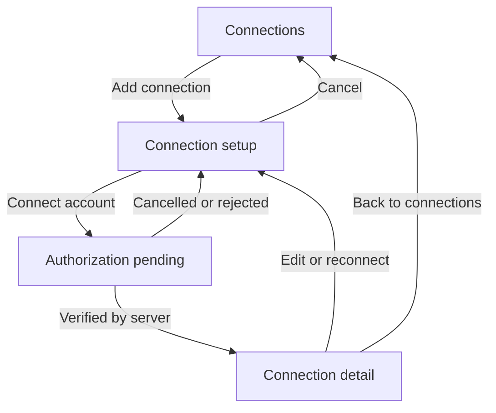
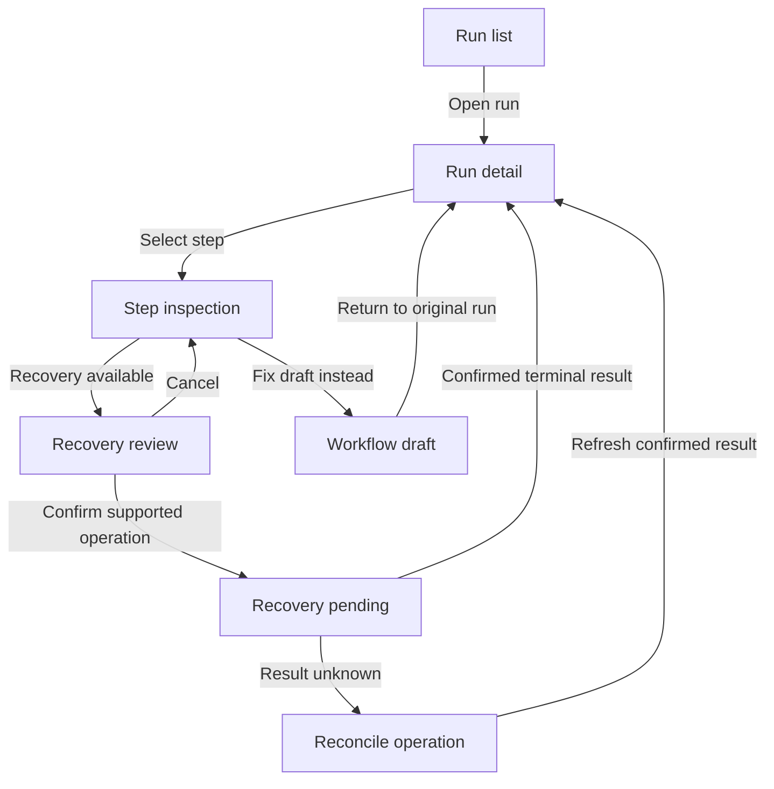

# ten98-connect: observed flows and proposed UX

Date: **19 October 2026**. Read with [evidence](evidence.md) and [review decisions](recommendations.md). **Observed** means documented by the linked vendor; **Proposed** is our inference for review, not approved functionality. No live accounts or real executions were used.

Assumed users: an operations builder on desktop, an operator investigating runs, and an approver who may use a phone. Primary goal: move from a named connection and draft to a verified, deliberately published automation, then diagnose failures without ambiguous repeat effects. Success is a server-confirmed outcome, not clicking a test, publish or retry button.

## Coverage map

| Current ten-tool matrix area | Flow below | Presentation boundary |
| --- | --- | --- |
| Resource cards for connections | C1 | Account identity, scope, health and actions |
| Fields, badges, detail cards | C1–C5 | Form and state presentation |
| Activity and tables | C6–C8 | Auditable changes and run inventory |
| Connector runtime, credentials, secrets | C1, C5, C8 | Application owns authorization, storage, connector discovery and invocation |
| Scheduling | C4 | Application owns next-run calculation, clock/DST rules and execution |
| Retries and workflow execution | C6 | Application owns repeat semantics, idempotency and reconciliation |
| Workflow canvas and node inspector: future extensions | C2 | Proposed presentation only; no engine or graph export exists today |
| Mapping editor: future extension | C3 | Proposed presentation; expression evaluation remains application owned |
| Execution debugger: future extension | C6 | Proposed read-only inspection and deliberate replay controls |
| Additional requested research: approvals / agent workflows | C7–C8 | Scope proposals requiring owner decision beyond the current matrix |

## State rules for every screen

These are proposed ten98 requirements derived from the existing [suite state model](../../UX-PATTERNS.md#state-model), not claims that all competitors implement them.

| State | Required presentation and safe next step |
| --- | --- |
| Empty | Explain the missing entity; offer creation or connection only if allowed. A workflow with no runs differs from a failed history request. |
| Loading | Name the requested data; retain usable context; prevent duplicate writes without inventing progress percentages. |
| Error | Preserve drafts and show field/provider/run context. Offer the smallest valid recovery action. |
| Permission | Keep authorized content readable and explain unavailable actions; server rechecks mutation permission. Never expose a hidden secret through a disabled input. |
| Stale | Show the data timestamp and refresh failure. Last known success is not current verified health. |
| Pending | Name what is awaited: OAuth callback, sample event, approval, worker capacity or delivery. Give cancellation/refresh behavior where the runtime supports it. |
| Partial / unavailable | Retain successful portions, explicitly mark absent payloads or tool discovery. Unknown counts and missing values do not become zero. |

All states require visible text as well as color. Standard fields and controls remain keyboard usable; status announcements must not move focus. The app router owns direct links and browser history. Narrow layouts retain a readable order and reachable actions. A hidden sidebar scrollbar must preserve native scrolling and keyboard access.

## C1 — Connect and maintain an account

**Observed.** [n8n credentials](https://docs.n8n.io/build/understand-workflows/create-and-edit-credentials) can be created from a scoped workspace or within a node; saving tests the credential. [Activepieces connection inventory](https://www.activepieces.com/docs/admin-guide/guides/connections) exposes account ownership, project/global scope and filters. Its [global connection flow](https://www.activepieces.com/docs/admin-guide/guides/global-connections) chooses an app, project access and permissions before authentication and save.

**Proposed flow.** Entry: Connections page or a node's connection field. Preconditions: current workspace/project is visible; caller may create/use the connection; integration auth methods are known.

| Step/screen | Intent and primary action | Branches and recovery |
| --- | --- | --- |
| Connections | Find an account; **Add connection** | Empty versus filtered empty; stale health with last check; unreadable accounts stay undisclosed. |
| Connection setup | Choose integration, meaningful account name, project and supported auth method; **Connect account** | No supported connector: return to search. Reuse existing account when appropriate. Preserve non-secret fields on failure. |
| Authorization pending | Complete provider authorization; **Check connection** if polling/manual check is supported | Cancelled provider flow returns to setup. Expired or rejected grant explains reauthorization. Popup completion alone is not success. |
| Connection detail | Confirm account identity, granted scope and verification time; **Use connection** | Authentication may succeed while resource discovery fails: show both facts, retry discovery, retain connection. |



Reconnect must identify affected flows before changing accounts or permissions. Disconnect needs an impact description and confirmed server result; do not claim revocation until the provider/backend confirms it. Account identity is more than a connector logo.

Reuse `ResourceCard`, `Badge`, `Field`, native `Input`/`Select`, `Button`, `Alert`, `SettingsSection`, `Dialog` and `ActivityFeed`. Existing small-dataset `DataTable` can present a modest local inventory. A large remote inventory needs application-owned query/pagination. No new generic connection engine is justified.

Keyboard/narrow: native select first; full-page setup is preferable to a crowded stacked modal on a phone. Provider-window close returns focus to the originating field. Long account names and status labels wrap.

## C2 — Build a draft and configure a step

**Observed.** [n8n's first-workflow guide](https://docs.n8n.io/build-your-first-workflow) begins with a trigger, adds/configures actions, inspects step output and then publishes. [Activepieces canvas controls](https://www.activepieces.com/docs/flows/canvas-controls) provide zoom, fit, layout direction, selection and notes. Its [version history](https://www.activepieces.com/docs/flows/versioning) preserves a locked published version while further edits occur in a draft.

**Proposed flow.** Entry: Workflows → New workflow or an existing draft. Name and project establish scope; choose a trigger; add an action; configure the selected node; test deliberately; review validation; publish the exact reviewed revision. Success: backend confirms which version is published. Start with a simple ordered outline and inspector; add freeform canvas only after real branching/scale requirements are defined.

Each node displays name, integration/action, configuration validity and execution/test status as separate concepts. A configured node is not a tested node. A failed test does not rewrite the previous production run. Editing a tested dependency invalidates dependent sample evidence where the application can determine this.

Empty draft offers **Choose trigger**. Inspector loading keeps the selected node named. Invalid required fields link from the validation summary. Read-only viewers can inspect but not mutate. Concurrent revision changes show a conflict with recovery, not silent overwrite. Publish pending preserves the draft and waits for reconciliation before retrying.

Reuse `PageHeader`, `Card`, `Field`, `Input`, `Select`, `Textarea`, `Tabs`, `Badge`, `Alert` and `Button`. A future canvas/node inspector is a product-specific contract, not an existing export. `Stepper` is display-only and assumes an ordered progression; do not misuse it as a branching graph editor or completed-test ledger.

Keyboard/narrow: an ordered, searchable step list must support selection, insertion and reordering without dragging. Canvas gestures need equivalent controls. At narrow widths show outline → selected inspector → data as navigable views, restoring focus to the selected node. Do not compress three panes to unreadable widths.

## C3 — Map data, inspect types and test effects

**Observed.** [Activepieces Passing Data](https://www.activepieces.com/docs/flows/passing-data) exposes data from upstream steps through an expandable selector; clicking inserts at the cursor and can mix fixed text with dynamic values. [Make mapping](https://help.make.com/mapping) starts from a sampled source bundle and distinguishes input from output. [Zapier testing](https://help.zapier.com/hc/en-us/articles/18811411817741-Test-Zap-steps) warns that trigger records may be generic samples. [Zapier action setup](https://help.zapier.com/hc/en-us/articles/8496257774221-Set-up-your-Zap-action) explicitly says action tests can change the connected app.

**Proposed flow.** Entry: a destination field in the selected step. Preconditions: upstream schema/sample and its provenance are known, or clearly absent. Select a source field → inspect type/example → insert a reference → preview evaluated result → validate against destination requirements → explicitly run the test if needed → inspect returned confirmation and downstream record link when available.

Label sample origin: “Provider sample”, “Captured event”, “Pinned test record” or “No sample”; include capture time and source version when known. Preserve missing, `null`, empty string, zero and false as different values. Mapping an array must not silently convert it to one arbitrary element. Invalid paths/types point back to the source selection without deleting the draft.

Before a test with side effects, identify the account, destination and action, such as “Create one contact in Sandbox CRM”. Read-only sample evaluation and live execution need distinct labels. No outcome is asserted from a successful HTTP transport alone; the app interprets provider results.

Pending sample collection says “Waiting for a test event” with stop/timeout behavior. Stale sample evidence is visible after upstream edits. Restricted data is redacted by the backend before reaching the UI. Oversized payloads offer bounded preview and authorized retrieval, not a frozen page.

Reuse `Field`, `Input`, `Textarea`, `Accordion`, `Tabs`, `CopyButton`, `Alert` and `Badge` around an application-owned mapping interaction. A searchable structured data picker and expression preview are proposed gaps; native controls suffice until real schema size proves otherwise. Keyboard selection and insertion must equal drag-and-drop capability; code/paths retain appropriate left-to-right reading within RTL screens.

## C4 — Schedule and publish deliberately

**Observed.** [Make scheduling](https://help.make.com/schedule-a-scenario) separates recurrence options, on-demand execution and optional bounds. [n8n Schedule Trigger](https://docs.n8n.io/integrations/builtin/core-nodes/n8n-nodes-base.scheduletrigger) uses workflow timezone, falling back to instance timezone, and requires publishing. [Activepieces publishing](https://www.activepieces.com/docs/flows/publishing-flows) applies draft changes only when published.

**Proposed flow.** Entry: trigger settings or workflow schedule. Choose event/manual/scheduled mode → select recurrence and named timezone → inspect backend-calculated upcoming runs → save draft → review version and schedule → publish/enable → show the confirmed next run. Pause and Run now are distinct actions; changing recurrence does not imply executing immediately.

No schedule shows “On demand”, not “Overdue”. Invalid recurrence/bounds remain editable. Preview failure says next run unavailable rather than computing an approximate date in the component. A stale preview cannot silently approve a changed schedule. Pending publication shows version and operation state. Read-only operators can view schedule; policy decides who can change it.

Reuse `SettingsSection`, `Field`, native `Select`, `Input type="time"` / `datetime-local`, `Checkbox`, `Badge` and `Alert`. `DateRangeField` is date-only and does not solve timezone scheduling. The backend must define DST, missed runs, overlap and rate limits before any reusable schedule editor contract. Mobile shows recurrence before exceptions; keyboard users never need a graphical clock.

## C5 — Manage secrets without implying browser masking is security

**Observed.** [n8n external secret stores](https://docs.n8n.io/administer/manage-credentials/use-external-secret-stores) documents adding a named vault/provider, configuring access and referencing secrets through credentials; availability is enterprise-gated. Global and project scope are separate choices.

**Proposed flow.** Entry: authorized connection settings. Choose an allowed credential source → provide the minimum required auth fields or vault reference → verify server access → display reference metadata and last verification → rotate or reconnect through an explicit operation. Default inventory contains metadata, not retrievable raw values.

Empty vault/reference and unavailable secret are distinct. Pending validation never reveals the secret in logs. Permission failures identify the missing capability without leaking the value. Rotation with unknown outcome shows reconciliation before repeat. A stale reference shows its last check and which flows may be affected.

Reuse `Field`, password `Input`, `SettingsSection`, `Badge`, `Alert`, and `ConfirmDialog` only where the action consequence warrants it. `SecretField` is a read-only presentation of a value already supplied to the browser; it must not be treated as vault access control. No new vault manager is approved. Keyboard reveal buttons need explicit names; wrapping references must not expose hidden values.

## C6 — Inspect an execution and recover precisely

**Observed.** [Activepieces runs](https://www.activepieces.com/docs/flows/debugging-runs) open a read-only builder with per-step results and input/output. [n8n execution history](https://docs.n8n.io/build/understand-workflows/understand-executions/view-all-executions) filters by workflow, status and time and distinguishes original-versus-current-workflow retry. Its [debug flow](https://docs.n8n.io/build/understand-workflows/understand-executions/debug-executions) copies past execution data to an editor. [Make incomplete executions](https://help.make.com/manage-incomplete-executions) resume at a failing module; temporary retries retain the failed configuration. [Workato reruns](https://docs.workato.com/en/recipes/rerun-job.html) use cached trigger data and the latest recipe version. [Pabbly's support guidance](https://forum.pabbly.com/threads/how-to-track-node-level-logs-enable-retries-and-use-rest-api-integrations-in-pabbly-connect.214474) distinguishes complete versus failed/skipped-step re-execution. These are different runtime promises.

**Proposed flow.** Entry: Runs, workflow history or a failure link. Filter → choose run → inspect immutable run/version/trigger → select failed step and attempt → view authorized input/output/error → choose a supported recovery mode → review version, retained input and repeated effects → confirm → follow the new attempt and its relationship to the original. Success: the new operation reaches a confirmed terminal outcome.



Use precise labels only when supported: “Resume from step 4”, “Restart original version”, “Run current draft with captured input”. Never have one ambiguous Retry button choose silently among these. Show automatic next-attempt time/count, and whether manual retry would duplicate a queued attempt. Read-only users can diagnose without executing. Uncertain provider side effects require reconciliation, not optimistic success or blind repetition.

Empty history, filtered empty, waiting, queued, running, skipped, cancelled, failed, partial and succeeded require separate presentation. Retained metadata with expired/redacted payload is not a loading spinner. Stale streaming data shows last received time. Cancellation pending is not cancelled. For agent delivery, execution success and message delivery are separate facts.

Reuse `DataTable` only for a complete bounded local dataset; large history/filtering/pagination is application owned. Reuse `Tabs`, `Card`, `Badge`, `Alert`, `ActivityFeed`, `Accordion`, `CopyButton`, `Dialog` and `Button`. A future execution-step list/detail workspace needs a real run schema. `ConfirmDialog`'s two-action flow fits one clear recovery operation; multiple recovery choices belong in a form with `Dialog`, not overloaded button labels.

Keyboard/narrow: a searchable step list links to an inspection heading; input/output have readable tabular/text alternatives. On mobile inspect one panel at a time and retain run/step breadcrumbs. Do not auto-scroll away from a user inspecting an earlier event.

## C7 — Two different approval flows, if accepted

**Observed publish gate.** [Activepieces Flow Approvals](https://www.activepieces.com/docs/flows/flow-approvals) changes a non-admin editor's publish action to a request in sensitive projects. A pending banner supports withdrawal; approvers review, approve or reject. A previously published version continues running. Its admin bypass and plan gating are product rules, not automatic ten98 choices.

**Observed runtime approval.** [Power Automate approvals](https://learn.microsoft.com/en-us/power-automate/modern-approvals) pauses for a human decision that can arrive through email, an approval center or an app. This approves a business operation, not the workflow definition.

**Proposed:** keep publish review tied to an immutable draft revision; keep runtime review tied to one execution/action. Both show requester, scope, effect and current state. Approval detail → deliberate Approve/Reject → pending submission → confirmed outcome. Changed/withdrawn/expired/already-decided requests are readable but not actionable. Offline/stale screens refresh before applying a decision. Rejection may include a reason; whether required is an owner policy decision.

Reuse `Card`, `Badge`, `ActivityFeed`, `Textarea`, `Field`, `Dialog` and `Button`. A dedicated approval inbox is new scope. On phones show action context before buttons; no Enter shortcut should approve merely because a page gained focus. Multi-surface concurrency and authorization stay on the server.

## C8 — Agent tools and scheduled work, if accepted

**Observed.** [Hermes MCP setup](https://hermes-agent.nousresearch.com/docs/user-guide/features/mcp) separates authorization from tool discovery and can show an authorized connection with unavailable tools. [OpenClaw pairing](https://docs.openclaw.ai/web/control-ui/connect-and-pair) presents pending device approval before connection. Its [execution approvals](https://docs.openclaw.ai/tools/exec-approvals) expose command, host, agent and execution context. [Automation operations](https://docs.openclaw.ai/releases/2026.8.1/automations-and-scheduling) distinguish execution from delivery. [Hermes scheduling](https://hermes-agent.nousresearch.com/docs/user-guide/features/cron) distinguishes scheduled execution and recovery from result delivery.

**Proposed:** connection → capability discovery → explicitly allowed tools → bounded task/session → inspect proposed action → single-use approval where policy requires it → execution → result delivery. The runtime owns tool policy and durable approval binding. Authentication success, available tools, permitted tools and successful invocation are separate states. Do not add a green “Connected” badge that implies all four.

A waiting approval names its exact action and target. Expired context cannot reuse an old approval. Stale session/disconnected channel retains the last known event time. Tool discovery failure offers discovery retry, not credential replacement by default. A completed execution with failed delivery offers delivery retry without rerunning the underlying action.

Reuse the connection, field, badge, alert and activity compositions above. Agent session/transcript UI, tool-permission checklist and delivery detail are proposals pending a confirmed runtime. `PermissionMatrix` presents permission choices but does not enforce agent authorization. Voice/microphone UI remains out of scope until Whispr's identity and need are confirmed.

## Proposed screen sketches

These are ten98 reading-order sketches, not copied competitor screens or implemented components. Each screen has one primary action appropriate to its current state.

```text
Connection detail
ten98 Connect / Workspace: Operations
CRM sandbox                                      [Use connection]
Account: Service account   Project: Internal tools
Authorized · Resources unavailable · Checked 10:42 GST
Reason: Provider returned a temporary discovery error
[Retry discovery]  [Connection settings]
Used by: Lead intake, Account sync
Activity: Authorized → Discovery failed
```

```text
Workflow draft
Lead intake / Draft 12 / Published 11               [Review publish]
Outline                  Selected step: Create contact
1. Webhook               Account: CRM sandbox
2. Validate email        Email*: [source.email]
3. Create contact        Sample: Captured event, 10:30 GST
                         Preview: person@example.test
                         Test creates one sandbox contact
                         [Test step]
Validation: 1 field needs attention → Company mapping
```

```text
Run detail
Lead intake / Run 284 / Published 11                [Review recovery]
Failed · Started 10:35 GST · Attempt 1
Steps                    Step 3: Create contact
1. Webhook — Succeeded    Provider rate limit
2. Validate — Succeeded   [Input] [Output] [Error] [Attempts]
3. Create — Failed       Automatic retry: queued for 10:37 GST
4. Notify — Not run      Record creation outcome: unconfirmed
                         Review provider result before repeating
```

## Proposed acceptance tasks for the first product prototype

1. Add two accounts from the same integration; select the intended account without relying on logos.
2. Cancel authorization, reconnect an expired grant, and distinguish auth success from discovery failure without losing setup context.
3. Build a three-step flow using keyboard only; map zero, false, missing and array data correctly; identify real versus sample data.
4. Explain the external effect before running a test; verify the returned record without marking the whole workflow production-ready.
5. Change a scheduled draft while the published version runs; identify effective timezone, version and next-run uncertainty.
6. Diagnose a failed step and explain exactly what a supported recovery will repeat, including queued retries and old-versus-current versions.
7. Inspect a run with expired payload and a disconnected stream at narrow width, 200% zoom, RTL and reduced motion.
8. If approvals/agents are accepted, handle an already-decided approval and a delivery failure without duplicating the underlying action.

Pass/fail behavior must be defined against the real application runtime. These research documents do not claim the tasks have been tested or passed.
