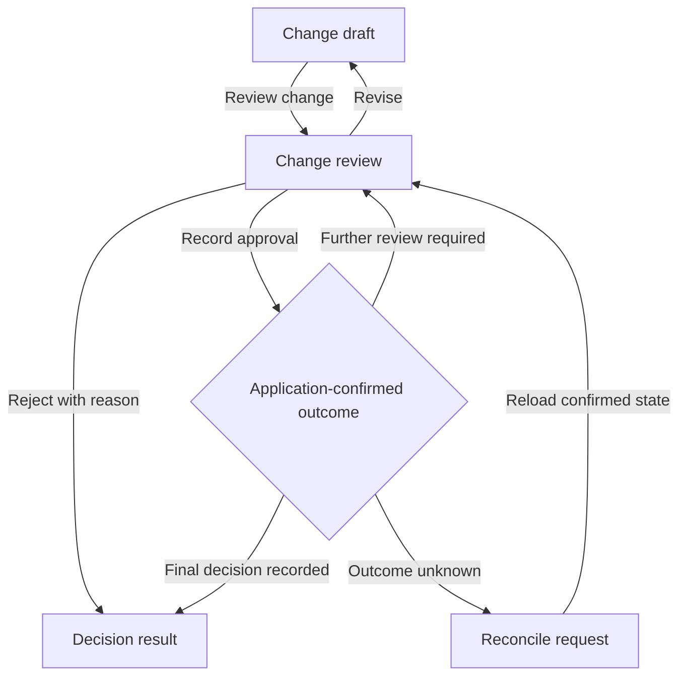
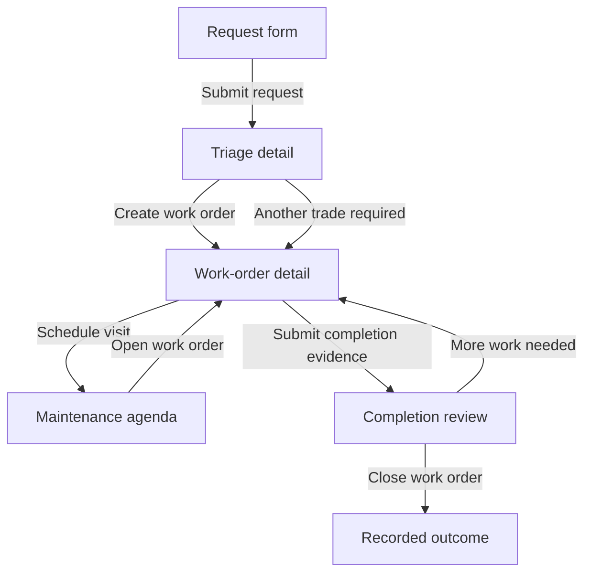

# Construction and Property: reference flows and proposed ten98 adaptations

Snapshot: **19 October 2026**. Scope and source-quality limits are in [evidence.md](evidence.md). **Observed** means documented by the named competitor; **proposed** means a ten98 design inference for review. Public examples were inspected, not exercised against real accounts or devices. No product feature or shared component was implemented by this research fork.

## Scope coverage

| Current matrix area | Flow |
| --- | --- |
| Construction shell, resource tables, task/status, fields, activity and project rules | C1 |
| Construction schedule | C2 |
| Plan viewer | C3 |
| Field inspection workflow | C4 |
| Procurement | C5 |
| Budget calculations, approvals, quantity/cost editor | C6, with measurement input from C3 |
| Field synchronization | C7 |
| Property records, portfolio resources | P1 |
| Tenancy rules and operational access | P2 |
| Maintenance calendar | P3 |
| Device authorization and protocols | P4 |
| Floor-plan/device map | P5 |
| Building controls, device cards/status | P6 |
| Automation editor and execution | P7 |
| Property settings, activity and consequential actions | P2, P4, P6, P7 |

## Shared state and access contract — proposed for all flows

Assumed users: desktop project/property operators, field staff using a phone/tablet, and separately authorized residents, vendors and installers. Persona and device priorities need owner confirmation; they are not discovered ten98 user-research facts.

| State | Required presentation and recovery |
| --- | --- |
| Empty | Explain the missing object, keep scope visible, offer the next permitted action. Filtered empty offers Clear filters. |
| Loading | Retain the selected scope and any usable prior data; identify the region loading. A skeleton never implies a measured progress percentage. |
| Error | Preserve drafts; associate validation with fields. Name the failed operation and a safe next action. |
| Permission | Explain read-only access or the unavailable action. Server enforcement and rechecking at submission are application-owned. |
| Stale | Show when the displayed data was observed; identify if refresh failed. Never convert missing or unknown measurements to zero. |
| Pending / uncertain | Show whether an item is only local, submitted, acknowledged or confirmed. If the outcome is unknown, reconcile before presenting a retry that could duplicate work. |
| Partial | Keep successful items visible and itemize failures. One failure does not erase successful uploads or device outcomes. |

Every flow below inherits this table; each lists its material exceptions. Route links preserve scope/filter state and browser Back behavior. Use `AppBrand`/Campaign icon vocabulary in the shared shell. Side navigation can scroll by wheel, touch and keyboard while its scrollbar remains visually hidden per the owner. Main content and tables still need usable overflow paths.

`DataTable` supplies local search, sorting and pagination for a small dataset. Construction, portfolio and device inventories that need server queries, remote totals or virtualization require an application-owned table integration using the shared visual tokens. Do not label one server page as the whole collection.

Accessibility throughout is a **ten98 requirement**, not a claim of competitor compliance: visible labels, semantic tables, meaningful status text, retained focus, keyboard alternatives to dragging, zoom/wrapping, reduced motion and RTL review. Drawings and spatial controls need a text/list equivalent for the tasks that can be expressed without the visual surface.

## Construction

### C1 — Project scope and task workspace

**Observed:** Fieldwire opens a project into Plans and organizes tasks by status/category. Procore's inspection documentation distinguishes project templates and permissions. Buildertrend centralizes organizational project-management settings, including schedule-view defaults. [Fieldwire navigation](https://help.fieldwire.com/hc/en-us/articles/360016524971-Getting-started-with-Fieldwire), [Procore inspection setup](https://support.procore.com/products/online/user-guide/project-level/inspections/tutorials/create-a-project-level-inspection), [Buildertrend settings](https://buildertrend.com/help-article/project-management-settings/).

**Proposed goal:** an authorized operator finds the correct project and acts on a scoped task. Entry: project list, assigned task or direct link. Success: the task/resource detail is open with an unambiguous project context.

| Screen | Intent / primary action | States and safeguards |
| --- | --- | --- |
| Projects | Search/filter; **Open project** | No projects differs from no access and filtered empty |
| Project overview | See assigned work and current facts; **Open task** | Preserve stale timestamps; permissions may differ by tool |
| Task detail | Read ownership, location, due date, evidence and activity; **Update task** | Show unsaved edits, conflicting updates and pending saves |
| Project settings | Edit a named policy section; **Save settings** | Explain which future records change; do not silently rewrite existing inspections |

Reuse `AppShell`, `PageHeader`, `ResourceCard`, `DataTable`, `Badge`, `Field`, `SettingsSection`, `ActivityFeed`. Use the table only for a small local dataset; server query/pagination remains app-owned. No generic project engine is needed in the library.

### C2 — Master schedule and field lookahead

**Observed:** Procore's current Scheduling offers Gantt, Table and Calendar, expandable work breakdown groups and timeline zoom. Buildertrend documents a critical-path toggle, phases and workday exceptions. [Current Procore view flow](https://support.procore.com/products/online/user-guide/project-level/scheduling/tutorials/view-a-schedule), [Buildertrend advanced schedule](https://buildertrend.com/help-article/advanced-schedule-overview/).

**Proposed goal:** review or update a scheduled activity without losing its dependencies. Preconditions: known project calendar/time zone, schedule revision, edit rights and an application-owned schedule model. Entry: project Schedule or linked activity. Success: an acknowledged revision with impacts visible.

| Screen | Intent / primary action | States and safeguards |
| --- | --- | --- |
| Schedule | Choose time window/view; **Open activity** | Empty schedule and failed import differ; identify read-only imported source |
| Activity detail | Review dates, owner and dependencies; **Save activity** | Validate cycles/calendars in app; show affected items before committing a consequential change |
| Save result | Inspect updated dates/revision; **Return to schedule** | Reconcile stale revision instead of overwriting another edit |

Reuse `Tabs`, `Field`, native date inputs, `Select`, `Badge`, `Alert`, `ActivityFeed`. A **Gantt/timeline is a proposed specialized extension**, not an existing export. Provide editable list/detail forms as the keyboard and narrow-screen path. Do not use Fieldwire's short task planning as proof that a master scheduling engine is covered.

### C3 — Find a plan, inspect revisions and measure

**Observed:** Fieldwire's plan list/grid exposes folder, version and task context. A sheet can hold pinned tasks. Its measurement tool requires a scale; changing calibration changes derived measurements. [Plans](https://help.fieldwire.com/hc/en-us/articles/360018233192-Introduction-to-the-Plans-tab-Web), [pinned task](https://help.fieldwire.com/hc/en-us/articles/360003458332-Introduction-to-Tasks), [calibration](https://help.fieldwire.com/hc/en-us/articles/211449806-How-to-use-the-measurement-and-calibration-tools).

**Proposed goal:** inspect the intended sheet/revision and capture a traceable observation or quantity. Preconditions: authorized drawing and revision metadata; units/scale before measurement. Entry: Plans, task link or search. Success: saved observation/quantity linked to a specific revision.

| Screen | Intent / primary action | States and safeguards |
| --- | --- | --- |
| Plans | Filter discipline/building/version; **Open sheet** | Same sheet number can occur in different buildings; show full scope |
| Sheet viewer | Read revision and tasks; **Add observation** | Distinguish archived, cached, latest-known and confirmed-current; offer accessible task list |
| Measurement detail | Confirm calibration, units and source; **Save measurement** | No scale means no trusted result; show recalculation impact when changing scale |

Reuse `PageHeader`, `ResourceCard`/app-owned table, `Tabs`, `Field`, `Input`, `Alert`, `Dialog`. Viewer, annotation and quantity extraction remain proposed extensions/app engines. Avoid pointer-only pin creation: provide a location/reference form. On mobile, open sheet and inspector as separate views with a persistent return path.

### C4 — Perform and resolve an inspection

**Observed:** Procore uses company/project templates, then an inspection instance with assignees and dates. Each item accepts its response type plus comments, attachments and observations; item activity records changes. Marking a section N/A can replace previous responses. [Create](https://support.procore.com/products/online/user-guide/project-level/inspections/tutorials/create-a-project-level-inspection), [perform](https://support.procore.com/products/online/user-guide/project-level/inspections/tutorials/perform-an-inspection).

**Proposed goal:** a field inspector records evidence and submits a complete inspection for the app-defined next stage. Preconditions: template revision, assignment, location and access; cached inputs if offline is supported. Entry: assignment or plan/location. Success: server-acknowledged submission, with unresolved findings retained.

| Screen | Intent / primary action | States and safeguards |
| --- | --- | --- |
| Inspection setup | Review template/location/assignee; **Create inspection** | No template explains the prerequisite; no template edit is retroactive by surprise |
| Inspection items | Answer and capture evidence; **Review inspection** | Per-item required responses, upload status, N/A reason; preserve local drafts |
| Inspection review | Resolve missing items; **Submit inspection** | Confirm bulk N/A replacement; distinguish locally queued from submitted |
| Inspection result | Read outcome and findings; **Open finding** | Completion of checklist is not proof that defects are resolved |

Reuse `Accordion`, `Field`, native controls, `Badge`, `Alert`, `Progress` only with real counts, `ActivityFeed`, `Dialog`. Native file input first; a reusable evidence-upload presentation is only a candidate gap. One section at a time on phones; keep saved/queued feedback near each item.

### C5 — Procurement commitment

**Observed:** Procore creates a purchase order under Commitments and gathers basic information, access, dates, schedule-of-values lines and attachments. It supports manual or CSV line entry and saving a draft. [Purchase-order flow](https://support.procore.com/products/online/materials-user-guide-with-project-financials/create-a-purchase-order).

**Proposed goal:** prepare and route an accurate commitment. Preconditions: supplier, project, budget references, currency, permissions and app-defined approval policy. Entry: procurement register or related change. Success: acknowledged draft/submission with its exact commercial status.

| Screen | Intent / primary action | States and safeguards |
| --- | --- | --- |
| Commitments | Find existing commitment; **Create purchase order** | Show duplicate/reference checks where the app can substantiate them |
| Purchase-order draft | Enter supplier, lines, delivery and evidence; **Review order** | Retain values on import/validation failure; name currency and quantity units |
| Order review | Inspect totals, recipients and approval route; **Submit for approval** | Server recalculates totals; show outcome uncertainty instead of automatic resend |
| Order detail | Follow status and audit history; **Open current review** | Submitted, approved, issued and supplier-accepted are separate domain decisions |

Reuse `Field`, `Input`, `Select`, `Card`, `Badge`, `ActivityFeed`, `Alert`. An editable line-item grid is a gap; begin with native line-item forms unless demonstrated scale justifies it. CSV import, purchasing rules, issuing and supplier communications belong to Construction.

### C6 — Budget, quantities and cost-change approval

**Observed:** Autodesk's Budget has a deliberate edit mode, quantity/unit/unit-cost columns, a row detail flyout and budget locking. A potential change order links cost items to affected budgets/contracts. Its approvals display reviewers and outcomes; final internal approval may produce Submitted rather than Approved. [Budget](https://help.autodesk.com/cloudhelp/ENU/Build-Cost/files/budgets-and-contracts/Cost_Work_with_Budgets.html), [potential change](https://help.autodesk.com/cloudhelp/ENU/Build-Cost/files/change-orders/Cost_Potential_Change_Orders.html), [approval semantics](https://help.autodesk.com/cloudhelp/ENG/Build-Cost/files/collaborate/Cost_Approval_Workflows.html).

**Proposed goal:** an authorized reviewer decides a specific financial change with its impact visible. Preconditions: versioned baseline, exact application calculations, related commitments and review policy. Entry: budget row, change register or assignment. Success: recorded decision with the resulting financial/workflow state shown.

| Screen | Intent / primary action | States and safeguards |
| --- | --- | --- |
| Budget | Compare original, approved, pending and forecast values; **Open line item** | Unknown values are not zero; format currency without changing precision |
| Change draft | Enter reason and linked quantity/cost changes; **Review change** | Show source revision and units; app calculates and validates |
| Change review | Inspect old/new values, documents and current reviewer; **Record decision** | Revise returns to editable draft; explain consequence of every available decision |
| Decision result | Read decision and next owner; **Open next action** | Distinguish internal review, external approval and committed cost |

Reuse `Card`, `Field`, `Badge`, `ActivityFeed`, `Alert`, `Dialog`. Do not force branching/rejected review states into `Stepper`, which visually completes earlier steps. A reusable approval summary and before/after values may be justified; approval policy and money calculations stay in the application.



### C7 — Work offline and reconcile

**Observed:** Fieldwire mobile can read downloaded content and create changes offline after prior authentication; changes sync when connected with the app open. Offline task numbers are assigned after server contact. This is documented for its mobile apps, not proof a React browser automatically behaves the same way. [Offline behavior](https://help.fieldwire.com/hc/en-us/articles/202631944-Q-A-Can-I-use-Fieldwire-while-offline).

**Proposed goal:** field work survives connection loss and becomes reconciled server data. Entry: before leaving coverage or a connection interruption. Preconditions: the application actually implements durable local storage, upload queue and reconciliation. Success: every item acknowledged or explicitly left needing attention.

| Screen | Intent / primary action | States and safeguards |
| --- | --- | --- |
| Field readiness | Check downloaded project/revision scope; **Prepare for offline work** | Show missing assets and capacity/auth limitations |
| Field work | Capture observations; **Save locally** | Explicit local-only label, stable local identifier, separate media progress |
| Sync status | Inspect queue and conflicts; **Review items needing attention** | Separate waiting, uploading, acknowledged, conflicted and uncertain |
| Conflict detail | Compare retained local and server versions; **Resolve conflict** | No silent last-write-wins; retain both versions until resolution is accepted |

Reuse `Alert`, `Badge`, `ActivityFeed`, `Accordion`, `Progress` with byte/item counts when available. A sync-status composition is a candidate shared pattern, not an offline engine. Keyboard and screen-reader users need a stable queue list; announce summaries rather than every chunk uploaded.

## Property

### P1 — Portfolio, property and leasable unit

**Observed:** Buildium uses property as the hub for units, leases and transactions. DoorLoop's guided flow selects type, address, unit details, accounts and ownership; its public screenshot uses a progress trail and descriptive subtype choices. [Buildium property flow](https://help.buildium.com/hc/s/article/How-do-I-add-a-rental-property-1557495011111), [DoorLoop illustrated flow](https://support.doorloop.com/en/articles/6085796-add-a-new-property).

**Proposed goal:** create or locate an accurate property record and its leasable spaces. Preconditions: ownership model, address/time zone and operator access. Entry: portfolio list or direct resource link. Success: saved record with units and next permitted tasks.

| Screen | Intent / primary action | States and safeguards |
| --- | --- | --- |
| Portfolio | Search/filter property; **Open property** | Keep vacant, archived and inaccessible distinct |
| Property details | Name/address/type/scope; **Save property** | Minimal required fields; keep local formats and manually editable address |
| Units | Identify leasable spaces; **Add unit** | Flag duplicate identifiers within scope; room, device area and leasable unit may differ |
| Property overview | Read occupancy, maintenance and device availability; **Open selected resource** | Separate data freshness by subsystem |

Reuse `ResourceCard`, `DataTable`, `PageHeader`, `Field`, `Select`, `Tabs`, `EmptyState`. **Do not adopt DoorLoop's duplicate-property workaround for mixed use by default.** ten98's property/building/floor/unit/room model is an explicit decision. Do not block record creation on accounting unless the selected product rules require it.

### P2 — Tenancy records, renewal and access

**Observed:** Buildium adds tenant and lease together from Rent roll, separates signed/unsigned, records property/unit/dates and rent/deposit charges. Its renewal flow shows current terms while creating the next period. These are product behaviors, not universally valid tenancy rules. [Add lease](https://help.buildium.com/hc/s/article/How-do-I-add-a-lease-1557495014686?r=41), [renewal](https://help.buildium.com/hc/s/article/Announcement-New-Lease).

**Proposed goal:** record or renew a tenancy with clear effective dates and access scope. Preconditions: property/unit, permitted operator, applicable tenancy policy and document revision. Entry: unit or rent roll. Success: acknowledged record; execution/signature and access provisioning each retain their own status.

| Screen | Intent / primary action | States and safeguards |
| --- | --- | --- |
| Tenancy record | Review parties, dates and status; **Edit tenancy** | No record differs from draft, unsigned, active or ended |
| Renewal draft | Compare current/proposed terms; **Review renewal** | Show overlapping periods and pending changes; retain draft on validation error |
| Renewal review | Inspect terms and effective date; **Save renewal** | Keep signature state and tenancy-effective state separate; derive each from applicable app rules. Email delivery does not establish signature |
| Access settings | Review resident/operator/vendor scope; **Save access policy** | Lease status and device access are not automatically equivalent; server owns authorization |

Reuse native fields, `Card`, `Badge`, `ActivityFeed`, `PermissionMatrix` for simple role capability drafts, and `Dialog`. Per-property/room/time-limited access needs an application policy editor, not an implied capability of that matrix. Jurisdictional calculations, signatures, eligibility decisions and lock authorization remain app/human responsibilities.

### P3 — Maintenance request to work order and calendar

**Observed:** Buildium allows multiple work orders under a task, separate work-order due dates and linked bills. AppFolio residents provide issue/photos, entry permission and availability, then see a request timeline. Vendors can estimate, schedule, mark work done and invoice; their guide distinguishes review/payment states. [Buildium work orders](https://help.buildium.com/hc/s/article/How-to-use-work-orders), [AppFolio resident flow](https://www.appfolio.com/help/online-portal), [vendor flow](https://www.appfolio.com/help/vendor-portal). Buildium describes a maintenance calendar populated from tasks/work orders. [Calendar feature](https://www.buildium.com/features/property-management-maintenance-software/).

**Proposed goal:** route a reported issue to completed, reviewed work while keeping the resident informed. Entry: resident request, operator task or planned maintenance. Success: app-confirmed closure with outstanding commercial steps separately visible.

| Screen | Intent / primary action | States and safeguards |
| --- | --- | --- |
| Request form | Describe location/issue and access; **Submit request** | Preserve photos/draft; explain submission pending or unavailable |
| Triage detail | Review urgency, duplication and scope; **Create work order** | Emergency handling is an explicit operating policy, not an assumed automated rule |
| Work-order detail | Assign vendor/time window and expected work; **Schedule visit** | Request due date, work due date and visit appointment are separate fields |
| Maintenance agenda | Filter date/property/assignee; **Open work order** | Unscheduled work remains visible; use property time zone |
| Completion review | Inspect evidence/outcome; **Close work order** | Work done, manager accepted, invoiced and paid are independent states |

Reuse `Field`, native file/date/time controls, `Badge`, `Card`, `ActivityFeed`, `Tabs`, app-owned table and `Dialog`. Start calendar with an accessible agenda; grid/calendar is a proposed extension. One request can contain multiple trades, so avoid a progress indicator that claims every related order is complete.



### P4 — Connect and authorize a device

**Observed:** Home Assistant Matter branches between new devices and devices already used with another controller. ZHA requires a coordinator, discovery and manufacturer pairing; a Zigbee device belongs to one network. Apple supports accessory setup by code and room assignment, and distinguishes removing a Matter accessory from Keychain, one service or all services. KNX/ETS separates configuration from downloading to a physical device. [Matter](https://www.home-assistant.io/integrations/matter/), [ZHA](https://www.home-assistant.io/integrations/zha/), [Apple setup](https://support.apple.com/en-nz/guide/iphone/iph125110541/ios), [Matter removal](https://support.apple.com/en-ca/102135), [ETS example](https://www.knx.org/news/ets6-and-knx-virtual).

**Proposed goal:** add the intended device/controller and establish its real capabilities. Preconditions: authorized operator, known integration, required network/hardware and physical-device access when needed. Entry: Devices or integration settings. Success: integration-confirmed discovery/commissioning followed by separately recorded verification.

| Screen | Intent / primary action | States and safeguards |
| --- | --- | --- |
| Integration choice | Select existing controller or supported protocol path; **Continue setup** | Explain capability-specific prerequisites, not one universal hub requirement |
| Pair/discover | Follow the selected protocol's steps; **Identify device** | Timeout, already paired, wrong network and permission denied need different recoveries |
| Device assignment | Confirm identity and location; **Save assignment** | Preserve discovered-but-unassigned devices; do not expose pairing codes in shared logs |
| Verification | Read supported capability and observed result; **Check device** | Added/configured/downloaded/verified are separate facts |
| Removal review | Identify device, selected controller/service and affected automations; **Remove selected connection** | Explain remaining access; reconcile uncertain removal before retry. Removing a saved code, one service and all services must not share an ambiguous label |

Reuse `ResourceCard`, `Field`, `Select`, `Alert`, `Badge`, `Accordion`, `Dialog`. A native file control can cover a future configuration import. Stepper is suitable only for a truly linear path whose earlier steps completed. Direct protocol drivers and existing-controller federation are unresolved architecture choices; no shared UI should promise both.

### P5 — Locate devices by building, area and map

**Observed:** Home Assistant groups areas into floors and assigns devices/entities to areas. It supports explicit unassigned areas and editing location assignments; deleting areas can affect automation targets. [Area organization](https://www.home-assistant.io/docs/organizing/areas/).

**Proposed goal:** locate a resource and move its presentation assignment without accidentally changing tenancy or control authorization. Preconditions: selected ten98 spatial model and a valid plan revision if a map exists. Entry: property, location or device search. Success: acknowledged assignment with affected references visible.

| Screen | Intent / primary action | States and safeguards |
| --- | --- | --- |
| Locations | Browse/search hierarchy; **Open area** | Include Unassigned; handle long and duplicate names with parent context |
| Area devices | Switch list/map; **Open device** | No floor plan still provides a usable list; stale map revision is labelled |
| Assignment form | Select location or pin; **Save assignment** | Keyboard picker/coordinates alternative; show automation impact before removing an area |

Reuse `Breadcrumb`, `ResourceCard`, `DataTable`, `Field`, `Dialog`. Hierarchical navigation and the floor-plan overlay are potential extensions. The map is an alternate view of resources, not their sole navigation or authorization boundary. Do not force every tenancy unit to equal a controller's area.

### P6 — Control devices and reconcile reported state

**Observed:** Home Assistant's card controls follow entity capabilities. KNX can use distinct command and state addresses; feedback is recommended, and restored values may be assumed rather than observed. ETS diagnostics can be inconclusive. [Card features](https://www.home-assistant.io/dashboards/features/), [KNX feedback](https://www.home-assistant.io/integrations/knx/), [ETS diagnostics](https://support.knx.org/hc/en-us/articles/360019068120-Groups-Diagnostics).

**Proposed goal:** perform a permitted control action and understand its confirmed or uncertain outcome. Entry: area/device detail. Preconditions: current authorization, capability, limit/unit and trustworthy state metadata. Success: observed acknowledgement at the level the integration can substantiate.

| Screen | Intent / primary action | States and safeguards |
| --- | --- | --- |
| Device detail | Read observed state/time/capability; **Set target** | Unknown differs from off; sensor-only devices offer readings rather than switches |
| Command pending | Compare requested target and reported state; **View command status** | Do not optimistically overwrite evidence; stop unsafe duplicate attempts |
| Command result | Inspect reported/assumed/partial result; **Return to device** | Timeout becomes unconfirmed; reconcile before repeating consequential actions |
| Diagnostics | Read connection/last-seen/failure scope; **Check connection** | Connection health is not proof of physical effect; reset is a separate action |

Reuse `ResourceCard`, `Badge`, `Field`, native numeric/range inputs, `Alert`, `ActivityFeed`, `Accordion`. A controlled `Switch` is presentation only; the app must model pending intent separately. New device-control presentation is a justified candidate only after the acknowledgement contract is specified. Group actions need per-device outcomes. Keep unit-bearing numeric alternatives beside sliders.

### P7 — Scenes, automation and run inspection

**Observed:** Apple scenes choose accessories and target states, offer a test and then save. Home Assistant's editor separates triggers, conditions and actions. Its Run actions command bypasses triggers and top-level conditions; traces expose executed steps. [Apple scenes](https://support.apple.com/en-nz/102313), [Home Assistant editor](https://www.home-assistant.io/docs/automation/editor/), [testing/traces](https://www.home-assistant.io/docs/automation/testing/).

**Proposed goal:** create a comprehensible automation and inspect why it did or did not run. Preconditions: targets/capabilities, authorization and application execution semantics. Entry: Automations or selected device. Success: saved rule with explicit enabled state, plus separately identified test/run evidence.

| Screen | Intent / primary action | States and safeguards |
| --- | --- | --- |
| Automation list | Find rule and enabled state; **Edit automation** | Empty list and no permission differ |
| Automation draft | Define when/if/then or scene targets; **Review automation** | Preserve edits; show deleted targets and unavailable capabilities |
| Automation review | Check targets and enable behavior; **Save automation** | Separate Save from Run actions now; a test can change real devices |
| Runs | Select timestamp/outcome; **Inspect run** | Not triggered, condition false, partially executed, failed and cancelled differ |
| Run detail | Read step inputs/results; **Open affected device** | Redact secrets; identify bypassed conditions and execution mode |

Reuse `Field`, `Select`, `Accordion`, `Card`, `Badge`, `ActivityFeed`, `Tabs`, `Alert`. Start with a structured step list. Branching canvas and run graph are proposals shared with `ten98-connect` only after a real flow requires them; neither implies a shared execution engine.

## Low-fidelity compositions — proposals, not competitor screenshots

These reuse the same reading order in both apps. Each screen has one primary task action; alternatives stay secondary.

```text
Project: Marina refurbishment > Inspections > Fire doors
Inspection: Level 2                         [Draft saved locally]
Location / assignee / template revision / due date
Section 2 of 5 — Door hardware
  Item 2.1  Closer operates correctly
  ( ) Pass  ( ) Fail  ( ) Not applicable
  Observation [                                ]
  Evidence    [Choose files]  2 saved / 1 waiting
  Last saved on this device: 14:32
                                   [Review inspection]
```

```text
Project: Marina refurbishment > Change 018
Replace corridor finishes                       [In review]
Reason / scope / linked drawing revision
             Original        Proposed          Difference
Quantity     120 m²          132 m²             +12 m²
Cost         [app value]     [app value]        [app value]
Current reviewer / due date / previous decisions
Decision [Approve for next review v]  Consequence explained
Comment [                                                ]
                                      [Record decision]
```

```text
Property: Marina House > Unit 204 > Request 381
Water leak                                      [Visit scheduled]
Request received / visit window / entry permission
Work orders: Plumbing [Scheduled] | Painting [Unassigned]
Evidence and resident-visible updates
Internal notes [restricted by app permissions]
                                             [Open work order]
```

```text
Property: Marina House > Floor 2 > Lobby > Thermostat
Room temperature: 24 °C                    [Online]
Reported setpoint: 24 °C   Observed: 14:32
Requested setpoint: 22 °C                  [Awaiting device]
Target temperature [22] °C   allowed range shown
Mode [Cool v]
Latest command and device feedback
                                      [View command status]
```

Compare the requested and reported **setpoints** when reconciling the thermostat command. The room reaching that temperature is a separate physical outcome.

```text
Automation: Lobby evening lights                  [Disabled]
When: sunset in property's configured time zone
If:   building operating hours allow the action
Then: Lobby lights → 40%  |  Reception lights → 60%
Missing targets: none
Save behavior: remains disabled until explicitly enabled
                                              [Save automation]
Separate secondary action: Run actions now — changes devices
```

## Acceptance before promoting a composition into the library

Review the real application flow, not only a catalogue mock. Validate an empty tenant/project, scoped permissions, slow/failed requests, unknown outcomes, stale data and one partial result. Verify phone layout, keyboard path, screen-reader status, 200% zoom and LTR/RTL. For plans and devices, use actual app fixtures that expose revision and feedback semantics. The shared package must not invent backend success, totals, calibration or policy enforcement. See [recommendations](recommendations.md) for the decisions still required.
