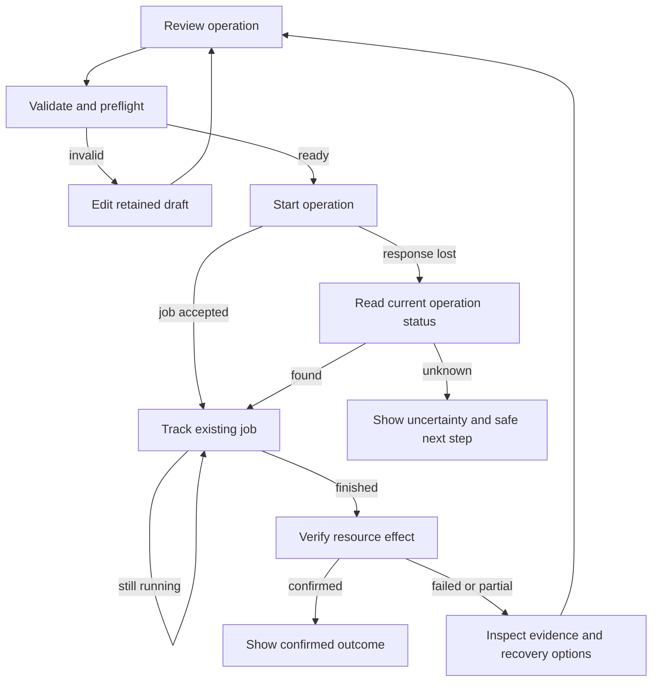

# Monitor and Server: observed flows and proposed ten98 UX

Research snapshot: **19 October 2026**. These are reviewable design proposals, not accepted product requirements. Evidence and shortlist methodology are in [evidence.md](evidence.md); decisions are in [recommendations.md](recommendations.md).

**Observed** means a public official guide or screenshot describes the behavior. **Live observed** means the public UI was exercised. **Proposed** is this research's synthesis for ten98. Competitor documentation does not establish ten98 behavior or prove competitor accessibility. Sources were accessed on the research date.

Assumed users are developers investigating errors, responders managing incidents, and authorized infrastructure/device operators. Primary desktop workflows should retain a useful narrow-screen path for triage. Exact estate size, operating systems, on-call model and backend capabilities remain open product decisions.

## Scope-to-flow coverage

| Matrix area | Flow IDs | Shared foundation / boundary |
| --- | --- | --- |
| Monitor collection | M1 | Setup forms and receipt status; collectors and credentials belong to the app |
| Metrics, sparklines, tables, alerts and activity | M2–M6, M10 | Existing presentation components; metric computation and remote query behavior belong to the app |
| Alert evaluation | M5 | Settings and preview states; evaluation/routing engine belongs to the app |
| Incident state | M6 | Header, actions, history; state transitions/concurrency belong to the app |
| Fleet actions | M7 | Device list/detail and action review; enrollment/MDM/execution belong to the app |
| Retention | M9 | Explicit scoped settings; retention/deletion processing belongs to the app |
| Log/trace explorer; real-time investigation | M2–M4 | Specialized extension proposal; query, streaming, sampling and redaction remain app-owned |
| Topology graph; incident timeline | M6, M8 | Specialized extension proposals, with table/list alternatives |
| Server resource tables, metrics, configuration and activity | S1–S8 | Existing foundations compose the basic screens |
| Hypervisor/container orchestration | S2–S4 | Guest/workload forms and result states; execution belongs to the app |
| Remote access | S6 | Session status and controls; transport and authorization belong to the app |
| RBAC | S8 | Access explanation and forms; enforcement belongs to the app |
| Task execution and recovery | S7 | Task list/detail, review and recovery result; job/recovery engine belongs to the app |
| Resource tree, VM editor | S1–S2 | Specialized extension only after a concrete navigation/editor requirement |
| Storage/network topology | S5 | Scoped configuration and dependency views; real topology belongs to the app |
| Terminal/console and task console | S6–S7 | Specialized display/input integration; sessions and job state remain app-owned |

## Monitor flows

### M1 — Connect a source and prove first data arrived

**Goal:** an authorized operator can identify the source, install/configure it, and verify receipt. Entry points: empty project, Connections, or a resource with missing telemetry.

**Observed:** GlitchTip creates an organization/project, selects the platform and team, then provides project-specific SDK/DSN setup. A test exception produces the first issue. New Relic's guided installation discovers supported software and offers matching integrations. Zabbix creates a host with identity, templates/groups and interfaces; active-agent naming must match the configured host. [GlitchTip setup](https://glitchtip.com/documentation/getting-started/), [test error](https://glitchtip.com/documentation/error-tracking/), [New Relic guided install](https://docs.newrelic.com/docs/infrastructure/infrastructure-agent/new-relic-guided-install-overview/), [Zabbix host form/screenshots](https://www.zabbix.com/documentation/current/en/manual/config/hosts/host).

**Proposed sequence:** choose scope and signal type → enter only required connection information → review generated instructions → install/test externally → verify first receipt → open the resulting resource. Keep credentials scoped and reveal only what the current operator may receive.

States: not configured; draft invalid; instructions ready; awaiting connection; connected but no events; first event confirmed; unauthorized; transport error; partial signal types; stale receipt. A saved form is not a connected collector. Errors retain the draft and offer edit/check status. Installation and receipt checks may finish after navigation; the app supplies persistent status.

Reuse `Stepper`, `Field`, `Input`, `Select`, `CopyButton`, `ResourceCard`, `Badge`, `Alert`, `Button`. `Stepper` only displays progress; it does not execute steps. Keep generated commands in a labelled, scrollable code region and supply a keyboard copy path.

### M2 — Carry investigation context from metrics to evidence

**Goal:** explain an abnormal measurement without losing service, environment and time scope.

**Live observed:** Grafana Play Explore places source/time controls before queries, with graph/table results and an inspector containing request statistics and data tabs. **Documented:** Grafana correlations can open a related query in split view using a selected log's fields; missing required fields prevent the link. Exemplars can open trace timing/spans. Datadog distinguishes recent live spans from indexed retained spans. [Public Explore](https://play.grafana.org/explore), [correlations](https://grafana.com/docs/grafana/latest/administration/correlations/use-correlations-in-visualizations/), [exemplars](https://grafana.com/docs/grafana/latest/visualizations/simplified-exploration/traces/investigate/view-exemplars/), [Datadog Trace Explorer](https://docs.datadoghq.com/tracing/trace_explorer/).

**Proposed sequence:** resource/service summary → choose metric/time interval → inspect anomaly → pivot to logs or trace using preserved context → inspect event/span → return to original result and selection. A pivot should disclose which filters transferred and which cannot transfer. Correlation is evidence, not proof of causality.

States: initial load; query running/cancelled; usable cached result while refreshing; confirmed zero; no matching records; unavailable source; partial sources; no trace identifier; sampled/expired evidence; stale result with last successful timestamp. Each panel reports its own result state. Never replace every panel because one source fails.

Reuse `PageHeader`, `MetricCard`, `Sparkline`, `Tabs`, `Card`, `Badge`, `Alert`. Date-only `DateRangeField` cannot express incident time windows; use labelled native `Input` controls with explicit timezone initially, and propose a proper time-range component only from a decided requirement. Split panes stack into result/detail views on narrow screens, preserving selection and a labelled return action.

### M3 — Read logs and traces without confusing absence with health

**Observed:** Grafana's explorer/correlation pattern supports query, results and detail; Datadog's live/indexed distinction changes available evidence by time range. Refer to M2 sources for those exact observations.

**Proposed sequence:** set source, time and filters → run query → read result count/coverage → open one log or trace → inspect structured attributes/spans → pivot or refine → save/share the query only if that feature is approved. A log region should offer pause/follow state, explicit resume and a retained scroll position. A trace should have a keyboard-readable ordered span list as well as any waterfall.

States: no source; invalid query; pending; no matches; truncated/limited result; partial backend response; source unavailable; retention boundary; paused stream; disconnected stream; stale result; redacted or forbidden field. Display count as loaded rows when total is unknown. Distinguish clear filters from broaden time range.

Reuse fields, badges, alerts, cards and disclosure controls. **Gap:** production log/trace explorer, query editor and virtualized result rendering. Existing `DataTable` operates on a small local dataset; it does not implement remote pagination, a log engine or span hierarchy. Streaming, query cancellation, redaction and retention are app responsibilities. Do not announce every incoming line to assistive technology; provide a bounded summary and manual read path.

### M4 — Triage a grouped error and inspect one event

**Observed:** Sentry separates issue-wide occurrence/user impact from the selected event's stack, breadcrumbs and tags. Resolve and Archive have different behavior; the breadcrumb redesign moves the full list into a separate detail surface. [Issue details](https://docs.sentry.io/product/issues/issue-details/), [issue states](https://docs.sentry.io/product/issues/states-triage/), [breadcrumb visual reference](https://sentry.io/changelog/improved-breadcrumbs-on-issues/).

**Proposed sequence:** filter issue queue → inspect impact and first/last occurrence → choose event → read stack and preceding activity → inspect correlated trace → assign/link work → resolve or suppress using explicit semantics → verify later occurrences. Completion is the app's confirmed triage outcome, not merely opening an event.

States: no issues; filtered empty; no source map; partially symbolicated stack; event expired while group remains; restricted payload; stale issue status; pending assignment; conflict from another responder; failed mutation; confirmed resolution; recurrence. Label missing evidence without erasing the rest of the issue. Preserve selected event when navigation returns.

Reuse `DataTable`, `PageHeader`, `Badge`, `Card`, `ActivityFeed`, `Accordion`, `Dialog`. **Gap:** structured stack-trace viewer and high-volume event navigation. Keep global impact and event metadata in visibly distinct sections. Use monospace tokens for identifiers, but readable body text for explanations. A disclosure can contain long breadcrumbs without adding another permanent scrolling sidebar.

### M5 — Configure detection, then verify delivery

**Observed:** Grafana's current rule flow includes source/condition, preview, evaluation, no-data/error handling and notification routing. Query success with no data differs from evaluation failure; current defaults/pending behavior must be checked against the deployed version. Current Sentry distinguishes Monitors, which create issues, from Alerts, which route notifications. [Grafana rule creation](https://grafana.com/docs/grafana/latest/alerting/alerting-rules/create-grafana-managed-rule/), [no-data/error states](https://grafana.com/docs/grafana/latest/alerting/fundamentals/alert-rule-evaluation/nodata-and-error-states/), [Sentry Monitors and Alerts guide](https://www.sentry.help/en/articles/15007504-monitors-alerts-guide-and-faq).

**Proposed sequence:** choose monitored scope → define condition and timing → preview with example data → specify missing/error-data policy → select owner/recipient route → preview recipients → send an explicitly requested test → review and activate. Keep test-send result separate from saved configuration. An evaluation preview need not send a real notification.

States: draft; validation failure; preview pending/error; normal; pending threshold; firing; recovery pending; no data; evaluation error; paused evaluation; muted notification route; delivery pending/failed. Muted delivery must not render a service healthy. Show the scope and expiry of suppression. Route diagnostics should explain why a recipient matched.

Reuse `SettingsSection`, `Field`, `Input`, `Select`, `Accordion`, `Stepper`, `Alert`, `Badge`, `Button`. Start with native forms. **Possible later gap:** a rule builder, routing preview and relative time-range input. App owns evaluation, notification dispatch and throttling. Keyboard users must reach conditional fields in reading order; narrow layouts place the review summary after the form.

### M6 — Manage an incident and retain its evidence

**Observed:** Jira Service Management can create an incident from selected alerts and retains linked alerts. PagerDuty acknowledgement claims responsibility and pauses escalation; timeout can trigger escalation again. Reassignment to a user differs from reassignment through a policy. Zabbix distinguishes acknowledgement, suppression, severity and closing, including mixed-permission bulk results. [JSM incident from alerts](https://support.atlassian.com/jira-service-management-cloud/docs/create-incidents-with-alerts/), [PagerDuty incidents](https://support.pagerduty.com/main/docs/incidents), [reassignment](https://support.pagerduty.com/main/docs/reassign-incidents), [Zabbix problem actions](https://www.zabbix.com/documentation/current/en/manual/acknowledgment).

**Proposed sequence:** open incident → inspect affected service/severity/evidence → acknowledge or assign → investigate/record mitigation → review resolution reason → resolve → inspect outcome and follow-up. Acknowledging is not recovering the service. Concurrent responders need updated ownership and conflict feedback.

JSM's timeline supports event filters and historical event timestamps; its linked post-incident review preserves the primary incident. PagerDuty escalation configuration shows targets/timeouts; open incidents can retain the policy snapshot they started with. [JSM timeline](https://support.atlassian.com/jira-service-management-cloud/docs/what-is-the-incident-timeline/), [PIR](https://support.atlassian.com/jira-service-management-cloud/docs/create-and-publish-a-post-incident-review/), [escalation policy](https://support.pagerduty.com/main/docs/escalation-policies).

States: open/unacknowledged; assignment pending; acknowledged; investigating; suppressed until time; resolution pending; resolved; reopened; stale/concurrent edit; forbidden action; partial bulk success. In a bulk review show selected scope, eligible targets and per-target failures; never imply every selected incident changed. Distinguish event time from recorded time in the timeline.

Reuse `PageHeader`, `Badge`, `Avatar`, `Tabs`, `DataTable`, `Dialog`, `Textarea`, `ActivityFeed`. **Gap when justified:** a filterable incident timeline with event provenance. A PIR editor and chat bridge are new feature suggestions. On small screens show the current incident and primary action before timeline; details remain accessible by links/disclosures.

### M7 — Enroll, investigate and act on a device

**Observed:** Fleet enrollment selects a fleet/OS before giving installation or mobile enrollment instructions. Deleting a host record does not unenroll it. Fleet reports support scoped live queries, while offline hosts do not answer. Scripts run after host check-in, with per-host and batch progress; pending targets can be cancelled. [Enrollment](https://fleetdm.com/guides/enroll-hosts), [reports](https://fleetdm.com/guides/reports), [scripts](https://fleetdm.com/guides/scripts).

**Proposed sequence:** choose fleet/platform → issue scoped enrollment instructions → confirm check-in → inspect inventory and freshness → filter/select devices → review exact action, eligibility and scope → queue execution → track each result → reconcile failed/unknown devices. Provide a distinct decommission flow; removing a row must not imply removing management from hardware.

Intune separates compliance outcomes and last-check-in reporting; completion of its server-side delete action is not proof of device retirement. Fleet policy automation separates policy failure from the script it launches. Jamf inventory keeps pending/failed commands in Management; Iru/Kandji blueprint reassignment applies during later check-in. [Intune compliance](https://learn.microsoft.com/en-us/intune/device-security/compliance/monitor-policy), [device actions](https://learn.microsoft.com/en-us/intune/intune-service/fundamentals/reports), [Fleet policy scripts](https://fleetdm.com/guides/policy-automation-run-script), [Jamf inventory](https://support.jamf.com/en/articles/11037897-viewing-computer-s-inventory-information-in-jamf-pro), [blueprint reassignment](https://support.kandji.io/kb/move-a-device-to-a-different-blueprint-1).

States: not enrolled; enrollment pending; checked in; online/offline/stale; compliant/noncompliant/grace/not evaluated/error; unsupported action; insufficient permission; queued; waiting for check-in; running; successful; failed; cancelled before start; mixed batch; server accepted but device effect unknown. Keep observed policy state, intended policy and remediation result separate.

Reuse `ResourceCard`, `DataTable`, `Badge`, `Alert`, `Dialog`, `ConfirmDialog`, `ActivityFeed`, `Progress`. Use `Progress` only with a defensible denominator and label it “devices completed”, not fabricated task progress. App owns OS support, authorization, global selection, idempotency and retries. Fleet's [role matrix](https://fleetdm.com/guides/role-based-access) is a useful reference for separating saved-script execution from arbitrary script/destructive privileges. Every row action needs a keyboard path; a mobile detail page may replace a wide inventory table.

### M8 — Inspect dependencies with a graph and a table

**Observed:** Grafana Tempo pairs a RED metrics table with a service graph and supports filtering/pivots; some filters can return span metrics without graph data. Datadog maps observed instrumented services within time/environment scope, and missing spans can prevent a map. ServiceNow Dependency Views navigates a root configuration item and upstream/downstream relations with node/depth limits. [Tempo graph/screenshots](https://grafana.com/docs/tempo/latest/metrics-from-traces/service_graphs/service-graph-view/), [Datadog Service Map](https://docs.datadoghq.com/tracing/services/services_map/), [ServiceNow Dependency Views](https://www.servicenow.com/docs/r/servicenow-platform/dependency-views/c_BusinesssServiceManagementMaps.html), [node actions](https://www.servicenow.com/docs/r/servicenow-platform/dependency-views/t_PerformActionsOnNGBSMMap.html).

**Proposed sequence:** select scope/root/time → inspect coverage → choose node or dependency row → view evidence and neighbors → pivot to resource/incident/telemetry → return with selection intact. Label whether edges come from observed calls, configured dependencies or discovery; those are different claims.

States: no instrumentation; loading; empty filter; graph unavailable but metrics available; incomplete topology; node/depth limit; stale snapshot; forbidden node details. Display evidence timestamp and coverage. Do not infer root cause from proximity or an edge alone; [Dynatrace's causality explanation](https://docs.dynatrace.com/docs/dynatrace-intelligence/root-cause-analysis/concepts) also distinguishes temporal from causal relationships.

Reuse `Card`, `Badge`, fields, `Tabs` and a small local table where appropriate. **Gap:** graph rendering, navigation and scalable dependency data. The graph must have an equivalent keyboard-accessible list/table with node actions, and a narrow-screen selected-node detail mode. A graph library is not justified until actual dataset scale and interaction needs are known.

### M9 — Change retention with an explicit data boundary

**Observed:** Zabbix Housekeeping configures storage periods by data category, with audit retention separately configured. Loki's compactor handles retention asynchronously; its settings and object-store policies are distinct. Log deletion can have a cancellation period and can be filter-only or filter-and-delete. These are backend semantics, not a ready-made generic retention UI. [Zabbix Housekeeping](https://www.zabbix.com/documentation/current/en/manual/web_interface/frontend_sections/administration/housekeeping), [Loki retention](https://grafana.com/docs/loki/latest/operations/storage/retention/), [Loki deletion](https://grafana.com/docs/loki/latest/operations/storage/logs-deletion/).

**Proposed sequence:** select scope/signal → inspect current effective retention and authority → edit policy → review whether it affects existing data and when it applies → save → track policy application separately from physical deletion. If explicit deletion is later approved, give it a separate reviewed workflow with target/time/filter summary and the actual cancellation/irreversibility boundary.

States: inherited setting; local override; unsupported backend; read-only access; invalid duration; draft; stale policy revision; saved awaiting application; partial cleanup; failed cleanup; deletion scheduled/in progress/completed. Do not promise immediate disk reclamation or recovery. Retention and deletion runtime remain app-owned.

Reuse `SettingsSection`, `Field`, `Input`, `Select`, `Alert`, `Badge`, `ConfirmDialog`, `ActivityFeed`. Keep data periods and timezone visible. Copy must state verified backend behavior rather than adopt a competitor's defaults.

### M10 — Explain uptime and maintenance

**Observed:** GlitchTip separates outgoing HTTP checks from inbound heartbeat URLs. UptimeRobot setup selects target, alert contacts, interval and location; outage details expose error/time/location. Uptime Kuma maintenance selects affected monitors/status pages, schedule strategy and timezone, suppressing alerts while maintenance is active. [GlitchTip uptime](https://glitchtip.com/documentation/uptime-monitoring/), [UptimeRobot setup](https://help.uptimerobot.com/en/articles/11358364-how-to-create-your-first-monitor-on-uptimerobot-quick-setup-guide), [outage diagnostics](https://help.uptimerobot.com/en/articles/11358466-how-to-debug-a-monitor-showing-as-down-in-uptimerobot), [Uptime Kuma maintenance/screenshots](https://github.com/louislam/uptime-kuma/wiki/Maintenance).

**Proposed sequence:** create check → verify first result → inspect outage evidence → acknowledge/associate incident → schedule maintenance with exact scope and expiry → verify checks after maintenance. Completion of a maintenance form does not establish service recovery.

States: awaiting first check; up; retry/pending; down with reason; paused; maintenance scheduled/active/ended; check runner unavailable; stale last check; notification failed. Show last measured time and distinguish expired heartbeat from collector failure when data supports it.

Reuse `ResourceCard`, `MetricCard`, `Badge`, fields, `ActivityFeed` and native datetime inputs. Advanced recurrence and public status pages are new suggestions, not requirements silently added by this flow. An uptime percentage requires the app to define the denominator and maintenance treatment.

## Server flows

### S1 — Find a resource and connect a deployment server

**Observed:** Openship's server inventory leads to server details; adding a connected server collects SSH details with a separate Test Connection action, then setup checks/installs prerequisites. It distinguishes unreachable host, rejected credentials and incomplete configuration. [Openship Servers](https://openship.io/docs/dashboard/servers), [custom-server guide](https://openship.io/docs/guides/custom-servers).

**Proposed sequence:** select organization/cluster/environment → locate resource by search/list or hierarchy → inspect identity/last contact → add a server when authorized → test connection → review setup changes → start setup → track component results → open overview. A resource tree and search results must lead to the same durable resource URL.

States: no resources; no filter matches; tree children not loaded; partial inventory; disconnected node; stale summary; forbidden detail; invalid credential; test pending/failure; setup queued/running/partial/complete. Avoid expanding the whole estate on load. Keep the selected resource's parent scope visible.

Reuse `AppShell`, `PageHeader`, `Breadcrumb`, `ResourceCard`, `MetricCard`, `Badge`, native fields and `ActivityFeed`. **Gap:** an accessible lazy resource tree if confirmed necessary. A simple nested link list may cover the first release. Native links support browser history and modified clicks; the app owns routing. Hidden sidebar scrollbars must retain keyboard/wheel/touch scrolling.

Proxmox's [9.2 dashboard image](https://www.proxmox.com/images/proxmox/screenshots/Proxmox-VE-9.2-Datacenter-Dashboard.png) supplies the resource-tree/context-navigation/task-history visual precedent. Komodo's [server connection guide](https://komo.do/docs/setup/connect-servers) uses an onboarding key, agent installation and connection confirmation. Key lifetime/reuse must reflect backend enforcement; a one-time display does not imply single-use authorization.

### S2 — Create and change a VM with a reviewable resource plan

**Observed:** Proxmox's published VM wizard progresses from identity and OS/media through system, disks, CPU, memory, network and confirmation. Harvester's VM form includes namespace, allocations, SSH key, volumes, networks and scheduling; disk sizing and node pinning can constrain later operations. [Proxmox wizard image](https://www.proxmox.com/images/proxmox/screenshots/Proxmox-VE-8-1-VM-Wizard-with-VirtIO-driver-ISO.png), [Harvester 1.7 VM creation](https://docs.harvesterhci.io/v1.7/vm/index/).

**Proposed sequence:** pick cluster/node and template/media → identity/allocations → disks → network → advanced settings only as needed → review resource plan and restart implications → create/change → track task → verify guest state. Existing VM edits must show current values and the intended change; hot changes and changes requiring restart cannot share a misleading “saved and applied” message.

States: no eligible host/media; insufficient capacity; unsupported guest/device option; invalid allocation; conflict/duplicate identity; unavailable storage/network; dirty draft; permission loss; queued/running/failed creation; partial allocation; stopped/running/unknown guest; saved pending restart. Product rules decide capacity and compatibility, not generic controls.

Reuse `PageHeader`, `SettingsSection`, `Field`, `Input`, `Select`, `Checkbox`, `Stepper`, `Alert`, `Dialog`. **Gap:** a VM editor composition when a specific virtualization backend defines its schema. Use a full page for long forms; keep review values readable and link back to their editable section. On narrow screens, step labels wrap and review precedes the primary action.

### S3 — Deploy or adopt a container stack

**Observed:** Portainer adds a named stack from editor, upload, Git or template; Git configuration distinguishes repository reference and Compose paths. Komodo supports UI, host-file and Git sources; matching an existing project depends on its Compose project name. Openship config reviews the detected build before launching a separate deployment task. [Portainer Add stack](https://docs.portainer.io/user/docker/stacks/add), [Komodo Compose](https://komo.do/docs/deploy/compose), [Openship deploy wizard](https://openship.io/docs/dashboard/deploy-wizard).

**Proposed sequence:** choose environment → choose deploy-new or adopt-existing → identify source and revision/project name → configure required variables, ports and volumes → review intended service changes → deploy/adopt → inspect per-service outcome and logs. Make the source of truth explicit; a Git-managed resource should explain whether local edits will be overwritten.

States: no environment; unauthorized source; missing registry credentials; invalid Compose; unsupported option; missing variable; name collision; drift between discovered and configured stack; image pull/build failure; partial service startup; healthy; running but unreachable endpoint; unknown deployment result. A running container is not proof that the application endpoint works.

Reuse `ResourceCard`, `Field`, `Input`, `Textarea`, `Select`, `Accordion`, `Badge`, `Alert`, `Stepper`, task composition. **Gap:** structured Compose/code editor or diff viewer only after native text editing proves insufficient. Variables and logs can contain secrets; app controls redaction and permission. Preserve exact submitted source and task reference after starting, rather than resetting the form.

### S4 — Deploy and investigate a Kubernetes workload

**Observed:** Rancher selects cluster → Explore → workload creation → image/ports → Create; readiness follows asynchronously, and external networking may still block access. OpenShift topology offers graph/list modes, name search and component resources such as pods, builds, routes and logs. Its 4.19+ console unifies perspectives, so older “switch to Developer” instructions are not universal. [Rancher 2.14 workload guide](https://ranchermanager.docs.rancher.com/v2.14/getting-started/quick-start-guides/deploy-workloads/nodeports), [OpenShift 4.20 topology](https://docs.redhat.com/en/documentation/openshift_container_platform/4.20/observability/building_applications/odc-viewing-application-composition-using-topology-view), [console documentation](https://docs.redhat.com/en/documentation/openshift_container_platform/4.20/observability/web_console/index).

**Proposed sequence:** choose cluster/namespace → find or create workload → inspect desired/ready counts → open failing pod/container → inspect events/logs → inspect route/service dependencies → apply an authorized change → observe rollout. Keep cluster, namespace and selected pod/container visible across pivots. Separate desired spec, observed status and endpoint reachability.

States: no cluster access; API unavailable; stale cached inventory; pending scheduling; image pull error; crash/restart loop; partial rollout; ready; service without endpoints; forbidden logs; expired pod; rollout failed/unknown. Do not turn an empty pod list during an API failure into “No workloads”.

Reuse shell/header, badges, cards, fields, tabs and alerts. Large workload lists require app-owned server query integration rather than loading all rows into `DataTable`. **Gap:** topology, manifest diff or specialized workload editor only when needed. Always offer a list path to the same resource details; graphs and hover actions cannot be the only route.

### S5 — Review storage and network changes before applying

**Observed:** Proxmox documents bridges, bonds, VLANs and staged network configuration, applied live or through reboot depending on setup. Harvester separates volume and network attachments with backend-specific constraints. Cockpit's historical design illustrates connectivity checks and rollback for network changes; that behavior must not be promised without ten98 backend support. [Proxmox networking](https://pve.proxmox.com/wiki/Network_Configuration), [Harvester VM configuration](https://docs.harvesterhci.io/v1.7/vm/index/), [Cockpit 121 historical design](https://cockpit-project.org/blog/cockpit-121.html).

**Proposed sequence:** inspect resource and attachments → edit one coherent change → validate compatibility and current revision → review affected resources, connectivity and restart impact → apply → track task → verify observed configuration. For removal, show attachment/use state and what happens to data. Keep capacity, allocated capacity and measured use distinct.

States: undiscovered topology; unsupported operation; attachment in use; insufficient capacity; invalid network/overlap; inherited/read-only configuration; unsaved draft; stale revision; pending apply/restart; applying; lost connection; partial apply; rollback supported/in progress/failed; confirmed current state. Show uncertainty if management connectivity is lost. Reconnection does not by itself prove every change applied.

Reuse `SettingsSection`, fields, `DataTable` for small attachment lists, `Badge`, `Alert`, `Dialog` and task detail. **Gap:** dependency visualization or a configuration diff. Automatic rollback is a new backend-dependent proposal. Keyboard and text/list alternatives must expose the same attachment actions as any diagram; mixed-direction IP addresses and identifiers need deliberate LTR handling.

### S6 — Open a console with explicit session state

**Observed:** Openship distinguishes disconnecting the browser from explicitly terminating a shell, and exposes supported session limits. Its managed and connected servers have different capabilities. The interaction idea is session lifecycle, not a universal promise of reconnect support. [Server terminal documentation](https://openship.io/docs/dashboard/servers#terminal-tab).

**Proposed sequence:** open resource → select console type if more than one is supported → confirm resource and privilege context → connect → interact → disconnect or explicitly end session → return to resource. Include visible session identity, connection state and an escape/focus path out of the terminal.

States: unavailable for resource; permission denied; connecting; active; read-only; disconnected/reconnectable; expired; resource stopped; another session limit reached; transport error; ending; ended. Keep sent-command status unknown when the connection drops after submission; reconnect/reconcile instead of automatically replaying commands.

Reuse `PageHeader`, `Badge`, `Alert`, `Button`, `Tabs`, `Dialog` around the integration. **Gap:** terminal/remote console input, rendering and accessible transcript. App owns authorization, transport, session expiry and audit. On narrow screens provide clear enter/leave-console controls; do not trap Tab globally or intercept normal page shortcuts outside the focused console. Use LTR for terminal content even in an RTL shell.

Additional observed references: Portainer chooses a container, command and user before Connect/Disconnect; Komodo distinguishes Exec from Attach and documents named persistent/shared sessions. These different semantics must remain visible if supported. [Portainer console](https://docs.portainer.io/user/docker/containers/console), [Komodo terminals](https://komo.do/docs/terminals).

### S7 — Follow a job, then recover deliberately

**Observed:** Openship deployment configuration leads to a build screen with phase progress, logs and state-specific actions. Backup restore is distinct: review → download/verify → type service name → apply. Protecting an existing backup does not create a new pre-restore copy. Rollback restores application release/configuration, while database/volume data remains separate. [Deploy wizard](https://openship.io/docs/dashboard/deploy-wizard), [backup restore](https://openship.io/docs/guides/backups-restore), [release rollback](https://openship.io/docs/guides/rollback-redeploy).

**Proposed sequence:** review target, change and recovery implications → start operation once → retain durable job reference → inspect phase/output → verify effect → complete or choose a supported recovery route. Long jobs continue visibly after the initial confirmation closes; reopening reads the same job. Label a queued job as queued, not successful completion.

States: validation failure; preflight pending/failed; accepted/queued; running; waiting for resource; stop requested; cancelled; succeeded; completed with warnings; failed; partial effect; status unknown; permission revoked. Logs remain inspectable after failure. Cancellation is an operation with its own acknowledgement, not an assumption that work stopped.

Reuse `Card`, `Badge`, `ActivityFeed`, `Alert`, `Button`, `Stepper`, `ConfirmDialog`, `Progress`. **Gap:** scalable task output and persisted job detail contract. `ConfirmDialog` locks while its callback is pending; do not keep it open through an hour-long job unless that interaction is explicitly required. The app must distinguish request acceptance from verified completion. Only use percentage progress when the server provides real progress or a defensible completed-item count.



The diagram is a proposed UI contract. The app determines valid retries, recovery paths and idempotency. An unknown result does not authorize another mutation.

Other useful references: Proxmox's [task viewer image](https://www.proxmox.com/images/proxmox/screenshots/Proxmox-VE-8-1-VMware-ESXi-Guestimport-progress.png) shows output/status and explicit stop/download controls. A documented [vCenter cancellation defect](https://knowledge.broadcom.com/external/article/408491/tasks-cannot-be-canceled-from-monitor-t.html) affected one task surface but not another; ten98 should drive duplicate action surfaces from one application controller. Komodo's [procedures](https://komo.do/docs/automate/procedures) combine sequential stages with parallel operations inside a stage; [resource sync](https://komo.do/docs/automate/sync-resources) previews changes. These execution features are optional suggestions, not assumed requirements.

For VM recovery, Harvester distinguishes restore-as-new from replace-existing, requires an appropriate backup target and exposes supported storage restrictions; in-cluster snapshots do not provide independent disaster recovery. Proposed ten98 review should expose backup age/completeness, target, restore mode, old-volume consequence and required shutdown before starting. [Harvester backup/restore](https://docs.harvesterhci.io/v1.7/vm/backup-restore/).

### S8 — Explain effective access without pretending UI is enforcement

**Observed:** Komodo separates resource levels (None/Read/Execute/Write) from Logs, Inspect, Terminal, Attach and Processes capabilities; inspection can reveal environment secrets. [Komodo permissions](https://komo.do/docs/configuration/permissioning).

**Proposed sequence:** choose resource/scope → inspect effective grants and inheritance → edit permitted assignments → review changes and sensitive capabilities → save → reload effective permissions. A readable resource does not automatically imply terminal or secret access.

States: inherited grant; explicit grant; denied capability; read-only viewer; unsaved permission draft; invalid combination; stale membership/revision; save pending/failed; effective access updated; session permissions changed elsewhere. Recheck authorization before each mutation, stream and sensitive detail response.

Reuse `PermissionMatrix`, `SettingsSection`, `Badge`, `Alert`, `Dialog`, `ActivityFeed`. The current matrix edits checkbox drafts; it does not calculate inheritance or enforce policy. Native table semantics and explicit role/permission labels are essential. On narrow screens keep role and permission context accessible in the table's named scroll region, and provide a focused per-role view if the product's scale requires it.

## Shared layout sketches and acceptance

These are ten98 compositions, not copied competitor screens. Keep Campaign's identity and existing token values.

```text
Incident INC-1042                 [Acknowledge]
Payments API / Production         Critical · Unassigned
Service state: Degraded           Observed 14:21:08 UTC
Alert evaluation: Firing          Delivery: Sent
--------------------------------------------------------
Overview | Evidence | Timeline | Related work
Impact summary                   Ownership and escalation
Selected event / query           Linked alerts/resources
Timeline with event time + actor
```

```text
Server / Cluster west / VM 208    [Start] [More actions]
Observed: Stopped                 Updated 14:22:30 UTC
--------------------------------------------------------
Overview | Configuration | Console | Tasks | Backups
CPU / memory / disk              Resource identity + scope
Current task: Start VM            Queued · job 7a4
Step / output / warnings          [Open task]
```

For every proposed flow, verify empty/loading/error/partial/stale/read-only behavior independently. Preserve query/form state after failure. Use descriptive native links and buttons, visible field labels, text status in addition to color, focus restoration and a safe close path. Supply tabular/text access to charts and graphs. On narrow screens stack context and detail in reading order; do not make horizontal page scrolling the only way to reach actions. Keep internal code/addresses LTR within RTL layouts. Test keyboard, screen reader, forced colors, reduced motion, zoom and long labels in the real app.

The current library's `DataTable` is local-data only, `Sparkline` is display-only and `PermissionMatrix` is presentation only. No component here supplies collection, MDM, hypervisor control, retention, permission enforcement or reconciliation. All such execution remains with application sessions.
