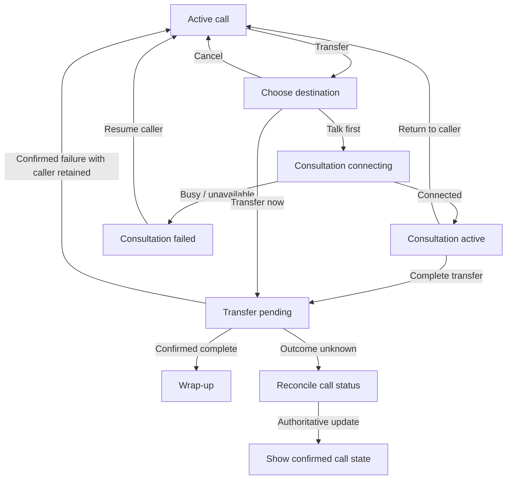
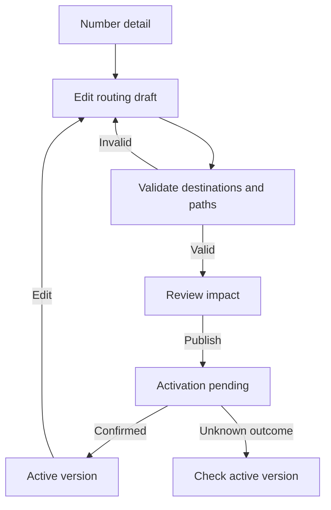

# ten98-voip flows for design review

Research date: **19 October 2026**. **Proposed adaptations, not accepted requirements or implemented exports.** The human and parent design-system session decide the UX; the VoIP application owns telephony behavior. [Evidence and source limitations](evidence.md) apply throughout.

“Observed” below describes an official documented workflow. Everything marked “Proposed” is our inference for ten98, including accessibility, recovery and layout requirements. None of these competitor flows was executed in a signed-in tenant.

## Complete matrix mapping

| Current coverage-table area | Flow below | Existing presentation to reuse | Application responsibility / possible extension |
| --- | --- | --- | --- |
| Contact tables | F1 | `DataTable`, `Field`, `Input`, `Badge`, `Avatar` | Directory search, tenant scope, calling permission; remote search is app-owned |
| Queue tables | F3, F4 | `DataTable`, `MetricCard`, `Card`, `Badge` | Live events, ordering, queue statistics and routing eligibility |
| Presence badges | F2, F4 | `Badge`, `Select`, `Field`, `Alert` | Separate requested/effective presence, queue membership and connectivity |
| Fields, detail cards and activity | F3, F5, F6, F7 | `SettingsSection`, `ResourceCard`, `ActivityFeed`, `Dialog` | Domain validation, mutation, audit provenance and access |
| SIP/media | F0, F1, F2 | `ResourceCard`, `Alert`, `Button`, `Field` | Registration, devices, media streams, protocols and diagnostics |
| Recording | F2, F6 | `Badge`, `Card`, native audio controls, `PermissionMatrix` | Capture, access, redaction, storage and retention |
| Routing | F3, F5 | `SettingsSection`, `Field`, `Select`, `Accordion` | Dialplan execution, destination validation, version activation |
| Call state | F1, F2 | `Card`, `Badge`, `Button`, `Alert` | Authoritative events, call/leg IDs, concurrency, reconciliation |
| Contact-center logic | F3, F4, F7 | `MetricCard`, `Tabs`, `Field`, `ActivityFeed` | Distribution, timers, wrap-up rules, calculations and outcomes |
| Access | Every flow, especially F0/F4/F6 | `PermissionMatrix`, `Badge`, `Alert` | Server enforcement and tenant isolation |
| Softphone extension | F0–F2 | Compose existing controls first | Potential bounded phone panel after call contract is decided |
| Live queue board extension | F4 | Metrics + app-owned live table | Dedicated board only after scale and update model are known |
| Call controls extension | F2 | `Button`, `Tooltip`, `Badge` | Candidate controlled action group, no SIP runtime |
| Routing builder extension | F5 | Form/list representation first | Canvas and keyboard alternative only for confirmed graph complexity |
| Recording player extension | F6 | Native `<audio controls>` first | Custom segment/transcript surface only if required |

The library's current `DataTable` is for a complete small local dataset. Its search, sort and pagination cannot represent a remote call history or partial live queue as if it were the full collection. The app should own those integrations and reuse the tokens and table conventions. There is no existing `Softphone`, `CallControls`, `RoutingBuilder` or `RecordingPlayer` export.

## F0 — Prepare an extension for calling

**User / entry:** PBX administrator opens an extension or provider; an agent opens Phone. **Success:** configuration is saved and the app has confirmed the relevant registration/media readiness; a saved form alone is not proof of working audio.

**Observed:** FusionPBX distinguishes gateways from outbound routes and supports registration-based versus IP-authenticated providers. Its Phone guide exposes Connecting, Registered, Disconnected and Registration Failed states and device selection. [Gateway guide](https://docs.fusionpbx.com/en/latest/accounts/gateways.html), [Phone guide](https://docs.fusionpbx.com/en/latest/applications/phone.html). Asterisk's ARI exposes channels, bridges, endpoints and media for application-controlled communication; it is not a UI layer. [Asterisk ARI](https://docs.asterisk.org/Configuration/Interfaces/Asterisk-REST-Interface-ARI/).

**Proposed sequence:**

| Step / screen | User intent / action | Recovery and state |
| --- | --- | --- |
| 1. Extension / provider detail | Confirm tenant, endpoint and configuration; **Edit settings** | Loading retains heading; forbidden view reveals no private credentials; missing resource has a return link |
| 2. Connection settings | Supply only required connection fields; **Save settings** | Field errors retain draft; secret input is an ordinary password `Input`, not read-only `SecretField`; saving is pending |
| 3. Connection status | Read confirmed state and timestamp; **Check connection** | Saved-but-unregistered is explicit; failed check shows specific safe next step; pending check cannot be mistaken for success |
| 4. Phone readiness | Choose input/output device; **Enable microphone** when needed | Denied permission, absent device and disconnected device have different guidance; never request camera for voice-only readiness |

The proposed readiness panel shows **Phone connection**, **Microphone** and **Calling permission** independently. A registration success cannot certify end-to-end call quality. A test call is a separate explicit action to an approved test destination, with charges and emergency-number rules decided by the app owner.

Keyboard/responsive: labelled native selects; read status text without relying on colored dots; wrap provider errors/identifiers; preserve phone numbers and SIP identifiers in an isolated LTR span in RTL layouts. At narrow widths the status and form stack, with no clipped error text.

## F1 — Find a person and start or answer a call

**User / entry:** employee/receptionist starts from Contacts, recent calls or the dialer; incoming offer opens a persistent call surface. **Success:** the app confirms an established call with the intended destination and device.

**Observed:** 3CX's documented client lets users search a person/number, choose the calling device and start a call; its directory distinguishes phonebook sources. [3CX Web Client](https://www.3cx.com/user-manual/web-client/). Amazon's documented workspace keeps an interaction list and active customer context next to the contact controls. [Agent workspace](https://docs.aws.amazon.com/connect/latest/adminguide/agent-user-guide.html).

**Proposed sequence:**

1. **Contacts:** search by name, extension or number; choose a result with tenant/department and number visible. Primary action **Call**. Empty directory offers the allowed next step; no matches offers **Clear search**. Unknown presence says “Presence unavailable.”
2. **Dialer:** show destination, calling identity and selected device; primary action **Call [name/number]**. Manual entry uses `type="tel"`, not number, because extensions and dial strings can contain `+`, `*` and `#`. The app validates supported formats.
3. **Connecting:** show destination and “Connecting…” with **Cancel call**. Do not start an elapsed-conversation timer yet. On busy/rejected/unreachable/permission-denied, show the specific outcome and a deliberate retry action.
4. **Incoming call:** show caller, called number/queue and device, with **Answer** and **Decline**. Answer stays pending until acknowledged. If another device/agent answers or the caller leaves, close the offer with an explanation, not a generic error.
5. **Active call:** retain caller and queue context across route navigation; controls from F2. Subsequent incoming calls must respect the app's capacity rules and clearly name which call is being changed.

Proposed desktop layout:

```text
ten98 VoIP · Dubai support              Phone connected · Device: Headset
Contacts / Recent calls                Availability: Available [Change]
Search people or numbers
Name          Extension   Presence     Active call: Sam · Support
Sam Chen      204         Available    Connected · 02:14
Leila Noor    206         In a call    [Mute] [Hold] [Keypad] [Transfer]
                                         [End call]
```

This is a hierarchy sketch, not final styling. On mobile, active call controls precede optional contact details. A persistent mini-call summary can open the full call panel; it must not cover page actions at 200% zoom. Incoming calls use visible text and optional user-enabled sound; do not rely only on notification permissions.

Keyboard: every action uses a labelled button; Escape closes a secondary picker, never hangs up. Do not capture digits globally while the agent types in notes/search. A dialpad is a labelled button grid in telephone order. New call events announce state changes without repeatedly announcing the timer.

## F2 — Control, consult and transfer a call

**User / entry:** agent on an active call. **Success:** requested operation is confirmed for the correct call/leg; a transfer completes only when the backend reports the hand-off outcome.

**Observed:** Aircall separates “Talk first” from immediate transfer, and its failed immediate-transfer behavior can return the call depending on destination/availability. Genesys exposes blind transfer and consultation separately, with controls for each party during consultation. These are not interchangeable runtime guarantees. [Aircall transfers](https://support.aircall.io/en-gb/articles/10375396999965), [Genesys transfers](https://help.genesys.cloud/?p=7195).

**Proposed state flow:**



| Action | Proposed state/feedback | Important safeguard |
| --- | --- | --- |
| Mute / unmute | Pressed state and label describe actual local microphone state | Mute is not hold and does not imply recording stopped |
| Hold / resume | Pending → confirmed hold; identify the affected party | A request timeout does not mean hold failed; reconcile before another command |
| Open keypad | Show the current call target for DTMF | Typed digits must not leak into notes or start another call |
| Start / stop recording | Pending → Recording / Paused / Not recording only from confirmed state | Capability and policy are app-owned; unavailable action explains why |
| Choose destination | Search result list with type, number and known availability | Require an explicit selected destination; text entry alone cannot accidentally choose a different person |
| Talk first | Caller: On hold; colleague: Connecting / Talking | **Cancel consultation** and **Resume caller** have explicit meanings; distinguish two legs |
| Transfer now / complete transfer | Show destination and pending state | Disable duplicate submission; uncertain outcome keeps context and starts reconciliation, not blind retry |
| End call | Separate danger action with the call/party named | Never map Escape to hang-up. For conferences distinguish leaving yourself from ending for everyone; exact confirmation policy needs owner decision |

Use existing `Button`, `Badge`, `Card`, `Dialog`, `Field`, `Input` and `Alert` for the first composition. A custom async destination combobox is a real gap only when a native select or results list cannot serve the directory. `ConfirmDialog` is not a call lifecycle controller: its promise rejection/automatic close behavior must not imply a telephony result.

Keyboard/responsive: logical focus order caller → state → actions → consultation; return focus when the picker closes. Two-party labels stack at narrow widths and in RTL, while numbers remain isolated LTR. Every icon action has a persistent accessible name. Transitions must not move the focused button into a different destructive action.

## F3 — Configure a queue and its members

**User / entry:** administrator opens Queues. **Success:** validated configuration is applied and active routing version/status is visible.

**Observed:** 3CX creates queues in Call Handling, with general routing settings, users, notifications/options and advanced settings. FusionPBX describes agent membership, distribution strategies, wait limits and timeout actions. FreePBX models queues as destinations usable by inbound routes, IVRs and time conditions. [3CX queues](https://www.3cx.com/docs/manual/call-center-queues/), [FusionPBX queues](https://docs.fusionpbx.com/en/latest/applications/call_center.html), [FreePBX queue concepts](https://sangomakb.atlassian.net/wiki/spaces/PG/pages/24608891/PBX%2BGUI%2B-%2BQueues%2BModule).

**Proposed sequence:** Queues list → **Create queue** → identity/scope → distribution and members → wait/fallback → review change → apply → confirmed detail. Use sections on one form before introducing a wizard; steps are justified only when dependencies require them.

| Form section | Minimum useful content | State and recovery |
| --- | --- | --- |
| Identity | Name, queue extension, tenant/department, assigned number(s) if applicable | Duplicate extension/number error; preserve draft; show scope before save |
| Distribution | Supported strategy and explanation, member list, order/priority where relevant | Empty membership is explicit; require or explain fallback; unavailable member retained with reason |
| Caller experience | Ring/wait timing with units, prompt and hold audio | Invalid units/range errors beside field; preview audio does not start a real call |
| Fallback | Destination when no agents, timeout, closed hours and holidays where supported | Missing/inaccessible/deleted destination blocks activation or follows owner-defined safe policy |
| Review | Changed values, affected numbers, activation scope | Stale version conflict offers reload/compare while preserving draft; partial apply shows per-resource result |

Keyboard/responsive: member ordering has Move up/Move down controls instead of drag-only behavior. Long labels wrap; sections stack; preview is supplemental. The server must check destination scope again on apply. No background retry of ambiguous apply operations.

Reuse `SettingsSection`, `Field`, `Input`, `Select`, `Checkbox`, `Accordion`, `Alert`, `ActivityFeed`. `Stepper` is display-only and marks earlier steps complete; use it only when actual validation has established completion.

## F4 — See live queues, agent readiness and supervisor actions

**User / entry:** agent changes own availability; supervisor opens a queue or an alert. **Success:** scope and freshness are clear, and any authorized intervention has a confirmed outcome.

**Observed:** 3CX differentiates global and selective queue login. FusionPBX's documented activity view places agents above current callers. Genesys distinguishes presence, routing state and queue activation; some views expose refresh timestamps. Zoom supports site/queue/agent drill-down and permission-limited metrics. [3CX queue status](https://www.3cx.com/docs/pbx-queue-status/), [FusionPBX activity](https://docs.fusionpbx.com/en/latest/status/active_call_center.html), [Genesys queue detail](https://help.genesys.cloud/articles/queues-activity-detail-view/), [Zoom analytics](https://support.zoom.com/hc/en/article?id=zm_kb&sysparm_article=KB0061144).

**Proposed sequence:** choose tenant/queue → see metrics and freshness → select waiting/active/agent count → inspect list/detail → choose authorized action → pending → confirmed activity entry. Agent presence changes are requested separately from queue opt-in and device connectivity.

```text
Support queue · Dubai · Asia/Dubai          Updated 14:32:08 [Refresh]
Waiting 4    Longest wait 02:11    Active 6    Eligible agents 3
[Waiting callers] [Active calls] [Agents]
Caller / Agent    Call state    Queue membership   Duration   Action
Leila Noor        Wrap-up       Opted in           00:23      View
Sam Chen          Idle          Opted out          02:04      View
Phone connection: unknown must remain separate from these states.
```

| Condition | Proposed behavior |
| --- | --- |
| No calls, confirmed measurement | Show 0 and “No callers waiting”; retain functioning board |
| Loading | Keep scope and metric labels, show status; avoid rendering guessed zeros |
| Stale connection | Freeze last known values with timestamp and “Updates interrupted”; disable actions that require unverified live state |
| Partial feed | Identify missing queue/agent data without clearing usable values |
| Status change pending | Show requested state alongside current confirmed state; preserve previous state until acknowledgment |
| Permission changed | Read-only explanation; server rejects unauthorized intervention; do not expose call details through errors |
| Caller leaves during action | Explain “Call has ended” or actual authoritative outcome; remove obsolete actions |
| Filtered empty | Offer clear filters; distinguish from an empty queue |

Monitoring, whisper and barge-in are **new feature suggestions**, not approved by the matrix's generic contact-center wording. If chosen, label the modes by who can hear whom and audit entry/exit. Do not silently enter a monitoring mode from a row click.

Keyboard/responsive: provide a text list alternative to a wallboard. Do not automatically reorder the focused row; offer sort/refresh intentionally. Announce meaningful threshold/state changes, not each second. Color supplements text. On mobile show scope, freshness and actionable rows before secondary charts. Use `MetricCard` with neutral trends when an increase is not inherently good/bad; app defines all formulas and thresholds.

## F5 — Route a number through hours, IVR and fallback

**User / entry:** administrator selects a number or call-handling resource. **Success:** an explicitly reviewed routing configuration is active, with clear fallback paths.

**Observed:** 3CX applies office hours from destination departments and supports timed overrides. FusionPBX IVR configures greeting, keypad options, timeout and exit action. Aircall's current call-flow article describes number → Call Distribution → editor, node settings on the right, and Publish; publication changes routing for that number. [3CX hours](https://www.3cx.com/docs/manual/office-hours/), [FusionPBX IVR](https://docs.fusionpbx.com/en/latest/applications/ivr.html), [Aircall routing](https://support.aircall.io/en-gb/articles/10375394403101).

**Proposed sequence:** Number detail → Edit routing → choose hours/time zone → greeting/menu → destinations/fallbacks → Validate → Review impact → Publish → confirmed active version. Start with a form/list; a graph is an optional view of the same structure.



Proposed routing preview:

```text
Main support number          Active: v7     Draft: changed
Hours: Mon–Fri 09:00–18:00 · Asia/Dubai
During hours → Greeting → 1 Support / 2 Billing
No input     → Replay once → Voicemail
Invalid key  → Retry once → Reception
Closed       → Closed greeting → Voicemail
[Validate draft]                       [Review and publish]
```

Empty draft offers a minimal template. Loading preserves existing active version. Invalid/missing destination errors link to the affected field/node; no-input and invalid-input branches are distinct. Stale edits show a version conflict. Publishing shows pending status; timeout reconciles active version before retry. Read-only users can inspect but not publish. Deleted destinations and cycles need domain validation. The owner must decide whether legal loops, retry limits and external transfers are supported.

Amazon's official routing version model provides immutable published snapshots and aliases, and its rollback guide republishes a selected version. These motivate a **proposed** ten98 draft/active separation and recovery path; adopting aliases or an entire flow engine is unnecessary. [Versions](https://docs.aws.amazon.com/en_en/connect/latest/adminguide/flows-versions-aliases.html), [rollback](https://docs.aws.amazon.com/connect/latest/adminguide/flow-version-control.html).

Keyboard/responsive: a complete ordered list/form editor must work without drag/pan. Node connections are also readable as destination names. Support zoom without hiding validation or publication controls; stack the settings inspector below selection on narrow screens. Time-zone and override-expiry labels stay visible. Use Campaign's tokens and icon family; do not inherit Aircall's green publication button as branding.

## F6 — Investigate a call and play an authorized recording

**User / entry:** agent opens own history; authorized supervisor follows a queue/call link. **Success:** the intended call/segment is identified and authorized media is available, or its absence is explained accurately.

**Observed:** FusionPBX CDR filters calls and exposes recording links, with a warning that default logging can omit a second call leg. Its recording list provides metadata and playback. Genesys has playback speed, per-party volume and segment-restricted access. Amazon distinguishes contact-search access from recording access and can search completed/in-progress contacts. [FusionPBX CDR](https://docs.fusionpbx.com/en/latest/applications/call_detail_record.html), [recordings](https://docs.fusionpbx.com/en/latest/applications/call_recordings.html), [Genesys playback](https://help.genesys.cloud/articles/work-with-an-interaction-overview/), [Amazon search](https://docs.aws.amazon.com/connect/latest/adminguide/contact-search.html).

**Proposed sequence:** History → date/time-zone and scope filters → call row → chronological call/leg detail → authorized recording → playback. Keep a stable back link preserving filters. Server search and pagination are required for large histories; no fake total from a loaded page.

| State | Proposed presentation and next action |
| --- | --- |
| No calls / no matches | Separate empty history from filtered empty; offer appropriate clear-filter action |
| Call still active | “In progress” and latest event timestamp; duration not final |
| Processing recording | Processing state with check/refresh, no enabled Play control |
| Not recorded | Explicit “No recording was made” only when confirmed |
| Access restricted | Explain recording access without revealing protected media/participants |
| Expired / deleted | Identify known lifecycle reason; do not call it a playback network error |
| Media unavailable | Keep call metadata; offer safe retry only for fetching media |
| Partial recording / missing leg | Identify available segments and gaps; do not imply a complete conversation |
| Expired media authorization | Refresh authorized access through the app; never embed long-lived secret URLs |

Reuse `DateRangeField` for date-only filters; use native labelled datetime inputs where time-of-day is required. Reuse `Card`, `Badge`, `ActivityFeed`, `Alert` and a native audio player before building a waveform. The player must not autoplay. Any transcript, redaction editor, download/export, retention management or deletion is separately scoped and permission checked. Text labels identify speakers in addition to colors. A transcript must not be presented as perfectly accurate or as a substitute for missing media.

Keyboard/responsive: play/pause, seek and volume stay keyboard-operable; preserve focus when media loads; show elapsed/total text. At 320px/200% zoom, controls stack and labels remain visible. In RTL, timestamps/phone numbers are isolated without reversing chronological sequence unexpectedly.

## F7 — Finish the interaction and return to readiness

**User / entry:** agent's call ends or transfers. **Success:** required outcome is persisted and the backend confirms the resulting readiness state.

**Observed:** Genesys ACW can require a wrap-up code and/or configured time; Done availability depends on those rules. NiCE's call guide provides Outcome, disposition/notes and Save & Close, with device-disconnection guidance. Avaya documents timed versus extended ACW; Cisco Finesse separately exposes consultation and transfer. These products demonstrate policy variation rather than one universal timer rule. [Genesys ACW](https://help.genesys.cloud/?p=2724), [NiCE calls](https://help.nice-incontact.com/content/agent/cxoneagent/handlecallsincxa.htm), [Avaya ACW](https://documentation.avaya.com/en-us/home/bundle/avaya-experience-platform-connect/usingworkspacesexperienceplatformconnect/after-contact-work.html), [Cisco Finesse](https://www.cisco.com/c/en/us/td/docs/voice_ip_comm/cust_contact/contact_center/WebexCCE/End_User_Guides/wxcce_b_finesse-desktop-ug/agent_tasks.html).

**Proposed sequence if wrap-up is selected:** confirmed end/transfer → Wrap-up panel → outcome and optional notes → **Finish wrap-up** → save pending → confirmed effective status. Show elapsed or remaining time with its meaning, not a generic timer. This is a proposed refinement of contact-center logic; required codes, maximum duration, auto-completion and redial are not approved requirements.

Empty outcome list explains configuration/access failure. Loading retains draft. Save failure keeps notes and provides retry only when the app can safely deduplicate. Unknown save outcome reconciles before repeating. If policy auto-completes during editing, preserve unsent notes and explain actual status. A user switching to Away must see whether it applies now or after wrap-up. Never infer availability just because the dialog closed.

Reuse `Field`, `Select`, `Textarea`, `Button`, `Alert` in a persistent panel or native `Dialog`. Notes survive route changes according to app policy. A screen reader receives one state transition announcement, not a countdown every second. On narrow screens the form follows call summary; controls remain reachable without scrolling the sidebar.

## Common acceptance scenarios for the parent/app handoff

These are proposed checks, not executed tests or a claim of implemented behavior:

1. Call is answered elsewhere while Answer is pending; the UI reconciles and explains the outcome.
2. Transfer target becomes unavailable after selection; original call/consultation is represented truthfully.
3. Network drops after a transfer/publish request reaches the server; no automatic duplicate command is issued.
4. An agent is Available but opted out, unregistered or in wrap-up; no single badge implies eligibility.
5. Queue stream becomes stale; values remain visibly dated and never become invented zeros.
6. Recording metadata exists but playback is forbidden, processing or partial; each is distinguishable.
7. Routing draft references a deleted or cross-tenant destination; activation cannot silently proceed.
8. Keyboard-only, light/dark, compact/comfortable, LTR/RTL, 320px and 200% zoom preserve labels, focus and essential controls.
9. The sidebar has no visible scrollbar track/thumb while its navigation remains wheel/touch/keyboard reachable.
10. No shared component creates credentials, places calls, stores recordings, executes routing or declares a server mutation successful on its own.
