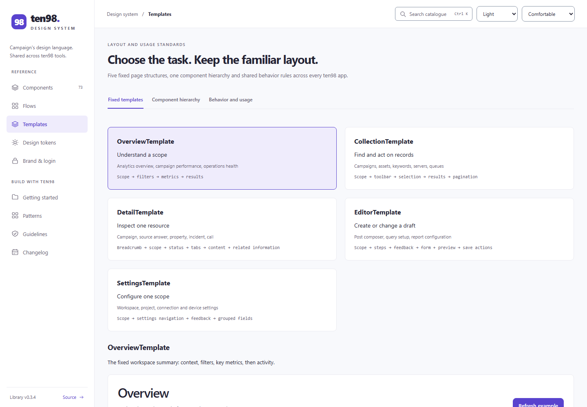
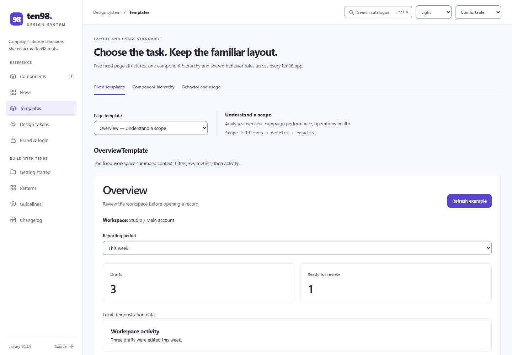
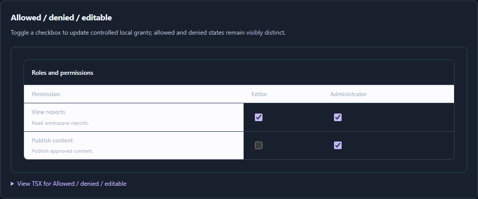
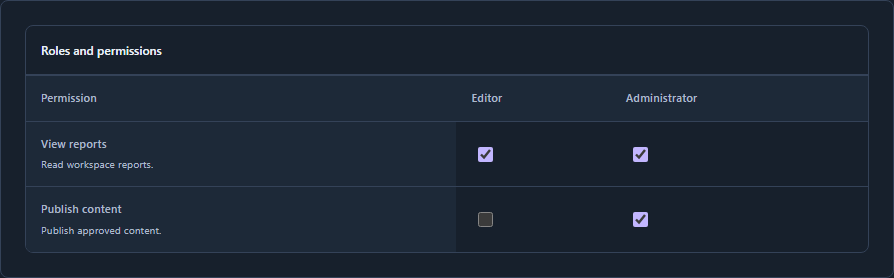
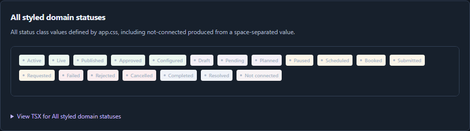
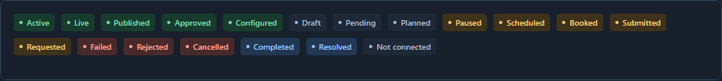
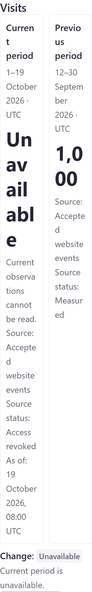
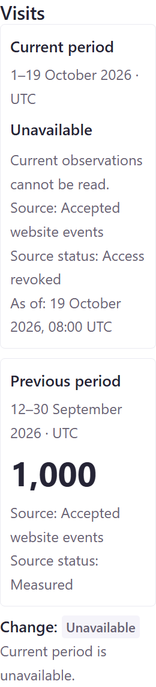

# Component, flow and template design review

Reviewed on 19 October 2026. The exhaustive baseline is version 0.3.4; the initial remediation is version 0.3.5, followed by the documented 0.3.6–0.3.9 corrections below. Campaign's existing logo, icons, purple accent and login composition remain the brand reference. English LTR is the required layout.

The system's strongest quality is its truthful state handling. It distinguishes a measured zero from missing data, a draft from applied scope, accepted work from delivery, and an uncertain outcome from a failed request. The largest design weaknesses were inconsistent theme surfaces, cramped results, and catalogue previews that did not faithfully show the shipped components. Those are more consequential than adding visual decoration.

## Exhaustive critique

| Coverage | Review |
| --- | --- |
| 45 controls, patterns and compatibility components | [Foundations](foundations.md) |
| 23 product components, including all 168 documented product states | [Product components](product-components.md) |
| Five fixed templates and all 28 reference flows | [Flows and templates](flows-templates.md) |

This covers all 73 public catalogue components: 45 foundations + 23 product components + five templates. The templates also appear in the 33-item flow/template review. Each item has a finding or a keep decision, a concrete recommendation, an implementation target and a reference. It is not a claim that every state/theme/device combination was visually inspected.

## Direct visual comparisons

The visual comparison reports pair matching ten98 functions with actual product UI, captured from public applications or official product screenshots. Each report identifies which kind of evidence was available. Documentation guidance alone does not count as a captured application screen, and an unavailable screen is recorded as a gap.

- [Campaign task comparisons](visual-campaign.md)
- [Discover task comparisons](visual-discover.md)
- [Template and workspace comparisons](visual-templates.md)
- [Actual Campaign and Discover consumer screens](consumer-screens.md)
- [Approval and recipient-review reference follow-up](visual-confirmations.md)

Competitor screenshots are reference evidence for this critique. Their assets, colors and branding are not part of the library. Differences in authorization, pricing, capture coverage, receipt handling and product capabilities remain app-owned decisions.

Screenshot files stay in the [source repository](https://github.com/Ten98-IO-Company/ten98-design-system/tree/main/docs/reviews/2026-10-19); the installed package contains Markdown documentation and runtime files, keeping visual research out of the application dependency.

## Remediation decisions

The P1/P2 changes below are implemented and pass the shared 0.3.5 gate. Consumer adoption is tracked separately in the completion ledger. The P3 row records proposals, not shipped refinements.

| Priority | Finding | Decision in 0.3.5 |
| --- | --- | --- |
| P1 | Global pale table-header fills and compatibility status fills made dark states difficult to read. | Existing semantic foreground, surface and border roles replace fixed fills. Check PermissionMatrix, ReviewSummary, RetentionTable, RankComparison and all 19 compatibility statuses. |
| P2 | Narrow list/detail opening could leave keyboard focus on the document body after hiding the originating control. | Recover hidden or removed workspace focus to the visible pane heading. Preserve initial focus, visible app-selected focus, guards, originating-control restoration and mounted drafts. |
| P2 | Four fixed audience columns squeezed values inside a desktop side panel. | Counts adapt to their actual panel width. All four counts and unavailable states remain explicit. |
| P2 | Explorer, funnel and attribution put the full analytical result into a narrow editor preview. | Existing overview/editor templates now place primary results at full width below configuration. Keep contained table scrolling on narrow screens. |
| P2 | Catalogue prose shrank metric values; grid previews stretched intrinsic buttons/badges. | Scope documentation typography to prose and align intrinsic specimens. Keep fields and result containers full width. Media status chips retain intrinsic width. |
| P2 | Template section links collided with the catalogue router. | Existing scoped preview-link handling scrolls and focuses the section while retaining the catalogue route. |
| P2 | Five large template-choice cards displaced the working preview. | Use one labelled native selector with the selected task, use cases and slot order beside it. Preserve all five examples and their full APIs. |
| P2 | Compatibility empty-state and control chrome bypassed theme roles. | Reuse accent, text, control-border and disabled roles for existing geometry. No new palette or component API. |
| P2 | Actual send-review headers split short words, and OOH confirmation showed opaque inventory IDs. | Keep short review headers on one line inside contained table scrolling; pair inventory names with the same stable IDs in quote and confirmation. |
| P2 | Numeric heatmap evidence was headed as ranked elements despite lacking element identity. | Add an optional evidence-list label, with exact existing defaults. Coordinate groups remain distinct from DOM elements, and unknown alignment still prevents an overlay. |
| P2 | The actual Campaign dark workspace switcher retained a pale fixed fill. | Reuse subtle-surface/control-border and accent-soft/accent roles in the shared switcher and avatar. Explicit/system theme contrast, native selection and an old-fill negative control pass. Consumer re-capture follows adoption. |
| P3 | Repeated nested borders, very small metadata and simulation controls competing with task actions. | Per-item recommendations remain proposals. Use quieter separators, readable supporting text and clearly grouped fixture controls where the actual task benefits; preserve consequential warnings. |

P1 means a material readability/accessibility defect; P2 means a meaningful behavior or consistency issue; P3 is optional refinement. These labels are review judgments, not a numerical quality score.

### Captured remediation

| Baseline 0.3.4 | Current 0.3.5 |
| --- | --- |
|  |  |
|  |  |
|  |  |

Further 0.3.5 captures show [readable send-review headers](images/remediation/send-review-after.png), [OOH names alongside stable inventory IDs](images/remediation/ooh-review-after.png), [compact attribution configuration with full-width results](images/remediation/attribution-after.png), and the [shared dark switcher](images/remediation/workspace-switch-after.png). The [actual 0.3.8 consumer follow-up](consumer-screens.md#current-campaign-follow-up--038) now verifies the rebuilt calendar, switcher and navigation beside the original baseline.

### Consumer-discovered follow-up: 0.3.6

Campaign's actual article editor exposed the documented multiline adapter limitation as a consequential mismatch: typing changed the native textarea but did not reach controller review, and asynchronous content did not prefill. The 0.3.6 correction forwards native textarea props with a compatible typed overload, preserves uncontrolled defaults and omits input-only attributes. New controlled/read-only states and an async-prefill/type/review browser fixture cover the shared contract. Actual article-saving acceptance remains with Campaign; 0.3.5 is immutable.

### Action and navigation follow-up: 0.3.7

The actual 0.3.6 Campaign re-capture confirmed calendar and workspace-switcher improvements, then exposed enabled secondary buttons with fixed app-local dark text and selected navigation with a fixed shared pale background. These are distinct ownership problems. The shared 0.3.7 patch uses existing roles for action and navigation states; Campaign separately reconciles its later fixed-color overrides. The theme matrix now checks actual normal/hover/selected/danger/primary/count contrast, waits for finite transitions and reproduces the old-fill failures. No geometry, API or JavaScript changes are involved. Final consumer captures and acceptance remain separate from the shared gate.

### Actual text reflow follow-up: 0.3.8

The rebuilt 0.3.7 app confirms the chrome fixes and contained calendar controls at 2× text. Its fixed-height nowrap breadcrumb pushes the profile control beyond a 320px viewport, producing a 382px document. The 0.3.8 shared patch preserves normal breakpoint heights as minimums, allows full context to wrap, and adds an old-rule negative control. Compare [the actual before crop](images/remediation/topbar-text-before.png) with [the repaired header and native skip link](images/remediation/skip-link-text-after.png): document width is 320px and the header grows to 72px with menu/profile controls contained. The [native consumer follow-up](consumer-screens.md#rebuilt-native-acceptance--793-check-campaign-checkpoint) also verifies corrected composer/preview contrast, both actual CSS themes, 2× composer text and keyboard skip navigation against Campaign's rebuilt 793-check checkpoint. Page-heading geometry and component APIs remain unchanged.

### Component-width metric follow-up: 0.3.9

Actual Discover Boards captures revealed oversized unavailable labels in its native Stats helper. A separate shared-component probe reproduced the same readability problem in ComparisonMetric: at a 260px desktop panel, fixed viewport-driven columns leave only 88px for each value. “Unavailable” splits into two fragments normally and five at actual 2× text; even the formatted baseline `1,000` breaks. The text is intact and the document fits, so an overflow-only check misses this defect.

| Shared 0.3.8 at actual 2× text | Corrected 0.3.9 at the same 260px panel width |
| --- | --- |
|  |  |

Compare the [normal-size before](images/remediation/comparison-panel-before.png) and [after](images/remediation/comparison-panel-after.png) too. These are actual catalogue components constrained to a legitimate panel width, not consumer captures. Columns now respond to available component width and text size. Only a true null gets supporting status typography; numbers and app-supplied strings keep metric typography. Zero, `1,000`, reasons, source context and the public API remain unchanged. The focused light/dark panel/320px browser cases check whole words, exact font doubling, containment and restored-old-rule failures; independent source/oracle review found no actionable blocker. Discover's separate native Stats correction remains app-owned.

### Preserved error announcements: 0.3.9

Discover's retained full Boards test caught a shared regression that the focused retry fixture missed: ReportPanel displayed the rejection reason but announced it as an ordinary status instead of the native error alert. The shared boundary now uses one alert for errors and a polite status for other states. Native checks cover all eight statuses; browser checks transition ready → error → ready while preserving the unaffected sibling and explicitly retained content. Both browser projects reproduce the missing alert before the correction. The original consumer assertion remains required after adoption; the smaller fixture does not replace it.

The new template-reference note also displaced the working preview below the first narrow screen. Moving it after the tabs and preview restores the existing first-screen and keyboard contract without weakening that test.

### Native Settings layout boundary: 0.3.9

An actual Campaign Settings capture widened a 320px document to 752px. Its direct grid column retained an automatic minimum around a correctly configured table scroller. One shared direct-child shrink guard preserves desktop tracks and keeps horizontal scrolling inside the table. The native-markup regression covers normal and actual doubled text, table contents/actions and native form values; restoring the old minimum reproduces overflow at both text sizes. The [frozen consumer recheck](consumer-screens.md#settings-and-exact-price-review--later-frozen-038-fixture) verifies the same guard in Campaign before package adoption. No new layout API is introduced.

## Evidence and verification

The detailed reports retain baseline observations, including subsequently corrected findings. A delayed focus probe established that Back already restored focus correctly; opening the hidden detail was the actual gap. The final tests target that behavior. Tests distinguish visible focused sections from their child headings, and they use the real 19-status inventory rather than an invented count.

Current automated gate and immutable package details are recorded in [release validation](../../VALIDATION.md). The new browser checks cover opaque text contrast, theme selection, panel sizing, catalogue typography, template navigation, keyboard focus, drafts and full-width analytical results. Negative controls restore the earlier pale fill and four-column audience layout. Independent source review checked the focus guards, semantic status mappings and test oracles before the complete suite.

The audit is local UI evidence. It does not certify every accessibility criterion, arbitrary future theme overrides, live providers, payments, delivery, databases or deployment. Actual Campaign/Discover consumer acceptance is tracked separately in the [completion ledger](../../CAMPAIGN-DISCOVER-COMPLETION.md).

## Reference direction

[Linear's 2026 design refresh](https://linear.app/now/behind-the-latest-design-refresh) provides a useful precedent for predictable headers and quieter supporting structure. [Geist's table guidance](https://vercel.com/geist/table) informs comparable values and semantic tables. [Stripe's component and view model](https://docs.stripe.com/stripe-apps/components) informs the distinction between focused tasks, related context and full-page results. These are design references, not proof that copying their appearance improves ten98 usability.

The product map now combines Connect and Wiki into one planned app and adds ten98-researcher. The existing ten98-connect identifier is provisional for the combined app; Researcher's feature scope is still proposed. See [the current coverage table](../../UX-PATTERNS.md#coverage-for-all-ten-tools). No researcher engine or new product feature is implied by this review.
