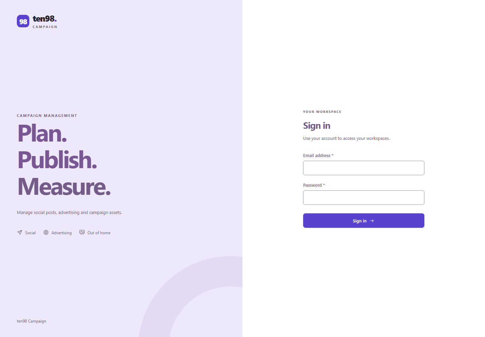
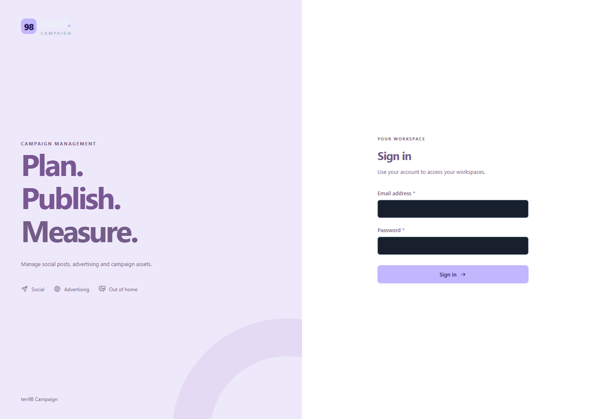
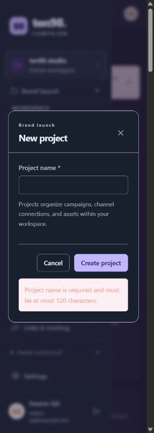
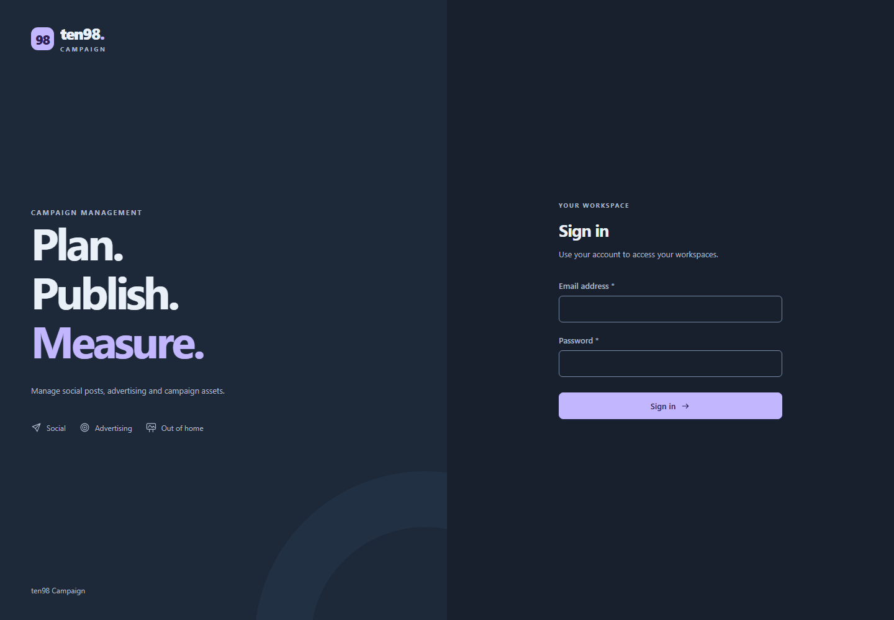

# Campaign dark-mode repair

Reviewed on 19 October 2026. Campaign's existing ten98 logo, icons and split login composition are the visual reference. This repair changes theme colors, preserving the light palette, dimensions and app behavior. Native app styles and shared compatibility styles are checked separately because later app rules can override the package.

## Actual baseline

| Existing light reference | Actual dark before repair |
| --- | --- |
|  |  |

These are Playwright screenshots of Campaign's actual public sign-in at `127.0.0.1:3318`, not a rebuilt mockup. A fresh browser imported no authentication state, entered no credentials and allowed only same-origin GET/HEAD requests. Desktop and 320px captures retained document containment. Explicit `data-theme` probes verify CSS, not saved preferences. The browser also emulated a dark operating-system preference; the initial app had already selected a dark theme. This does not prove a theme controller or preference persistence.

The dark screen mixed dark inputs and buttons with a white form and pale lavender story. The wordmark was visually faint against the pale story. Sampled non-brand normal-text pairs remained at least 4.652:1, so the baseline is not described as a general text-contrast failure.

Campaign's signed-in disposable preview independently reproduced an actual validation error without creating a project: a whitespace-only name passed the browser's required check, then the server rejected it. The error combined foreground `rgb(255,163,153)` with background `rgb(253,240,245)`, measuring **1.7313:1**. The foreground came from a native dark override; the pale background and border came from the shared compatibility rule.

## Actual sign-in after installation

The independent fresh-context Playwright probe repeated all five scenes against the rebuilt native app on the exact 0.3.11 archive. Dark, explicit system-dark and narrow-dark normal-text samples measure at least **7.409:1**; form labels measure **8.261:1**, heading **14.318:1** and button **7.893:1**. The light minimum remains **4.652:1**. The separate wordmark observation is **12.841:1**, not a normal-text AA claim. The [320px dark capture](images/consumer/campaign-login-dark-after-320-0.3.11.png) remains contained.

The light brand-region comparison is exact: zero changed pixels out of 8,700, maximum channel delta zero. The mark, wordmark, product label, split layout, icons and decorative orbit remain visible. No authentication interaction, writes, external requests or storage-state import occurred. The QA server supplies explicit dark activation; no production theme resolver or preference-persistence acceptance is implied.

## Shared repair and checks

The authentication story uses existing semantic dark surface, text, muted and accent roles. The orbit uses the existing raised-surface role so the decorative pattern remains visible. The form error owns a complete dark foreground/background/border pair using existing danger roles. `light-dark()` selects from the actual used `color-scheme`; original light literals remain unchanged. No component API, token palette, dependency, logo geometry or behavior is added.

The runnable [legacy theme spec](../../../tests/browser/legacy-theme.spec.ts) checks independent numeric light/error colors, text contrast, explicit/system themes, nearest nested themes and unchanged light geometry. Negative controls restore the pale surfaces and reproduce dark failures. Its no-attribute test deliberately supplies the existing dark roles and color scheme: this establishes inheritance, not automatic operating-system detection. [MDN documents the used-color-scheme behavior](https://developer.mozilla.org/en-US/docs/Web/CSS/Reference/Values/color_value/light-dark).

The complete frozen-source gate passes 58 native checks, 511 standalone TSX examples and 166 Playwright cases, one browser worker and no retries. Final package and actual consumer acceptance are recorded in [release validation](../../VALIDATION.md) and the [completion ledger](../../CAMPAIGN-DISCOVER-COMPLETION.md). Authenticated validation-error and interaction checks remain open; the shared fixture and public sign-in alone do not close the whole app repair.
