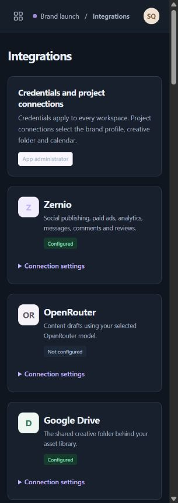
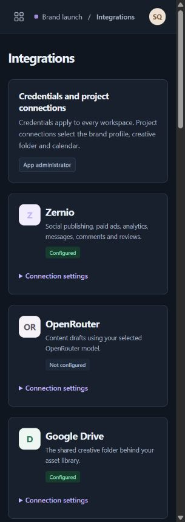
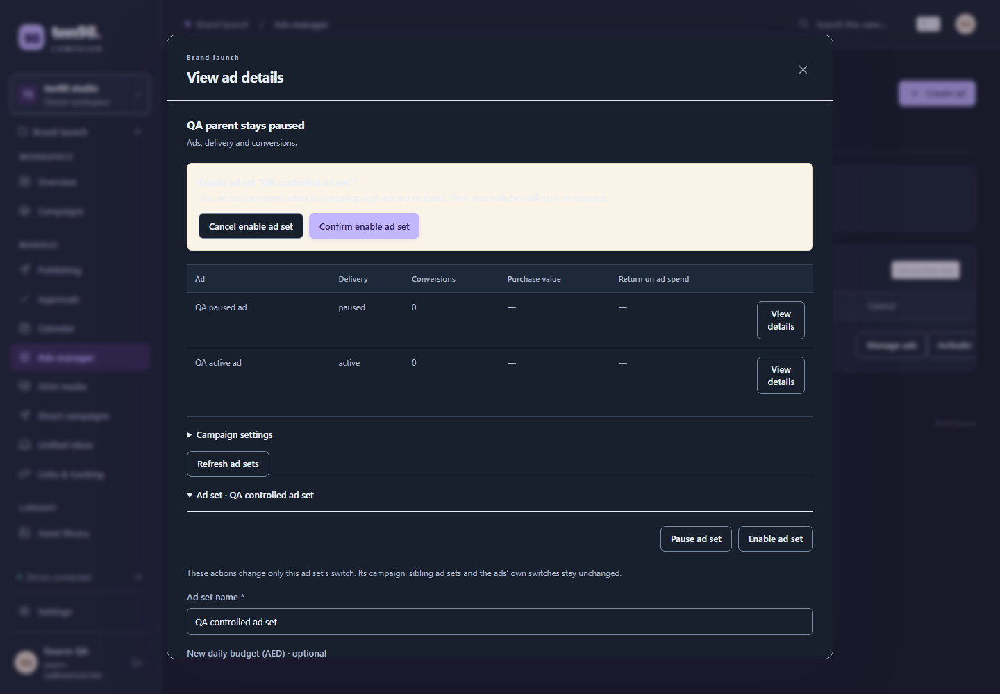
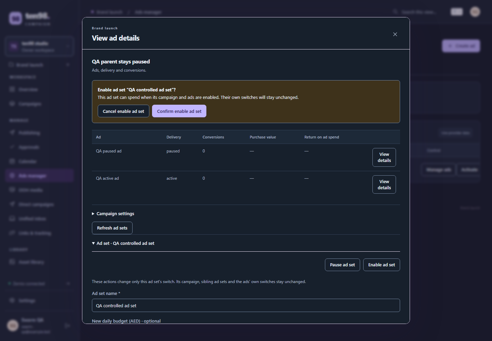
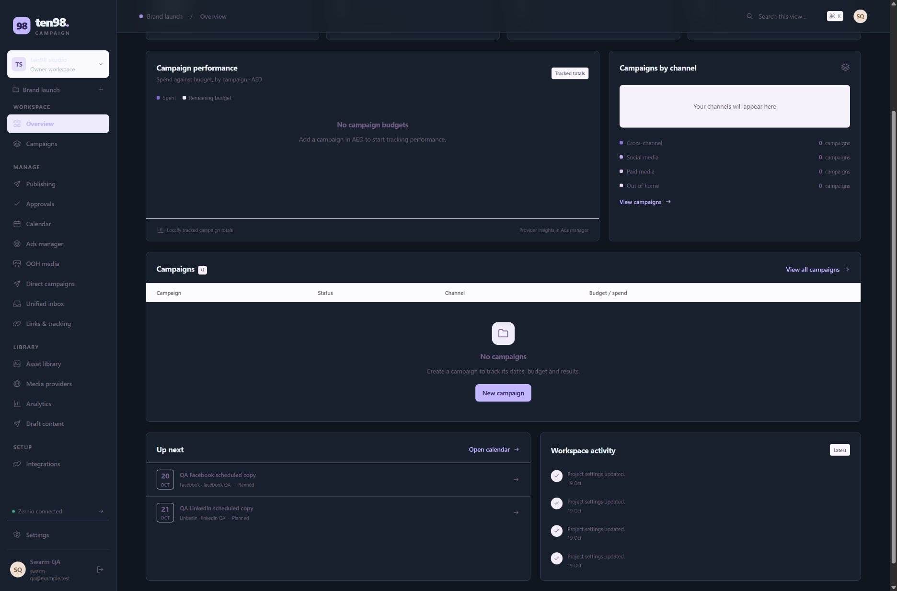
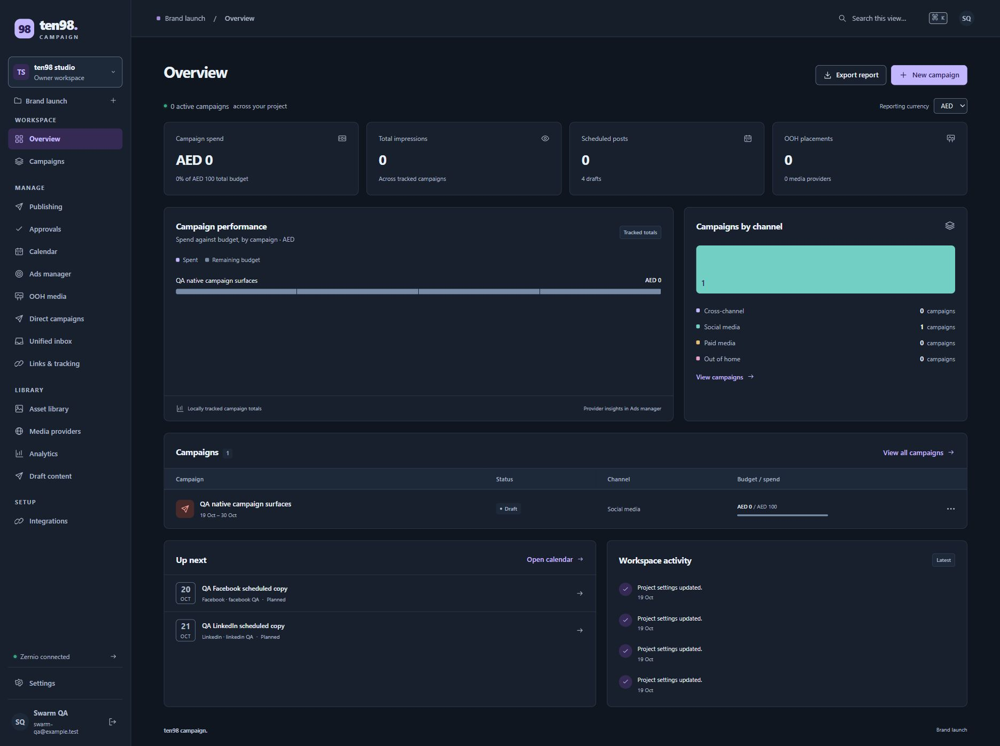
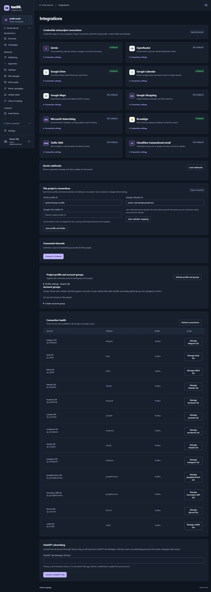
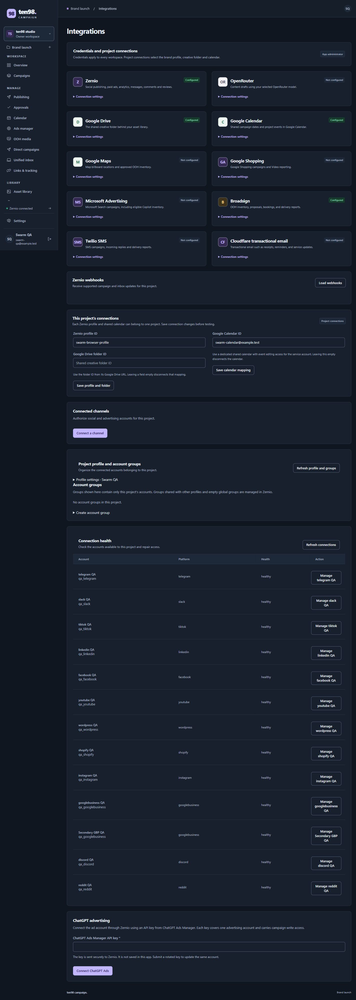

# Campaign dark-mode repair

Reviewed on 19 October 2026. Campaign's existing ten98 logo, icons and split login composition are the visual reference. The shared repair preserves its original light colors and dimensions; native controls/headings reuse canonical semantic roles. Native app styles and shared compatibility styles are checked separately because later app rules can override the package. Exact light pixel identity is claimed only for the measured brand region.

## Actual baseline

| Existing light reference | Actual dark before repair |
| --- | --- |
|  |  |

These are Playwright screenshots of Campaign's actual public sign-in at `127.0.0.1:3318`, not a rebuilt mockup. A fresh browser imported no authentication state, entered no credentials and allowed only same-origin GET/HEAD requests. Desktop and 320px captures retained document containment. Explicit `data-theme` probes verify CSS, not saved preferences. The browser also emulated a dark operating-system preference; the initial app had already selected a dark theme. This does not prove a theme controller or preference persistence.

The dark screen mixed dark inputs and buttons with a white form and pale lavender story. The wordmark was visually faint against the pale story. Sampled non-brand normal-text pairs remained at least 4.652:1, so the baseline is not described as a general text-contrast failure.

Campaign's signed-in disposable preview independently reproduced an actual validation error without creating a project: a whitespace-only name passed the browser's required check, then the server rejected it. The error combined foreground `rgb(255,163,153)` with background `rgb(253,240,245)`, measuring **1.7313:1**. The foreground came from a native dark override; the pale background and border came from the shared compatibility rule.

## Actual sign-in after installation

The independent fresh-context Playwright probe repeated all five scenes against the rebuilt native app on the exact 0.3.11 archive. Dark, explicit system-dark and narrow-dark normal-text samples measure at least **7.409:1**; form labels measure **8.261:1**, heading **14.318:1** and button **7.893:1**. The light minimum remains **4.652:1**. The separate wordmark observation is **12.841:1**, not a normal-text AA claim. The [320px dark capture](images/consumer/campaign-login-dark-after-320-0.3.11.png) remains contained.

The light brand-region comparison is exact: zero changed pixels out of 8,700, maximum channel delta zero. The mark, wordmark, product label, split layout, icons and decorative orbit remain visible. No authentication interaction, writes, external requests or storage-state import occurred. The QA server supplies explicit dark activation; no production theme resolver or preference-persistence acceptance is implied.

## Shared repair and checks

The authentication story uses existing semantic dark surface, text, muted and accent roles. The orbit uses the existing raised-surface role so the decorative pattern remains visible. The form error owns a complete dark foreground/background/border pair using existing danger roles. `light-dark()` selects from the actual used `color-scheme`; original light literals remain unchanged. No component API, token palette, dependency, logo geometry or behavior is added.

The runnable [legacy theme spec](../../../tests/browser/legacy-theme.spec.ts) checks independent numeric light/error colors, text contrast, explicit/system themes, nearest nested themes and unchanged light geometry. Negative controls restore the pale surfaces and reproduce dark failures. Its no-attribute test deliberately supplies the existing dark roles and color scheme: this establishes inheritance, not automatic operating-system detection. [MDN documents the used-color-scheme behavior](https://developer.mozilla.org/en-US/docs/Web/CSS/Reference/Values/color_value/light-dark).

The complete 0.3.11 frozen-source gate passes 58 native checks, 511 standalone TSX examples and 166 Playwright cases, one browser worker and no retries. The subsequent candidate and native checks below close additional observed paint defects without changing that historical record.

## Actual authenticated native follow-up

The first native review also exposed an inherited light fill on the noninteractive App administrator tag: **1.86868:1**. Campaign has no native declaration for `.subtle-tag`; 0.3.12 fixes its shared surface/border once. The actual installed tag measures **7.40913:1** afterward. Campaign removes its separate configured/not-configured foreground overrides, restoring complete state pairs at **7.1783:1 / 7.4091:1**. The native integration/empty-state headings and supporting copy now use existing theme roles, measuring at least **8.2611:1** in the sampled screen; its empty-state icon measures **7.0962:1**.

| Shared tag before | Same actual tag after |
| --- | --- |
|  |  |

Native warning/review panels had their own pale background and inherited dark foreground. The fresh authenticated Playwright probe reproduced **1.04:1**, preserving the original evidence. Campaign owns this rule and pairs its warning, alert/error and toast colors with existing semantic roles; no duplicate library bridge is added.

| Native confirmation before | Native confirmation after |
| --- | --- |
|  |  |

The final fresh-context probe passes **58 checks**. Cancel makes no status write; Confirm changes only the fake ad set while its parent/delivery stay paused; Pause restores the own switch. Sibling sets and individual ad switches stay unchanged. Keep editing retains the draft, and Discard resets it. Whitespace project submission returns HTTP 400 and creates no project. Exactly two guarded synthetic status writes occur, active then paused; there are no blocked requests, page errors, external calls or authentication-state exports.

All six captures pass actual dialog/document containment and text contrast: confirmation **7.893:1**, accepted receipt **14.318:1**, dirty review **10.924:1** and project error **6.645:1**, including 320px scenes. The [actual narrow error](images/consumer/campaign-form-error-dark-after-320-0.3.12.png) retains its full message. This is disposable local-fixture evidence, not a live advertising/provider or real-account acceptance claim. Explicit Load ad review and its draft preservation were outside this probe.

The original probe stopped after enabling because the refreshed native details section was closed. One source-backed probe correction reopens the observed summary before Pause and dirty-field checks. The full repeated run passes with its original contrast threshold and exact request guards; no product change was made for that expected refresh behavior.

The validated native paint source is `src/styles.css` SHA256 `5F89867E6463AEBD4B553968F998176791547E8FAE2E5235B4293080295AC911`, with unchanged `src/post-composer.css` SHA256 `3A9F8F49EF8D39390AD47421D3460B685D039A2392D4593D253DF67EB7EDCF37`. Earlier combined app gates passed 924 checks, build and isolated non-root container smoke; the 0.3.12 paint candidate adds its focused four color/geometry checks and a successful build. These checkpoints precede separate later feature work.

## The user's actual full Overview

The earlier login and dialog captures did not exercise the whole Overview. The exact user's open tab exposed 38 failing text pairs, together with pale table/channel surfaces and faint sidebar, legend, date, activity and footer text. The native owner repaired those foreground/background pairs using existing theme roles. Shared 0.3.14 supplies the matching `.count` and `.avatar` backgrounds alongside Campaign's native semantic dark foregrounds; these changes must be adopted together. Shortcut hints, tab counts and default integration initials are also repaired without changing their light literals or geometry.

| Actual Overview before | Refreshed Overview after |
| --- | --- |
|  |  |

Root inspected both full-screen images. Sidebar selection, workspace selector, header shortcut/avatar, chart legend and footer, campaign table, upcoming dates, activity and page footer now have coherent dark surfaces and legible text. The app owner's readback on the refreshed 1,887px dark viewport measures 115 visible text samples, minimum **7.0962:1**, with zero failures. The after scene contains one isolated synthetic campaign so the row, budget and populated channel chart are exercised. The before image is scrolled and empty, so these are observational before/after captures, not identical-data or pixel-difference evidence. The successful public-login light-brand pixel comparison remains a separate, narrower claim.

The separate [empty Overview capture](images/consumer/campaign-overview-empty-dark-after-0.3.14.png) exercises the previously pale channel band: its foreground is `rgb(173,185,202)` on `rgb(29,41,56)`. The 1,440px scene measures 98 text samples with minimum **7.0962:1**, zero failures and document scroll/client width both 1,425px. The [populated native inbox](images/consumer/campaign-inbox-dark-after-0.3.14.png) measures 97 text samples with minimum **6.5624:1** and zero failures. Its final capture starts at scroll position zero, with header and sidebar top both zero; an earlier scrolled full-page artifact is retained locally and required no layout CSS repair. These sample readbacks support the observed scenes; they are not a whole-application accessibility certification.

The Overview native source at installation is `src/styles.css` SHA256 `4F57584030350D58E37EC7E99C169656CBDF003B53E0282BA9922DDBBC01BA1A`; post-composer paint is unchanged at the hash recorded above. Root independently verifies both hashes. Campaign verifies exact shared archive SHA256 `66204916E1A46261F1719A7A75672E3D56D8C3553F4C36804A2066C3110772D7`, installs it offline, builds and restarts the preview, then refreshes the user's actual tab. Native color/geometry checks pass four of four. Its final native regression gate passes **931/931 in 51.998s**, with zero skips/failures, and the production container build succeeds. The complete shared 0.3.14 gate also passes **166/166 Playwright cases in 3.4 minutes**, one worker, zero retries, alongside 58 native library checks and 511 standalone examples. [Release validation](../../VALIDATION.md) preserves the immutable archive record; [consumer acceptance](../../VALIDATION.md) keeps native feature and provider boundaries separate.

## Final app-owned provider initial

A bounded caller review confirms provider initials are text, not SVG marks. Google's and OpenRouter's native fixed pairs are legible. The Broadsign initial is a separate native defect: actual before paint is `rgb(153,109,46)` on `rgb(252,246,233)`, **4.25594:1** at 15px/700. Campaign corrects that complete pair using existing dark warning colors and a darker light foreground. Its actual dark after paint is `rgb(243,204,120)` on `rgb(62,50,27)`, **8.18137:1**. The initial remains 37×37px at 15px/700. The light source assertion measures **6.17107:1**; no actual light screenshot acceptance is claimed for this follow-up. This one native light foreground correction is the exception to preserved light literals; shared package light colors remain exact.

| Broadsign before | Broadsign after |
| --- | --- |
|  |  |

The full 931-check gate above immediately precedes this single-pair native correction. After it, four targeted checks, production build, production container build and isolated non-root read-only smoke pass. Root verifies final native stylesheet SHA256 `FDCF339C1EA02C6C3C4CFAF19E0F013E8881AC8FFCA4FBE6A1D3E839B48F7F65` and reads the successful focused/build/smoke logs. The shared 0.3.14 archive remains unchanged. No further feature work or audit was added to this urgent correction.
