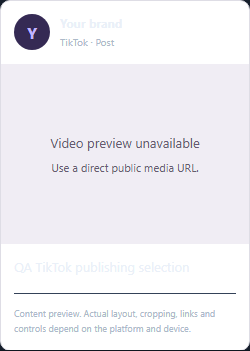
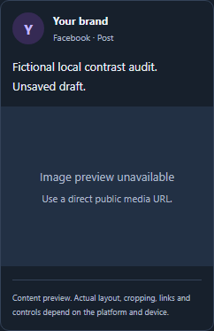
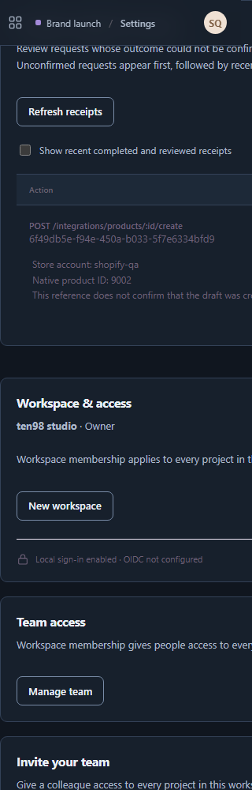
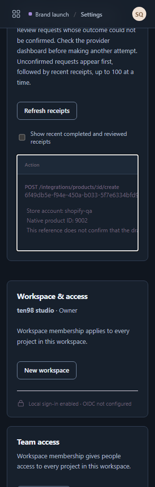
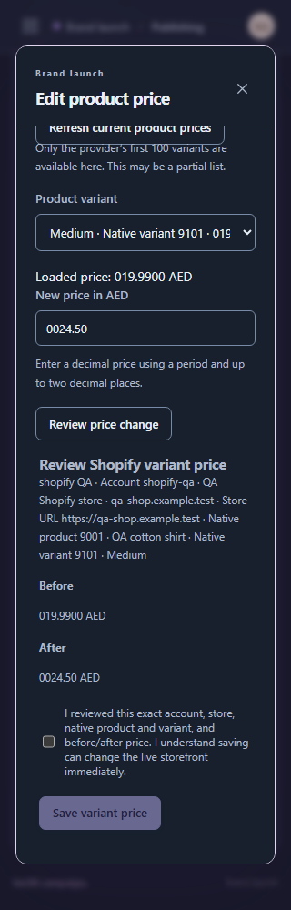
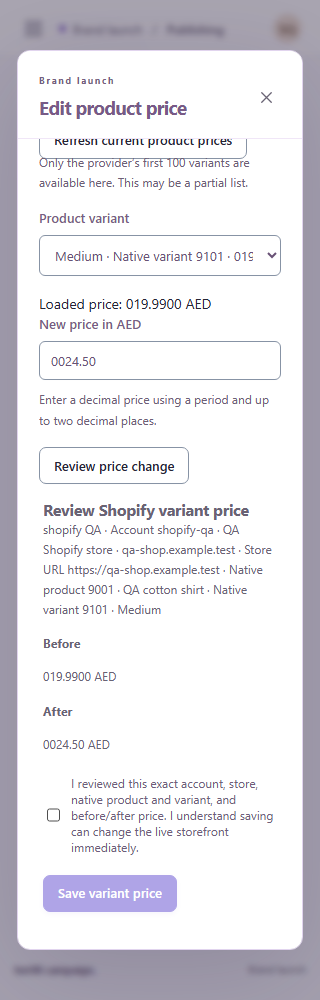
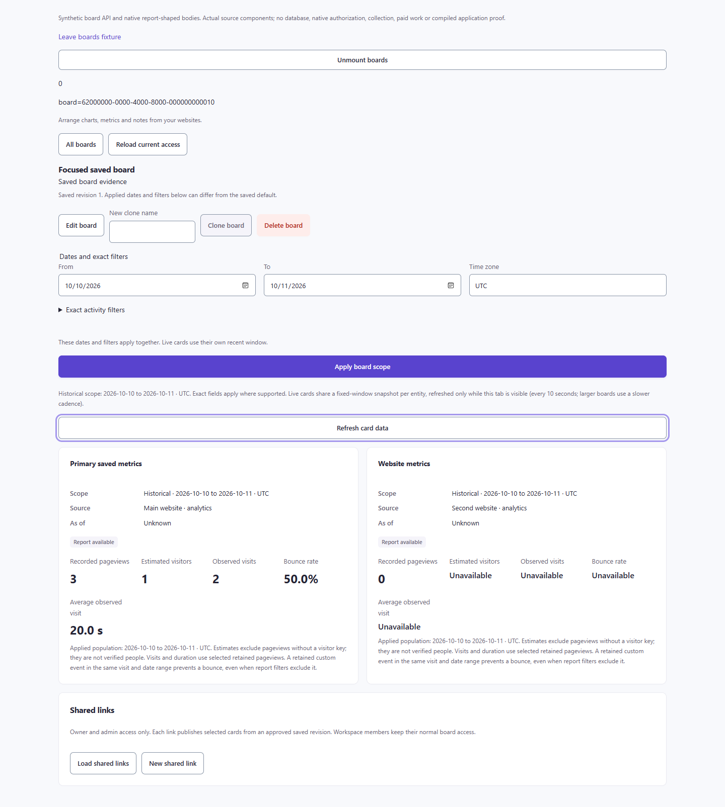
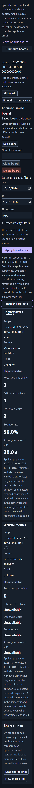

# Campaign and Discover: consumer screen review

Reviewed 19 October 2026. These images come from the consumer app source or browser fixtures, rather than the design-system catalogue. They do **not** establish a full authenticated product session, live backend/provider results, publishing, payment or successful recording playback. The seven original baseline images use Campaign **0.3.4**, Discover replay/Explorer **0.3.3**, and an unrecorded package version for Search Console. Campaign calendar/composer and Discover heatmap, Boards and Audit follow-ups use **0.3.8**; final Campaign helper/calendar captures use installed **0.3.9**, and final Discover Boards captures use installed **0.3.10**. Baseline findings are retained with their original version. Latest per-flow acceptance is tracked in the [completion ledger](../../CAMPAIGN-DISCOVER-COMPLETION.md).

The official reference images and their provenance are retained in [Campaign C2](visual-campaign.md#c2--planning-and-exact-version-approval), [Campaign C3](visual-campaign.md#c3--paid-campaign-creation) and the [Discover D3/D8/D15 register](visual-discover.md#capture-and-comparison-register). Comparisons below concern visible hierarchy only. Keep existing ten98 branding, exact accounts and values, independent workflow states, source freshness/unknown disclosures and consent boundaries.

## Current Campaign follow-up · 0.3.8

The rebuilt app was captured again in the app owner's disposable local fixture, using fictional accounts and synthetic provider responses. Page requests were restricted to same-origin reads; no provider, article, approval or ad mutation was sent. This is actual consumer markup with the installed package, rather than a catalogue approximation.

| Original 0.3.4 consumer | Rebuilt 0.3.8 consumer |
| --- | --- |
|  |  |

The native calendar now uses dark surfaces for out-of-month cells; the shared workspace switcher and selected navigation use their semantic roles. The [320px calendar](images/consumer/campaign-calendar-320-0.3.8.png) retains account-specific dates, `Asia/Dubai` and `GMT+4`. Those two original dark-theme findings are closed by actual-app re-capture.

The [320px doubled-text calendar](images/consumer/campaign-calendar-320-doubled-text-0.3.8.png) fits a 320px document. Computed fonts and numeric line heights were snapshotted before doubling; its heading changes from 22px to 44px, body zoom remains `1`, and no visible content button or input escapes horizontally. The [header crop](images/consumer/campaign-topbar-320-doubled-text-0.3.8.png) measures 72px tall, up from 58px: menu and profile controls remain inside it. This establishes the measured reflow case, not complete accessibility certification, focus-outline containment or native date-picker popup behavior.

Fresh captures also retain the [approval queue before native preview repair](images/consumer/campaign-approvals-320-0.3.8.png) and [paused ad form with the exact synthetic lead-form selection](images/consumer/campaign-ad-form-320-0.3.8.png). The preview readability repair is verified below; the long queue remains a design proposal. The ad image remains a creation form rather than a completed receipt.

### Confirmed native follow-up findings

This table records the before-state. The rebuilt native acceptance immediately below closes these readability and skip-link findings.

| Actual consumer evidence | Finding and ownership |
| --- | --- |
| [Approval preview crop before repair](images/remediation/native-preview-before.png) | `.post-preview-caption` and `.post-preview-heading strong` inherited `#eaf0f8` on opaque white: **1.146414:1**. Metadata/note inherited `#adb9ca`: **1.986889:1**. The unavailable-media placeholder had a correctly paired **5.500174:1** contrast. Campaign's native `post-composer.css` supplied a white preview surface while inheriting dark-app text. The common preview boundary now uses paired roles, preserving platform/thread/media rendering; the rebuilt 793-check acceptance below closes this finding. |
| Native composer [options](images/remediation/native-composer-options-before.png), [validation](images/remediation/native-composer-checks-before.png) and [media](images/remediation/native-composer-media-before.png) | Three sibling panels have the same native boundary defect: options summary `#eaf0f8` on `#faf9fd` measures **1.09:1**; validation heading and media title on `#fdfcfe` measure **1.12:1**. Their supporting labels measure **1.90–1.94:1**. The existing preflight summary remains a readable **6.46:1** pair. Preserve native disclosures, validation and media controls while pairing the three panel surfaces. The options image includes the modal's overlapping sticky header/footer, rather than an unobscured summary closeup. |
| [Unfocused skip-link leak before repair](images/remediation/skip-link-text-before.png) | The white strip belonged to Campaign's native `.skip-link`, not a clipped topbar control. Its fixed `top:-60px` hid a 47px element, but the doubled 65px element leaked 5px into view. Focus correctly moved it to `top:12px`. Campaign's intrinsic hide/reveal correction and keyboard recheck are verified below; shared header geometry needs no duplicate override. |

The original preview/composer colors use the actual composed paint stack, without opacity or image ambiguity. That initial composer audit verifies actual `data-theme="dark"`; changing the operating-system preference alone did not change the fixture's selected theme and supplies no light-theme evidence. The separate final acceptance below explicitly checks both actual CSS themes. These are scoped readability findings, not an app-wide contrast audit.

### Rebuilt native acceptance · 793-check Campaign checkpoint

| Original native preview | Rebuilt native preview |
| --- | --- |
|  |  |

The two images exercise the same native preview boundary with different fictional content/channel fixtures; this is a contrast comparison, not a pixel-identical content regression. Additional captures show the [light preview](images/remediation/native-preview-after-light.png), [dark preview at actual 2× text](images/remediation/native-preview-after-dark-2x.png), repaired [validation](images/remediation/native-composer-checks-after.png), [media](images/remediation/native-composer-media-after.png) and [options](images/remediation/native-composer-options-after.png) panels.

Independent Playwright acceptance on the rebuilt app passes **15 measured plain-text pairs per actual CSS theme**: minimum **6.457:1 dark**, **5.156:1 light**. The browser explicitly sets and asserts `data-theme` after load; this checks actual component CSS, not saved user-preference persistence. Restoring the old pale surfaces reproduces the failures; removing that control restores the exact current colors. Native validation, media detail and the deliberate preflight pair remain readable.

The same composer is checked at actual 2× text in both themes: all computed fonts and numeric line heights are snapshotted before enlargement, the caption changes **13→26px**, document/client width remains **320px**, and visible native controls remain horizontally inside the modal. Body/root zoom and visual viewport scale stay **1**. Intentional horizontal tab/media scrollers retain their own containment. Tall panel crops include the modal's sticky header/footer; these geometry checks do not establish every vertical focus target or unobscured full-panel screenshot.

A separate dark-theme native-focus check passes **12 cases**: caption, media URL, alt text, options title, media-details summary and footer Cancel at normal/2× text. Without manual scrolling, each target receives focus and passes center hit-testing against the sticky header/footer. No obstruction was found within that scope. This is representative focus-visibility evidence, not a complete Tab-order audit.

The skip link is now [fully hidden while unfocused](images/remediation/skip-link-text-after.png), with its bottom at **−4px** at normal and doubled text. [Keyboard focus reveals it](images/remediation/skip-link-text-focused.png); Enter focuses the main content. Restoring the old fixed offset independently reproduces the **5px** leak. Header controls stay contained. This closes the native skip-link finding without another shared-header override.

Campaign's production/type build, full **793/793** combined checks and container build pass at this checkpoint. The owner subsequently reports **816/816** checks and browser acceptance after its separate native Shopify price batch on 0.3.8; these retained root visual captures and measurements remain qualified to the 793-check source. These fixture checks sent no provider mutation and establish no live publication, payment or delivery result. The long approval queue and optional density refinements remain proposals, distinct from the corrected readability and reflow defects.

### Settings and exact price review · later frozen 0.3.8 fixture

The later native Settings capture found a separate layout defect: a 320px viewport produced a **752px** document because the direct grid column kept its table's automatic minimum. The panel and table scroller were already configured correctly. Campaign's temporary direct-child shrink guard and the identical shared 0.3.9 correction address that boundary; the following actual-app images use **0.3.8 plus the native guard**, not an installed 0.3.9 archive.

| Before: document widens to 752px | After: document stays 320px |
| --- | --- |
|  |  |

The [actual doubled-text capture](images/consumer/campaign-provider-recovery-320-doubled-text-0.3.8-after.png) also retains a **320px** document. All 111 rendered elements are snapshotted before font/line-height enlargement; the heading measures **16→32px** with actual dark CSS and root/body zoom 1. The recovery table keeps its **250px** viewport while content grows **696→1237px**. After native focus, ArrowRight moves its scroll position **0→40px** at both text sizes. No controls escape outside that intentional scroller. This is keyboard scrolling after focus, not a complete Tab-order audit. The sticky header partly covers the section heading at the captured scroll position; these are not unobscured whole-panel captures.

The [exact price review](images/consumer/campaign-price-review-320-0.3.8.png) preserves the synthetic native product/variant and literal **019.9900 AED → 0024.50 AED**. Its confirmation remains unchecked and no price is saved. Native product **9002** remains an unconfirmed reference, with the explicit disclaimer that the reference does not confirm draft creation. The frozen pass records 27 GET/HEAD requests, no external/write attempts or page errors, and only the separate fictional fixture sign-in exception. These captures establish neither live storefront changes nor confirmed provider outcomes. The faint supporting review text warrants a subsequent measured contrast review; this pass supplies no contrast ratio for it.

### Final Campaign helper-text acceptance · installed 0.3.9

Campaign installed the inspected immutable 0.3.9 archive and removed the duplicate native Settings guard. All **829/829** combined checks, production/container builds and offline non-root smoke pass. Its app-owned fixed helper color, visible as faint text in the preceding price-review image, is now the existing semantic muted role.

| Actual dark review | Actual light review |
| --- | --- |
|  |  |

Independent Playwright acceptance measures **six heading/context/before-after text samples per actual HTML theme**. Dark is **8.261:1**, `rgb(173,185,202)` over `rgb(23,32,44)`; light is **5.773:1**, `rgb(105,99,116)` over white. Computed ancestor opacity is 1 and backgrounds are composed from the actual layers. Restoring the fixed color reproduces **2.848:1**; removing it restores the exact current values. This closes the earlier helper-text finding through one app-owned rule shared by its native callers, without another library change.

Both price themes and the Settings check retain a **320px** document with root/body zoom 1. Native product 9001 / variant 9101 keeps **019.9900 AED → 0024.50 AED**, with confirmation unchecked and no save; native 9002 keeps its unconfirmed-reference disclaimer. The frozen run records 44 GET/HEAD requests, no external/write attempts or page errors, and the fictional sign-in exception. This final gate measures normal-text helper contrast and retained values; the earlier actual 2× Settings and composer evidence remains separate. It is not a whole-app contrast or focus certification.

### Final native calendar review · 0.3.9

Campaign's original action-column selector forced the shared review's After cells to 45px, creating 983px rows and a 2,038px table at 320px. Its native selectors now exclude `.t98-review-table`, preserving their former specificity and native callers. Related fixed cell colors and white hover fills are excluded at the same boundary. The shared table keeps its existing 400px minimum; no wider-table workaround or library CSS change was needed.

The final normal table has a 200px local viewport, 179px After column, 202px rows and 478px total height. Native focus plus ArrowRight moves the scroller 0→40px. Nine measured cell pairs have minimum contrast **7.409:1 dark / 5.279:1 light**; both themes fit the 320px viewport with a 305px document/client area.

The app-owned actual-text check snapshots all **213 rendered fonts and line heights before writes**. Its review heading measures **14→28px**, cells **11→22px**, root/body zoom stays 1, and the document remains 305px. The After column is 164px; two naturally wrapped 747px rows produce a 1,602px table. Both date/account/caption cells remain reachable and keep whole words; keyboard left scrolling moves 200→160px. [First After row](images/consumer/campaign-calendar-double-first-row-320-0.3.9.png) and [second-row view](images/consumer/campaign-calendar-double-320-0.3.9.png) are real app captures with horizontal table scrolling; they do not show every column simultaneously. No plan publish or calendar sync occurs. Original measurement receipt: `ten98-campaign/.cache/calendar-flow-320.json`. This closes the native calendar readability follow-up; subsequent product/recovery feature batches have separate acceptance.

## Current Discover heatmap follow-up · 0.3.8

[Actual source-component fixture, 1440px light](images/consumer/discover-heatmap-1440-light-0.3.8.png) · [320px dark with measured 2× outer text](images/consumer/discover-heatmap-320-dark-doubled-text-0.3.8.png) · [Clarity's official inspector image](images/discover/ref-heatmap.png) · [official heatmap guide](https://learn.microsoft.com/en-us/clarity/heatmaps/heatmaps-overview).

These captures come from Discover's accepted source component with synthetic saved-name/numeric-heatmap responses and a private ready-peer fixture. The blank historical sample is a test peer, **not real rrweb playback or a captured customer page**. The actual native renderer's alignment checks were exercised separately. The accepted frozen gate passes 19 groups in 80 contexts with 163 synthetic requests; the 19 visible outer preview elements are measured at 2×, including a 16→32px heading, with zoom 1. The historical iframe DOM is deliberately excluded from font modification so captured geometry remains meaningful.

**Keep:** source/viewport/time and unknown-background limits remain explicit. “Coordinate groups and depth bands” correctly describes numeric observations without claiming ranked DOM element identities. Native horizontal/vertical sample controls, accessible data and pagination remain available.

**Design proposal:** the current desktop composition still stacks the historical canvas, evidence controls and a 50-row coordinate table into a long page. Clarity's rail/canvas relationship suggests a bounded desktop inspector with adjacent evidence and sequential narrow content. That proposal requires native geometry, keyboard, scrolling and pagination checks before adoption; the screenshot does not justify inventing element identities or provider capabilities. Functional frame acceptance does not imply that this optional density change is implemented.

## Current Discover Boards and Audit follow-up · 0.3.8

| Flow and actual source-fixture captures | Comparison, accepted behavior and limits |
| --- | --- |
| D9 before native Stats repair: [320px dark](images/consumer/discover-boards-320-dark-doubled-text-0.3.8.png), [1440px light](images/consumer/discover-boards-1440-light-doubled-text-0.3.8.png), both actual 2× text · [Umami board designer](images/discover/ref-board.png) | ReportPanel keeps source/scope/as-of attached to each native metric card, including unknown time, measured zero and unavailable values. Per-card retry refreshes that card and preserves its sibling; restoring the old global retry fails the request-count control. The fragmented unavailable strings shown here are corrected by the accepted native Stats follow-up below. At this historical checkpoint the older 21-group/108-context matrix caught errors announced as status rather than alert. Its unchanged original assertions subsequently pass in the final 0.3.10 acceptance below. |
| D14: [320px light](images/consumer/discover-audit-320-light-doubled-text-0.3.8.png), [1440px dark](images/consumer/discover-audit-1440-dark-doubled-text-0.3.8.png), both actual 2× text · [Screaming Frog audit reference](images/discover/ref-audit.png) | The aggregate summary says “No findings recorded in 9 analyzed pages,” states attempted/analyzed coverage and static HTML mode, and keeps unknown page freshness explicit. It preserves native issue/page tabs and details rather than treating an empty finding list as proof that a site is healthy. Independent review and the full root gate pass all 31 original plus three new groups: 1,072 legacy and 75 new synthetic requests, inside the separate 1,200/100 limits and 1,300 total cap. |

These are actual source components with synthetic responses, not authenticated app, database, collection or provider proof. The Boards check measures 258 visible-body fonts at actual 2× and zoom 1. Both adapters report minimum plain-text contrast of 5.279:1 light and 7.409:1 dark in their measured cases. The references inform hierarchy; neither supplies identical counting, saved-revision, sharing or audit coverage semantics.

### Accepted native Boards Stats repair

| Before at actual 2× text | After native Stats correction at actual 2× text |
| --- | --- |
| [320px dark: fragmented unavailable text](images/consumer/discover-boards-320-dark-doubled-text-0.3.8.png) | [320px dark: complete unavailable words](images/consumer/discover-boards-stats-320-dark-fonts200-0.3.8.png) |
| [1440px light: oversized unavailable fragments](images/consumer/discover-boards-1440-light-doubled-text-0.3.8.png) | [1440px light: supporting status typography](images/consumer/discover-boards-stats-1440-light-fonts200-0.3.8.png) |

The native Stats helper now distinguishes unavailable status text from numeric metrics and uses text-relative tracks. Independent source review and the root rerun pass **nine groups, 64 synthetic API requests and 11 contexts** through actual BoardsPanel and its native router. Across 320/1440px and light/dark, each of four unavailable values remains a complete single-line word at **16→32px**, while numeric zero remains `0` at **24→48px**. The probes snapshot all 258 visible-body fonts before doubling; no document overflow or page errors occur and body zoom remains **1**. Wrapped `<bdi>` values preserve the same distinction. Minimum measured plain-text contrast remains **5.279:1 light / 7.409:1 dark**.

All eight retained after-captures: 320px [light normal](images/consumer/discover-boards-stats-320-light-normal-0.3.8.png), [light 2×](images/consumer/discover-boards-stats-320-light-fonts200-0.3.8.png), [dark normal](images/consumer/discover-boards-stats-320-dark-normal-0.3.8.png), [dark 2×](images/consumer/discover-boards-stats-320-dark-fonts200-0.3.8.png); 1440px [light normal](images/consumer/discover-boards-stats-1440-light-normal-0.3.8.png), [light 2×](images/consumer/discover-boards-stats-1440-light-fonts200-0.3.8.png), [dark normal](images/consumer/discover-boards-stats-1440-dark-normal-0.3.8.png), [dark 2×](images/consumer/discover-boards-stats-1440-dark-fonts200-0.3.8.png). Their original evidence is `board-status-typography/ten98-discover/private/swarm/boards-library-e3f5afdc2f/evidence.json`; copied image bytes match the eight recorded source captures.

This checkpoint closed native Stats typography, while the full D9 gate was still open. The later frozen legacy run stopped after **93.16s**, nine groups, 38 contexts and 148 synthetic requests: its unchanged malformed-revision assertion found no error alert because shared ReportPanel used `role="status"`. Unlike the earlier unexplained mount failures, retained failure DOM and screenshot identify this semantic regression. Shared 0.3.9 corrects the error announcement; the subsequent independent-name and native surface corrections are accepted in the final 0.3.10 gate below. These source-fixture captures establish no native authorization, SQL, live provider or release readiness.

### Final Discover Boards acceptance · 0.3.10

| Actual installed 0.3.10, 1440px light | Actual installed 0.3.10, 320px dark with 2× text |
| --- | --- |
|  |  |

These are the actual BoardsPanel source and native router, using the inspected 0.3.10 archive with synthetic API responses. The source images were copied byte-for-byte from `ten98-discover/private/swarm/boards-library-e6ed899b20/`; original measurements and captures remain in its `evidence.json`. They are consumer fixtures, not a complete authenticated session. Compared with [Umami's board designer](images/discover/ref-board.png), the adopted pattern keeps each report's title, scope and evidence together; native editing, revisions, sharing and unsupported rendering remain app-owned. The prominent unknown time is deliberate evidence, rather than a decorative freshness badge.

The final original Boards gate passes **21 groups, 108 fresh contexts, 445 synthetic API requests and eight captures in 110.79s including cleanup**, below its 120s limit. The public script and every original assertion remain unchanged; an independently reviewed private startup-only copy supplies exact fixture entries/preincludes. Its error-alert, independent visible heading/region name, opaque full-height card and contrast checks all pass. The new optional ReportPanel label preserves “Visitor activity” as the heading and “Visitors over time” as the region. Two scoped native wrapper rules restore the old surface/stretch boundary without changing shared CSS or adding duplicate card padding/borders.

The focused nine-group gate also passes in 11 contexts with 64 synthetic requests. One stale focused error-status expectation was corrected to **one alert / zero statuses**, with independent exact-diff review; the original 21-group script was not changed. Four 320/1440px light/dark scenes snapshot **258 visible elements before actual font/line-height doubling**: statuses measure **16→32px**, numeric zero **24→48px**, body zoom remains 1, whole words remain readable and no document overflow occurs. Minimum measured contrast is **5.279:1 light / 7.409:1 dark**.

Final app checks record **901 passed, three skipped and zero failed out of 904**, plus passing type, production build, plan, seven shared-browser groups and four token groups. The 0.3.10 shared release remains a qualified prerelease: two broad browser attempts each encountered one different pre-mount host-resource failure, with all affected isolated rechecks passing; see [shared validation](../../VALIDATION.md#independent-report-names-0310). This closes D9 shared presentation acceptance while leaving database, authorization, live-provider and deployment acceptance separate.

## Discover native replay renderer · separate harness

[Captured masked rrweb playback, 320px](images/consumer/discover-native-rrweb-harness-320.png) shows reconstructed masked content in the accepted native-player harness. It uses the unmodified local rrweb recorder/player DOM and MessagePort path, with synthetic configuration, Begin and ingress acknowledgements. The evidence records no external or unexpected requests and no page errors; hostile-resource cases remain contained separately.

This is stronger renderer evidence than the historical blank transport peer below, but its plain harness controls are **not the current 0.3.8 shared transport UI**. It does not establish authenticated recording retrieval, database persistence, customer-page fidelity or complete end-to-end masking. Keep the renderer evidence and shared-control acceptance distinct when comparing [Umami's replay UI](images/discover/ref-replay.png).

## Campaign calendar · desktop · 0.3.4

[Consumer screenshot, 1440px](images/consumer/campaign-calendar-1440-0.3.4.png) · [Sprout calendar image](images/campaign/c2-reference-repair-1.png) · [official calendar guide](https://support.sproutsocial.com/hc/en-us/articles/360000121343-How-do-I-use-the-Publishing-Calendar).

**Strength:** October 2026, date navigation and two account-specific post cards share a clear month grid. The Google Calendar section explicitly says calendar events do not publish social posts. Sprout's historical October 2022 week image provides a useful reference for a compact date/view toolbar and readable post cards.

**Original finding, closed in the 0.3.8 follow-up:** Pale out-of-month cells dominate the dark calendar, and the workspace switcher is pale with faint text. Campaign corrected its native calendar; shared `src/lib/app.css` corrected the switcher. The current actual-consumer captures above verify both.

**Limit:** Two fixture posts do not establish dense-calendar usability, successful scheduling or Google synchronization. Sprout's different period, view and dataset provide no capacity or behavior equivalence.

## Campaign calendar · narrow · 0.3.4

[Consumer screenshot, 320px](images/consumer/campaign-calendar-320-0.3.4.png) · [same Sprout desktop reference](images/campaign/c2-reference-repair-1.png).

**Strength:** The month grid becomes a readable publishing agenda. It retains `Asia/Dubai`, `GMT+4`, the October 20/21 account-specific times and explicit draft states. Google integration details wrap below the agenda.

**Gap / next task:** The long Google planning explanation and separated date controls make secondary integration work occupy much of the screen. Tighten that grouping while preserving its whole-project scope and the statement that calendar events do not publish posts.

**Limit:** This is one 320px fixture state. The supplied Sprout capture is desktop; it cannot establish a competing mobile pattern or prove keyboard, zoom or provider behavior here.

## Campaign approvals · narrow · 0.3.4

[Consumer screenshot, 320px](images/consumer/campaign-approvals-320-0.3.4.png) · [Campaign C2 reference limits](visual-campaign.md#c2--planning-and-exact-version-approval).

**Strength:** The screen explains that approval never publishes, displays exact selected account IDs, and distinguishes “Changed since review,” “Not requested” and “Submitted to provider.” The changed draft retains its review context.

**Gap / next task:** Repeated platform previews followed by account previews create a very long queue; pale preview text is difficult to read against white cards. Prioritize the account/version summary and selected creative, retaining access to each exact account preview and unavailable-media explanation.

**Limit:** Several previews explicitly lack playable media. The Sprout [calendar image](images/campaign/c2-reference-repair-1.png) and [guide](https://support.sproutsocial.com/hc/en-us/articles/360000121343-How-do-I-use-the-Publishing-Calendar) supply calendar context, not an approval dialog; no competitor approval equivalence or actual publication outcome is claimed.

## Campaign new ad form · narrow · 0.3.4

[Consumer screenshot, 320px](images/consumer/campaign-ad-review-320-0.3.4.png) · [TikTok objective-selection image](images/campaign/c3-reference-repair-1.png) · [official creation guide](https://ads.tiktok.com/resources/help/article/how-to-create-an-ad-in-tiktok-ads-manager-for-new-advertisers).

**Strength:** Labelled channel, advertising account, source, format, goal and budget fields retain `Meta · facebook QA`, `AED` and the paused-before-activation explanation. TikTok's image illustrates separation of objective choice and dependent settings.

**Gap / next task:** The form extends beyond this crop. Inspect its remaining fields and exact outgoing review at 320px before changing density; keep currency, target countries and paused/activation boundaries adjacent to their decisions.

**Limit:** Despite the filename, the image shows the creation form, ending at target countries. It does not show a completed confirmation or an ad receipt. TikTok's desktop objective picker is a different provider and stage.

## Discover replay · narrow with doubled text · 0.3.3

[Consumer screenshot](images/consumer/discover-replay-320-doubled-text-0.3.3.png) · [Umami replay image](images/discover/ref-replay.png) · [official replay documentation](https://docs.umami.is/docs/replays).

**Strength:** The captured controls remain readable at 320px with enlarged text: Ended, Play recording, `Elapsed 0:02 / 0:02`, named seek and `2×` speed. Recording context, explicit preview action and masking limitations remain visible. Umami's image offers a clear player/transport grouping reference.

**Gap / next task:** The tall blank player separates the preview action from transport. Verify a real authorized rrweb recording in the consumer, then assess a bounded responsive player with controls close to it; preserve separate replay consent, retention, completeness and masking disclosures.

**Limit:** The screenshot explicitly declares a **synthetic transport and player-peer fixture**. Its blank playback area is not real rrweb playback, capture correctness or native authentication proof. The displayed five-minute capture limit is not the observed duration.

## Discover Explorer · desktop · 0.3.3

[Consumer screenshot, 1440px](images/consumer/discover-explorer-1440-0.3.3.png) · [Umami breakdown image](images/discover/ref-breakdown.png) · [official breakdown documentation](https://docs.umami.is/docs/breakdown).

**Strength:** Applied scope sits above the result, with a visible focus ring on Edit filters. Zero events/page views/custom events remain distinct from unavailable visitors and unknown capture coverage. The literal path and campaign values remain inspectable. Umami similarly attaches an applied condition to its numeric result.

**Gap / next task:** Large gaps separate scope, measurement quality, metrics and the empty breakdown. Bring these into a tighter report group while keeping the applied 2024-02-28–29 UTC scope and bounded-CSV explanation explicit.

**Limit:** Synthetic DTOs exercise an empty report, not a live analytics query. Umami's populated country table cannot establish equal metric semantics, data coverage or scale; this image also does not exercise narrow layouts.

## Discover Search Console · desktop · saved-response fixture

[Consumer screenshot](images/consumer/discover-search-performance-desktop.png) · [Google metric/chart image](images/gaps/gsc-performance-2025.png) · [official announcement, 10 December 2025](https://developers.google.com/search/blog/2025/12/weekly-monthly-views-search-console).

**Strength:** Source, saved snapshot, property, October 1–2 interval and `America/Los_Angeles` are explicit. Unknown measurement freshness remains beside the completed import. The two rows retain `0` versus unavailable position and the second row's exact `2` clicks, `10` impressions, `0.2` CTR and `1.5` position.

**Gap / next task:** Consolidate repeated snapshot/status text into a compact report header and keep the freshness warning immediately above the table. Google's captured summary groups metrics and a trend tightly; use that hierarchy only where the consumer actually supplies data.

**Limit:** This is a synthetic saved response, not a live Google account or import. A completed import does not establish measurement completeness or freshness. Google's historical chart crop has no query table or permission state; its displayed CTR percentage must not replace the consumer's native fractional unit. No weekly/monthly aggregation or chart capability is inferred.

## Follow-up boundary

The original calendar/switcher dark-theme findings are closed by the 0.3.8 consumer captures. Other gaps remain concrete inspection/design tasks unless a follow-up explicitly closes them. Library validation and consumer acceptance remain separate in the [completion ledger](../../CAMPAIGN-DISCOVER-COMPLETION.md).
