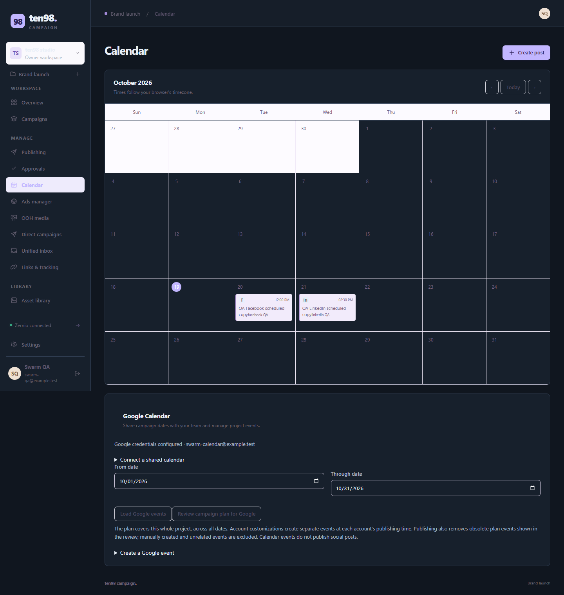
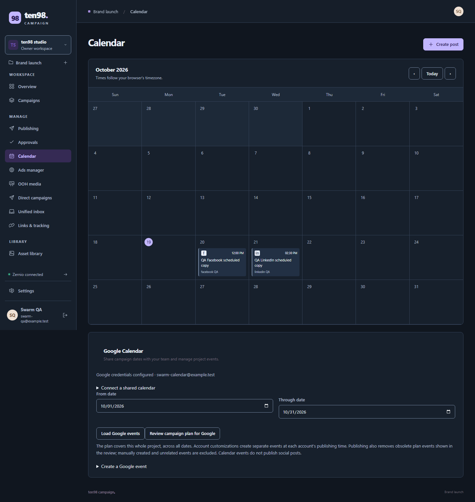

# Campaign and Discover: consumer screen review

Reviewed 19 October 2026. These images come from the consumer app source or browser fixtures, rather than the design-system catalogue. They do **not** establish a full authenticated product session, live backend/provider results, publishing, payment or successful recording playback. The seven original baseline images use Campaign **0.3.4**, Discover replay/Explorer **0.3.3**, and an unrecorded package version for Search Console. The current Campaign follow-up below uses **0.3.8**; baseline findings are retained with their original version. Discover's latest acceptance is tracked in the [completion ledger](../../CAMPAIGN-DISCOVER-COMPLETION.md); its images here remain historical until a dated follow-up replaces them.

The official reference images and their provenance are retained in [Campaign C2](visual-campaign.md#c2--planning-and-exact-version-approval), [Campaign C3](visual-campaign.md#c3--paid-campaign-creation) and the [Discover D3/D8/D15 register](visual-discover.md#capture-and-comparison-register). Comparisons below concern visible hierarchy only. Keep existing ten98 branding, exact accounts and values, independent workflow states, source freshness/unknown disclosures and consent boundaries.

## Current Campaign follow-up · 0.3.8

The rebuilt app was captured again in the app owner's disposable local fixture, using fictional accounts and synthetic provider responses. Page requests were restricted to same-origin reads; no provider, article, approval or ad mutation was sent. This is actual consumer markup with the installed package, rather than a catalogue approximation.

| Original 0.3.4 consumer | Rebuilt 0.3.8 consumer |
| --- | --- |
|  |  |

The native calendar now uses dark surfaces for out-of-month cells; the shared workspace switcher and selected navigation use their semantic roles. The [320px calendar](images/consumer/campaign-calendar-320-0.3.8.png) retains account-specific dates, `Asia/Dubai` and `GMT+4`. Those two original dark-theme findings are closed by actual-app re-capture.

The [320px doubled-text calendar](images/consumer/campaign-calendar-320-doubled-text-0.3.8.png) fits a 320px document. Computed fonts and numeric line heights were snapshotted before doubling; its heading changes from 22px to 44px, body zoom remains `1`, and no visible content button or input escapes horizontally. The [header crop](images/consumer/campaign-topbar-320-doubled-text-0.3.8.png) measures 72px tall, up from 58px: menu and profile controls remain inside it. This establishes the measured reflow case, not complete accessibility certification, focus-outline containment or native date-picker popup behavior.

Fresh captures also retain the [approval queue](images/consumer/campaign-approvals-320-0.3.8.png) and [paused ad form with the exact synthetic lead-form selection](images/consumer/campaign-ad-form-320-0.3.8.png). The approval preview readability and long queue need separate inspection; a successful calendar check does not close them. The ad image remains a creation form rather than a completed receipt.

### Confirmed native follow-up findings

| Actual consumer evidence | Finding and ownership |
| --- | --- |
| [Approval preview crop](images/remediation/native-preview-before.png) | `.post-preview-caption` and `.post-preview-heading strong` inherit `#eaf0f8` on opaque white: **1.146414:1**. Metadata/note inherit `#adb9ca`: **1.986889:1**. The unavailable-media placeholder has a correctly paired **5.500174:1** contrast. Campaign's native `post-composer.css` supplies a white preview surface while inheriting dark-app text; fix the paired roles at this common preview boundary, preserving platform/thread/media rendering. Consumer repair and re-capture remain open. |
| [Unfocused skip-link leak at doubled text](images/remediation/skip-link-text-before.png) | The white strip belongs to Campaign's native `.skip-link`, not a clipped topbar control. Its fixed `top:-60px` hides a 47px element, but the doubled 65px element leaks 5px into view. Focus correctly moves it to `top:12px`. Campaign owns an intrinsic hide/reveal correction and keyboard recheck; shared header geometry needs no duplicate override. |

The measured preview colors use the actual composed paint stack, without opacity or image ambiguity. These are scoped readability findings, not an app-wide contrast audit. Both native issues have been handed to the Campaign owner; this report does not yet claim their repair.

## Campaign calendar · desktop · 0.3.4

[Consumer screenshot, 1440px](images/consumer/campaign-calendar-1440-0.3.4.png) · [Sprout calendar image](images/campaign/c2-reference-repair-1.png) · [official calendar guide](https://support.sproutsocial.com/hc/en-us/articles/360000121343-How-do-I-use-the-Publishing-Calendar).

**Strength:** October 2026, date navigation and two account-specific post cards share a clear month grid. The Google Calendar section explicitly says calendar events do not publish social posts. Sprout's historical October 2022 week image provides a useful reference for a compact date/view toolbar and readable post cards.

**Original finding, closed in the 0.3.8 follow-up:** Pale out-of-month cells dominate the dark calendar, and the workspace switcher is pale with faint text. Campaign corrected its native calendar; shared `src/lib/app.css` corrected the switcher. The current actual-consumer captures above verify both.

**Limit:** Two fixture posts do not establish dense-calendar usability, successful scheduling or Google synchronization. Sprout's different period, view and dataset provide no capacity or behavior equivalence.

## Campaign calendar · narrow · 0.3.4

[Consumer screenshot, 320px](images/consumer/campaign-calendar-320-0.3.4.png) · [same Sprout desktop reference](images/campaign/c2-reference-repair-1.png).

**Strength:** The month grid becomes a readable publishing agenda. It retains `Asia/Dubai`, `GMT+4`, the October 20/21 account-specific times and explicit draft states. Google integration details wrap below the agenda.

**Gap / next task:** The long Google planning explanation and separated date controls make secondary integration work occupy much of the screen. Tighten that grouping while preserving its whole-project scope and the statement that calendar events do not publish posts.

**Limit:** This is one 320px fixture state. The supplied Sprout capture is desktop; it cannot establish a competing mobile pattern or prove keyboard, zoom or provider behavior here.

## Campaign approvals · narrow · 0.3.4

[Consumer screenshot, 320px](images/consumer/campaign-approvals-320-0.3.4.png) · [Campaign C2 reference limits](visual-campaign.md#c2--planning-and-exact-version-approval).

**Strength:** The screen explains that approval never publishes, displays exact selected account IDs, and distinguishes “Changed since review,” “Not requested” and “Submitted to provider.” The changed draft retains its review context.

**Gap / next task:** Repeated platform previews followed by account previews create a very long queue; pale preview text is difficult to read against white cards. Prioritize the account/version summary and selected creative, retaining access to each exact account preview and unavailable-media explanation.

**Limit:** Several previews explicitly lack playable media. The Sprout [calendar image](images/campaign/c2-reference-repair-1.png) and [guide](https://support.sproutsocial.com/hc/en-us/articles/360000121343-How-do-I-use-the-Publishing-Calendar) supply calendar context, not an approval dialog; no competitor approval equivalence or actual publication outcome is claimed.

## Campaign new ad form · narrow · 0.3.4

[Consumer screenshot, 320px](images/consumer/campaign-ad-review-320-0.3.4.png) · [TikTok objective-selection image](images/campaign/c3-reference-repair-1.png) · [official creation guide](https://ads.tiktok.com/resources/help/article/how-to-create-an-ad-in-tiktok-ads-manager-for-new-advertisers).

**Strength:** Labelled channel, advertising account, source, format, goal and budget fields retain `Meta · facebook QA`, `AED` and the paused-before-activation explanation. TikTok's image illustrates separation of objective choice and dependent settings.

**Gap / next task:** The form extends beyond this crop. Inspect its remaining fields and exact outgoing review at 320px before changing density; keep currency, target countries and paused/activation boundaries adjacent to their decisions.

**Limit:** Despite the filename, the image shows the creation form, ending at target countries. It does not show a completed confirmation or an ad receipt. TikTok's desktop objective picker is a different provider and stage.

## Discover replay · narrow with doubled text · 0.3.3

[Consumer screenshot](images/consumer/discover-replay-320-doubled-text-0.3.3.png) · [Umami replay image](images/discover/ref-replay.png) · [official replay documentation](https://docs.umami.is/docs/replays).

**Strength:** The captured controls remain readable at 320px with enlarged text: Ended, Play recording, `Elapsed 0:02 / 0:02`, named seek and `2×` speed. Recording context, explicit preview action and masking limitations remain visible. Umami's image offers a clear player/transport grouping reference.

**Gap / next task:** The tall blank player separates the preview action from transport. Verify a real authorized rrweb recording in the consumer, then assess a bounded responsive player with controls close to it; preserve separate replay consent, retention, completeness and masking disclosures.

**Limit:** The screenshot explicitly declares a **synthetic transport and player-peer fixture**. Its blank playback area is not real rrweb playback, capture correctness or native authentication proof. The displayed five-minute capture limit is not the observed duration.

## Discover Explorer · desktop · 0.3.3

[Consumer screenshot, 1440px](images/consumer/discover-explorer-1440-0.3.3.png) · [Umami breakdown image](images/discover/ref-breakdown.png) · [official breakdown documentation](https://docs.umami.is/docs/breakdown).

**Strength:** Applied scope sits above the result, with a visible focus ring on Edit filters. Zero events/page views/custom events remain distinct from unavailable visitors and unknown capture coverage. The literal path and campaign values remain inspectable. Umami similarly attaches an applied condition to its numeric result.

**Gap / next task:** Large gaps separate scope, measurement quality, metrics and the empty breakdown. Bring these into a tighter report group while keeping the applied 2024-02-28–29 UTC scope and bounded-CSV explanation explicit.

**Limit:** Synthetic DTOs exercise an empty report, not a live analytics query. Umami's populated country table cannot establish equal metric semantics, data coverage or scale; this image also does not exercise narrow layouts.

## Discover Search Console · desktop · saved-response fixture

[Consumer screenshot](images/consumer/discover-search-performance-desktop.png) · [Google metric/chart image](images/gaps/gsc-performance-2025.png) · [official announcement, 10 December 2025](https://developers.google.com/search/blog/2025/12/weekly-monthly-views-search-console).

**Strength:** Source, saved snapshot, property, October 1–2 interval and `America/Los_Angeles` are explicit. Unknown measurement freshness remains beside the completed import. The two rows retain `0` versus unavailable position and the second row's exact `2` clicks, `10` impressions, `0.2` CTR and `1.5` position.

**Gap / next task:** Consolidate repeated snapshot/status text into a compact report header and keep the freshness warning immediately above the table. Google's captured summary groups metrics and a trend tightly; use that hierarchy only where the consumer actually supplies data.

**Limit:** This is a synthetic saved response, not a live Google account or import. A completed import does not establish measurement completeness or freshness. Google's historical chart crop has no query table or permission state; its displayed CTR percentage must not replace the consumer's native fractional unit. No weekly/monthly aggregation or chart capability is inferred.

## Follow-up boundary

The original calendar/switcher dark-theme findings are closed by the 0.3.8 consumer captures. Other gaps remain concrete inspection/design tasks unless a follow-up explicitly closes them. Library validation and consumer acceptance remain separate in the [completion ledger](../../CAMPAIGN-DISCOVER-COMPLETION.md).
