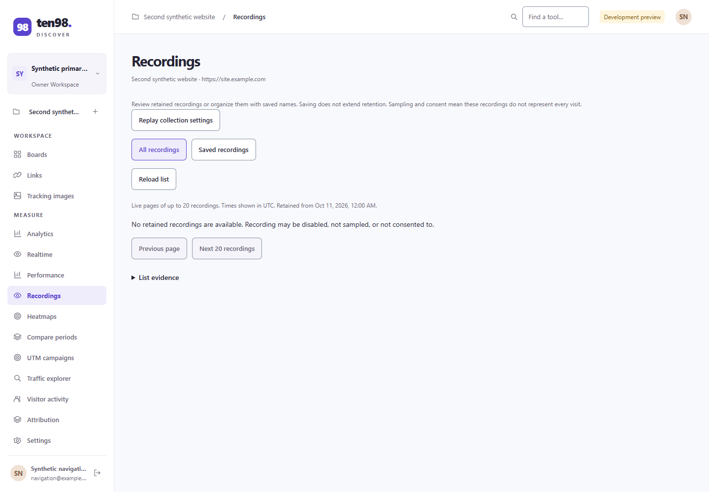
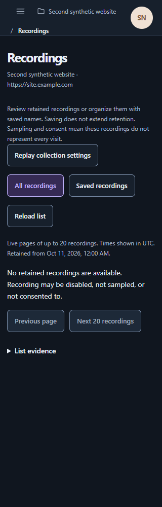

# Discover navigation, capture setup and replay review

Reviewed **19 October 2026**. Discover now uses direct task names and separates setup from retained evidence. The actual application screenshots confirm a corrected selected state for recording filters. The capture and replay source-component fixtures support the revised hierarchy and interaction checks, with the evidence limits below.

## Scope and evidence

The native application captures use synthetic project data: [desktop before](images/consumer/discover-recordings-selected-before-1440.png), [desktop after](images/consumer/discover-recordings-selected-after-1440.png), [320px dark](images/consumer/discover-recordings-selected-after-320-dark.png) and [320px doubled text](images/consumer/discover-recordings-font2-320.png). They show the real app shell and Recordings empty state, not a database-backed recording or authenticated paid-provider result.

The [capture setup](images/consumer/discover-chatgpt-setup-1440.png), [capture history](images/consumer/discover-chatgpt-captures-empty-1440.png) and [opened paused replay](images/consumer/discover-replay-opened-paused-1440.png) use the actual source components with synthetic peers. The replay image explicitly identifies its fixture boundary; its preview canvas is blank. These are useful UI evidence, not proof of a collector, native rrweb rendering, database, native authentication or provider acceptance.

External references are actual vendor UI images, rendered in Chromium and captured on 19 October 2026. They were not operated as authenticated applications. Otterly's [Add Prompts article](https://help.otterly.ai/add-prompts), dated 8 September 2026, supplies the [prompt library](images/consumer/otterly-prompts-setup-reference-1.png) and [Add Prompts form](images/consumer/otterly-prompts-setup-reference-2.png). The article date does not establish the screenshot's product version. The official [Umami replays reference](https://docs.umami.is/docs/replays) supplies the [player image](images/discover/ref-replay.png), with provenance retained in the [original visual register](visual-discover.md). No vendor branding is proposed for reuse.

## Task boundaries retained

| Destination | User task and evidence boundary |
| --- | --- |
| Saved prompts | Author and version questions, then review their runs. A saved question is distinct from a returned answer. |
| ChatGPT answers | Request and inspect DataForSEO captures of ChatGPT answers with web search. This is a named capture method, not a claim of direct consumer-account integration. |
| Answer analysis | Inspect retained answers from prompt runs. Analysis does not reconstruct missing original payloads. |
| Recordings | Browse retained recordings and open a selected recording's metadata before requesting its payload. Saving a name does not extend retention. |
| Visitor activity / Traffic explorer / Compare periods | Direct labels distinguish visitor investigation, traffic queries and period comparison. |

The implementation owner reports flat **Measure / Research / Connect** navigation, retained old search aliases and route capabilities. The supplied native screenshots visibly confirm the Measure group and direct Recordings, Compare periods, Traffic explorer and Visitor activity labels; they do not capture every navigation destination.

## Pairwise visual findings

| Captured pair | Observed comparison and disposition |
| --- | --- |
| [Native Recordings before](images/consumer/discover-recordings-selected-before-1440.png) → [after](images/consumer/discover-recordings-selected-after-1440.png) | Before, All recordings and Saved recordings had the same white background, border and text treatment despite correct pressed semantics. After, All recordings has the existing accent text, border and subtle filled background. The active sidebar destination is also visibly filled. This fixes a real state-recognition problem without changing the API. |
| [Otterly library](images/consumer/otterly-prompts-setup-reference-1.png) ↔ [ten98 capture history](images/consumer/discover-chatgpt-captures-empty-1440.png) | Otterly places Add Prompts beside its library search above the table. Ten98 places Capture answer above a separate Capture history panel with lifecycle, charge and evidence columns. Both make creation a distinct action from browsing retained records. This is a partial task match: Otterly shows saved questions, while ten98 shows capture requests and outcomes. [Source](https://help.otterly.ai/add-prompts). |
| [Otterly authoring form](images/consumer/otterly-prompts-setup-reference-2.png) ↔ [ten98 capture setup](images/consumer/discover-chatgpt-setup-1440.png) | Otterly has a compact left-aligned input block with Cancel and one Save prompts action. Ten98 similarly bounds the setup panel, gives the task one title, provides Back to captures and ends with one Review estimate action. The longer native form retains saved-prompt search, connection and estimate acknowledgement rather than copying Otterly's short form. Otterly's setup image does **not** show country selection, provider connection, per-capture quotation, saved-prompt selection or Back; those controls have no matching visual reference here. [Source](https://help.otterly.ai/add-prompts). |
| [Umami player](images/discover/ref-replay.png) ↔ [ten98 opened paused fixture](images/consumer/discover-replay-opened-paused-1440.png) | Umami gives a recorded page most of the space, with a compact timeline/transport directly below and metadata beneath. Ten98 now has a bounded preview followed by named Play, seek, speed and Close controls, while retaining completeness and masking context. The supplied ten98 canvas is blank and its transport is vertically stacked; this does not establish recorded-content or playback visual parity. Validate the final composition with real rrweb content before judging that parity. [Source](https://docs.umami.is/docs/replays). |

| Native selection correction | Narrow-screen verification |
| --- | --- |
|  |  |

At 320px, the native header, source address, recording explanation and controls wrap inside the viewport. The [doubled-text capture](images/consumer/discover-recordings-font2-320.png) shows stacked filter/pagination controls and a wrapping address rather than clipped text. These observations cover this empty state; they do not certify every populated table, dialog or contrast ratio.

## Implemented flow decisions

The owner reports one page heading with source facts; capture setup is separated from history and detail, using the existing 42rem form bound. Repeated method explanation uses a native disclosure. Back retains the guarded draft, and unknown charge, estimate, privacy, expiry and source limitations remain available. The setup screenshot confirms a separate history return action, collapsed method explanation and a disabled Review estimate action while required input is missing.

The list's **Open recording** action opens metadata/detail. The next **Open player** action loads, validates and opens a paused preview; **Play recording** remains explicit. Incomplete cached data offers **Resume loading**. Opening metadata does not automatically load the payload. UI Play, seek, speed requests and initial paused state were exercised against the synthetic peer. Native rrweb playback and real recorded-content acceptance remain unproven.

## Verification and remaining acceptance

The implementation owner reports three AI flow groups passing in 3.97s, 19 actual-application groups in 23.868s, and eight replay groups containing 47 contexts, 92 GET checks and 11 asset checks in 49.22s. The actual-application fixture was strengthened to require the exact second project and an empty search query. Negative checks fail against the old Open player and history-focus behavior. The doubled-font probe first caught a 12px `!important` source-address rule; the corrected probe snapshots/restores styles and asserts exact doubled font sizes and numeric line heights. These are reported run results, not independently rerun by this documentation review.

The owner also reports 95 offline checks, type/build and plan checks passing. The main working checkout received the nine owned files on 19 October at 19:38 UTC. Root independently compared all nine final SHA256 pins with those actual files: all match. The owner's separate conservation check preserves all 95 unrelated inherited hashes, with 104 dirty public paths and no extras. The frozen runtime source predates the copy; checkpoint clarification changes no public file. This review does not change the existing `.10` integration pin.

<details><summary>Frozen main-checkout source pins</summary>

```text
src/components/AISearchPanel.tsx 1620B15989BC6D84E56BCC28F93959D404F2CB683D51EE289373FD392600324B
tests/research-flow-browser-fixture.tsx FFB0112FE577E62AAA68046950BF91D786B344F409E5FDB63F49E26C056678A2
tests/research-flow-browser.mjs 9CA3095CC95CC6D62BFD6D8CC6F32207E962FEA3C087161084BF9BEE3E54CF84
src/components/SessionReplayPanel.tsx 09EED76E785ACE22A05F6D5C13071DC57849EE26A411DBD16D79F37FFD732FBF
tests/session-replay-browser.mjs 661CE2F834663B936C92D4D0011FE7248A39C8A95B1475D94D0ADA41C8B6D892
src/routes/index.tsx AA00633A89BECB930C13C8416DC4734C96F45B09BC787250A7551D08620E2830
src/campaign-ui.css FEEA2AA072443FFD85ABF2CE89E33F6024BF27EE256C5E4F8F943B295FF9B998
tests/ai-search-browser.mjs 1EA6339BA6240A10B49F4884813FA00153D446B7F6655802BE91F488A09AAF06
tests/workspace-navigation-browser.mjs 206AC02213AEBA681BF8C186D1212AD50ED0BF3D4F91A1001DF3B1D451D64F69
```

</details>

Remaining acceptance is concrete: inspect populated capture history and real paid-provider outcomes; exercise a retained recording through the authentic collector and native rrweb player; compare its rendered content and transport with the reference at desktop, narrow width and doubled text. The existing UI checks remain valid within their synthetic boundaries. No database, authentication, paid SQL, collector or provider completion is claimed.
