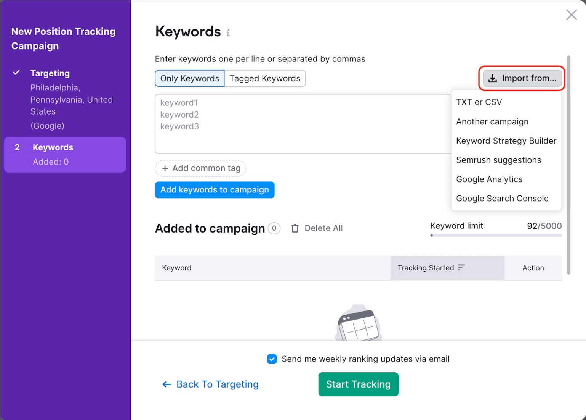
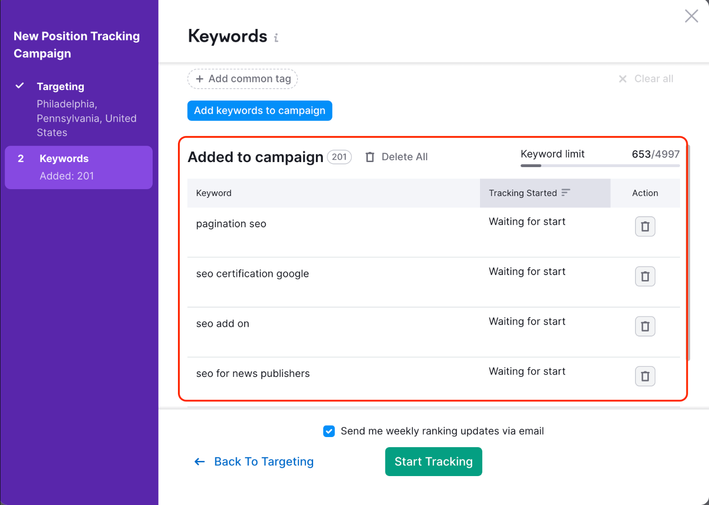
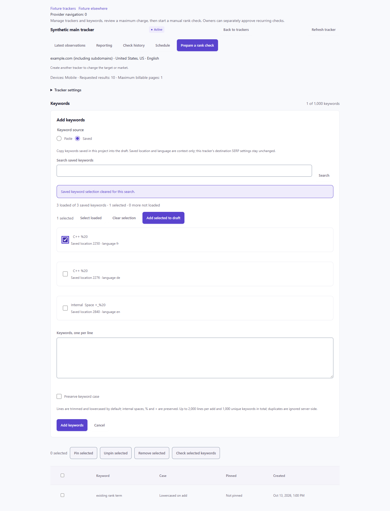
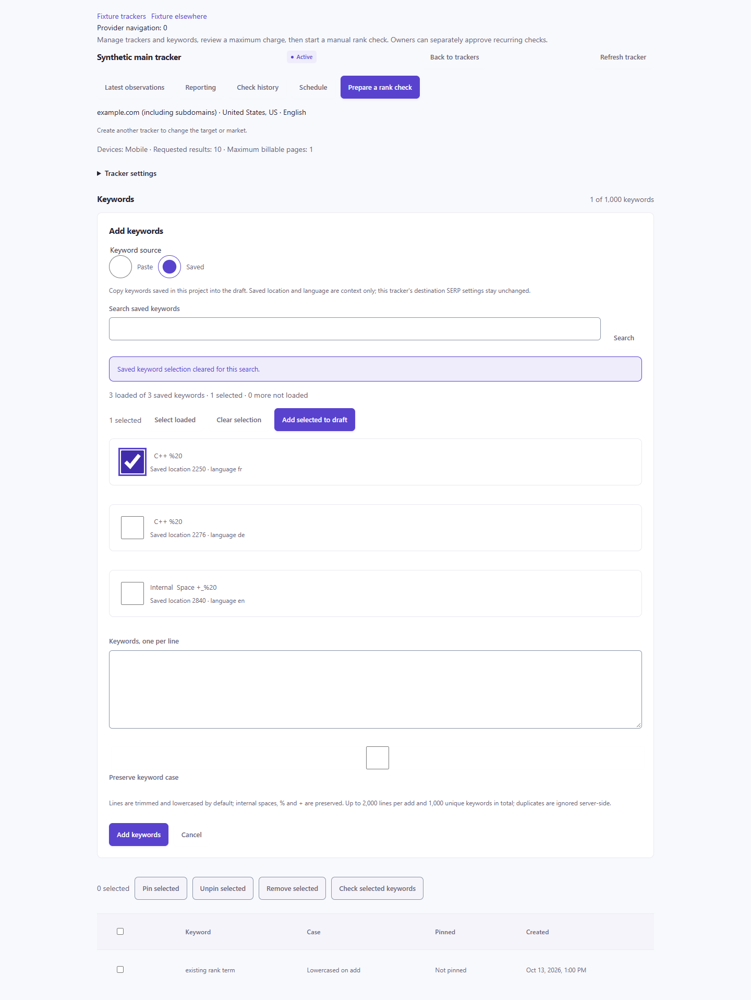

# Saved keywords into rank tracking

This review follows the [D13 saved-keyword selection contract](../../research/campaign-discover/flows.md#d13-saved-keyword-selection-contract). It compares the exact keyword-source task with a real product UI image and the Discover implementation. Source choice, local draft editing, saving tracker keywords and starting a paid check are separate actions.

## Actual reference

Source: [Semrush Position Tracking setup, Step 2](https://www.semrush.com/kb/548-configuring-position-tracking), [official UI image](https://static.semrush.com/kb/uploads/2025/05/22/image-20250522172424-5.jpg). Captured on 19 October 2026 by rendering the official image in Playwright and screenshotting its image region. This is vendor-published product UI, not an authenticated session we operated. The source is 1600×1145; its browser-fitted capture is 1538×1100. PNG SHA256: `88652454D7B4682C73802B3A831A0681FD8D455F694866D05338F0377F9ED82A`. The source screenshot includes its own red highlight around Import from. Its publication date and application version are not established by its URL.

**Observed:** an import-source menu sits beside keyword entry; Add keywords to campaign is distinct from the lower Added to campaign review table and Start Tracking action. The six visible import sources and tagging controls belong to Semrush. The screenshot shows an empty added list; it does not prove a completed import or selection behavior.

The same [setup guide](https://www.semrush.com/kb/548-configuring-position-tracking) supplies this [filled review image](https://static.semrush.com/kb/uploads/2024/01/23/Screenshot%202024-01-23%20at%2012.35.02.png). Its sidebar and Added to campaign count both show 201; four visible rows say Waiting for start. The separate Start Tracking footer remains. The image itself highlights the review area in red. It corroborates the added-versus-started distinction, without proving our execution of the vendor flow. Captured through the same one-image Playwright method; PNG is 1542×1100, SHA256 `F42BB354C83FA29487413BA40688D83EF4CD9ADE49AC2E7F52D67AB3742BC67F`. Quota numbers are vendor/sample context, not ten98 limits.

**Adaptation:** use two visible native source choices, Paste / Saved keywords, for Discover's two supported sources. Put controlled saved-row selection and Add selected to draft beside each other. Keep the editable draft and existing Add keywords action separate from later cost review and Start. Preserve ten98 branding, immutable destination SERP scope, literal keyword text and native mutation guards. Neither the image nor the vendor documentation establishes ten98's pagination, selection-reset or billing semantics. Do not import the vendor's additional sources, quota or automatic first-project launch behavior.

## Actual Discover implementation

| Official source relationship | Native Discover implementation |
| --- | --- |
| Source menu, editable entry, separate campaign review and later Start Tracking, captured above. |  |

Discover now offers Paste / Saved inside its existing Add keywords form. Saved explicitly reads this project's saved rows; search and Load more use the existing read-only POST route. Checked rows append literal keyword text to the editable draft. Existing manual edits remain, selection clears after copying, and focus moves to the draft. Only the existing Add keywords action submits the native mutation; cost review and Start remain separate. Saved market/language stays source context and does not change destination SERP settings.

These captures show the actual RankTrackingPanel, RankTrackingView, native router and application styles with installed **0.3.10**, using synthetic APIs. They are not a full authenticated product session. The [320px normal light form](images/consumer/discover-rank-keyword-picker-320-light-0.3.10.png) and [320px dark form at actual 2× text](images/consumer/discover-rank-keyword-picker-320-dark-doubled-text-0.3.10.png) retain complete labels and local list scrolling. Image bytes match the app-owned captures under `ten98-discover/private/swarm/cycle13/integration-evidence/rank-saved/`.

### Screenshot-derived corrections

| Finding in actual native rendering | Accepted correction |
| --- | --- |
| A full 50-row list was **6,286px** tall; its first checkbox began at 805px and append action at **7,082px**. Bulk controls followed every row. | Put bulk controls before the list and bound the labelled, focusable native list to `min(24rem, 50vh)`. In the measured 1440px scene the local viewport is **384px**, with the same **6,286px** scroll content; the toolbar begins at 782px, before the first checkbox at 863px. End scrolling, first/last checkbox focus and all 50 literal labels pass. |
| Keyboard append cleared selection and disabled its trigger, leaving activeElement on BODY. | Reuse the existing `focus: 'words'` mechanism to focus the editable draft; keyboard activation now asserts that destination. |
| New 44px checkbox/radio glyphs dominated the text; the case checkbox inherited text-field sizing and appeared far from its label. | Use compact native glyphs inside at least **44px clickable labels**, retain the radio/native height gate, and put Preserve keyword case beside its checkbox. State, exact text and mutation handling remain unchanged. |

| Before control/layout polish | Final native controls |
| --- | --- |
|  |  |

The control-polish before-image is a retained actual capture of View SHA256 `0D288F746B4EE6C5C79BAEE2AFD9AAED7C38C6524B52D3372B2199EDCF0E58CB`. The separate [50-row before-layout image](images/consumer/discover-rank-keyword-picker-50-before-replay.png) was **regenerated**, not retained from the first run: a read-only Vite substitution renders the exact frozen pre-layout View `C1A349B9CF2052F237063706EA6533E26F4FAC858D7BAA1F1DD7134D568641EB` with the same native fixture. Its source hash and Vite substitution hit were verified and it reproduces the original geometry. The [final 50-row source region](images/consumer/discover-rank-keyword-picker-50-after.png) shows the accepted bounded list; neither is a live customer session.

### Playwright acceptance

- **Focused flow:** 21 groups, 76 synthetic API requests, one context, **14.71s**; below the 100-request/24-context/120s caps. Hard-coded checks cover exact draft prefix/newlines/manual edits, literal `C++`/`%20`, source-market identity, append versus search replacement, malformed DTOs/cursors/revisions, access loss, obsolete requests, explicit raw add payload, deliberate capacity refusal and exact uncertain-write retry. Picker actions issue no quote/start/research-save/refresh requests or provider-navigation callbacks.
- **Native regression:** all **14 scenarios**, 85 synthetic requests, one context, **13.85s**. One public wait was strengthened from ambiguous text “Pinned” to the exact status **cell**, preventing a table header from satisfying it before the reply. The exact one-line diff was independently reviewed; other scenarios, assertions and timeouts remain. The final public test is not described as byte-identical to its baseline.
- **Rendering:** eight English LTR width/theme/font scenes cover 1440/320px, light/dark and normal/actual 2× text. Computed fonts are snapshotted before enlargement, body zoom remains 1 and document widths stay 1440/320px. Every scene requires three source checkboxes plus Preserve case, non-null containing labels and label width/height ≥44px; radio/native height checks remain. Four settled normal-text contrast scenes measure 24 pairs each, with minimum **5.773:1 light / 7.096:1 dark**. This is scoped evidence, not whole-app accessibility certification.
- **Other relevant gates:** typecheck, production build, plan and 24 offline rank-parser checks pass. The runnable regression remains in Discover as `tests/rank-saved-keywords-browser.mjs`, opt-in with `TEN98_RANK_SAVED_BROWSER=1` and its existing installed Playwright module/channel configuration. It reuses the existing public fixture and adds no framework or dependency.

Final frozen sources: Panel `054CC5C122ADAB25A9ED1C72E7B58E74B6428A8628111F014FB702B6F9B898D1`; View `3341CD16FFDFA13798B773D007A02722CD8737A3D591B9BFE28AFDC225DB21BE`; focused public test `6B696A080D583DE0DBA43C758C2F73415BB391EDE746E3179E7656612FAE613C`; native public test `C79D10ECA8681553C10702D231E681C9D3E2EADDDF5EC3E09A3CE2ABB584A232`. Receipts/scripts are preserved in the app's main private evidence directory before isolated-checkout cleanup.

Independent controller, exact-diff, oracle and visual reviews found no remaining blocker after the listed corrections. Early focused runs corrected a wrong fixture heading, a selector that included source context, a vacuous count/provider check and target-oracle coverage; actual browser scroll settling was awaited rather than weakening end-position assertions. These corrections are retained separately from product changes.

**Limits:** synthetic capacity rejection and acknowledgement receipts establish client behavior, not SQL atomicity or durable server idempotency. Held obsolete requests may already be aborted, so the harness shows they cannot affect this UI without independently proving delivery of a late server response. Browser interception does not observe server-to-provider traffic. Database/provider work remains paused. The existing library primitives cover this flow; fixes belong to native composition/focus and shared usage guidance. No library API, token, CSS, dependency or archive changed, and [0.3.10's shared prerelease qualification](../../VALIDATION.md#independent-report-names-0310) remains in force.

Third-party product UI remains attributed comparative evidence, not a ten98 product asset or an MIT relicensing of Semrush's interface. Images are excluded from the package archive.
