# Campaign: actual product UI compared with today's ten98 flows

Captured and visually inspected **19 October 2026**. Every reference below is an actual product UI image rendered by a browser from an official public help or product-update page, or its linked image. **None is a live authenticated competitor session.** Current ten98 captures are the synthetic local flow recipes at `http://127.0.0.1:5198`, at a 1440 × 1000 viewport; the image itself contains the whole relevant preview or review dialog. Screenshots are limited excerpts for comparison. Their brands and assets are not implementation assets.

This review follows the scope and state constraints in [flows](../../research/campaign-discover/flows.md), [evidence](../../research/campaign-discover/evidence.md), and [recommendations](../../research/campaign-discover/recommendations.md). It adds visual evidence; it does not establish competitor usability, accessibility, API parity, or production readiness. Keep Campaign's logo, icons and login. Keep exact accounts, provider capabilities, transactional purpose, independent approval/scheduling/delivery states, and reconciliation before repeating an unknown write.

## Eight-flow coverage

All source URLs were accessed on 19 October 2026. A dated sample remains historical even when the help page is current.

| Flow | Official rendered product UI and exact screenshot | Matching current ten98 capture | Coverage and decision |
| --- | --- | --- | --- |
| C1 Composer | [Buffer composer guide](https://support.buffer.com/articles/scheduling-posts-4Qdld7giAZ) · [channel picker + preview](images/campaign/c1-reference-1.png) | [Composer](images/campaign/c1-current.png) · `#flows/campaign-compose-social` | Match for account selection and composition/preview hierarchy. Retain account-specific copies; improve selection density. The reference is an empty composer with its picker open, not a completed media preview. |
| C2 Calendar / approval | [Sprout calendar guide](https://support.sproutsocial.com/hc/en-us/articles/360000121343-How-do-I-use-the-Publishing-Calendar) · [official linked calendar image](https://support.sproutsocial.com/hc/article_attachments/9943416254221) · [capture](images/campaign/c2-reference-repair-1.png) | [Agenda](images/campaign/c2-current.png), [exact-version review](images/campaign/c2-current-review.png) · `#flows/campaign-plan-approve` | Historical **October 2022** week-view sample. Match for planning density; no competitor approval dialog captured. Retain agenda and explicit version review. |
| C3 Paid creation / paused review | [TikTok May 2026 creation guide](https://ads.tiktok.com/resources/help/article/how-to-create-an-ad-in-tiktok-ads-manager-for-new-advertisers) · [official linked objective image](https://lf-tt4b.tiktokcdn.com/obj/i18nblog/tt4b_cms/en-US/5jqet0ab9qci-12Bua6ivWfFLRQBZj2q8LG.png) · [capture](images/campaign/c3-reference-repair-1.png) | [Settings and creative](images/campaign/c3-current.png), [paused-creation review](images/campaign/c3-current-review.png) · `#flows/campaign-create-paid` | Partial: objective selection only; TikTok native UI versus a Google Ads fixture. No competitor paused-creation or activation review was observed. Retain ten98's separate paused/create/activate contract. |
| C4 Performance / change | [Optmyzr All Accounts guide](https://help.optmyzr.com/en/articles/7892969-all-accounts-dashboard-user-guide) · [scope, table and health popover](images/campaign/c4-reference-final-1.png); [Budget Dashboard update, 25 May 2026](https://updates.optmyzr.com/en/see-exactly-how-your-spend-tracks-against-target-kRxmHbso) · [budget overview](images/gaps/optmyzr-budget-overview-2026.png), [target/actual spend](images/gaps/optmyzr-spend-comparison-2026.png) | [Performance and budget form](images/campaign/c4-current.png), [change review](images/campaign/c4-current-review.png) · `#flows/campaign-performance-change` | Partial: scope/cost/diagnostics plus budget-summary hierarchy. All Accounts sample dates are **November–December 2023**; the new figures accompany a **25 May 2026** article, with no sample year visible. Neither shows a before/after change confirmation. Retain exact change review, ownership and currency. |
| C5 OOH booking | [Broadsign Guaranteed campaign guide](https://docs.broadsign.com/broadsign-platform/en/Documentation_Gteed_Campaigns/g-c-new-campaign.html) · [inventory choices](images/campaign/c5-reference-repair-1.png), [save/hold/booking actions](images/campaign/c5-reference-final-1.png) | [Inventory proposal](images/campaign/c5-current.png), [booking review](images/campaign/c5-current-review.png) · `#flows/campaign-ooh-booking` | Partial: actual UI strips, not a complete booking workspace or provider receipt. Retain distinct proposal/commit/readback; do not import unsupported inventory types or hold features. |
| C6 Inbox / recovery | [Agorapulse assign/review guide](https://support.agorapulse.com/en/articles/10441656-how-to-assign-and-review-items-in-the-inbox) · [official inbox GIF frame with assignment dialog](images/campaign/c6-reference-final-1.png) | [Recovery plus opened conversation](images/campaign/c6-current-inbox.png) · `#flows/campaign-recovery-inbox` | Match for inbox list/detail/context. Capture is a frame of a published walkthrough, not interaction testing. No competitor publication-recovery screen captured. Retain per-destination receipts and separate workflow review. |
| C7 Media / approval | [Frontify official asset sharing guide](https://help.frontify.com/en/articles/4895189-sharing-capabilities-assets-collections-and-folders) · [asset grid + contextual actions](images/campaign/c7-reference-repair-1.png) | [Metadata, review gates and attachment](images/campaign/c7-current.png) · `#flows/campaign-media-approval` | Partial: asset discovery/contextual actions, not exact-version approval. Bynder detail page was browser-blocked. Retain full metadata and gates; improve visual discovery only when real previews exist. |
| C8 Audience / send | [Mailchimp import-results guide](https://mailchimp.com/help/view-import-results/) · [actual import-result UI](images/campaign/c8-reference-final-1.png) | [Five-row import + audience](images/campaign/c8-current-audience.png), [exact transactional send review](images/campaign/c8-current-review.png) · `#flows/campaign-direct-audience` | Partial: import-result feedback only, with **October 2019** sample. No desktop send-checklist UI rendered from the regular-email guide. Retain transactional eligibility and exact send review; improve result summary hierarchy. |

## C1 — Composer

| Buffer: official captured UI | Current ten98: actual local recipe |
| --- | --- |
| 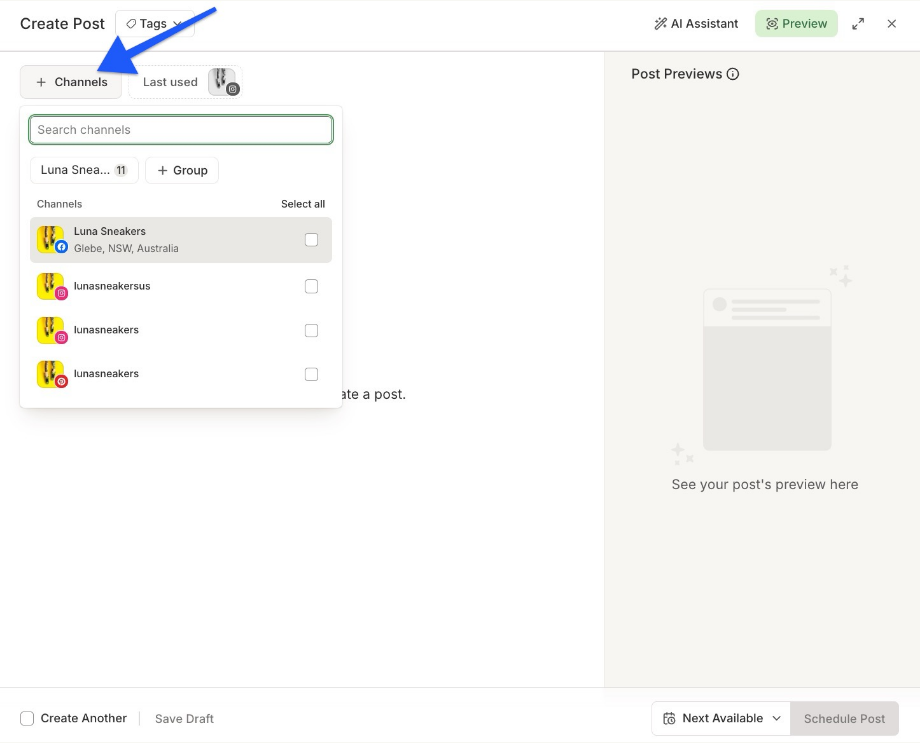 | 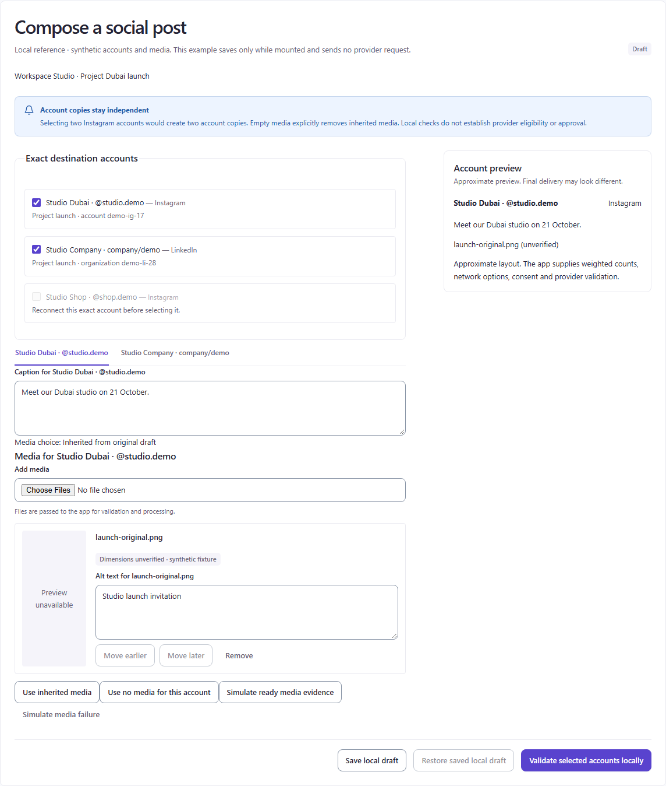 |

**Observed comparison.** Hierarchy: Buffer puts channel selection near the title and preserves the central editing area; ten98's expanded account cards occupy much of the editing column before the caption. Actions: Buffer places scheduling/draft actions in a clear footer; ten98 also has a footer, but several simulation buttons sit among media-editing controls. Density: ten98 exposes full account IDs and a large alt-text field even for one unverified item. Context: ten98's account tabs and active-account preview make independent copies explicit, which this reference does not demonstrate. Feedback: ten98 visibly names unverified media and approximation; the empty Buffer preview cannot establish media-validation behavior.

**Retain / improve.** Retain account tabs, exact destination names, disabled reconnect reason, alt text and approximate preview. Improve the default composition hierarchy by making the selected-account summary compact with an explicit way to inspect/select accounts; put demo outcome controls in a labelled disclosure while keeping readiness adjacent to the media.

**Concrete target:** `src/catalog/campaign/ComposeSocialPost.tsx`, composed with the existing `DestinationPicker` and `EditorTemplate`. No new composer framework or provider grouping is justified by this screenshot.

## C2 — Planning and exact-version approval

| Sprout: historical official calendar sample | Current ten98: agenda and review |
| --- | --- |
| 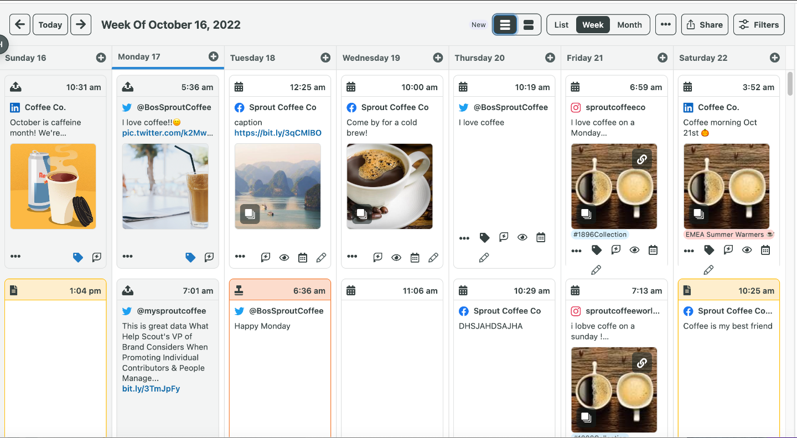 | 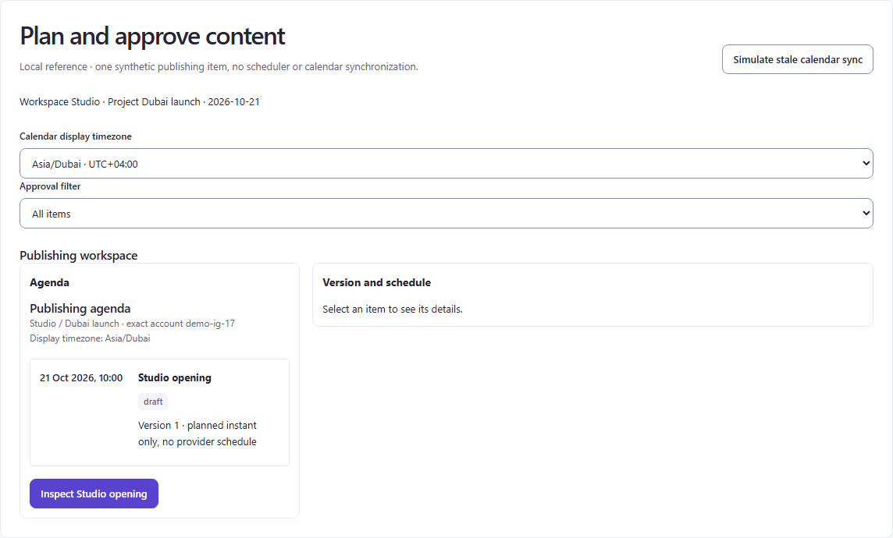 |
| Calendar reference has no approval dialog in this capture. |  |

**Observed comparison.** Hierarchy: Sprout keeps date navigation, view choice and filtering in one toolbar above date columns; ten98 stacks two full-width selects above a single-item list/detail workspace. Actions: Sprout's cards expose many small icons; ten98 has a clear labelled Inspect action and textual review actions. Density: the week grid presents many posts; the one-record fixture cannot demonstrate comparable scanning at scale. Context: ten98 explicitly displays the calendar timezone and the review's exact submitted instant. Feedback: ten98's review states that approval does not schedule or prove delivery; this must survive visual cleanup.

**Retain / improve.** Retain the keyboard-friendly agenda and review dialog. Tighten the wide-screen timezone/filter toolbar and make the selected item's title/time the dominant detail heading. A week/month renderer remains a separate scope decision; the historical image does not require adding it.

**Concrete target:** `src/catalog/campaign/PlanAndApprove.tsx` toolbar and `PublishingAgenda` composition. Keep native labelled time fields, exact revision and timezone semantics.

## C3 — Paid campaign creation

| TikTok: official objective-selection UI | Current ten98: settings and paused review |
| --- | --- |
| 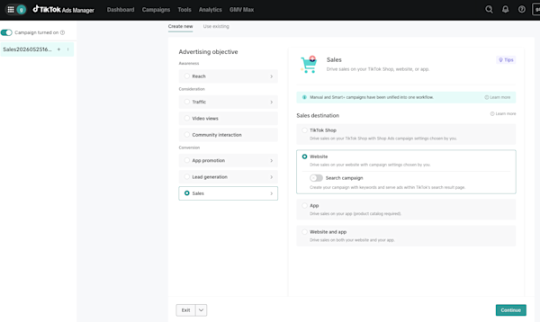 | 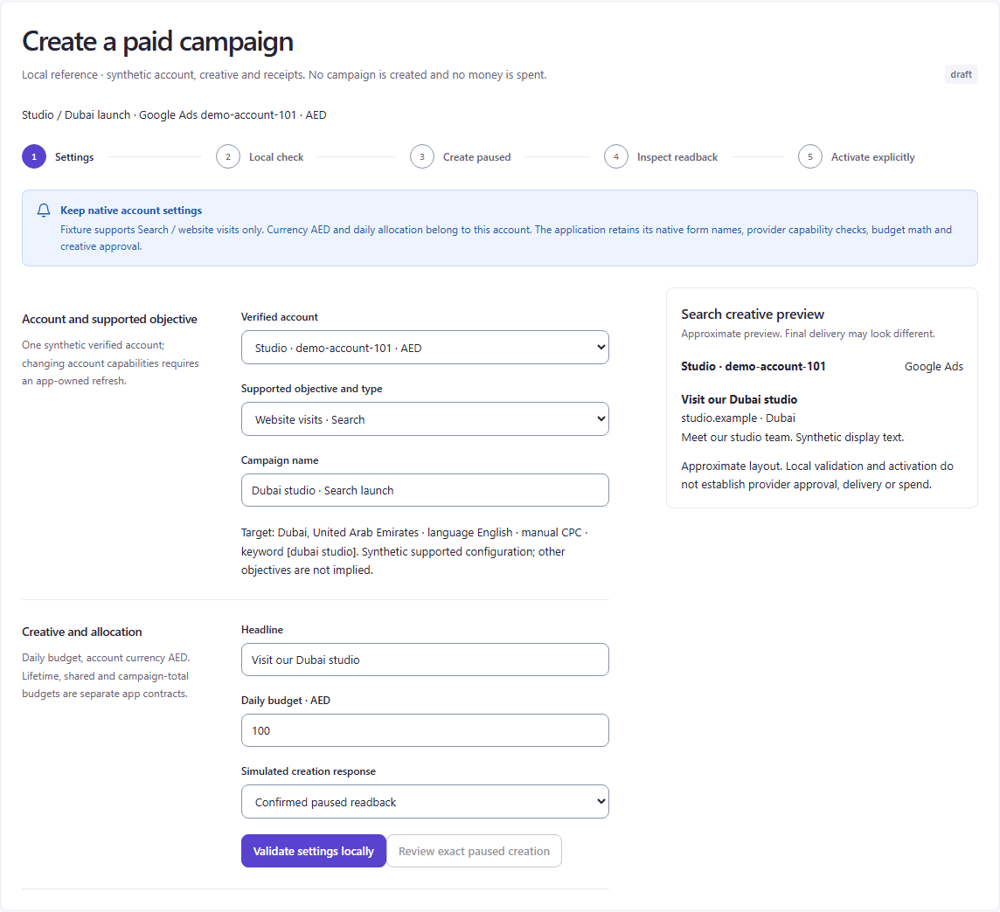 |
| Reference does not show paused creation or activation. | 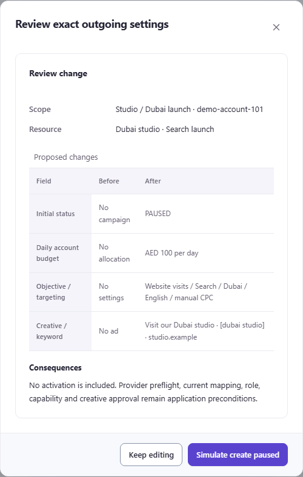 |

**Observed comparison.** Hierarchy: TikTok separates objective choices in a rail and shows dependent destination choices beside it; ten98 shows a stepper, account fields and preview together. Actions: TikTok shows one Continue action; ten98 shows local validation followed by an initially disabled review action. Density: ten98's prose capability description competes with ordinary field labels. Context: ten98 names account currency and daily allocation explicitly. Feedback: ten98's review lists initial PAUSED status and no activation; the TikTok objective image provides no equivalent evidence. Its 600 × 358 source also cannot support detailed typography or contrast judgments.

**Retain / improve.** Retain the supported one-objective scope and separate paused-create/activate stages. Move simulated response selection into demo controls and shorten contextual prose beside the objective without hiding currency or preconditions. Improve creation review to prioritize final settings rather than repeated low-information “No…” before values.

**Concrete target:** `src/catalog/campaign/CreatePaidCampaign.tsx` and its `ReviewSummary` composition. Do not add TikTok objectives or change Google's provider contract based on this reference.

## C4 — Performance inspection and paid changes

| Optmyzr: official dashboard and budget samples | Current ten98: inspection and edit |
| --- | --- |
| 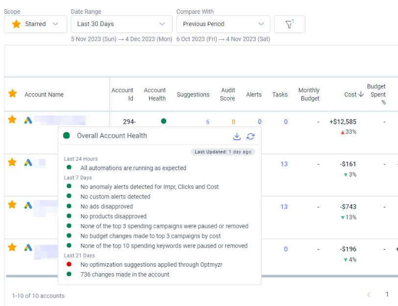 | 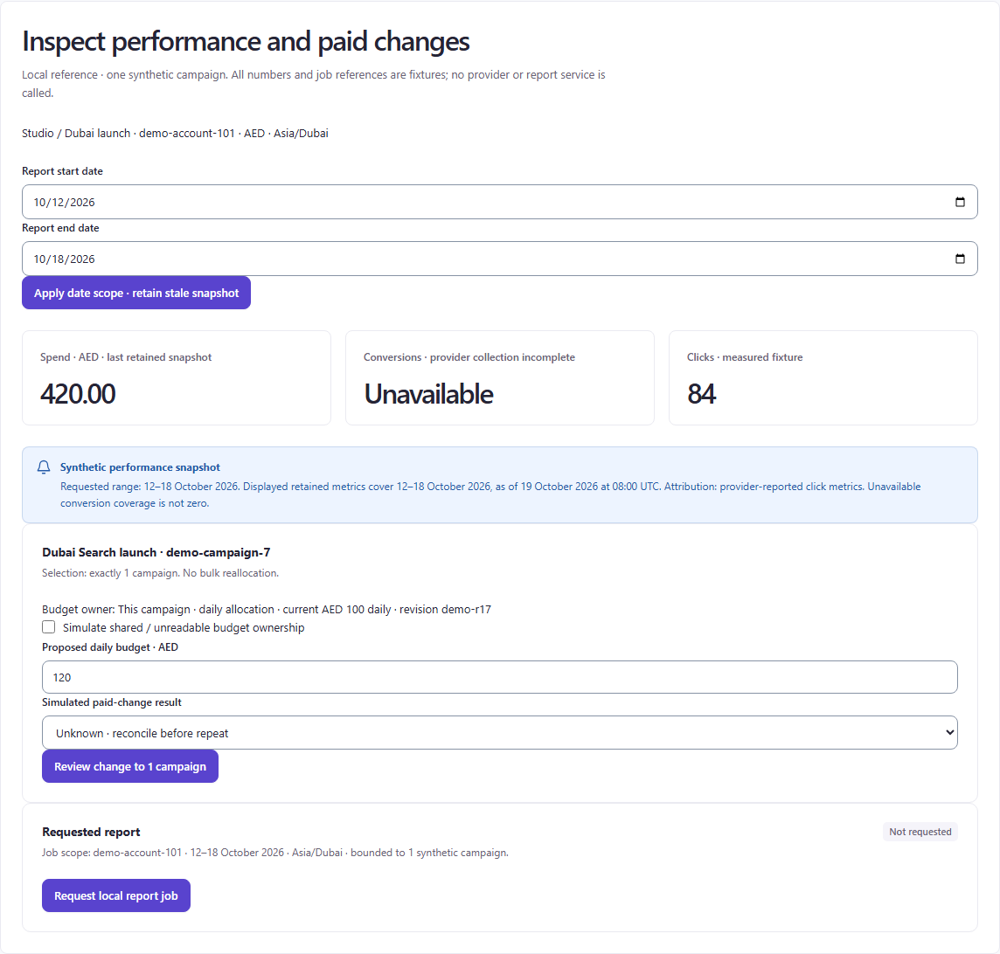 |
| 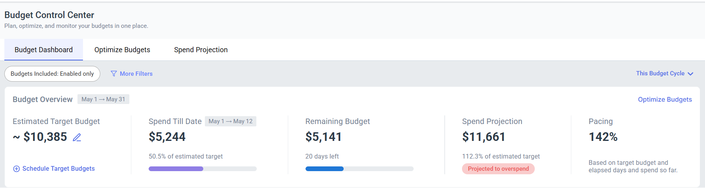 | 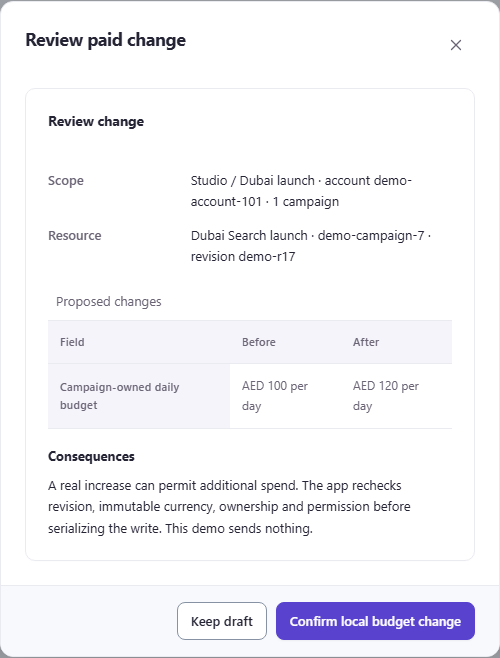 |
| 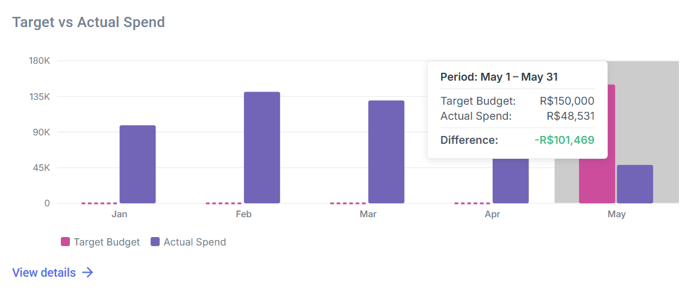 | Neither new reference shows a budget-change confirmation or provider outcome. |

**Observed comparison.** Hierarchy: Optmyzr places scope/date/comparison above rows and opens health diagnostics in context; ten98 places two long date fields before metrics and a large budget form. Actions: ten98's date-apply, budget-review and report-request buttons each appear primary in separate sections. Density: Optmyzr is a multi-account table; ten98 is a single-campaign fixture, so row capacity is not an equal dataset comparison. Context: both expose scope; ten98 also exposes retained snapshot range/time, budget ownership and revision. Feedback: ten98's unavailable conversions are explicitly different from zero; retain that disclosure rather than copying numeric dashboard presentation blindly.

The 25 May 2026 update adds two narrower comparisons: Budget Control Center groups target, spend to date, remaining budget, projection and pacing beneath a cycle/filter bar; the separate target-versus-actual chart keeps a legend and a period/value/difference tooltip next to its bars. The figures use `$` and `R$` respectively and are separate samples, not a currency conversion or ten98 budget values. Neither crop demonstrates edit confirmation, ownership validation or a provider receipt.

**Retain / improve.** Retain measured/unavailable distinctions, ownership block, before/after review and independent report retrieval. Use a compact wide-screen date toolbar; group supplied budget context beside campaign scope, then make budget editing a deliberate secondary task. Keep actual stale-range disclosure beside the metrics. Borrow the new figures' grouping only: do not add forecasts, pacing, target scheduling or charts without corresponding supplied data and an approved contract.

**Concrete target:** `src/catalog/campaign/InspectPaidPerformance.tsx`. The retained dashboard and budget-summary figures support inspection layout; the rejected monthly-spend automation-settings image remains outside this comparison. No automatic reallocation feature is approved.

## C5 — OOH proposal and commitment

| Broadsign: actual official UI excerpts | Current ten98: proposal and review |
| --- | --- |
|  | 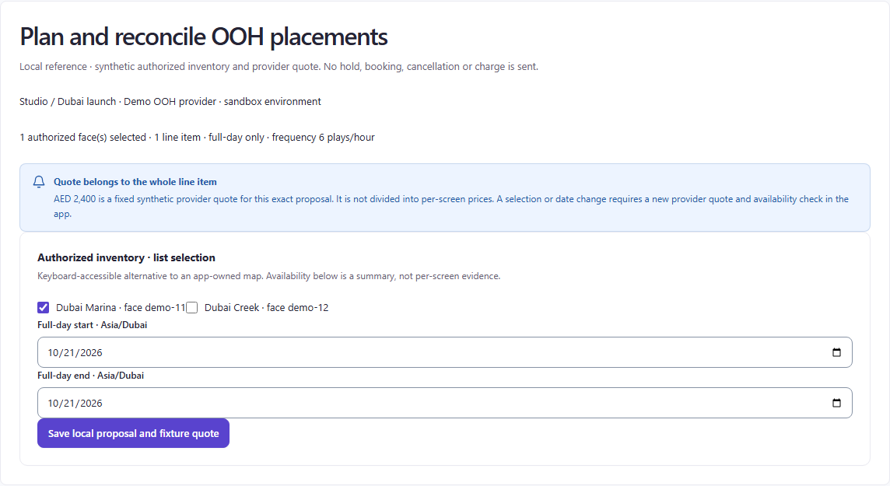 |
|  | 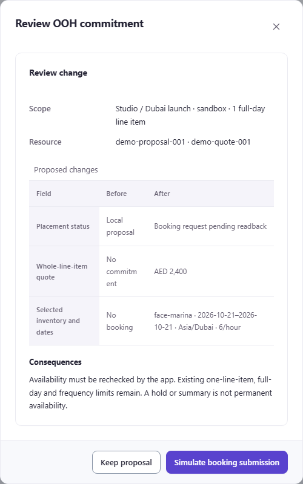 |

**Observed comparison.** Hierarchy: Broadsign's inventory choices each include one short explanatory line; ten98's current list starts with authorized face names and a scope statement. Actions: the reference has several commitment-related actions at once; ten98 progressively enables proposal, availability and booking review. Density: ten98's two face checkboxes appear directly adjacent with almost no visual separation. Context: ten98 explicitly names sandbox, one line item, full-day dates and frequency. Feedback: the review says pending readback and keeps the AED 2,400 quote whole. Broadsign's button strip cannot establish provider receipt or partial-availability presentation.

**Retain / improve.** Retain progressive commitment and whole-line-item pricing. Space each selectable face as a distinct row with readable provider identity. In the booking review, display the human face label together with its provider ID; the current review shows `face-marina`, which is less recognizable than “Dubai Marina” in the selection list.

**Concrete target:** `src/catalog/campaign/BookOohPlacement.tsx` inventory layout and `ReviewSummary` values. Do not invent per-screen prices, map evidence, extra inventory types or supported holds.

## C6 — Inbox and publishing recovery

| Agorapulse: official walkthrough frame | Current ten98: opened conversation plus recovery |
| --- | --- |
| 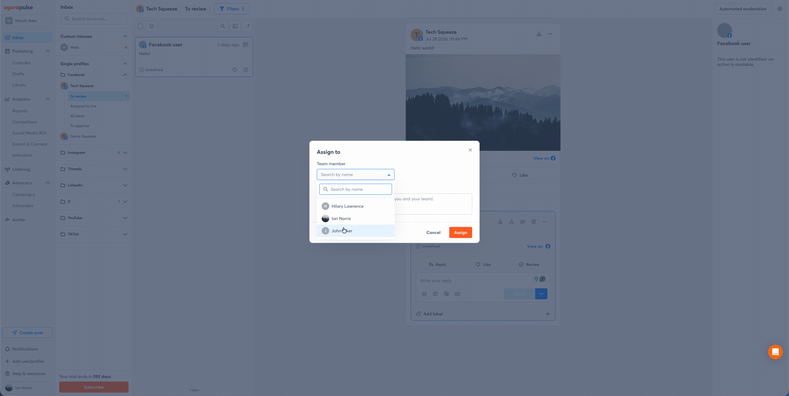 | 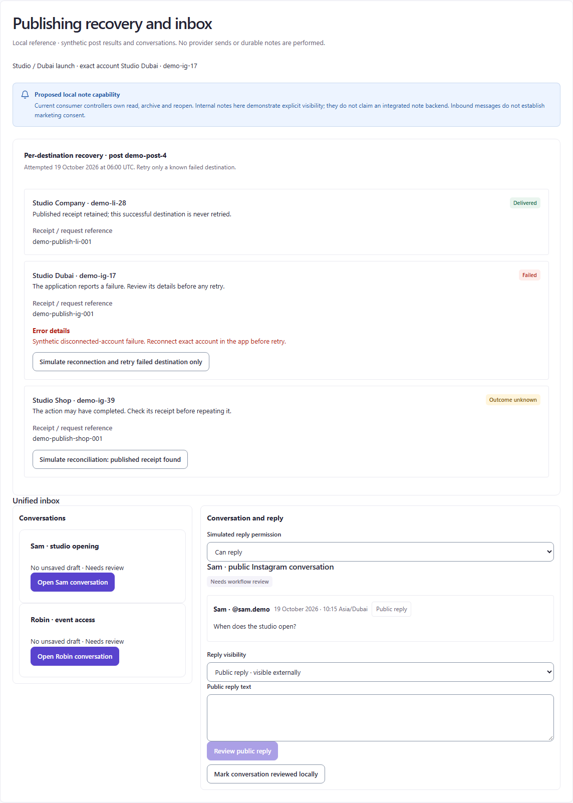 |

**Observed comparison.** Hierarchy: Agorapulse gives the conversation most of the workspace and retains account/message context in side columns; its assignment dialog overlays the thread. ten98 places three large recovery cards before the inbox, pushing the reply down the page. Actions: Agorapulse uses a contextual assignment dialog; ten98 visibly distinguishes public reply, internal visibility and workflow review. Density: ten98's recovery details are readable but dominate an unrelated conversation task. Context: ten98 explicitly retains destination receipts and the exact public conversation. Feedback: delivered, failed and unknown destinations have different available actions; that is more important than copying the reference's compact icon row.

**Retain / improve.** Retain unknown-outcome reconciliation, public-send review, unsaved draft guard and workflow state separate from sending. Move publication recovery into a separate labelled tab/section or collapsed summary so an opened inbox starts with its list and thread. Do not add assignment solely because it appears in Agorapulse; no assignment backend is claimed here.

**Concrete target:** `src/catalog/campaign/RecoverPublishingInbox.tsx`, using existing `Tabs`, `DetailWorkspace` and `OperationResults`. The public GIF was captured as a static frame at a larger viewport for inspection; no walkthrough interaction was exercised.

## C7 — Media discovery and approval

| Frontify: official asset discovery and contextual actions | Current ten98: exact asset metadata and gates |
| --- | --- |
| 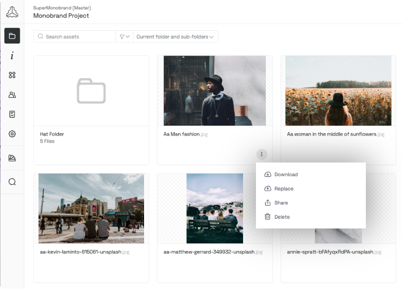 | 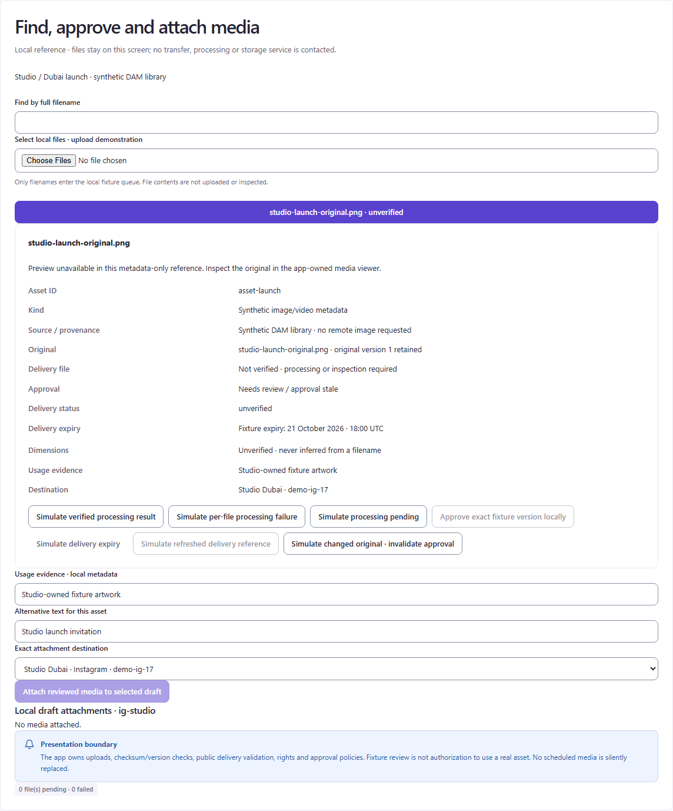 |

**Observed comparison.** Hierarchy: Frontify centers recognizable thumbnails with filenames and places actions on the relevant asset; ten98 starts with a full-width selected filename button followed by a long metadata card. Actions: Frontify's menu limits persistent button clutter; ten98 shows seven simulation/status controls near approval. Density: ten98's fields retain useful detail but require substantial scrolling before attachment. Context: ten98 explicitly names original version, delivery reference, expiry, usage evidence and exact destination. Feedback: the metadata-only fixture correctly says preview unavailable and keeps approval disabled when unverified.

**Retain / improve.** Retain full filename search, provenance, rights, expiry and exact-version approval. Add real thumbnails only when supplied by a verified app-owned renderer; preserve an explicit fallback. Group outcome simulations in a disclosure, and show the operational approval/attachment status beside the selected asset.

**Concrete target:** `src/catalog/campaign/InspectAndAttachMedia.tsx` and existing `AssetDetails` composition. Frontify sharing is evidence for discovery/action placement only. Bynder's browser challenge prevented the planned detail capture; neither reference proves equivalent approval behavior.

## C8 — Import outcomes, audience eligibility and explicit send

| Mailchimp: official import result sample | Current ten98: all rows and exact send |
| --- | --- |
| 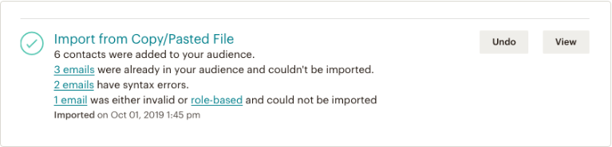 |  |
| No competitor desktop send-review image was captured. |  |

**Observed comparison.** Hierarchy: Mailchimp starts with the import name and outcome counts, with View/Undo alongside; ten98 starts with channel/purpose and exposes all five result rows before composition. Actions: ten98 clearly names the two-recipient send review; simulation controls compete with it at the bottom. Density: Mailchimp's compact result is easier to scan at a glance; ten98's table preserves more per-row evidence and remedies. Context: ten98's audience rail separates total 5, eligible 2, excluded 2 and unverified 1. Feedback: the send dialog repeats exact sender, subject, content, recipient signature and purpose. Its narrow Before column visibly breaks the word “Before” across lines.

**Retain / improve.** Keep the row evidence, consent/suppression exclusions and transactional-only purpose. Add a compact outcome summary immediately above the retained result table, without implying that imported means eligible. Put simulation controls in their own disclosure. Fix the shared review layout so column headings stay readable and the exact content remains inspectable.

**Concrete target:** `src/catalog/campaign/ReviewDirectAudience.tsx` and shared `ReviewSummary` layout. Review the same layout in C3/C4/C5 after changing it. Do not import marketing send permissions, Undo semantics or automatic resends from a Mailchimp import screenshot.

## Evidence limits and review checks

Eight local flows are paired with official UI references, including two added C4 budget figures alongside its historical All Accounts sample. **Full-flow competitor coverage remains incomplete:** C2 lacks competitor approval; C3 lacks paused review/activation; C5 shows only inventory/actions strips; C7 lacks exact-version approval; C8 lacks desktop send review. C4 still lacks a competitor budget-change confirmation; its two added figures show budget summaries and spend comparison only. C6 matches inbox layout but not publishing recovery. These gaps are not waived by the existence of another screenshot.

Sprout's page and Bynder's page displayed browser challenges. Publicly linked Sprout imagery supplied the dated calendar capture; Frontify supplied a limited media-discovery alternative. TikTok's article did not render useful browser UI, but its primary-source-linked image did. The Mailchimp regular-email guide rendered no product UI during two bounded attempts; its official import-results guide supplied the narrower alternative. No account was created, no signup/payment/booking/send was made, and no user tab or local server was changed.

The original capture manifest in `.qa/visual-campaign/manifest.json` records source URL, final URL, image URL, dimensions, filename and failed attempts. The two added C4 budget figures are linked directly to their official update and retained images above. `capture.mjs`, `repair.mjs`, and `final-capture.mjs` preserve the original method: browser-rendered image-region screenshots, not remote-media downloads or recreated competitor screens. Extra unused images and blocked-page captures are retained privately under `.qa/visual-campaign/unused`, outside this public critique's image set.

Checks: compare visible screenshots with claims; preserve research scope and semantic boundaries; verify all report image paths and all eight flow IDs with `.qa/visual-campaign/check.mjs`. No usability test, automated visual score or accessibility certification is inferred. A separate cold-read worker was omitted because this task explicitly prohibited nested workers. No canonical research source was consolidated or changed.
