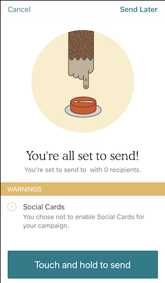
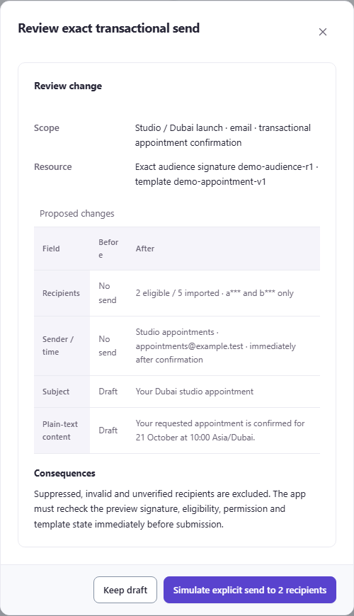
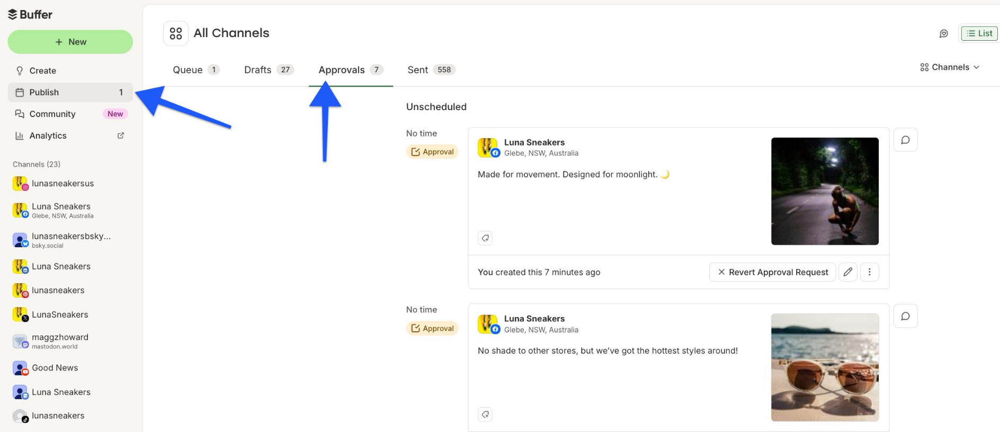
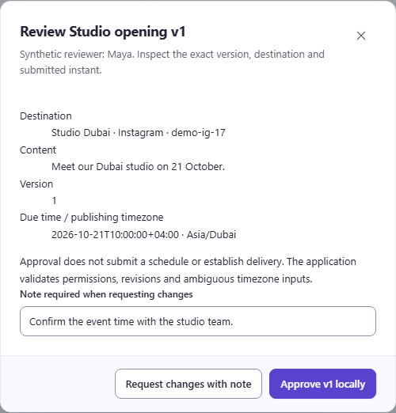

# Approval and send-review evidence follow-up

Checked **19 October 2026**. This supplement compares actual published UI with saved C2/C8 local captures. C2 now has author-side pending-approval context, but no approver decision screen. C8 has recipient configuration and an iOS final-send summary, but no equivalent desktop review of exact recipients and content. **Both full-flow comparisons remain partial.** The original Campaign report and saved local captures were not changed.

## Source and capture register

| Task | Primary source and outcome | Date, capture class and limit |
| --- | --- | --- |
| C2 pending-approval context | [Buffer managing and approving draft posts](https://support.buffer.com/articles/managing-and-approving-draft-posts-57li7M8tDA) supplied [this capture](images/follow-up/buffer-approval-review-2026-10-19.png) of its [official annotated Approvals-tab figure](https://support.buffer.com/api/attachments.redirect?id=43d07d8b-51d2-4281-80fa-d09448cf6aeb). | Captured **2026-10-19 at 16:51:43 UTC**, **1888 × 816 pixels**, from the help page's rendered image region at device scale 2; original figure **2218 × 956**. Official published UI, not a live app session. Publication, image and product-version dates are unknown; relative “7 minutes ago” is not a dated sample. This is the author's view, with Revert Approval Request. |
| C2 approver decision | [Buffer mobile draft/approval guide](https://support.buffer.com/articles/creating-managing-and-approving-draft-posts-on-the-buffer-mobile-app-XSRim1JeUl) rendered guidance but no usable product UI image in this bounded pass. | Accessed 19 October 2026. No screenshot or version-binding claim is inferred from the instructions. The two permitted Buffer source pages did not supply a captured approve/reject decision screen. |
| C2 earlier access limit | [Sprout Message Approval Workflows](https://support.sproutsocial.com/hc/en-us/articles/205974715-Message-Approval-Workflows) previously displayed a security-verification page. No product UI was captured. | Prior attempt on 19 October 2026; **not revisited in this pass**. No publication/sample date or product version was verified; the challenge was not bypassed. |
| C8 recipient selection within the email checklist | [Mailchimp About Pre-Built Segments](https://mailchimp.com/help/about-pre-built-segments/) rendered an actual product figure with the alt text `email-checklist-pre-built-segments`. [Official image URL](https://mailchimp.com/ctf/images/yzco4xsimv0y/19eszG2UGPC4H74nx0t48X/401ecacf0fcd4963430e36e2875c3fb7/email-checklist-pre-built-segments.png); [retained capture](images/follow-up/mailchimp-email-checklist-recipients-2026-10-19.png). | Captured **2026-10-19 at 16:36:37 UTC**, **600 × 352 pixels**, from the browser-rendered image region. **Official published UI image**, not a live authenticated app. Page publication date, screenshot date and UI version are unknown; no sample date is visible. Access date does not establish a 2026 product build. |
| C8 mobile final-send summary | [Mailchimp Create an Email on iOS](https://mailchimp.com/help/create-design-and-send-an-email-campaign-on-ios/) supplied [the official Campaign checklist figure](https://eep.io/images/yzco4xsimv0y/2bte7EUt8MCoU22Ow0cys0/956f0f3fc8385980290e6d4b4b067dac/campaign-checklist.png); [retained capture](images/follow-up/mailchimp-ios-send-checklist-2026-10-19.png). | Captured **2026-10-19 at 16:50:55 UTC**, **276 × 474 pixels**, from the browser-rendered image region at device scale 1; original figure **275 × 473**. Official published iOS UI, not a live app. Publication/image/version dates are unknown; no sample date is visible. The figure shows **0 recipients**, a Social Cards warning and Touch and hold to send. |

Captures use the installed Playwright browser and `locator.screenshot()`, with authorized public network access. The retained Buffer capture was taken inside its help page after the standalone attachment URL offered a download. The Mailchimp captures use the observed official image URLs rendered in the browser. No retained asset was obtained with a file/HTTP download utility or recreated. No account, signup, approval, import or send operation was performed.

## C8: what the pixels support

| Mailchimp: official recipient configuration figure | ten98: existing synthetic audience capture |
| --- | --- |
|  |  |

Mailchimp places the named audience directly under **To**, followed by **Send to** and its open menu. The field still reads “All subscribers in audience”; “Recent customers” is highlighted in the menu. The still image does not establish a committed selection. The crop ends near the next checklist section: it does not show recipient counts, the complete checklist, final confirmation or a send outcome.

The saved ten98 capture makes a different, narrower contract visible: five import rows, two eligible transactional recipients, two excluded contacts and one unverified contact. Its separate [exact-send review](images/campaign/c8-current-review.png) binds recipients, sender/time, subject and plain-text content to an audience signature and template version. Those local images were retained from the earlier 19 October comparison pass; they were not recaptured from the newly published base.

**Proposed adaptation:** keep a compact audience identity and eligibility summary near the recipient decision and review action. Preserve the detailed row remedies, exclusion reasons, exact signature and transactional-only purpose. A reference menu does not justify adding Mailchimp's marketing segments, AI segmentation or a provider capability. Keep draft recipient choices distinct from the exact audience being reviewed.

### C8 final-send summary: mobile evidence

| Mailchimp: official iOS final-send summary | ten98: saved exact transactional-send review |
| --- | --- |
|  |  |

Mailchimp puts a readiness headline and recipient count above a separate warning section, with Cancel and Send Later at the top and one explicit send action at the bottom. This is actual final-send UI evidence, but the sample says **0 recipients** while presenting a ready headline. It is not a live test of eligibility. Sender, subject, full content, recipient identities and an immutable review signature are not visible in this figure.

**Proposed adaptation:** give the exact eligible count, warnings and final action a clear reading order while keeping ten98's sender/content review and signature visible. Retain Cancel/Keep draft. Do not copy the zero-recipient readiness message, marketing permissions or press-and-hold gesture into the transactional desktop flow.

**Remaining C8 limit:** recipient configuration and a mobile final-send summary are now visually evidenced. An equivalent desktop checklist/confirmation, consent/suppression behavior, exact-version binding and delivery outcome remain unverified. The mobile figure does not establish parity with ten98's two-recipient review.

## C2: pending context, not an approver decision screen

| Buffer: official author-side Approvals tab | ten98: saved exact-version decision dialog |
| --- | --- |
|  |  |

Buffer groups account identity, caption and thumbnail within each pending post, and keeps Unscheduled/No time and an Approval badge beside the card. The visible action is **Revert Approval Request**. This author-side queue does not show an approver's approve/reject controls, a revision identifier or the effects of approval. The second Buffer source offered instructions only; it does not fill that visual gap.

The saved ten98 review visibly includes destination, content, version 1 and the due instant with Asia/Dubai context; it also states that approval does not schedule or establish delivery. **Proposed adaptation:** keep post identity/content together and make pending versus decision context clear. Preserve the exact destination/version/instant and labelled decision actions. Do not infer version-binding, approval invalidation or scheduling behavior from Buffer's still image. The historical Sprout calendar remains planning evidence only. **An actual external approver decision screen remains a gap.**

This pass used two Buffer source pages and one Mailchimp iOS source page, plus their observed image URLs. It makes no ranking claim and does not establish backend compatibility, accessibility or usability results. Existing local screenshots remain earlier synthetic evidence, not fresh consumer captures. Keep Campaign's identity and the existing approval, audience and delivery boundaries.
