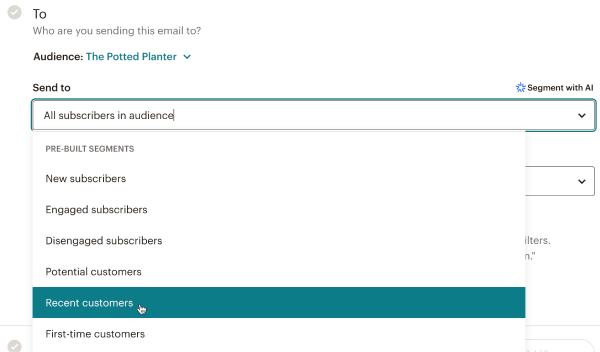
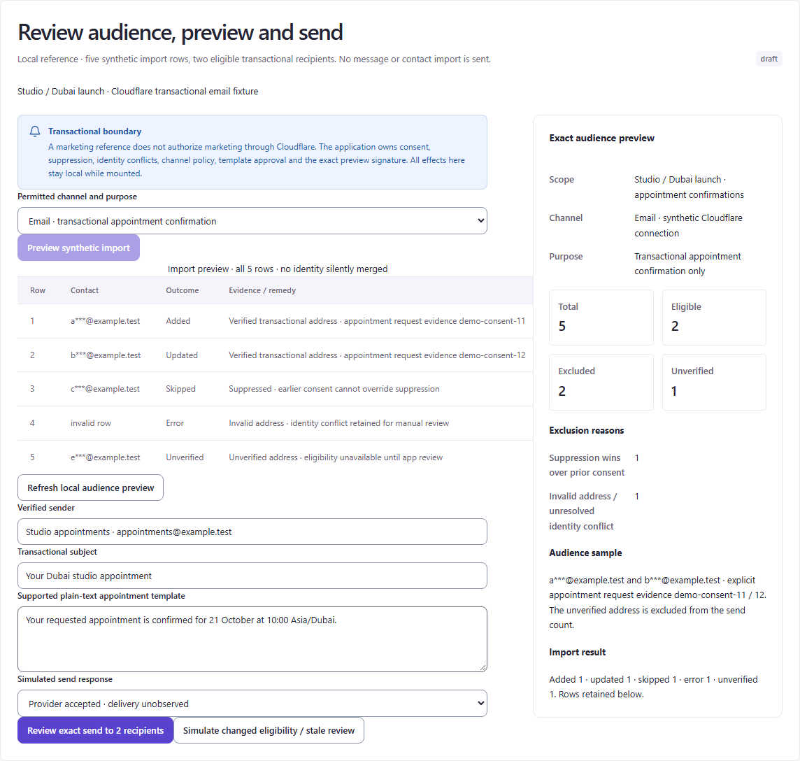

# Approval and send-review evidence follow-up

Checked **19 October 2026**. This narrow supplement revisits C2 exact-content approval and C8 recipient/checklist review. The existing visual reports and saved local captures were not changed. Only C8 yielded a usable external UI figure; both full-flow comparisons remain partial.

## Source and capture register

| Task | Primary source and outcome | Date, capture class and limit |
| --- | --- | --- |
| C2 exact-content approval | [Sprout Message Approval Workflows](https://support.sproutsocial.com/hc/en-us/articles/205974715-Message-Approval-Workflows) displayed “Just a moment…” and a security-verification page. No product UI was captured. | Access attempted 19 October 2026. No publication/sample date or product version was verified. The challenge was not bypassed; no further Sprout attempt was made. |
| C8 recipient selection within the email checklist | [Mailchimp About Pre-Built Segments](https://mailchimp.com/help/about-pre-built-segments/) rendered an actual product figure with the alt text `email-checklist-pre-built-segments`. [Official image URL](https://mailchimp.com/ctf/images/yzco4xsimv0y/19eszG2UGPC4H74nx0t48X/401ecacf0fcd4963430e36e2875c3fb7/email-checklist-pre-built-segments.png); [retained capture](images/follow-up/mailchimp-email-checklist-recipients-2026-10-19.png). | Captured **2026-10-19 at 16:36:37 UTC**, **600 × 352 pixels**, from the browser-rendered image region. **Official published UI image**, not a live authenticated app. Page publication date, screenshot date and UI version are unknown; no sample date is visible. Access date does not establish a 2026 product build. |

The installed Playwright browser opened only these two official pages and Mailchimp's observed linked image, with the authorized network access. The image was captured with `locator.screenshot()` at device scale 1; it was not downloaded by a file/HTTP utility or recreated. No account, signup, approval, import or send operation was performed.

## C8: what the pixels support

| Mailchimp: official recipient configuration figure | ten98: existing synthetic audience capture |
| --- | --- |
|  |  |

Mailchimp places the named audience directly under **To**, followed by **Send to** and its open menu. The field still reads “All subscribers in audience”; “Recent customers” is highlighted in the menu. The still image does not establish a committed selection. The crop ends near the next checklist section: it does not show recipient counts, the complete checklist, final confirmation or a send outcome.

The saved ten98 capture makes a different, narrower contract visible: five import rows, two eligible transactional recipients, two excluded contacts and one unverified contact. Its separate [exact-send review](images/campaign/c8-current-review.png) binds recipients, sender/time, subject and plain-text content to an audience signature and template version. Those local images were retained from the earlier 19 October comparison pass; they were not recaptured from the newly published base.

**Proposed adaptation:** keep a compact audience identity and eligibility summary near the recipient decision and review action. Preserve the detailed row remedies, exclusion reasons, exact signature and transactional-only purpose. A reference menu does not justify adding Mailchimp's marketing segments, AI segmentation or a provider capability. Keep draft recipient choices distinct from the exact audience being reviewed.

**Remaining C8 gap:** the new figure adds real recipient-configuration evidence beyond the earlier import-results screenshot. It does **not** fill the final pre-send checklist/confirmation gap, prove consent/suppression behavior or establish parity with ten98's two-recipient send review.

## C2: disposition

The saved [ten98 exact-version review](images/campaign/c2-current-review.png) visibly includes destination, content, version 1 and the due instant with Asia/Dubai context; it also states that approval does not schedule or establish delivery. Sprout's blocked page supplied no comparable pixels in this attempt. The historical calendar reference in the original Campaign report remains planning evidence only. **Exact-content approval remains an external visual-evidence gap.**

This follow-up supports a narrow layout judgment. It does not establish vendor behavior, backend compatibility, accessibility or usability results. Keep Campaign's identity and the existing approval, audience and delivery boundaries.
