# Discover: actual interface comparison

Understood as: compare D1–D17 with real interfaces for the same tasks, retain visual evidence and identify concrete layout improvements to the current design-system specimens. This review supplements [the existing flow research](../../research/campaign-discover/flows.md) and [competitor evidence](../../research/campaign-discover/evidence.md); it does not repeat their rankings or authorize product features.

All captures were made on **19 October 2026**. **Live** means a public running application. **Official** means an actual product UI image published in the vendor's documentation or official product article, opened in Chromium and captured from its rendered image region. It does not mean we operated an authenticated product. **Local** means the current interactive design-system specimen at `http://127.0.0.1:5198`, using synthetic data. Screenshot publication dates are unknown unless the source explicitly dates the image; article publication and visible sample dates do not prove the product version. No accounts, signups, paid providers or production mutations were used.

There are **20 external captures**: one live Plausible dashboard and 19 official UI images; every D row has a current local screenshot, with an additional D17 detail. **D15 has partial visual evidence:** Google's 10 December 2025 announcement supplies an actual Search Console metric/chart screen with a weekly/monthly menu and September–November 2025 sample dates. It does not show query rows, property permissions or quality states. The GA4 data-quality article supplies the separate report disclosure image for D10. The public Umami shared dashboard was not used because no observed share URL was available.

## What should change first

1. **Make applied scope compact, then emphasize the result.** D2/D3/D6/D11/D12 currently stack full-width fields above a small table. Plausible and Umami place concise scope controls above dominant data. Keep draft and applied values visibly distinct; a compact toolbar must never relabel retained results with pending input.
2. **Separate authoring from evidence.** D4 and D16 put a long editor/receipt above the result. Give saved-definition/run review and the resulting funnel/coverage clear adjacent or sequential sections. The receipt remains available and unknown charges remain prominent.
3. **Use a real inspector composition at desktop widths.** D7's page canvas precedes its ranked list; Clarity connects a left ranking rail directly to the canvas. Adapt that relationship while retaining a sequential narrow layout, keyboard selection and the alignment gate.
4. **Show useful evidence density without importing vendor semantics.** D13 needs readable rank status/reason, D14 type and priority, and D17 capture method/source relationship. Compact ordinary context; do not hide essential unknown/partial/expired reasons in tooltips.

These are visual adaptations. Keep the existing ten98 brand, Campaign-derived logo and icon vocabulary, tokens and accessible controls. No vendor colors, logos, navigation taxonomy or provider capability are proposed for adoption.

## Capture and comparison register

Every row below was captured/checked on **2026-10-19**. Paths are relative to this document. **Keep** identifies the current useful behavior; **Improve** is the proposed visual change, not an implemented change. Source targets are the files to change if the layout recommendation is accepted. Shared-component extraction should follow matching callers, not precede them.

| ID / task family | External UI, source and capture class | Current local capture / exercised state | Concrete comparison, keep / improve, source target |
| --- | --- | --- | --- |
| D1 · Collection setup | [Plausible installation status](https://plausible.io/docs/troubleshoot-integration) · Official · [image](images/discover/ref-install.png) | [D1](images/discover/ten98-d01.png) · initial setup/waiting for events | Plausible puts one green installation banner above a ready but empty report. Ten98 visibly separates installation check and accepted-event receipt in two resource panels. **Keep** that distinction and disabled first-report action. **Improve** status hierarchy with one short next-step line and compact timestamp rows; avoid letting the explanatory alert dominate setup. Target: [InstallTracker.tsx](../../../src/catalog/discover-analytics/InstallTracker.tsx), `ResourceCard` composition. |
| D2 · Analytics overview | [Plausible public dashboard](https://plausible.io/plausible.io) · Live · [image](images/discover/ref-plausible-live.png) | [D2](images/discover/ten98-d02.png) · ready comparison | Plausible gives a shallow site/date/filter row, horizontal metric strip and dominant trend, then paired breakdowns. Ten98 stacks date/page/baseline/state controls before two metric cards and a one-row table. **Keep** named baseline, applied scope and missing/zero behavior. **Improve** a wrapping date/filter toolbar and stronger result grouping; only show charts for actual supplied series. Target: [OverviewComparison.tsx](../../../src/catalog/discover-analytics/OverviewComparison.tsx), `OverviewTemplate`, `ComparisonMetric`, `AppliedFilters`. |
| D3 · Query and breakdown | [Umami breakdown](https://docs.umami.is/docs/breakdown) · Official · [image](images/discover/ref-breakdown.png) | [D3](images/discover/ten98-d03.png) · retained query/result | Umami uses a dark applied condition strip immediately above a dense numeric table, with field configuration as a secondary action. Ten98's form is larger than its result. **Keep** explicit Run and the previous applied query while draft input changes. **Improve** separate query-builder and result sections, with applied query directly attached to the result table; use numeric alignment and useful column widths. Target: [QueryExplorer.tsx](../../../src/catalog/discover-analytics/QueryExplorer.tsx), `AppliedFilters`, `DataTable`. |
| D4 · Funnel definition/result | [Umami funnels](https://docs.umami.is/docs/funnel) · Official · [image](images/discover/ref-funnel.png) | [D4](images/discover/ten98-d04.png) · Run saved funnel | Umami cards connect numbered step labels to horizontal bars, counts and conversion rates. Ten98 presents a narrow, tall editor followed by textual supplied steps. **Keep** exact ordered conditions, keyboard move controls, saved-state boundary and both previous-step/overall denominators. **Improve** a clearly headed result section and compact step editor so the supplied funnel summary is discoverable; never copy Umami's single-rate presentation at the cost of either denominator. Target: [OrderedFunnel.tsx](../../../src/catalog/discover-analytics/OrderedFunnel.tsx), `FunnelBreakdown`, `EditorTemplate`. |
| D5 · Cohorts and journeys | [Umami retention](https://docs.umami.is/docs/retention) · Official · [cohort image](images/discover/ref-retention.png); [PostHog paths](https://posthog.com/docs/product-analytics/paths) · Official · [path image](images/discover/ref-journey.png) | [D5](images/discover/ten98-d05.png) · retention tab | Umami's grid uses repeated column rhythm and cohort size at the left; PostHog uses a wide transition canvas with scope above. Ten98's single cohort explains missing/future/zero in cells. **Keep** those distinct temporal states and click-to-inspect evidence. **Improve** stable cohort/size columns and short cell labels with accessible detail; keep journey graph beside an equivalent ordered list when that tab is selected. Journey graph behavior was not exercised in this capture. Target: [RetentionJourneys.tsx](../../../src/catalog/discover-analytics/RetentionJourneys.tsx), `RetentionTable`, `JourneyPath`. |
| D6 · Attribution | [Umami attribution](https://docs.umami.is/docs/attribution) · Official · [image](images/discover/ref-attribution.png) | [D6](images/discover/ten98-d06.png) · first observed touch, ready | Umami places model/type/step in one row, metrics next and source/UTM columns below. Ten98 devotes most vertical space to four full-width inputs. **Keep** native first/strict-last observed definitions, independent UTM/paid-ad fields and full-population denominator. **Improve** a wrapping model/conversion/acquisition toolbar and adjacent applied-definition text above results. Target: [ObservedAttribution.tsx](../../../src/catalog/discover-analytics/ObservedAttribution.tsx), `OverviewTemplate`, `DataTable`. |
| D7 · Spatial investigation | [Clarity heatmaps](https://learn.microsoft.com/en-us/clarity/heatmaps/heatmaps-overview) · Official · [image](images/discover/ref-heatmap.png) | [D7](images/discover/ten98-d07.png) · aligned exact captured viewport | Clarity gives ranked elements a left rail, linked numbered markers on a dominant canvas and compact mode controls. Ten98 places the canvas above the ranked table, creating a tall scan between selection and evidence. **Keep** geometry/time context and suppression of unknown/mismatched/expired/revoked overlays. **Improve** desktop ranking/canvas columns with common selection emphasis, then list/preview sequencing on narrow screens. The local SVG is an expressly synthetic slot. Target: [HeatmapInvestigation.tsx](../../../src/catalog/discover-analytics/HeatmapInvestigation.tsx), `VisualEvidenceFrame`. |
| D8 · Replay investigation | [Umami replays](https://docs.umami.is/docs/replays) · Official · [image](images/discover/ref-replay.png) | [D8](images/discover/ten98-d08.png) · explicit load completed, paused | Umami gives the recorded page most space, an event rail at left and a continuous transport strip below. Ten98 has a text-only application player slot, transport and metadata. **Keep** explicit authorized load, paused completion, named controls, separate replay consent, strict masking, seven-day policy and gap disclosure. **Improve** an obvious bounded player region, transport as one wrapping group and event/metadata context beside it. Do not imitate a working recording with fabricated frames. Target: [ReplayInvestigation.tsx](../../../src/catalog/discover-analytics/ReplayInvestigation.tsx), `ReplayControls`. |
| D9 · Board authoring | [Umami board designer](https://docs.umami.is/docs/design-a-board) · Official · [image](images/discover/ref-board.png) | [D9](images/discover/ten98-d09.png) · one widget added, unsaved | Umami's picker shows properties, component choices and a large live preview in three columns. Ten98 already separates source/widget fields and board preview, but its preview is mostly metadata. **Keep** keyboard move actions, local widget failures, explicit save and separate reader/share review. **Improve** preview hierarchy: widget title/value first, compact source/as-of footer, then failure state; retain readable metadata and scope. Target: [ReportBuilder.tsx](../../../src/catalog/discover-research/ReportBuilder.tsx), `ReportPanel`. |
| D10 · Measurement confidence | [GA4 data-quality disclosure](https://support.google.com/analytics/answer/12856703?hl=en) · Official · [image](images/discover/ref-quality.png) | [D10](images/discover/ten98-d10.png) · measured sample | GA4 anchors an expanded quality explanation to report context; Ten98 places its prominent value, short source/time row and native expandable basis in one reading path. **Keep** essential freshness/denominator limits visible outside the disclosure and measured zero separate from unknown. **Improve** align source/as-of/value/quality as one compact result block, with detailed basis adjacent to that result. The screenshot supports disclosure placement, not identical metric semantics. Target: [MeasurementConfidence.tsx](../../../src/catalog/discover-research/MeasurementConfidence.tsx), `EvidenceSummary`. |
| D11 · Keyword research | [Semrush Keyword Magic](https://www.semrush.com/kb/617-keyword-magic-tool-manual) · Official · [image](images/discover/ref-keyword.png) | [D11](images/discover/ten98-d11.png) · quote → explicit local execution → receipt → bounded ideas | Semrush puts seed/market above match/facet controls and a dominant selectable metric table. Ten98's draft fields precede a small three-row result with a visible partial alert. **Keep** 25/50/100 bounds, explicit quote/run, provider labels, selection count, zero/null and saved-versus-tracked distinction. **Improve** after-run result heading, compact executed-scope/receipt summary and a selection action bar attached to the table. No new facets or provider metrics are inferred. Target: [KeywordResearch.tsx](../../../src/catalog/discover-research/KeywordResearch.tsx), `RunCostSummary`, `DataTable`. |
| D12 · Domain/backlink investigation | [Ahrefs backlink filters](https://help.ahrefs.com/en/articles/2134275-how-to-use-filters-in-site-explorer-backlinks-reports) · Official · [image](images/discover/ref-backlink.png) | [D12](images/discover/ten98-d12.png) · organic exact-path scope → local quote/run/receipt → partial table | Ahrefs presents target/scope at the top, dense filter controls and referring-page/anchor evidence in the table. Ten98 shows an extensive receipt before two organic rows; this is a shared scope/run comparison, not a captured local backlink result. **Keep** organic/backlink scope distinctions, original receipt, explicit execution and reconciliation before uncertain retry. **Improve** a compact executed-target summary and dedicated receipt section, preserving unknown settlement prominently. Ahrefs is layout inspiration, not an approved connector; DataForSEO rank must retain its name. Target: [DomainResearch.tsx](../../../src/catalog/discover-research/DomainResearch.tsx), `RunCostSummary`, `EvidenceSummary`. |
| D13 · Project/rank history | [Semrush position tracking](https://www.semrush.com/kb/549-position-tracking-overview-manual) · Official · [image](images/discover/ref-ranks.png) | [D13](images/discover/ten98-d13.png) · local project created, Latest | Semrush keeps project/engine/market/update context above tabs, comparisons and graph. Ten98 repeats project setup controls before a wide reason-rich table. **Keep** immutable engine/location/device context, native position 0 meaning not found in checked coverage, null reasons and compatible-baseline rules. **Improve** move completed setup into compact project context and give Latest/History/Runs stronger navigation; allow long reasons to wrap without compressing keyword and position. Do not infer a chart series from two positions. Target: [ProjectRanks.tsx](../../../src/catalog/discover-research/ProjectRanks.tsx), `RankComparison`. |
| D14 · Audit triage | [Screaming Frog quick start](https://www.screamingfrog.co.uk/seo-spider/tutorials/quick-start-guide/) · Official · [image](images/discover/ref-audit.png) | [D14](images/discover/ten98-d14.png) · local run → partial result | Screaming Frog places issue name/type/priority/count in a dense list with a selected description/remedy below. Ten98's compact three-row issue table is already clearer at small scope, with partial-coverage alert above. **Keep** type separate from priority, bounded progress and retained issue selection. **Improve** a visible selected-row affordance and adjacent issue description at desktop widths, sequential detail on mobile. Retain origin/static/network restrictions; incomplete coverage cannot imply health. Target: [TechnicalAudit.tsx](../../../src/catalog/discover-research/TechnicalAudit.tsx), `DetailTemplate`, `DataTable`. |
| D15 · Owned-property search | [Google Search Console weekly/monthly announcement, 10 December 2025](https://developers.google.com/search/blog/2025/12/weekly-monthly-views-search-console) · Official · [metric/chart image](images/gaps/gsc-performance-2025.png) · **Partial: report summary only** | [D15](images/discover/ten98-d15.png) · retained Query rows, Ready | Google groups clicks, impressions, average CTR and average position above a trend with the time-granularity menu at its upper right. The historical sample shows September–November 2025; query rows, property selection, access and quality states are outside the crop. Ten98 shows property/loaded interval/source-quality context above native daily query rows. **Keep** null/zero, native fractional CTR, preliminary/stale quality and revoked-access hiding; Google's displayed percent is not the local fraction's unit. **Improve** group property/loaded interval and the retained-dimension control in a compact report header, with quality directly above the table. The reference supports summary hierarchy only; do not add weekly/monthly aggregation, a chart without supplied series, country/device filters or export. Target: [SearchPerformance.tsx](../../../src/catalog/discover-research/SearchPerformance.tsx), `EvidenceSummary`, `AppliedFilters`. |
| D16 · AI execution/comparison | [Profound report interpretation](https://docs.tryprofound.com/answer-engine-insights/interpret) · Official · [image](images/discover/ref-prompt.png); [Otterly prompt monitoring](https://help.otterly.ai/search-prompt-monitoring) · Official · [image](images/discover/ref-otterly.png) | [D16](images/discover/ten98-d16.png) · approved version → explicit local run → partial provider receipts | Profound puts report tabs and period/facet controls above metric/chart/ranked providers. Otterly condenses prompts, brand coverage and movement into an aligned list. Ten98's long editor and cost receipt put supplied comparison and provider outcomes far below. **Keep** immutable prompt version, API method label, explicit quote, planned versus observed denominators and incompatible-baseline explanation. **Improve** separate authoring/run-review and result sections, with coverage/outcomes directly adjacent; reuse compact context instead of dropping it. Import no consumer-UI equivalence, background run or overage policy. Target: [PromptComparison.tsx](../../../src/catalog/discover-research/PromptComparison.tsx), `ComparisonMetric`, `OperationResults`, `RunCostSummary`. |
| D17 · Citation/answer investigation | [Scrunch citation guide](https://scrunch.com/how-tos/how-to-track-citations-in-ai-search/) · Official · [list](images/discover/ref-citation-list.png), [answer](images/discover/ref-citation.png) | [D17 list](images/discover/ten98-d17.png), [detail](images/discover/ten98-d17-detail.png) · Inspect Explicit citation | Scrunch links domain/topic counts to a timestamped response, summary facts and full answer with source chips. Ten98's list makes relationship/capture/ownership explicit; detail separates original answer, annotation and source URL. **Keep** that evidence taxonomy and Back preserving scope. **Improve** selected-execution title/time/method as one detail header and a clear answer-first reading order, with source evidence adjacent on wide screens. Preserve missing/loading/expired/revoked payload gating; aggregate counts cannot reconstruct an answer. Target: [CitationInvestigation.tsx](../../../src/catalog/discover-research/CitationInvestigation.tsx), `EvidenceDetail`. |

## Selected visual pairs

These embeds are actual captured pixels. Full-resolution files in the register support closer inspection; the contact sheets used for review are working evidence under `.qa/visual-discover/`.

| Reference | Current ten98 |
| --- | --- |
| Live Plausible: compact scope, metrics and trend. 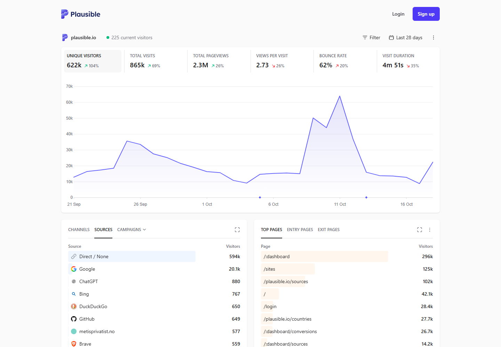 | D2: applied scope and comparison. 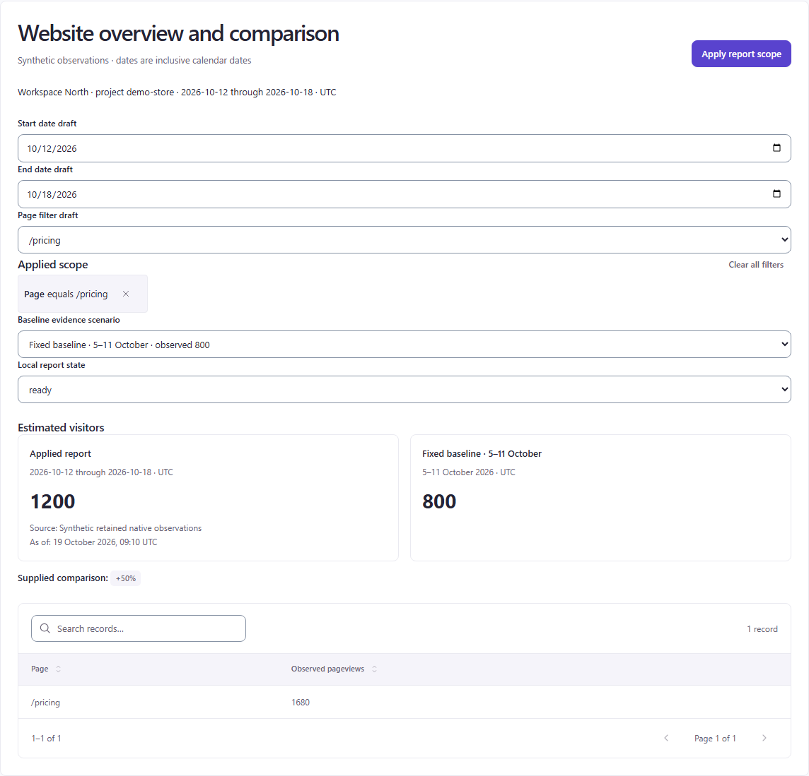 |
| Official Umami funnel: steps linked to rates/bars. 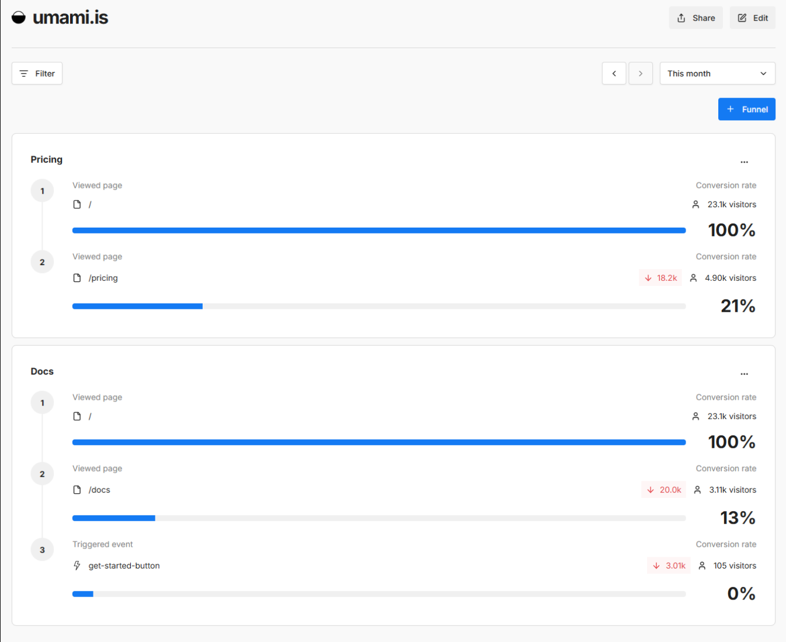 | D4: saved ordered editor and supplied result. 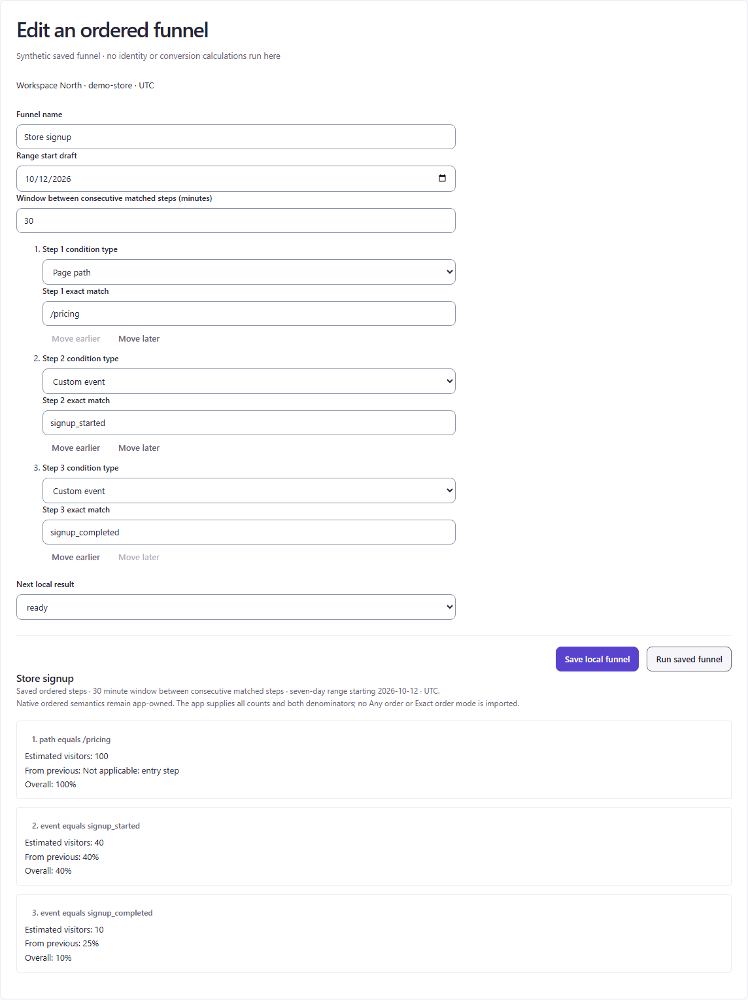 |
| Official Clarity: ranking beside page canvas. 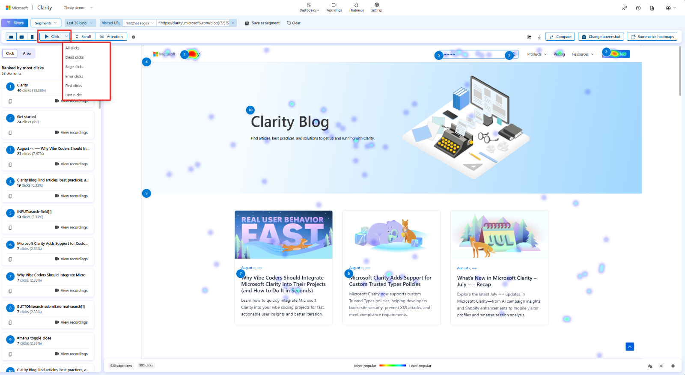 | D7: explicitly aligned synthetic evidence. 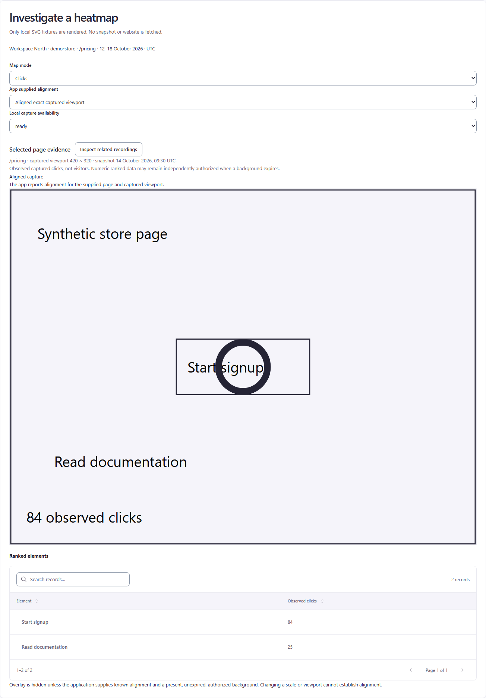 |
| Official Semrush: research context and dominant selection table. 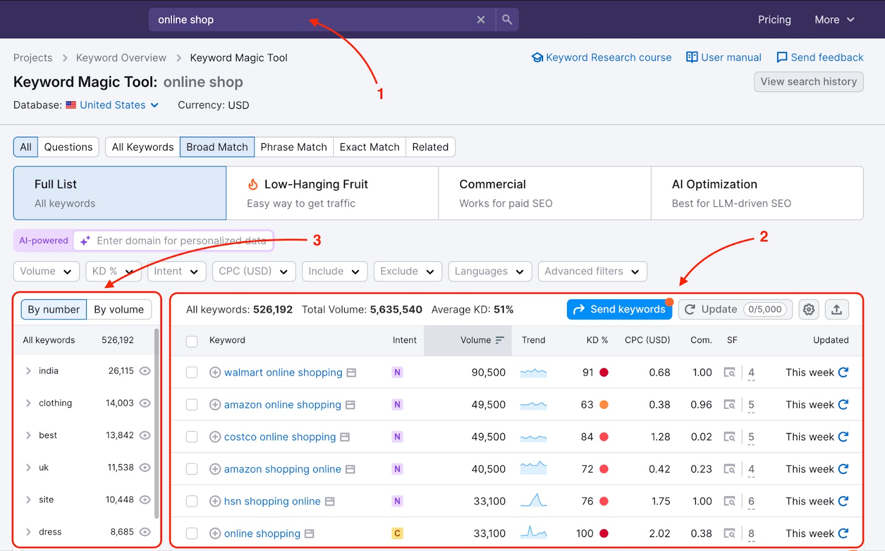 | D11: bounded returned ideas and explicit receipt. 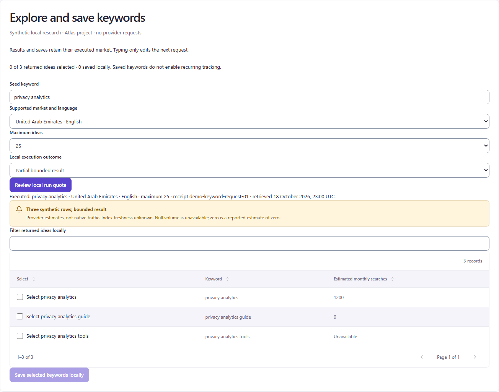 |
| Official Google: historical metric/chart summary and time-granularity menu; query table not shown. 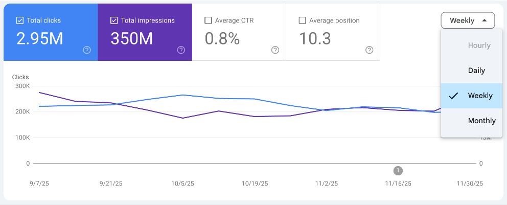 | D15: retained daily query rows with native units and source quality. 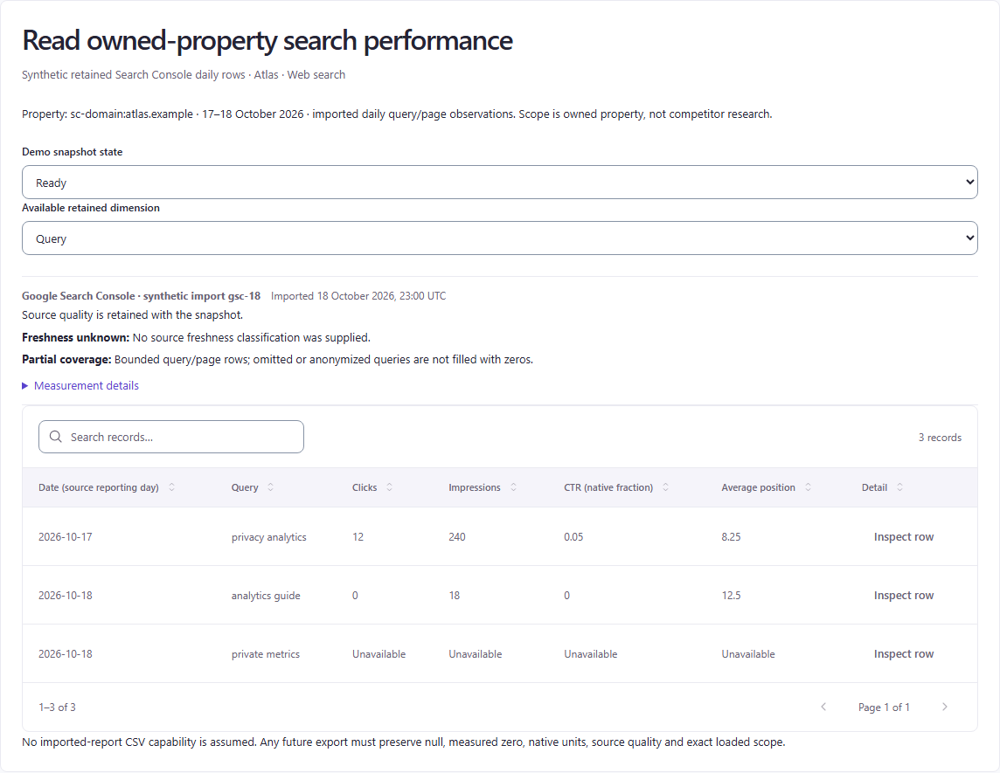 |
| Official Profound: persistent scope and comparison above result. 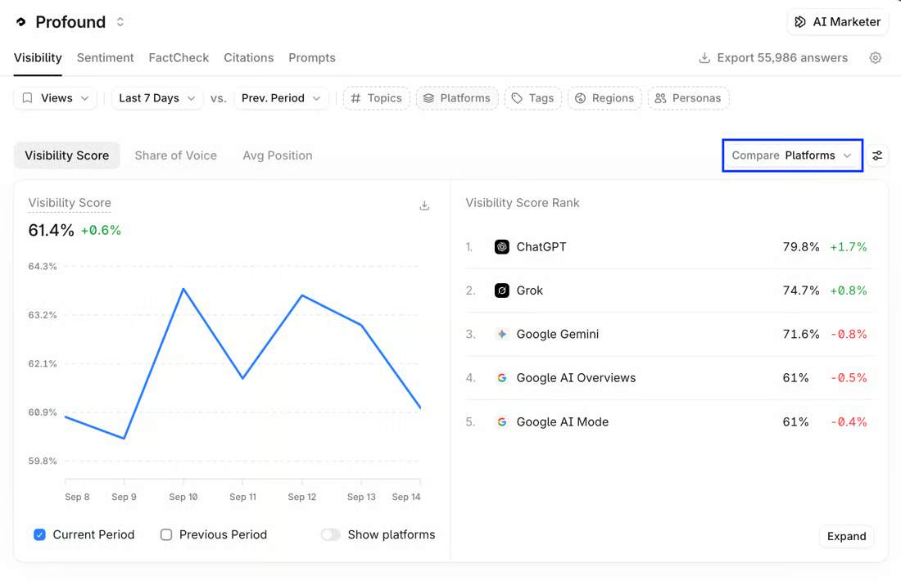 | D16: versioned local execution, receipts and partial coverage. 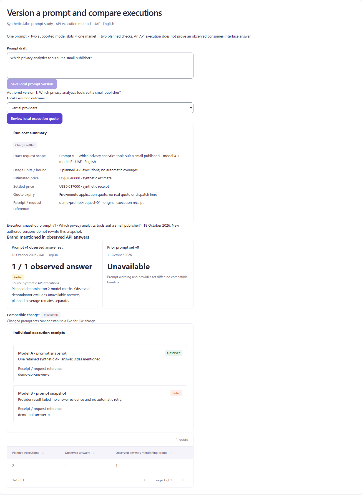 |
| Official Scrunch: timestamped original answer. 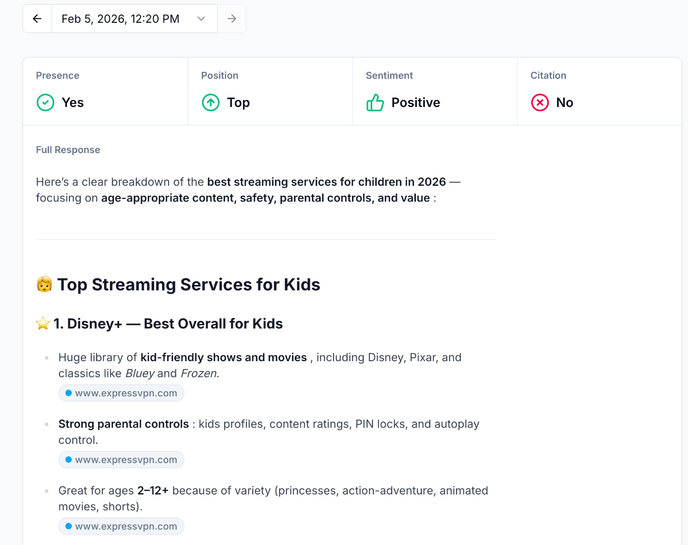 | D17: scoped original evidence. 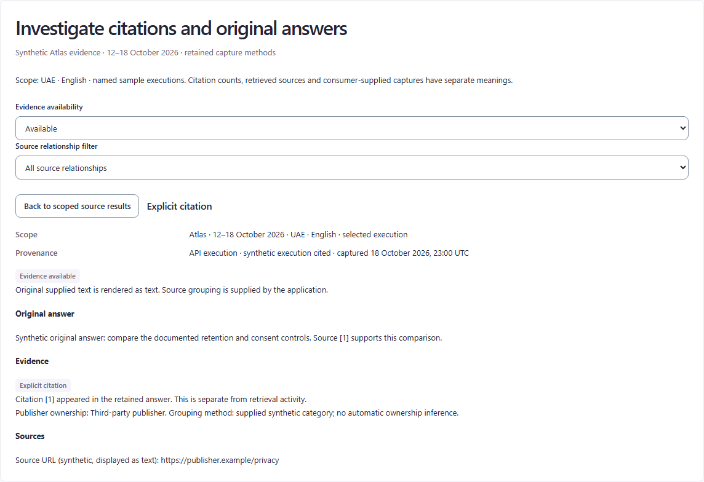 |

## Verification and limits

Captured with the already installed Playwright browser through the bundled Node runtime. External images were rendered in the browser and captured using image-region screenshots; remote assets were not downloaded through HTTP/file utilities. The local screenshot region is `.reference-preview`, so catalogue explanation does not masquerade as app UI. The original capture manifest is retained locally at `.qa/visual-discover/captures.json`; the D15 addition is linked directly to its official source and retained image above. Public UI is a visual reference, not evidence of performance, accessibility compliance or vendor-wide usability.

Visual QA covered four contact sheets and readable closeups of the live dashboard, spatial inspector, original-answer view and current prompt result; the D17 detail was also inspected separately. Existing research and source contracts were cross-checked for duplicate or conflicting claims. This review keeps method/denominator/billing/security facts in those canonical sources and reports layout observations here. No benchmark, numerical usability score, inferred adoption ranking, provider operation or source-code change is claimed. A fresh reviewer can use the source/current links without needing the working browser session.

Outstanding evidence: D15 still lacks a matching query-table, permission or quality-state reference; its metric/chart crop does not establish full-flow visual parity. Additional app interaction checks remain necessary before implementing an inspector or compact toolbar. This English LTR review does not replace keyboard, narrow-screen, zoom or permission-state tests of a future implementation.
