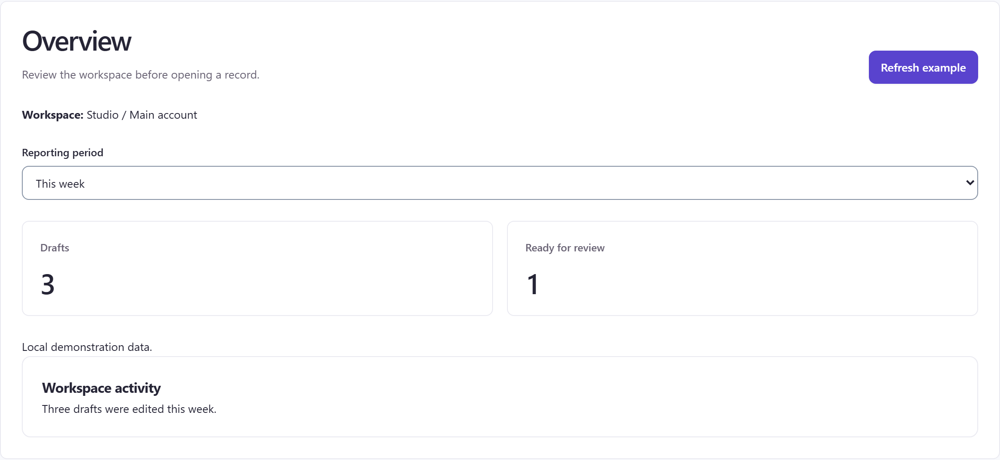
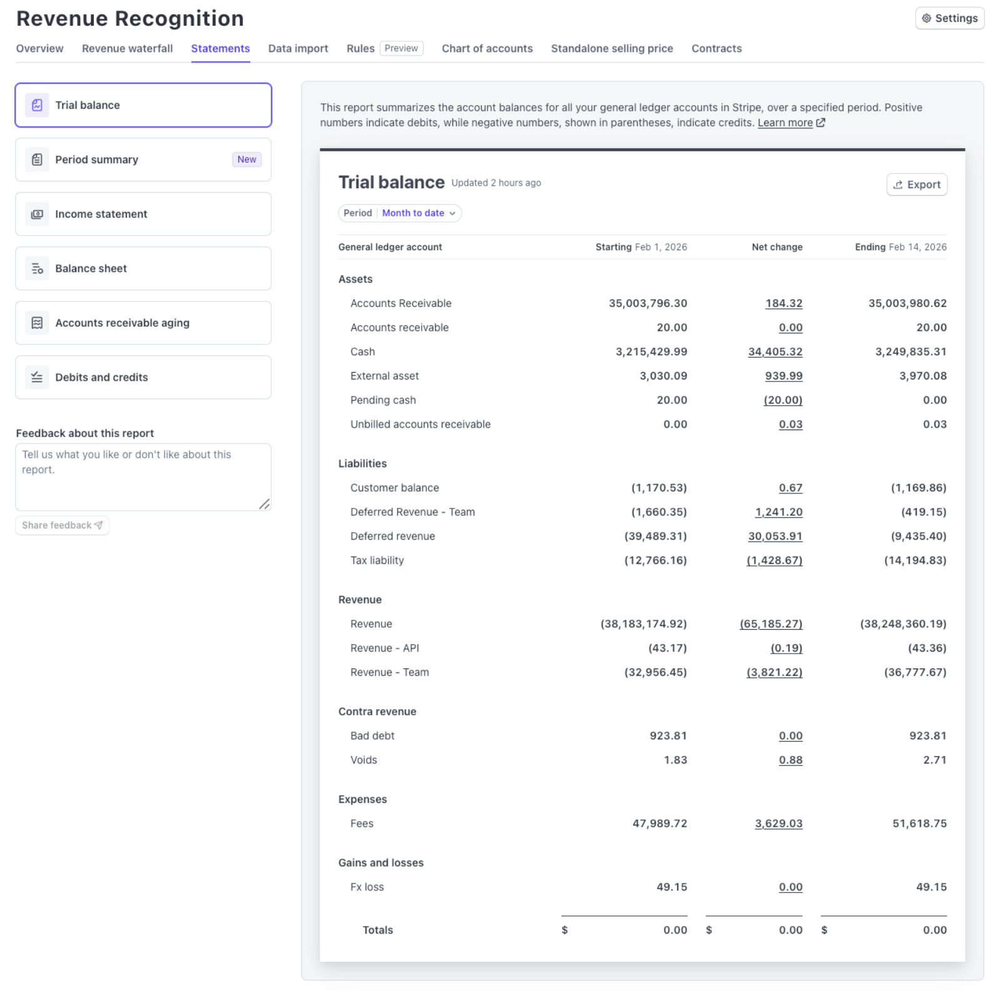
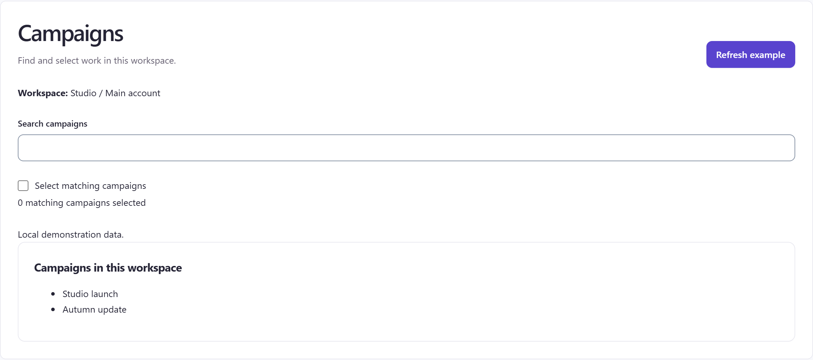
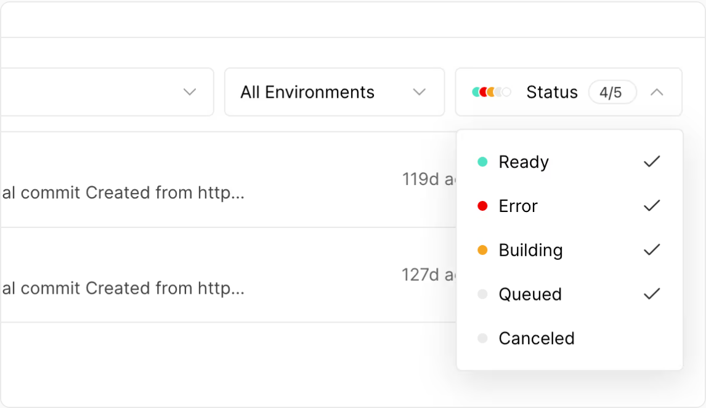
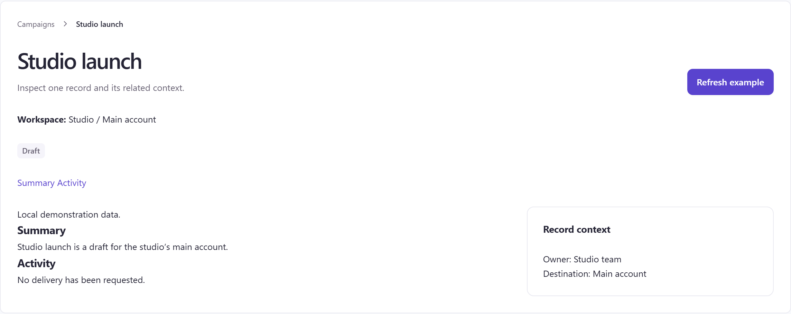
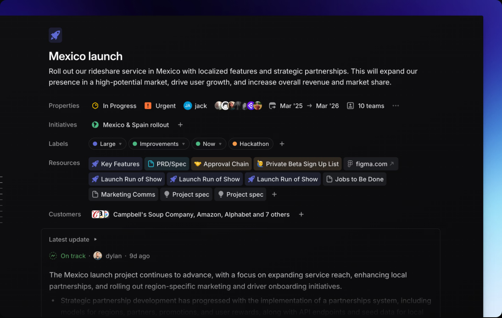
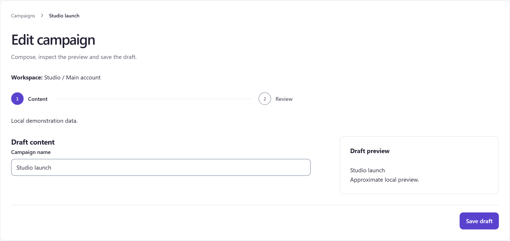
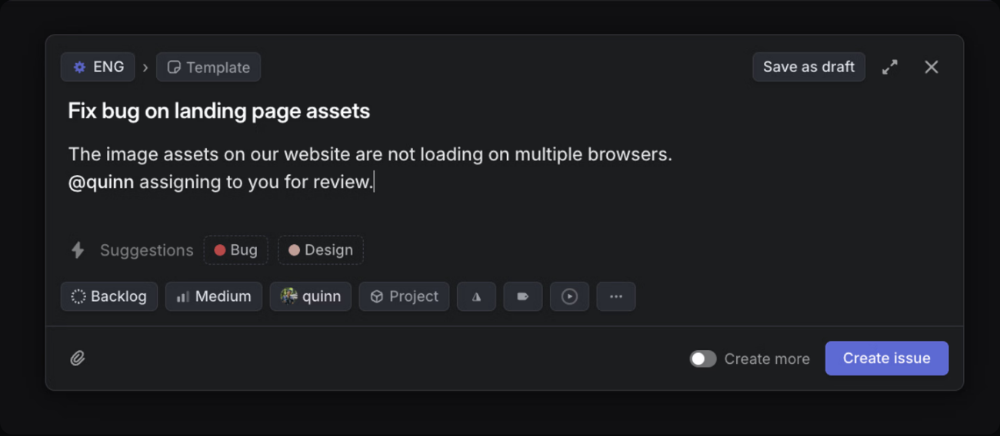
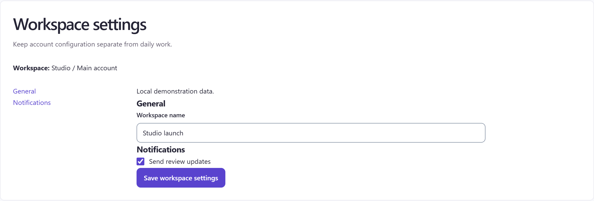
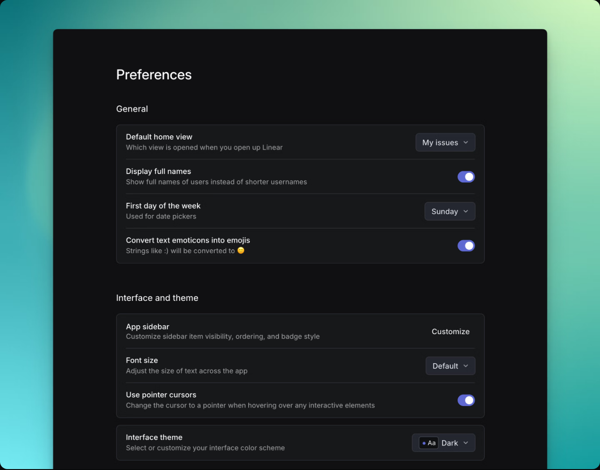

# Fixed templates compared with real app UI

Captured and visually inspected on **19 October 2026**. Understood as: compare our five existing page templates and their controls with relevant real product screens, then recommend bounded improvements. This is evidence for design decisions; it does not add product features.

Keep the five task structures. The clearest improvement is tighter grouping inside their slots: short filters in a view bar, distinct section navigation, grouped settings rows, and sufficient width for report tables. Campaign's logo, icons and login remain the brand baseline. References inform structure and control placement, not competitor branding.

## Evidence register

All external images below are **official captured UI figures**, rendered on the product owner's public documentation/article page and saved with Playwright `locator.screenshot()`. They are not authenticated live app captures. No recreated screens or landing-page heroes are used. Documentation can contain older UI; capture date does not prove that every figure reflects a 2026 production build.

| ID | Official source URL and captured UI | Local screenshot |
| --- | --- | --- |
| R1 | [Linear design refresh](https://linear.app/now/behind-the-latest-design-refresh), actual before/after view controls and borders. The article's blueprint header mockup was excluded. | [linear-refresh-borders.png](images/templates/linear-refresh-borders.png) |
| R2 | [Linear display options](https://linear.app/docs/display-options), open Display menu. | [linear-display-options.png](images/templates/linear-display-options.png) |
| R3 | [Linear custom views](https://linear.app/docs/custom-views), issue-view sidebar with Overview/Insights and assignee counts. | [linear-issue-views.png](images/templates/linear-issue-views.png) |
| R4 | [Linear preferences](https://linear.app/docs/account-preferences), grouped settings with selects and switches. | [linear-settings.png](images/templates/linear-settings.png) |
| R5 | [Vercel managing deployments](https://vercel.com/docs/deployments/managing-deployments), deployment list crop with the status filter open. | [vercel-collection.png](images/templates/vercel-collection.png) |
| R6 | [Linear issues](https://linear.app/docs/creating-issues), populated issue composer. | [linear-editor.png](images/templates/linear-editor.png) |
| R7 | [Linear projects](https://linear.app/docs/projects), one project's summary, properties, resources and latest update. | [linear-project-detail.png](images/templates/linear-project-detail.png) |
| R8 | [Stripe Revenue Recognition reports](https://docs.stripe.com/revenue-recognition/reports), Statements → Trial balance with period, update time, Export and numeric report. | [stripe-report.png](images/templates/stripe-report.png) |

Our captures use the existing server at `http://localhost:5198/#templates`, a 1440 × 1000 CSS-pixel viewport, device scale 2, light theme and comfortable density. The native **Page template** select chose each template; `.reference-preview` was captured. These show live local catalogue controls with synthetic data. Component details were captured at `#components/data-table?tab=states` and `#components/applied-filters?tab=states`. All 15 retained images were opened and inspected individually.

## Overview — understand a scope

| ten98 OverviewTemplate | Stripe report summary, R8 |
| --- | --- |
|  |  |

**Observed:** ours reads title/action → workspace → full-width Reporting period → two equally weighted metrics → activity. Refresh example is a filled header action. Stripe places the period directly below the report title, update time beside that title, and Export at the report's upper right; tab and report navigation surround a dense numeric body. The captured state is a populated Trial balance, not a chart overview. Our two cards and visible scope are easy to scan, but the short period value occupies an entire row and separates context from results.

**Keep / improve:** keep scope before results and equal metric weight. Constrain short period controls and group related date/filter controls inside the existing filters slot; keep applied interval and evidence near results. Use a wide result region when the overview contains a table. This reference supports report framing, not a claim that our dashboard needs Stripe's financial navigation, export feature or chart inventory.

## Collection — find and act on records

| ten98 CollectionTemplate | Vercel deployments filter, R5 |
| --- | --- |
|  |  |

**Observed:** our header, workspace, full-width search, checkbox, selection count and two-item list occupy successive bands. Vercel's crop groups environment and status dropdowns horizontally immediately above record rows; the open Status control says 4/5 and uses text, colored dots and checkmarks. The crop does not show global navigation or create/bulk actions. Our default is unfiltered with zero selected; Vercel shows a partially selected filter state.

**Keep / improve:** retain explicit selection count and native search. For real collections, group search and supported filters in the toolbar, and use the existing DataTable when rows need comparable fields. Give selection feedback a compact, coherent band. Do not add display modes or new filtering semantics because another app has them. R2 shows where supported display preferences can live; R3 shows a secondary summary beside results, not a reason to squeeze every table into a narrow preview.

## Detail — inspect one resource

| ten98 DetailTemplate | Linear project detail, R7 |
| --- | --- |
|  |  |

**Observed:** ours has breadcrumb → title/action → workspace → Draft badge → Summary/Activity links → content plus a context card. Summary and Activity currently appear as adjacent text links with little separation. Linear's captured project places status, urgency, lead and dates in a compact properties row, then labelled resources and latest update. It carries substantially more metadata per vertical band. Its global navigation and mutation action placement are outside this crop; the visible project is In Progress with an On track update.

**Keep / improve:** keep the breadcrumb, readable status text, related-information aside and explicit “No delivery has been requested” state. Give section links clear spacing and an active/target treatment appropriate to their actual navigation behavior. Group richer metadata within existing scope/status/content slots rather than giving every property a new card. Do not treat Linear's project health as evidence of delivery or import its urgency model.

## Editor — create or change a draft

| ten98 EditorTemplate | Linear issue composer, R6 |
| --- | --- |
|  |  |

**Observed:** our breadcrumb, title, workspace and two-step indicator precede a form/preview split with Save draft in a separated footer. Linear's focused composer puts team/template at top left, Save as draft at top right, title/body in the main writing region, compact property controls below, and Create issue at bottom right. Both show populated drafts; neither screenshot demonstrates saving, validation, failure recovery or draft persistence. Linear has no separate preview in this capture.

**Keep / improve:** keep a stable footer for the current save/review action and the preview where visual composition requires it. For richer Campaign forms, group short metadata and reserve the main area for content. Do not turn every simple editor into a modal or add steps for a single action. A visible stepper must describe real stages; publishing and paid activation retain their own review and outcome contracts.

## Settings — configure a scope

| ten98 SettingsTemplate | Linear preferences, R4 |
| --- | --- |
|  |  |

**Observed:** our title/workspace sit above left section links and a wider form. General and Notifications meet closely, and the save button follows the checkbox. Linear groups General and Interface and theme into distinct sections; each setting puts label/help on the left and a select, switch or action on the right, separated by thin rules. The reference shows selected values and on/off switches, but no save or pending state. Its global settings navigation is outside the crop.

**Keep / improve:** keep explicit save and app-owned feedback. Separate form groups with the existing spacing rhythm and short help text when needed. For longer settings, use aligned rows only where labels and controls still fit, stacking at narrow widths. Space and mark our section navigation clearly. A static switch screenshot does not establish autosave, and does not justify changing a native checkbox's semantics.

## Foundational controls and patterns in these screens

| Pattern | Direct comparison | Decision |
| --- | --- | --- |
| View bar and filters | R1 labels Filter/Display and uses quieter, flatter segmentation; R2 groups display selects, switches and selected property chips. R5 pairs readable status labels with colored dots and checkmarks. Our [AppliedFilters detail](images/templates/ten98-applied-filters.png) exposes dimension/operator/value, remove and Clear all plus a separate draft example. | Keep applied-scope clarity and labelled controls; make their containing band compact. Do not replace explicit text with icons or use color alone. Display-property chips and applied query chips have different meanings. |
| Tables and badges | R8 aligns numeric columns and keeps period/update/export in the report frame. Our [DataTable detail](images/templates/ten98-data-table.png) shows search, sortable headers, status badges and pagination within one bounded table. | Reuse DataTable for appropriate collections. Align numeric comparisons consistently; keep meaningful status text and bounded scrolling. The reference is not proof of keyboard sorting, selection or accessibility behavior. |
| Buttons, inputs, selects, checks and switches | Our five captures consistently use labelled native fields and one filled action per task. R6 gives Create issue a clear footer position; R4 aligns mixed controls without turning every row into a card. | Keep Campaign's visual identity and existing control sizing. Improve grouping and action hierarchy before changing tokens or creating another control family. |

## Limits and disposition

These are visual judgments, not measured conversion, accessibility or performance findings. The screen crops cannot prove keyboard behavior, focus, save semantics, live data freshness or every responsive state. Keep existing narrow-screen, text-enlargement and truthful-state requirements. Documentation screenshots are reference evidence, not acceptance tests for ten98.

The checked Stripe Dashboard basics figure was a YouTube end card and was rejected. Its Balance/report-options pages supplied text but no relevant UI figure in the captured DOM. R8 is the replacement actual report UI; a complete Stripe live Home/focus/detail screenshot remains a gap. The guessed Linear issue-view URL did not return usable content; R7 supplies an official resource-detail screen instead. No authenticated accounts were opened and the user's existing tab/server were not changed.

New Connect + Wiki and Researcher remain inventory context only. Nothing here authorizes their creation. Recommended changes concern existing shared examples and composition, within the [canonical layout and behavior rules](../../LAYOUTS-AND-USAGE.md).

QA: source URLs were opened, screenshots were inspected, and links to all retained images were checked. Observations were checked against the actual pixels; recommendations remain explicitly judgments. No product code or template API changed.
