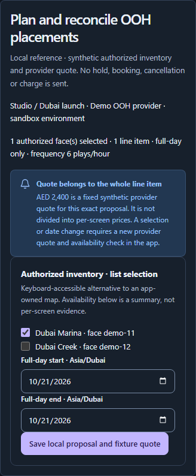
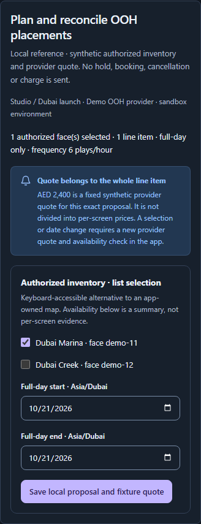

# Feature sections, full pages and consistent spacing

The catalogue previously mounted full page templates inside all 28 feature flows. Several controls relied on browser-default spacing, so OOH date fields and the save action touched, alerts and cards met without separation, and template content slots did not establish a shared rhythm between features.

Flows now compose smaller feature sections. The five template specimens are complete pages combining several features and components. Campaign’s branding, palette, icons and authentication composition are retained. The [canonical layout guide](../../LAYOUTS-AND-USAGE.md) defines the hierarchy, spacing ownership, usage rules and worker implementation brief.

## Implementation

- `FlowSection` adds an h2, optional description, applied context and section actions. It owns no page title, shell, form, request, permission or state controller.
- All 28 flow specimens use one feature root, explicit control/action groups and full-width results. Supporting previews follow primary content. Their original state controllers, field constraints, guarded actions and outcome distinctions remain.
- Overview, Collection, Detail, Editor and Settings examples now combine multiple coherent feature sections beneath one page heading. The editor preserves incomplete-draft saving and one native form association; publishing readiness remains separate.
- Card owns spacing between direct content children, with token-based 20px desktop and 16px narrow insets. Alert has an additive `actions` slot below ordinary inline prose. Media labels and toast actions no longer add margins on top of an existing gap. Flex-header titles and metadata boundaries use the parent’s spacing.
- Existing spacing tokens define 8px related-content, 12px action, 16px control/content and 24px feature gaps. Short template filters keep a bounded width. Table status badges wrap between words rather than breaking a short status mid-word; tables retain contained scrolling.

## Source conservation

Root independently matched all 28 original snapshots to released source `25c744e` with LF normalization. The bounded source checker verifies all 477 imported non-layout component opening tags, original Alert attributes and all 28 controller regions against those snapshots. This is source compatibility evidence, not runtime proof. A newly wrapped mapped media action required its existing item ID on the wrapper; its original Button and controller remain unchanged.

## Visual comparisons

Before captures use the unchanged released source served from a separate local catalogue. After captures use actual rendered components and local synthetic state, in light/dark at 1440px and 360px. The broader interaction gate also retains the existing 320px project and actual doubled-text checks.

| OOH before, dark 360px | Feature section after, dark 360px |
| --- | --- |
|  |  |

The retained [Broadsign UI strips](../2026-10-19/visual-campaign.md) support grouping inventory choices and keeping proposal/commitment actions distinct. They do not establish complete booking or provider-receipt parity. The retained [Linear settings and project figures](../2026-10-19/visual-templates.md) support grouped settings and feature hierarchy within a complete page. These are historical official documentation figures, not fresh authenticated competitor sessions. We retain ten98’s branding and application contracts.

An independent reviewer inspected 12 initial after captures covering every template kind, both widths and themes, OOH and four before/reference images. It identified a mobile status breaking mid-word and a desktop short filter stretching across the page. Both were corrected with shared rules and rendered checks. A second bounded review of nine refreshed final images confirms both corrections, with no further concrete spacing, hierarchy, touching-control or clipping defects in those images. Root also inspected the final OOH, Collection and Editor captures.

| Full page specimen | Light desktop | Dark narrow |
| --- | --- | --- |
| Overview | [Screenshot](images/spacing-layout/template-overview-light-1440.png) | [Screenshot](images/spacing-layout/template-overview-dark-360.png) |
| Collection | [Screenshot](images/spacing-layout/template-collection-light-1440.png) | [Screenshot](images/spacing-layout/template-collection-dark-360.png) |
| Detail | [Screenshot](images/spacing-layout/template-detail-light-1440.png) | [Screenshot](images/spacing-layout/template-detail-dark-360.png) |
| Editor | [Screenshot](images/spacing-layout/template-editor-light-1440.png) | [Screenshot](images/spacing-layout/template-editor-dark-360.png) |
| Settings | [Screenshot](images/spacing-layout/template-settings-light-1440.png) | [Screenshot](images/spacing-layout/template-settings-dark-360.png) |

## Verification

The final frozen-source gate passes **190/190 Playwright cases in 2.9 minutes**, one worker and zero retries. Architecture, typecheck, production/library builds, **62/62 native checks** and **515 standalone strict TSX examples** pass. Copied template states match live SSR content. The 130 frozen source/test/tooling/manifest inputs remain exact after the browser run. All 28 final screenshots are refreshed; a bounded subset of 20 images is public. The [machine-readable receipt](spacing-layout.json) records source pins, all image hashes, conservation results, earlier failures and limits.

Earlier runs exposed a test locator defect, a mapped-wrapper key warning, a border-box measurement mistake and a preview-area oracle unsuitable for complete pages. Each was corrected with retained interaction/fault checks. Interrupted development-server runs and Windows socket exhaustion motivated a bundled test site rather than repeated module requests. The built fixtures then exposed stylesheet-order and CSS-lowering differences: deliberate fault styles now apply after parsing, and both catalogue builds preserve native `light-dark()`/`color-scheme` behavior as shipped by the library. The full 26-case theme matrix and final 190-case run pass without reducing numeric palette or contrast thresholds. These are modern installed-Chromium results, not older-browser compatibility certification.

Immutable MIT archive SHA256 `6C2AF5F0E028CAFAEB3DA55DD221BAD27698D4EB946E7C3BA41ACC793ECAA864`: **380,288 bytes / 95 entries / 32 module-declaration files / 10 CSS files / 51 Markdown files / no images**. All 42 runtime/style files match the tested build and an independently installed offline consumer. Its public imports render a full page with two feature sections and separate Alert actions. Source target is `20eae97bb535eeabc0a56b5c1787c5c484b74a93`. The archive keeps packaging-time documentation; these final packaging receipts are recorded afterward without repacking it. The initial consumer setup incorrectly linked the working folder, producing two React copies; the corrected check explicitly installs the immutable tarball and passes. Earlier archives remain unchanged.

Catalogue interaction checks use synthetic data. They do not establish live provider, authentication backend, deployment or subsequent app feature acceptance. Immutable 0.3.16 remains unchanged. Primary applications retain their accepted UI16/runtime1.1 contract until the coordinated UI18/runtime1.2 path preserves this tested UI17 layout base and passes matching architecture and consumer checks. Publishing UI17 does not waive that contract.
